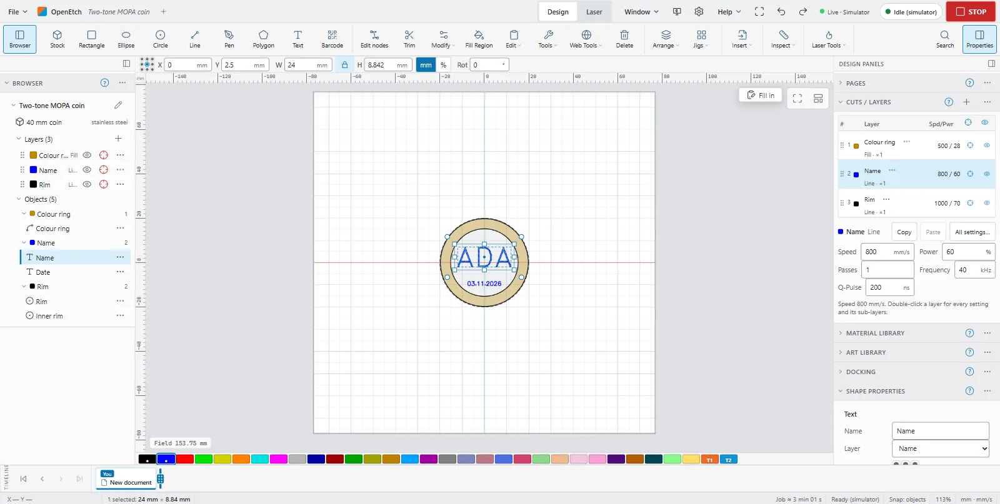
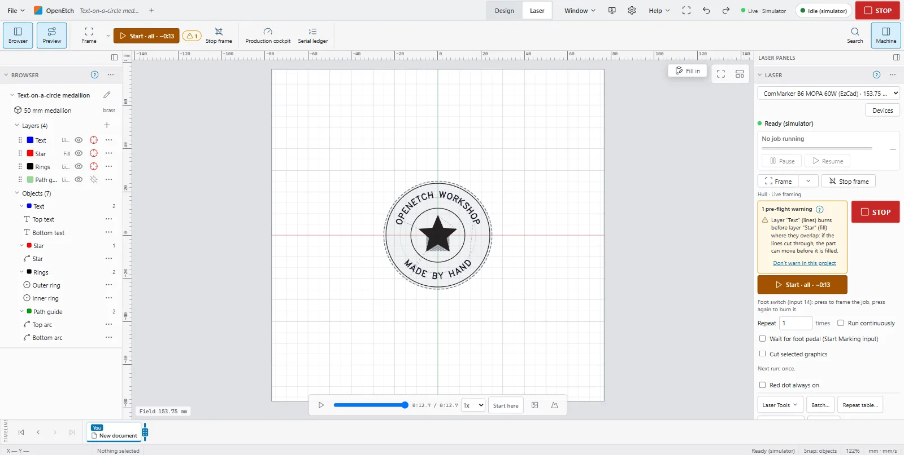

# OpenEtch

Open-source design and control software for galvo fibre lasers with BJJCZ (LMC, EzCad2-family) boards. It works
much like LightBurn: draw or import a design, put shapes on layers with cut settings, preview and frame the job,
then burn it. A Rust engine runs beside the laser, on a Raspberry Pi or a PC. You use the app in a browser on a PC,
Mac, iPad or phone. AI agents can design over MCP, but only a person can approve or start a burn.

The reference machine is a ComMarker B6 MOPA 60 W.

**[Try OpenEtch Design in your browser](https://krzim.github.io/OpenEtch/)**: the editor with no install, no laser
and nothing uploaded.



> **Status:** early and under active development. Burning has been tested only on the B6 MOPA. GRBL and Ruida
> gantries can be added by hand, but their support is untested on real hardware. Read
> [Laser safety](docs/guide/safety.md) before you connect a laser.

## What it does

- **Design:** shapes, pen and node editing, booleans, offsets, text with bending and text on a path, variable text,
  serial numbers, barcodes and QR codes, image dithering and tracing, Fill Region, arrays and nesting, jigs, templates
  and an art library.
- **Layers and materials:** fill and line layers with galvo settings (power, speed, frequency, pulse width, interval,
  passes, sub-layers and burn order), LightBurn `.clb` material libraries, MOPA colour notes and preview, test grids
  with an energy-density check, and a 3D relief preview.
- **Run jobs:** toolpath preview with a time estimate, red-dot framing, operator-PIN approval, foot switch, pause at a
  layer, repeat and job counter, a production cockpit for batch work, a serial ledger and a job log. A **STOP**
  button is on every screen.
- **Files:** open SVG, DXF, PDF, AI, EPS, images, HPGL, G-code, Gerber, 3D models (as depth maps), EzCad `.ezd`,
  RDWorks `.rd` and LightBurn `.lbrn2` / `.lbrn` / `.lbt` files. Export SVG, DXF, PDF and LightBurn, and move
  settings with LightBurn `.lbzip` bundles.
- **Devices:** import devices from LightBurn or EzCad, lens correction files, galvo and red-dot calibration, rotary.
- **Any screen:** a Fusion 360-style workspace on a desktop, with iPad and phone layouts. It installs as a web app.
- **AI agents:** an MCP server at `/mcp` gives agents the same design commands as the app. They can draw, edit and
  check a job, but never approve or start a burn. See [AI agents](docs/guide/ai-agents.md).
- **Add-ins:** send drawings from [Autodesk Fusion](tools/fusion360-addin/README.md) and
  [Inkscape](tools/inkscape-extension/README.md).



## Quick start

You need Rust 1.95 or newer with the `wasm32-unknown-unknown` target, and Node.js 22 or newer.

```sh
rustup target add wasm32-unknown-unknown

cd web
npm install
npm run wasm:tools   # once: the pinned wasm-bindgen and binaryen
npm run build        # the app, into web/dist
cd ..

cargo run --release -p engine
```

Open <http://localhost:7878>. The engine starts with a simulator, so nothing reaches a laser until you build with
`--features usb` and start it with `--usb`. To run it on a Raspberry Pi as a service, reach it from other devices,
or pair a phone, see [Getting started](docs/guide/getting-started.md).

## Documentation

- [User guide](docs/guide/index.md): every feature, step by step. It is also built into the app (Help > User
  guide, or `F1`).
- [Architecture](ARCHITECTURE.md): the engine, its API, the crates and how the parts fit together.
- [Web UI](web/README.md): building, testing and the device test harnesses.
- [HTTPS on the Pi](docs/https-on-the-pi.md): installing the app and using it from other devices on your network.

## Repository layout

| Path | What it is |
|---|---|
| `crates/engine` | The `openetch` program: HTTP API, WebSocket events, MCP server, run approval, and it serves the app |
| `crates/lmc` | The BJJCZ LMC galvo board protocol |
| `crates/machine` | Machine profiles and devices, LightBurn and EzCad device import, the laser connections (LMC over USB, GRBL, Ruida) |
| `crates/plan` | Turning a design into toolpaths, time estimates |
| `crates/doc`, `crates/geom`, `crates/commands` | The document model, geometry, and the command API shared by the app and MCP |
| `crates/fileio`, `crates/lbrn`, `crates/text`, `crates/corfile`, `crates/ruida` | File formats, fonts and text, lens correction files, Ruida protocol |
| `crates/appcore`, `crates/webcore` | The engine glue that also runs in the browser (wasm) for OpenEtch Design |
| `web` | The React and TypeScript app |
| `docs` | The user guide and design notes |
| `tools` | The Fusion and Inkscape add-ins |

## Contributing

Bug reports and pull requests are welcome. Before you send a change, run `cargo test --workspace` and
`cargo clippy --workspace --all-targets`, and in `web` run `npm test` and `npm run typecheck`. Never test against a real
laser from a test or a script: use the simulator.

## Licence

Licensed under either of [Apache License, Version 2.0](LICENSE-APACHE) or [MIT license](LICENSE-MIT), at your
option. Third-party code, fonts and data are listed in [ATTRIBUTION.md](ATTRIBUTION.md).

Unless you state otherwise, any contribution you intentionally submit for inclusion in this work, as defined in the
Apache-2.0 licence, is dual licensed as above, without any additional terms or conditions.

OpenEtch is not affiliated with LightBurn Software, ComMarker or BJJCZ. Their names are used only to describe what
OpenEtch works with.
