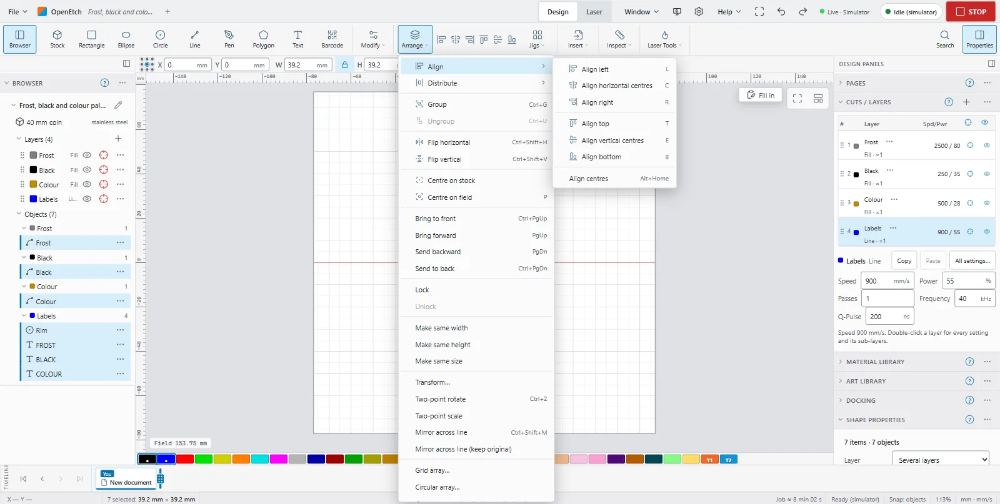
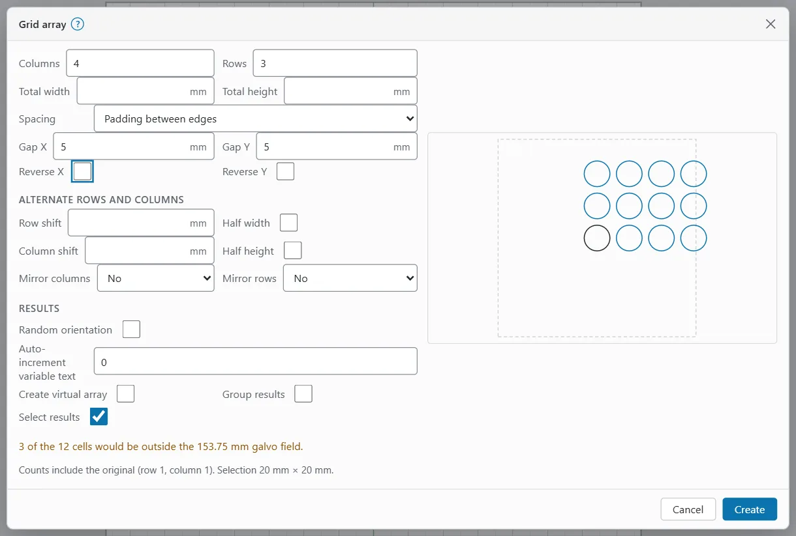

# Arranging and arrays

The **Arrange** menu holds the commands that line objects up, order them and copy them in patterns. On a computer it is in the **Arrange** group of the ribbon; on the phone, it is in the tool strip.

> **Note:** On a Mac, press `Cmd` where this guide says `Ctrl`, and `Option` where it says `Alt`.

## Align, distribute and arrange

### Align

Aligning moves the other objects to the last object you selected, which stays put. To make another selected object the reference, `Ctrl`+click it twice.

Select two or more objects, then use **Arrange > Align** or the keys:

| Command | Key (canvas) | Key (anywhere) |
|---|---|---|
| **Align left** | `L` | `Alt+Left` |
| **Align horizontal centres** | `C` | `Alt+PgUp` |
| **Align right** | `R` | `Alt+Right` |
| **Align top** | `T` | `Alt+Up` |
| **Align vertical centres** | `E` | `Alt+PgDn` |
| **Align bottom** | `B` | `Alt+Down` |
| **Align centres** | | `Alt+Home` |

With two or more objects selected, a row of align buttons also shows in the **Arrange** group.

### Distribute

Distributing spaces three or more objects evenly. **Arrange > Distribute** has:

- **H-Spaced (equal gaps)** and **V-Spaced (equal gaps)**: equal gaps between the edges.
- **H-Centered (equal centre spacing)** and **V-Centered (equal centre spacing)**: equal spacing of the centres.

Beginner Mode hides Distribute.

### Centre, flip and order

- **Centre on stock** and **Centre on field** (`P`) move the selection to the middle.
- **Flip horizontal** (`Ctrl+Shift+H`) and **Flip vertical** (`Ctrl+Shift+V`) mirror the selection in place.
- **Bring to front** (`Ctrl+PgUp`), **Bring forward** (`PgUp`), **Send backward** (`PgDn`) and **Send to back** (`Ctrl+PgDn`) change the draw order.
- **Make same width**, **Make same height** and **Make same size** match the other objects to the last one selected.

To mirror across a line you pick, or rotate and scale by exact amounts, see [Transform](selecting-and-transforming.md#transform).

### Move to a page position

To move the selection to a corner, an edge or the centre:

1. Choose **Arrange > Move selected objects…**
2. Under **Relative to**, pick **The workspace (galvo field)** or **The stock**.
3. Set a **Margin** to keep in from the edges.
4. Click one of the nine position buttons. Each click is one undo step.
5. Click **Done**.

The selection keeps its size and rotation.

### Move together

To line objects up one after another with a fixed gap, choose **Arrange > Move horizontally together…** (`Alt+Shift+H`) or **Move vertically together…** (`Alt+Shift+V`). Set the **Direction** and the **Spacing** between their boxes, then click **Move**. The first object stays; a negative spacing overlaps them. A group moves as one object.

### Docking

The **Docking** window (in the **Window** menu) slides the selection until it touches another shape or the workspace edge. Click **Dock left**, **Dock up**, **Dock down** or **Dock right**. **Padding** is the gap kept in the direction of travel. **Move as group** and **Lock inner objects** control what moves together. Docking is not on the phone.

## Group and lock

- To group, select two or more objects and press `Ctrl+G` (**Arrange > Group**). A group selects and moves as one.
- To ungroup, select the group and press `Ctrl+U` (**Arrange > Ungroup**).
- To lock objects so they cannot be moved, edited or deleted, choose **Arrange > Lock**. **Arrange > Unlock** frees them.

## Arrays and nesting

### Grid array

A grid array makes rows and columns of copies.

1. Select the objects to copy.
2. Click **Array** in the **Insert** group, or choose **Arrange > Grid array…**
3. Set **Columns** and **Rows**. The counts include the original. Or set **Total width** or **Total height** to fit as many as possible.
4. Pick the **Spacing**: **Padding between edges** (**Gap X**, **Gap Y**) or **Centre to centre** (**Pitch X**, **Pitch Y**).
5. Check the preview, then click **Create**.

More options:

- **Reverse X** builds the columns to the left; **Reverse Y** builds the rows towards you.
- **Alternate rows and columns**: **Row shift** (or **Half width**) and **Column shift** (or **Half height**) make brick or honeycomb layouts. **Mirror columns** and **Mirror rows** flip every other one **Left-right** or **Top-bottom**.
- **Random orientation** turns each copy by a random angle. The same **Seed** gives the same angles; **New seed** picks others. The preview does not show the random angles.
- **Auto-increment variable text** raises each copy's serial or CSV Offset by this much (see [Variable text](variable-text-and-barcodes.md#copies-that-count-on)).
- **Group results** and **Select results** decide what happens to the copies afterwards.

The dialog warns when cells would fall outside the galvo field. An array has at most 10,000 cells, the original included. The preview draws the first 400.

### Virtual arrays

Tick **Create virtual array** to make linked clones: edit an original and every clone changes. Right-click a virtual array for **Edit array…**, **Duplicate array**, **Flatten array** (makes the clones ordinary objects), **Add to array** and **Remove from array**.

### Circular array

**Arrange > Circular array…** copies the selection round a centre:

- **Count**: the number of copies, the original included (2 to 10,000).
- **Sweep**: 360° spaces them evenly round the circle; a negative angle goes clockwise.
- **Rotate copies**: off keeps each copy upright, like clock numerals.
- The centre: **Centre X** and **Centre Y**, or **Pick centre…**, **Field centre** or **Stock centre**.

### Copy along a path

**Arrange > Copy along path… (path selected last)**: select the objects, then the path last. Spread them by **Count** or **Spacing**, and tick **Rotate to the path** to turn them along it.

### Quick nest

**Arrange > Quick nest…** packs parts into a region. Select the parts, and to nest into a shape, select it last.

- **Method**: **True shape (parts interlock, fill holes)** or **Quick nest (bounding boxes)**.
- **Into**: **The stock**, **The whole field** or the last selected shape.
- **Spacing**, **Edge gap**, **Rotations** and **Grid cell**.
- **Multipage** puts parts that do not fit onto new pages.

Parts that do not fit stay where they were.

## Common mistakes

- **A key chose a tool instead of aligning, or the reverse.** With one object selected, `R`, `E`, `C` and `T` pick tools; with two or more they align.
- **The wrong object stayed put when aligning.** Align and the Make same commands follow the last object you selected. Select the reference last, or `Ctrl`+click it twice.
- **A locked object will not move or delete.** Choose **Arrange > Unlock** first.
- **The array runs off the field.** The Grid array dialog warns about cells outside the galvo field; fewer columns or rows, or a smaller gap, keeps them in.
