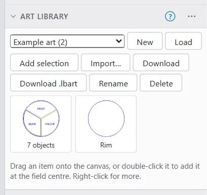

# Art Library

The Art Library keeps artwork you use again and again: logos, borders, icons, a maker's mark. The engine keeps the libraries in its projects folder, so every browser and every AI agent sees the same ones.

The Art Library is a window on a computer or tablet. It is not on the phone.

## Open the Art Library {#the-art-library-window}

Do one of these:

- Click **Art** in the **Insert** group.
- Choose **Tools > Art Library**.
- Choose **Art Library** in the **Window** menu.

The window shows the current **Library** at the top, with a search box and the items as thumbnails.

## Make or load a library {#libraries}

- **New**: creates a new, empty library. Give it a name.
- **Load**: loads a library file, either OpenEtch's .oeart or LightBurn's .lbart.
- **Download**: saves the library file to your computer.
- **Download .lbart**: saves it as a LightBurn Art Library.
- **Rename**: renames the library.
- **Delete**: deletes the library file from the engine's projects folder.

> **Warning:** Deleting a library deletes it for every device that uses this engine. Download it first to keep a copy.

A library name cannot contain `\ / : * ? " < > |`, or start or end with a dot.

## Add items {#add-items}

To add shapes from your design:

1. Select the shapes.
2. Click **Add selection**, or right-click and choose **Add to Art Library…**
3. Give the item a name if you like, and click **OK**.

The item keeps the artwork only, not the cut settings.

To add a file as an item, click **Import…** and pick it. The library takes SVG, DXF, PDF, AI, images, LightBurn .lbrn2 files and more.

## Add art to your project {#insert-art}

- Drag an item onto the canvas. It lands centred where you drop it.
- Or double-click it, or right-click it and choose **Add to project**. It lands at the centre of the field.

The art's shapes go onto the layer with the same colour. If there is none, OpenEtch makes a new layer of that colour with default settings.

> **Warning:** A layer made this way has default settings, which may not suit your material. Check its power, speed and interval, and work out the energy density, before you burn. See [Layers and settings](layers-and-settings.md).

On a tablet, tap an item to select it, then tap its **Insert** button. Items cannot be dragged on a touch screen.

## Manage items {#manage-items}

Right-click an item (long-press on a tablet, or tap its ⋯ button) for:

- **Add to project**
- **Rename…**
- **Copy to library…** and **Move to library…**
- **Delete**

Type in **Search items** to find an item by name.

## LightBurn art libraries {#lightburn-art-libraries}

OpenEtch can load a LightBurn .lbart library with **Load**, import one into the current library with **Import…**, and save a library as .lbart with **Download .lbart**. If the engine cannot read .lbart files, it says so; update the engine.

To move all your settings, including art libraries, to another computer, see [Files and projects](files-and-projects.md).
