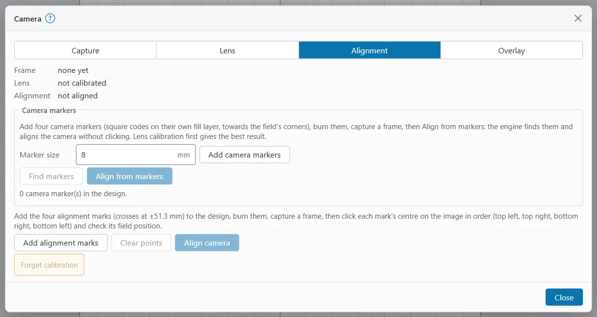

# Camera

A camera looking at the work area lets you see the stock under your design and place the design on it. OpenEtch's camera works like LightBurn's camera for galvos: capture, calibrate the lens, align to the field, then show the image on the canvas.

Camera support is unverified on hardware. Treat the result as a placement aid and always frame before you burn.

## Before you start

You need one of:

- a USB (UVC) camera on the engine's computer, with an engine built with camera capture;
- the camera of the device you are using (laptop, tablet or phone), held or mounted over the work;
- a photo of the work area, saved as PNG or JPEG.

A browser can use its own camera only when the app is opened over HTTPS or at `localhost` on the engine's own computer. Otherwise **Use this browser's camera** stays off. The repository's HTTPS guide (`docs/https-on-the-pi.md`) shows how to serve the app over HTTPS.

Calibration is kept per device. Keep the camera fixed once it is aligned; if it moves, align it again.

## Open the Camera window

- **Design workspace:** in the ribbon, open **Laser Tools** and choose **Camera**.
- **Laser workspace:** in the Laser window, open **Laser Tools** and choose **Camera**.
- **Phone:** open the **Job** tab, then **Laser Tools > Camera**.

**Camera** appears only when the engine has the camera feature.

The window has four pages: **Capture**, **Lens**, **Alignment** and **Overlay**. At the top it shows the current **Frame** (its size, or **none yet**), the **Lens** state and the **Alignment** state.

## Capture a frame

On the **Capture** page, use one of:

- **Capture** (with the engine's camera): set **Camera** to the camera number (0 for the first) and click **Capture**. If the engine was built without camera capture, a note says so.
- **Use this browser's camera:** click it, allow the camera, point it at the work and click **Snapshot**. **Stop camera** turns it off.
- **Load an image…:** pick a PNG or JPEG.

"Camera frame updated." confirms the new frame.

## Calibrate the camera lens

Lens calibration removes the curve a camera lens puts into straight lines. Do it once per camera, before aligning.

1. Print a checkerboard. Count its inner corners (where four squares meet), across and down.
2. On the **Lens** page, set **Inner corners across** and **Inner corners down** (9 × 6 by default).
3. Hold the checkerboard flat in view and capture a frame.
4. Click **Detect checkerboard**. If it is found, click **Add view 1** (the number counts up with each view).
5. Repeat steps 3 and 4 from at least three different angles.
6. Click **Calibrate lens**.

The Lens state then reads "calibrated", with the remaining error in pixels. Smaller is better.

## Align the camera to the field

Alignment tells OpenEtch where each camera pixel is in the galvo field. You burn a few marks at known places, capture them, and match them up.

> **Warning:** Alignment marks are real burns. Wear eye protection rated for your laser's wavelength, run the fume extraction and stay with the job. Work out the energy density of the layer first: J/mm² = power W ÷ (speed mm/s × line interval mm). On stainless with a 60 W MOPA, roughly 2 to 15 J/mm² marked without melting on the reference machine (yours may differ); more can melt or warp thin stock. Use settings you have tested on scrap.

### With camera markers

Camera markers are square codes that the engine can find in the frame by itself.

1. On the **Alignment** page, set the **Marker size** (8 mm by default).
2. Click **Add camera markers**. Four markers are added towards the field's corners, on their own fill layer.
3. Check that layer's settings and energy density, then frame and burn the markers on scrap.
4. Capture a frame without moving the stock.
5. Click **Find markers** to check they are seen. A message lists the markers found.
6. Click **Align from markers**. It needs a frame and at least four markers in the design.

Calibrating the lens first gives the best result.

### By clicking marks

1. Select the layer the marks should go on. **Add alignment marks** stays off until a layer is selected.
2. On the **Alignment** page, click **Add alignment marks**. Four crosses are added at known positions, a third of the field width from the centre in X and Y.
3. Burn them, then capture a frame.
4. Click each cross's centre on the image, in this order: top left, top right, bottom right, bottom left.
5. Check the **Field X (mm)** and **Field Y (mm)** of each point in the table, and correct them if a mark is elsewhere.
6. Click **Align camera**. It needs at least four points.

**Clear points** starts the clicking again. The Alignment state then shows the remaining error in mm and the number of points.

## Show the camera image on the canvas

1. On the **Overlay** page, tick **Show camera image on the canvas**.
2. Set the **Opacity**.
3. After you capture a new frame, click **Update overlay**.

The overlay needs an alignment. Without one, the page says "Align the camera first."

## Forget calibration

**Forget calibration** (on the **Alignment** page) removes the lens calibration and the alignment for this device. Use it after you move or change the camera.

## Limits

- Unverified on hardware.
- The overlay is a still frame, not live video. Capture again after you move the stock.
- The galvo field is small and the camera sees it at an angle, so check placement with the red-pointer frame before every burn (see [Preview and framing](preview-and-framing.md)).
