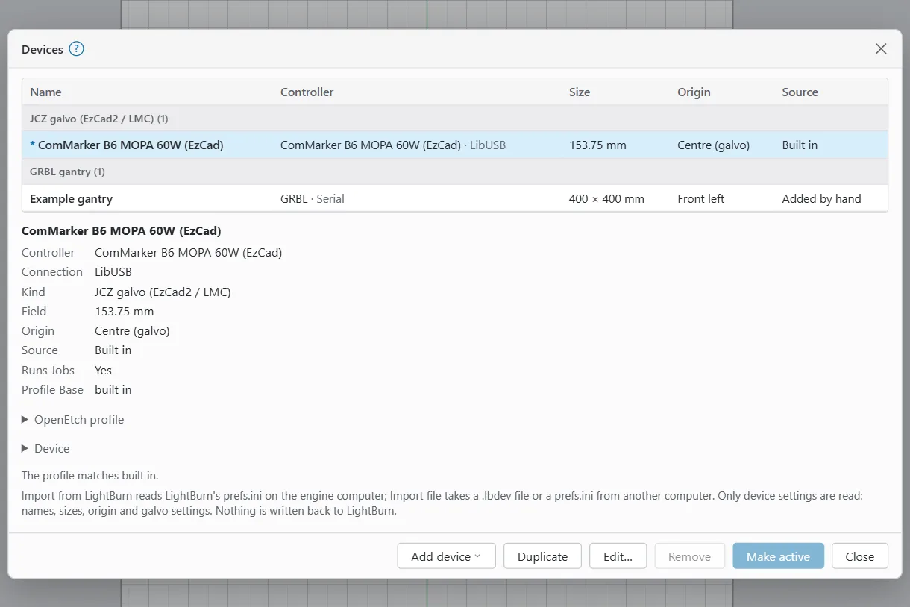
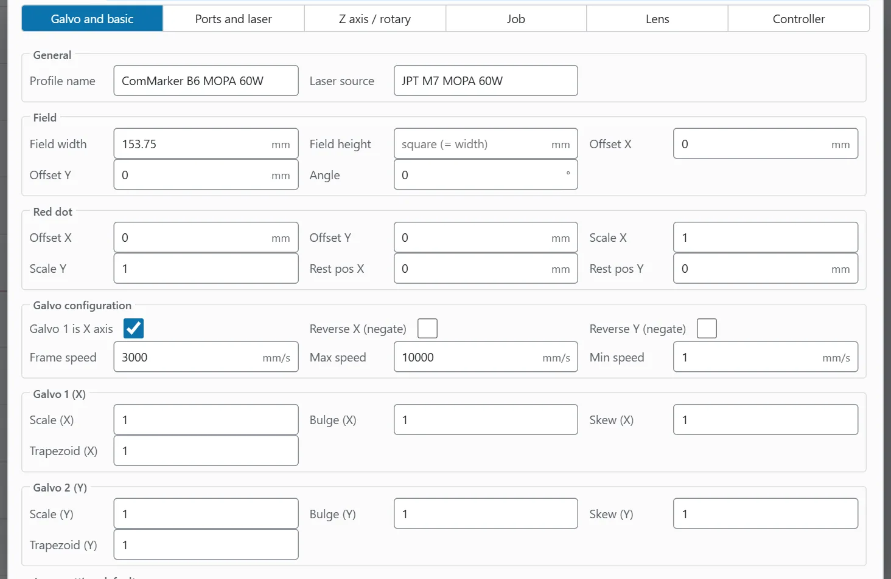
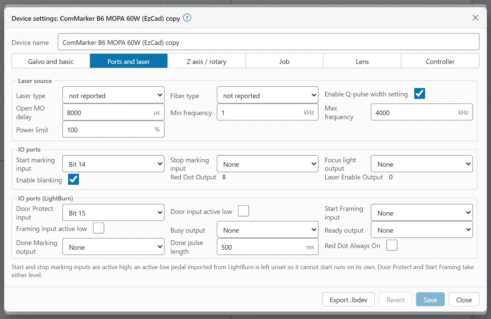
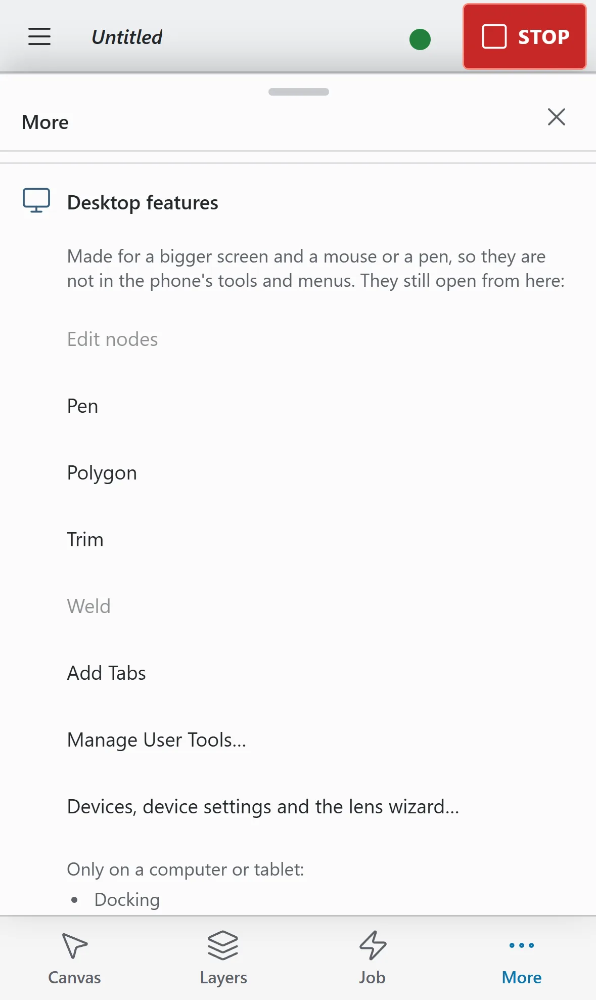

# Devices and calibration

A device is OpenEtch's record of one laser: its field size, galvo settings, timing, inputs and outputs, and hard limits. This page shows how to add devices, choose the one you work with, change its settings and calibrate it.

> **Warning:** Calibration means marking real test patterns. Wear eye protection rated for your laser's wavelength, run the fume extraction, and never leave a job unattended.

## What a device is

OpenEtch keeps a list of devices, like LightBurn's Devices window. One of them is the **active device**. The active device decides:

- the size of the canvas (the galvo field, or a gantry's bed);
- the settings the engine sends to the laser;
- the hard limits every job is checked against.

These kinds of device can be in the list:

- **The built-in device.** The engine's own machine profile. It is always there, it is read-only, and it cannot be removed. To change its settings, duplicate it and edit the copy.
- **JCZ galvo devices** (EzCad2 / LMC boards). OpenEtch can drive these.
- **GRBL and Ruida gantries you add by hand** (see [Add a GRBL or Ruida gantry](#add-a-grbl-or-ruida-gantry)). OpenEtch can drive these too, but this is unverified on hardware.
- **Design-only devices.** Everything else, such as gantry lasers or other galvo boards imported from LightBurn. Their workspace is used for designing and for LightBurn files, but OpenEtch cannot run jobs on them. They are tagged **design only** in the list.

Importing a LightBurn gantry never makes OpenEtch drive it. A gantry only runs jobs when you add it yourself with **New GRBL…** or **New Ruida…**

## Open the Devices window

On a computer or tablet:

- choose **File > Laser > Devices…**, or
- press `Alt+Shift+M`, or
- in the Laser workspace, click **Devices** next to the device dropdown at the top of the **Laser** window.

On a phone, device editing is a desktop feature, so it is not in the phone's menus. It still opens: tap **More**, open **Desktop features** and tap **Devices, device settings and the lens wizard…**

### The device list

The list shows every device with its **Name**, **Controller**, **Size**, **Origin** and **Source**. The active device has a star (*). When you have more than one kind (for example galvos and gantries), the list is grouped by kind.

Click a device to see its settings below the list: **Controller**, **Connection**, **Kind**, **Field** (or **Workspace** for a gantry), **Origin**, **Source**, whether it **Runs jobs**, and its **Profile base**. Open **OpenEtch profile** and the other groups to read every value.

If a device differs from its base profile, a line such as "3 differences from …" lists the differences. "The profile matches …" means there are none.

The footer has:

| Button | What it does |
|---|---|
| **Add device** | A menu of the ways to add a device (see below). |
| **Duplicate** | Makes an editable copy of the selected device. |
| **Edit…** | Opens the selected device's settings. |
| **Remove** | Removes the selected device (asks first). |
| **Make active** | Makes the selected device the one you work with (asks first). |
| **Close** | Closes the window. |

On a phone, **Duplicate**, **Edit…** and **Remove** are in the footer's **More** menu.

## Add a device

Click **Add device** in the Devices window. The menu has:

- **Import from LightBurn on this computer**
- **Import file…**
- **Import EzCad…**
- **New GRBL…**
- **New Ruida…**

The first time the engine starts, it imports LightBurn's devices from the computer it runs on (if LightBurn is installed there). It makes LightBurn's default device active when OpenEtch can drive it (a JCZ galvo); otherwise the built-in device is active.

### Import from LightBurn

OpenEtch reads only device settings from LightBurn: names, sizes, origin and galvo settings. Nothing is written back to LightBurn.

To import the devices of LightBurn on the engine's computer:

1. Open the Devices window.
2. Click **Add device > Import from LightBurn on this computer**.
3. A message says how many devices were added, updated or skipped.

"This computer" means the computer the engine runs on. If the engine runs on a Raspberry Pi, LightBurn is usually not there. Use a file instead.

To import a LightBurn file from another computer:

1. In LightBurn, export the device as a `.lbdev` file, or find LightBurn's `prefs.ini` (on Windows in `%LOCALAPPDATA%\LightBurn`, on a Mac in `~/Library/Preferences/LightBurn`).
2. In OpenEtch, click **Add device > Import file…** and pick the file.
3. If the file holds several devices, choose one of them or **All … devices** in the **Import from …** list, then click **Import**. LightBurn's default device is marked **(LightBurn default)**.

Only the typed device fields leave your browser; the rest of `prefs.ini` is cut away before the file is sent. A device you imported before (same name, controller, connection and size) is updated rather than added twice.

### Import an EzCad markcfg file

EzCad keeps the laser's own settings in a file called `markcfg7`, in the laser's EzCad folder (in the `plug` folder on most machines, `PARAM` on some).

1. Copy `markcfg7` from the computer that came with the laser.
2. Click **Add device > Import EzCad…** and pick the file.
3. The new device appears in the list, named after the file. Select it and check its settings with **Edit…**

The import reads the field size, the galvo axis settings (which galvo is X, and the reverse directions), the correction file name, the frame (red light) speed, the speed and frequency range and the start-marking input. Some of these meanings are unverified on hardware, so check them.

The import stores only the correction file's name. To load the `.cor` file itself, use the device's **Lens** page (see [Lens correction file](#lens-correction-file-cor)), or use the Find My Laser wizard below, which takes both files.

### The Find My Laser wizard

This wizard adds a galvo from its EzCad files in three steps. To open it, choose **File > Laser > Find My Laser / Add galvo…** On a phone, tap **More**, open **File**, tap **All file commands** and choose **Laser > Find My Laser / Add galvo…**

1. **1. Find the laser.** The wizard scans for BJJCZ galvo boards when it opens; click **Scan USB** to scan again. The table shows each board's **Board (VID:PID)**, **Port**, **Serial** and **Status** (**Supported** or not). If nothing is found, check the cable and that EzCad is closed. An engine built without USB support says so; go on to step 2.
2. **2. EzCad settings.** Click **Choose markcfg7…** and, if you have it, **Choose .cor…** for the lens correction file.
3. **3. Create the device.** Check the **Device name**, tick **Make it the active device** if you want, and click **Create device**.

Limits come from the markcfg and can only be lowered later. The wizard is unverified on hardware.

### Add a GRBL or Ruida gantry

- **New GRBL…** adds a GRBL 1.1 gantry on a serial port. Fill in **Name**, **Serial port**, **Baud**, **Width (mm)**, **Height (mm)**, **Origin**, **Max S ($30)** and **Max feed (mm/min)**, and tick **Homing switches ($22)** and **Dynamic power (M4)** as your machine needs. Click **Add**.
- **New Ruida…** adds a Ruida DSP gantry on the network. Fill in **Name**, **Controller IP address**, **Width (mm)**, **Height (mm)**, **Origin**, **Max power (%)** and **Max speed (mm/s)**, and tick **RDC634XG controller** if it is one. Click **Add**.

The message "Added …. Make it active to connect." confirms it. Then make the device active. Both are unverified on hardware.

### From the command line

On the engine's computer you can also manage devices in a terminal:

- `openetch devices list` lists the devices; the active one is marked `*`.
- `openetch devices import <file>` imports the devices of a `.lbdev` file or `prefs.ini` (`--add <name>` picks one). Restart the engine to see them.
- Starting the engine with `--device <id or name>` uses that device for this run instead of the active one.

## Switch the active device

Switching devices changes the machine: the engine swaps the profile and sets the laser up again.

To switch:

1. In the Laser window, pick a device from the device dropdown. Or, in the Devices window, select it and click **Make active** (or double-click it).
2. Read the confirmation. It gives the new field or workspace size, says whether the engine sets the laser up again or the device is for designing only, and warns when the origin differs.
3. Click **Switch device**.

Things to know:

- You cannot switch while a run is under way ("A run is under way. Wait for it to finish or press STOP.") or while the red pointer is framing ("The red pointer is framing. Stop the frame first.").
- Switching cancels pending runs.
- Open designs keep their field coordinates. New documents start at the new device's size.
- A design-only device sets the canvas size only. Frame and Start stay off until you make a device active that OpenEtch can drive.

An AI agent can list devices but cannot switch, import, edit or remove them.

## Duplicate, remove and export

- **Duplicate** makes a copy you can edit. Use it on the built-in device before you change anything.
- **Remove** asks you to confirm. You cannot remove the built-in device or the active device (make another device active first). A device imported from LightBurn or a `.lbdev` file can be imported again; one added by hand is deleted for good. Removing a device also removes its saved preferences (such as layer defaults and the Job Checklist), its camera calibration and its recorded run times.
- **Export .lbdev** (in the device settings footer) saves the device as a LightBurn `.lbdev` file.

## Device settings

To open a device's settings, select it in the Devices window and click **Edit…** The dialog is called **Device settings:** followed by the device name. The settings are those of a galvo; for a design-only device a note says "OpenEtch cannot drive this device; its settings are kept for LightBurn."

At the top you can change the **Device name**. The settings are on six pages: **Galvo and basic**, **Ports and laser**, **Z axis / rotary**, **Job**, **Lens** and **Controller**.

To change settings:

1. Edit the fields you need. Edited fields are marked.
2. Click **Save**. **Revert** throws your edits away.
3. If a field is wrong, it turns red and **Save** stays off until you fix it ("Fix the fields marked in red first"). The engine also checks the values and shows its message at the field it names.

Saving the active device sets the laser up again with the new settings ("Device settings saved; the laser was set up again with them."). The engine refuses to change the active device's settings while a job runs or the red pointer is framing.

Hover over a field to see its hint and the matching LightBurn setting name. A field the engine does not report shows **not reported**; type a value to set it.

The built-in device is read-only. Its dialog says so and shows **Duplicate to edit** instead of **Save**.

### Galvo and basic

| Group | Fields |
|---|---|
| **General** | **Profile name**, **Laser source** (for your information only, for example the source's model). |
| **Field** | **Field width**, **Field height** (empty means square), **Offset X**, **Offset Y**, **Angle** (counter-clockwise, within ±45°). |
| **Red dot** | **Offset X**, **Offset Y**, **Scale X**, **Scale Y**, **Rest pos X**, **Rest pos Y**. These affect framing only; the burn never moves. |
| **Galvo configuration** | **Galvo 1 is X axis**, **Reverse X (negate)**, **Reverse Y (negate)**, **Frame speed**, **Max speed**, **Min speed**. |
| **Galvo 1** and **Galvo 2** | **Scale**, **Bulge**, **Skew** and **Trapezoid** for that galvo's axis; the group title and labels name the axis, for example **Galvo 1 (Y)** and **Scale (Y)**. Bulge is distortion near the centre, skew near the edges, trapezoid is corner tapering (keystone). 1 means no correction. |
| **Jump setting defaults** | **Jump speed**, **Min jump delay**, **Max jump delay**, **Jump distance limit**, **Jump speed limit**. |
| **Delay defaults** | **Laser On TC**, **Laser Off TC**, **End TC**, **Polygon TC**, **Delay limit**. |

### Ports and laser

This page holds the laser source and the board's inputs and outputs.

**Laser source:** **Laser type** (only fibre sources are driven), **Fiber type** (**MOPA** or **Q-switched**), **Enable Q-pulse width setting**, **Open MO delay**, **Min frequency**, **Max frequency**, **Power limit**.

**IO ports:**

| Field | What it is for |
|---|---|
| **Start marking input** | The foot pedal input. Empty means none. |
| **Stop marking input** | Aborts a running job when set. It cannot be the same bit as the start input. |
| **Focus light output** | A second pointer, on bit 1 to 15. It can never be the laser-enable (0) or red-dot (8) bit. |
| **Enable blanking** | Turns the pointer off between shapes while framing. |
| **Red dot output** | Fixed at 8. |
| **Laser enable output** | Fixed at 0. |

**IO ports (LightBurn):**

| Field | What it is for |
|---|---|
| **Door Protect input** and **Door input active low** | An enclosure interlock. While it is active no run is approved and a running job aborts. |
| **Start Framing input** and **Framing input active low** | An external switch that starts framing (light only) while the board is idle. |
| **Busy output** | On while a job runs. |
| **Ready output** | On while the board is set up. |
| **Done Marking output** and **Done pulse length** | Pulsed when a job finishes, with the laser off. The pulse is 1 to 5000 ms. |
| **Red Dot Always On** | Keeps the red pointer lit while the board is idle, never during a job. The Laser window's **Red dot always on** box sets the same thing. |

Each output needs its own bit from 1 to 15, and not the laser-enable, red-dot or focus bit.

The start and stop marking inputs are active high. An active-low pedal imported from LightBurn is left unset, so it cannot start runs on its own. Set it yourself once you have checked the wiring. Door Protect and Start Framing take either level.

The start marking input is what the foot switch uses. It starts the foot switch cycle only on an engine started with `--approval click` (see [Running a job](running-a-job.md)).

### Z axis / rotary

Use this page if a motor is wired to the board's extension axis.

1. Tick **Extension axis**.
2. Choose what it **Drives**: **Z lift**, **Rotary**, **Linear table (Repeat Marking)** or **Rotating table (Repeat Marking)**.
3. Fill in the fields that appear:
   - **Z lift:** **Steps per mm**, **Lowest Z**, **Highest Z** and **Reverse direction**.
   - **Linear table** or **Rotating table:** **Steps per mm** (for a rotating table, steps per degree) and **Reverse direction**.
   - **Rotary:** **Reverse direction**. The rotary's steps per rotation are set in [Rotary setup](#rotary-setup).
4. Click **Save**.

Moves of the extension axis never fire the laser. This is unverified on hardware.

With a Z lift, the Laser window's **Red dot and Z** section shows **Z position** and **Move Z**. With a table, the Laser window's **Repeat table…** runs Repeat Marking (see [Running a job](running-a-job.md)).

### Job

These settings belong to the active device. Make the device active to change them.

- **Framing:** **Require framing before start**. Approval is refused until the job was framed on this device since its last edit.
- **Job Checklist:** **Show the Job Checklist before each approval**, the items (one per line), **Save items**, **Revert** and **Suggest items**.
- **Sound:** **Play sound when a job finishes**, **Mute in this browser** and **Test sound**.
- **Defaults:** **Load default layer settings on New / restart**, and how many layer and optimisation defaults are saved (see [Settings](settings.md#layer-defaults)).

The [Safety](safety.md) page explains the approval checks in full.

### Lens

The **Lens** page has the lens correction file, the lens calibration wizard and a read-only view of the **Current corrections**. See [Lens correction file](#lens-correction-file-cor) and [Calibrate the galvo lens](#calibrate-the-galvo-lens).

### Controller

For the active device, this page reads the board: **Connected**, **Profile**, **Laser source**, **Laser / fiber type**, **Serial**, **Serial words**, **Version words** and **Extension axis**. Click **Read again** to refresh. The serial and version words are shown as the board answers; their meaning is not decoded. For any other device the page says "Make this the active device to read its controller."

### Hard limits

**Power limit**, **Max speed**, **Jump speed limit**, **Delay limit** and the frequency range (**Min frequency** and **Max frequency**) are hard limits. Every job and frame is held to them.

You can only tighten them: lower the power limit, the speeds, the delay limit and the maximum frequency, or raise the minimum frequency. The dialog refuses to loosen a limit past its current value, and the engine refuses any value beyond the device's base profile. Hover over the field to see the limit.

## Field size

The field is the square (or rectangle) the galvo can reach through the lens. It sets the canvas size and the scale of every mark. If it is wrong, every design marks too big or too small.

To set it:

1. Find your lens's field size. It is usually printed on the lens, or in EzCad's settings (the markcfg import reads it).
2. Open the device's settings and set **Field width** on the **Galvo and basic** page. Leave **Field height** empty for a square field.
3. Click **Save**.
4. Mark a square of known size and measure it. If it is still off, calibrate the lens (below).

**Offset X**, **Offset Y** and **Angle** in the **Field** group move and turn the whole marked field. Use them if your marks are shifted or rotated against the machine.

LightBurn files do not store the field size. See [Troubleshooting](troubleshooting.md#field-size-or-position-is-wrong) if an imported LightBurn design lands in the wrong place.

## Lens correction file (.cor)

A `.cor` file is an EzCad lens correction table from the laser's maker. It corrects the distortion of the lens across the field.

To load one:

1. Open the device's settings and go to the **Lens** page.
2. Click **Load COR file…** and pick the file.
3. The engine checks the file before it stores it. For the active device, it uploads the table to the board again.

**Correction file** shows the file in use, or **None (uncorrected)**. **Clear** removes it. You cannot load a file into the built-in device; duplicate it first.

## Calibrate the galvo lens

The **Calibrate galvo lens** wizard marks a test square, asks you to measure it, and works out new field scale, bulge, trapezoid and skew values. Repeat it to refine. The correction model is OpenEtch's own (LightBurn publishes none).

You need: a device you can edit (not the built-in one) that is the active device, calipers, and a scrap piece of your test material. **Calibrate lens…** stays off until the device is active.

> **Warning:** Before you mark the pattern, work out the energy density of its layer. Energy density in J/mm² = power in watts ÷ (speed in mm/s × line interval in mm). Power in watts is your source's rated power times the power percentage. For example, 40 % of a 60 W source is 24 W; at 400 mm/s and a 0.02 mm interval that is 24 ÷ (400 × 0.02) = 3 J/mm². On stainless steel with a 60 W MOPA, about 2 to 15 J/mm² marked without melting on the reference machine (yours may differ); more can melt or warp thin stock. The lens pattern is thin lines, so use a layer whose settings you have already tested on that material. These numbers are starting points to test, not guarantees.

To calibrate:

1. In the Devices window, duplicate your device if needed, make the copy active and click **Edit…**
2. On the **Lens** page, click **Calibrate lens…**
3. **Test pattern:** set the **Pattern size** (by default 65 % of the field width, at most 100 mm) and the **Layer**. Click **Add test pattern**. A square with centre lines and diagonals is added to the design. If you already marked a pattern of this size, click **I have marked it** to go straight to the measurements.
4. **Mark:** click **Request marking**. This only requests a run of the pattern; nothing fires from the wizard. Check focus and material, then approve the pending run in the Laser window: with the operator PIN (**Approve…**, type the PIN, then **Confirm and fire**), or with **Start** on an engine without a PIN. When it has marked, click **Next**.
5. **Measure:** measure each line with calipers and type the values: **Top edge**, **Bottom edge**, **Middle horizontal**, **Left edge**, **Right edge**, **Middle vertical**, **Diagonal up (bottom left to top right)** and **Diagonal down (top left to bottom right)**. Every side should be the pattern size; each diagonal is √2 times that.
6. Optionally fill in the **Corner shifts (optional, for X and Y skew)**. Leave them empty to put all the skew on X.
7. Click **Solve**. A table compares the **Current** and **New** values.
8. Click **Apply to device** to store them. Mark the pattern again to check.

## Red dot alignment

The red pointer sits off the beam axis, so the framed outline may not match the burn. The **Red dot** fields correct framing only; they never move the burn.

To align it:

1. Mark a small cross at a known place, for example the centre of the field. Check the layer's energy density first, as for any test mark.
2. In the Laser window, open **Red dot and Z**, type that position in **Red dot X** and **Red dot Y** and click **Move red dot here**. The red dot is light only.
3. See how far the dot is from the cross.
4. In the device's settings, adjust **Offset X** and **Offset Y** under **Red dot**, and **Scale X** and **Scale Y** if framing a large shape comes out too big or small. Click **Save**.
5. Check again. **Stop frame** ends the held dot.

**Rest pos X** and **Rest pos Y** are where the dot parks when framing stops.

## Rotary setup

Rotary support is unverified on hardware. It needs an active device whose extension axis is set to **Rotary** (see [Z axis / rotary](#z-axis--rotary)). Without one, the dialog warns that rotary runs are refused.

To open it, click **Rotary…** in the Laser window, or press `Ctrl+Shift+R`. The button is hidden in Beginner Mode.

| Setting | What it does |
|---|---|
| **Enable rotary** | Turns rotary marking on for this project. |
| **Rotary type** | **Chuck** or **Roller**. |
| **Steps per rotation** | Motor steps for one turn of the rotary. |
| **Object diameter** | The diameter of the work. |
| **Roller diameter** | Roller type only. |
| **Split size** | The design is marked in strips of this width around the work, turning between strips. Strips meet edge to edge. |
| **Cylinder correction** | Corrects for the curve of the surface. |
| **Tapered object (taper warp)** | For tumblers: **End diameter** and **Taper length**. |

The dialog shows the **Circumference**, the **Steps per turn of the work**, the **Design height** and the number of strips. If the design is taller than the circumference, a run is refused because it would mark over itself.

The work's axis lies along field X; the design's Y wraps around it. The settings are saved with the project.

**Test rotate** turns the rotary to the second strip and back. It is motion only; the laser stays off. Keep hands clear of the rotary. **Defaults** resets the values. Click **OK** to save.

## The simulator

The engine runs a simulated laser unless it was started with `--usb` (and built with USB support). The simulator never touches hardware.

You can tell you are on the simulator:

- the status chip says **Idle (simulator)**;
- the Laser window says **Ready (simulator)**;
- the **Machine** card shows **Link** as **Connected (Simulator)**.

The **Machine** card also shows **Approval**: **Operator PIN** or **Start in the app**.

Everything else works as with a real laser: framing, requesting and approving runs, the Job Checklist, Stop and the job log. Timings may differ from a real burn. Use it to learn OpenEtch, check files and try AI agents.

To run a separate simulator for practice, start the engine without `--usb` and give it its own folders, for example `openetch --config-dir <test folder> --projects-dir <test folder>`. Its devices, preferences and projects stay apart from your real ones. If another engine already uses the port, add `--listen 127.0.0.1:<another port>`. On its first start it imports LightBurn's devices from this computer, as any new engine does; `--lightburn-prefs <path>` points it at another `prefs.ini`.

An engine started with `--sim-pin` shows **SIMULATOR TEST PIN**: approvals use a test PIN and only ever drive the simulator. The engine refuses `--sim-pin` together with `--usb`.

## On a phone or tablet

- **Tablet:** the Devices window, device settings and the lens wizard work as on a computer.
- **Phone:** the **Job** tab shows the device dropdown, so you can switch devices. To add, edit or calibrate a device, tap **More > Desktop features > Devices, device settings and the lens wizard…** The forms are long; a computer or tablet is easier.

