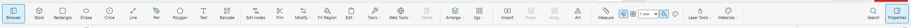
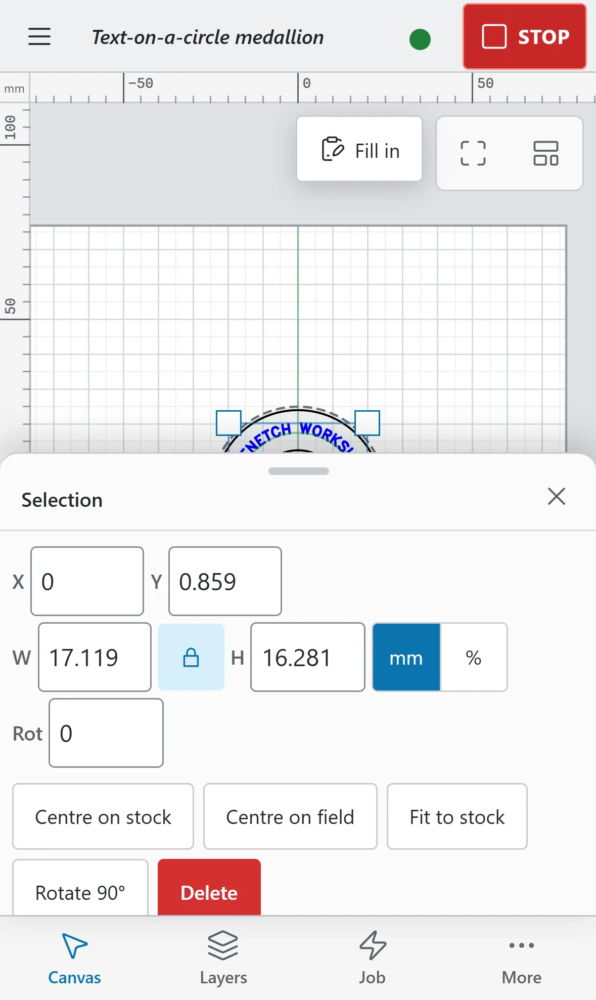
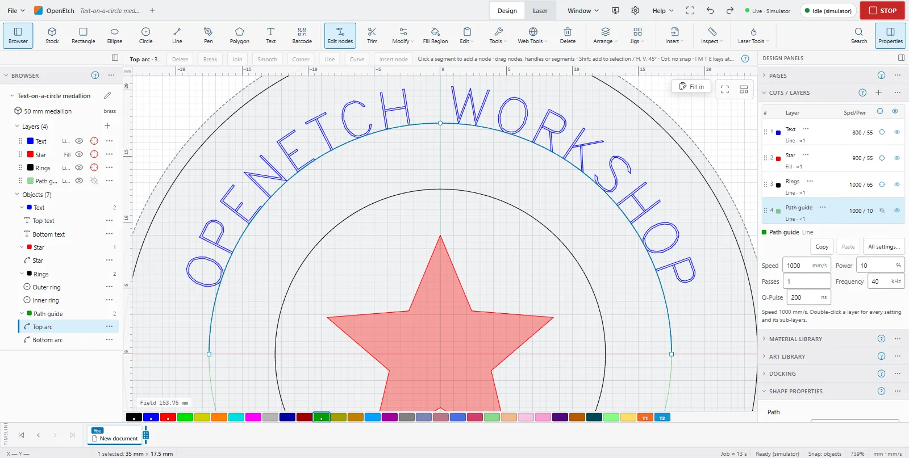
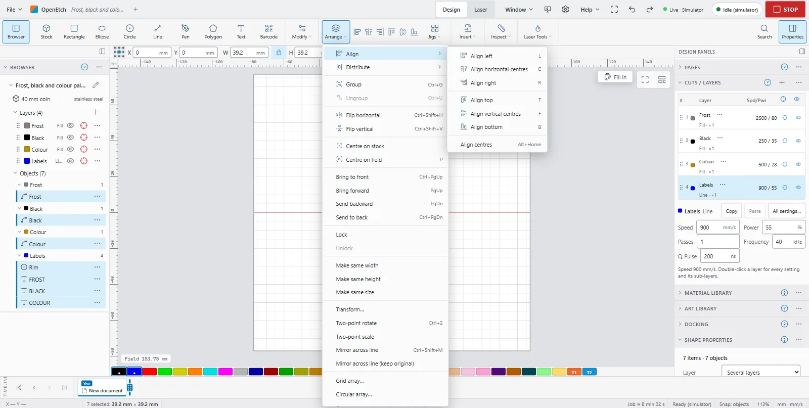
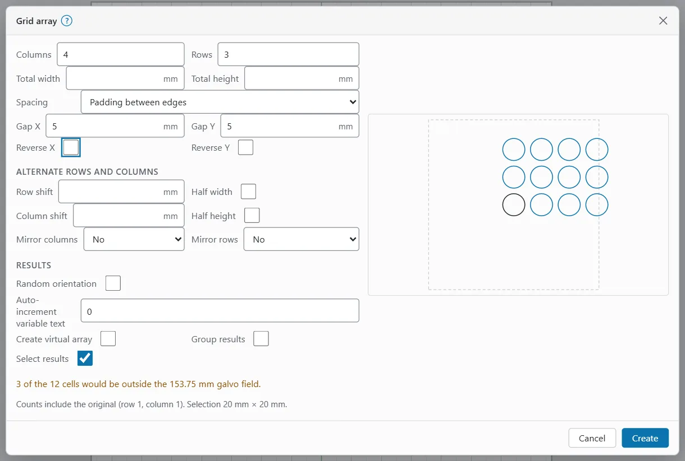
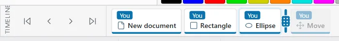

# Drawing and editing

This page covers the drawing and editing tools of the **Design** workspace. Every edit you make is one engine command and one step on the timeline, so you can always undo it.

> **Note:** On a Mac, press `Cmd` where this guide says `Ctrl`, and `Option` where it says `Alt`. On a Mac, `Ctrl`+click is the right-click. Menus on a Mac show the keys as symbols (⌘ ⌥ ⇧).

## Where the tools are {#where-the-tools-are}

The tools sit in different places on each kind of screen.

| Screen | Where the drawing tools are |
|---|---|
| Computer (wide window) | The ribbon at the top, in the groups **Create**, **Modify**, **Arrange**, **Insert**, **Inspect** and **Laser Tools**. In a narrow window, the least-used groups fold into a button with the group's name; click it to open the group. |
| Tablet | A tool rail down the left edge of the canvas. Groups that do not fit open sideways as a flyout. |
| Phone | Tap the **Canvas** tab at the bottom. The sheet that opens holds the tool strip, which scrolls sideways. |

The ribbon groups hold these tools:

| Group | Tools |
|---|---|
| **Create** | **Stock**, **Rectangle**, **Ellipse**, **Circle**, **Line**, **Pen**, **Polygon**, **Text**, **Barcode** |
| **Modify** | **Edit nodes**, **Trim**, the **Modify** menu, **Fill Region**, the **Edit** menu, the **Tools** menu, **Web Tools**, **Delete** |
| **Arrange** | The **Arrange** menu (and a row of align buttons when two or more objects are selected), the **Jigs** menu |
| **Insert** | **Import**, **Place**, **Array**, **Art** |
| **Inspect** | **Measure**, the snap and view toggles, and the result colours toggle |
| **Laser Tools** | Material, interval and focus tests, the Material Library and the MOPA materials (see the laser pages) |

To find any command by name, press `S` or click **Search** in the ribbon, then type. On the phone, use **More > Command search…**

To see a short menu of what you can do with the selection, right-click it. On a touch screen, press and hold (long-press) instead. A long right-click menu files its entries under **Modify**, **Arrange**, **Select** and **Laser** submenus.

> **Tip:** To put the creation tools in a vertical rail on a computer, as LightBurn does, right-click empty space in the ribbon and tick **Creation tools on a vertical rail (LightBurn style)**.

### Tools that are not on the phone {#phone-desktop-features}

The phone's tool strip and menus leave out **Pen**, **Polygon**, **Edit nodes**, **Trim**, **Weld** and **Add Tabs**, because they are made for a bigger screen and a mouse or a pen. You can still start them from **More > Desktop features**. Docking and editing the Art Library work only on a computer or tablet.

## Pan and zoom {#pan-and-zoom}

- To zoom, turn the mouse wheel, or press `Ctrl+=` and `Ctrl+-`. `Ctrl+0` zooms to the whole field.
- To pan, drag with the middle mouse button, or hold `Space` and drag.
- On a touch screen, pan with two fingers and pinch to zoom.
- The buttons at the top right of the canvas are **Fit field** and **Zoom to selection**.

On a Mac trackpad, two-finger scrolling pans and a pinch zooms. To change this, use **Trackpad: scroll pans, pinch zooms** in Preferences.

## Draw shapes {#draw-shapes}

New shapes go on the current layer. To choose the layer first, click it in **Cuts / Layers**.

To draw a rectangle or an ellipse:

1. Click **Rectangle** (`R`) or **Ellipse** (`E`).
2. Drag on the canvas from one corner to the opposite corner.
3. Let go. The shape is selected, ready to move or size.

To draw a circle from its centre:

1. Click **Circle** (`C`).
2. Press where the centre goes and drag outwards.

With any of these tools, a tap or click without a drag places a 20 mm shape.

These keys change a drag while you hold them:

| Key | Effect |
|---|---|
| `Shift` | A square, or a circle with the Ellipse tool |
| `Ctrl` | Draw from the centre (with the Circle tool: snapping off) |
| `Alt` | Snap to guides only |
| `Esc` | Cancel the drag |

On a touch screen, the modifier bar at the bottom left of the canvas has **Square** and **From centre** buttons for the same thing (see [The modifier bar](the-workspace.md#touch-modifier-bar)).

> **Note:** With two or more objects selected, `R`, `E`, `C`, `T`, `L` and `B` align the selection instead of choosing a tool. See [Align](#align-and-arrange). Single-letter keys work only while the canvas has the focus.

### Shape properties {#shape-properties}

A rectangle, ellipse, polygon or star you drew stays editable as that shape. Select one shape on its own and the **Shape properties** section shows in the Properties window:

| Shape | Fields |
|---|---|
| Rectangle | **Width**, **Height**, **Corner radius** |
| Ellipse | **Radius X**, **Radius Y** |
| Polygon | **Sides**, **Radius**, **Star**, **Corner radius** |
| Star | **Points**, **Radius**, **Star**, **Inner radius** (%), **Corner radius** |

The shape keeps its centre, rotation and layer. To edit its nodes one by one, convert it to a path first (**Modify > Convert to path**, `Ctrl+Shift+C`).

The corner radius can be at most half the shorter side. A polygon has 3 to 1000 sides.

## Draw lines and curves {#draw-lines-and-curves}

To draw a line or a polyline:

1. Click **Line** (`Ctrl+L`).
2. Click each point in turn.
3. To finish, double-click, press `Enter`, or click **Finish** in the tool bar.
4. To close the shape instead, press `C`, click **Close**, or click the first point again.

While you draw:

- Hold `Shift` to keep the line at 15° steps.
- Press `Backspace`, or click **Undo point**, to remove the last point.
- Press `Esc` to cancel the line.

To draw smooth curves, use **Pen** instead. Click for a corner point, or press and drag to make a smooth curve point. Finish and close it as for a line.

On the phone, tap the points, then tap **Finish** or tap the first point to close. The Pen is under **More > Desktop features** on the phone.

## Draw polygons and stars {#draw-polygons-and-stars}

To draw a polygon or a star:

1. Click **Polygon**.
2. In the tool bar, set **Sides** (or **Points** for a star), tick **Star** for a star, and set **Inner** (the inner points' radius as a percentage) and **Corner radius**.
3. Drag from the centre to where the first corner goes. Hold `Shift` to turn in 15° steps.

A tap without a drag places a 20 mm shape.

## Select objects {#select-objects}

Selection follows LightBurn's rules.

| To | Do this |
|---|---|
| Select one object | Click its line, or inside a closed shape |
| Add to the selection | `Shift`+click |
| Add or remove one object | `Ctrl`+click |
| Remove from the selection | `Ctrl+Shift`+click |
| Select everything inside a box | Drag from left to right on empty canvas (a solid box) |
| Select everything the box touches | Drag from right to left (a dashed box) |
| Select all | `Ctrl+A` |
| Invert the selection | `Ctrl+Shift+I` |
| Step to the next or previous object | `Tab` or `Shift+Tab` |
| Clear the selection | `Esc` (the first press goes back to the Select tool), or click empty canvas |

The same modifier keys work with the box. Clicking a member of a group selects the whole group.

You cannot select objects on a hidden layer. A locked object can be selected but not moved or edited until you unlock it.

To select by kind, open **Edit > Select** and choose **Select open shapes**, **Select open shapes set to fill** or **Select contained shapes** (the shapes inside the selected ones).

On a touch screen, one finger on empty canvas draws the selection box. To make one finger pan instead, change **One finger on empty canvas** to **Pan** in Preferences.

## Move, rotate and scale {#move-rotate-and-scale}

### On the canvas {#on-the-canvas}

- To move, drag a selected object. Hold `Shift` to keep to horizontal, vertical or 45°; a guide line shows the direction.
- To scale, drag a corner handle (keeps the proportions) or an edge handle (one direction). Hold `Shift` to free the proportions, or `Ctrl` to scale about the centre. Dragging past the opposite side mirrors the selection.
- To rotate, drag a round handle just outside a corner. Hold `Shift` for 15° steps, or `Ctrl` for 5° steps.
- Press `Esc` before you let go to cancel the drag.

On a touch screen, tap a selected object again to switch its handles between scaling and rotating.

A lone circle stays round when you scale it while **Keep round** is on in Properties.

### With the keyboard {#with-the-keyboard}

| Keys | Moves or turns the selection |
|---|---|
| Arrow keys | 5 mm |
| `Shift`+arrow | 20 mm |
| `Ctrl`+arrow | 1 mm |
| `Ctrl+Shift`+arrow | 0.1 mm |
| `.` and `,` | 90° clockwise and anticlockwise |
| `Shift` with `.` or `,` | 45° |
| `Ctrl` with `.` or `,` | 15° |
| `Ctrl+Shift` with `.` or `,` | 1.5° |
| `P` | Moves the selection to the centre of the field |

You can change the arrow-key distances in Preferences, under **Editing**. **Default moves (5, 20, 1, 0.1 mm)** puts them back.

> **Warning:** `Ctrl+.` is also a STOP key. While a job is running, it stops the job instead of turning the selection.

### With numbers {#numeric-fields}

On a computer, the row under the ribbon shows the selection's **X**, **Y**, **W** and **H** and its rotation (**Rot**, or **Rot by** for several objects). Type a value and press `Enter`.

- The small grid of dots is the **Reference point**: X, Y, sizing and rotation refer to that point of the selection's box.
- The lock button keeps **W** and **H** in proportion.
- The **mm** / **%** switch sets whether W and H are lengths or a percentage of the current size.

The Properties window has the same fields, plus **Name**, **Layer**, **Lock aspect**, **Diameter** with **Keep round** for a circle, **Rotation** and a **Flip** readout. On a touch screen it also has a nudge pad: **Nudge left**, **Nudge right**, **Nudge up** and **Nudge down**, with a **Step** of **Normal**, **Large**, **Small** or **Tiny**. On a tablet, tap **Properties** over the canvas to open the window.

On the phone, select an object and the **Selection** sheet opens with these fields and the buttons **Centre on stock**, **Centre on field**, **Fit to stock**, **Rotate 90°** and **Delete**.

If part of the selection is outside the galvo field, Properties says so: the laser cannot reach it.

### Transform {#transform}

To scale, slant or mirror by exact amounts, open **Arrange > Transform…**:

- **Scale about the centre**: type **Scale** (or **Width** and **Height** with **Keep proportions** off) as a percentage, then click **Apply scale**.
- **Shear (slant) about the centre**: type an **X** or **Y** angle (up to ±89°), then click **Apply shear**.
- **Pick on the canvas**: **Mirror across line…**, **Mirror copy across line…**, **Two-point rotate…** and **Two-point scale…** (tick **Two-point scale also rotates** to turn as well).
- Click **Done** to close the dialog.

The same picks are in the **Arrange** menu:

- **Two-point rotate** (`Ctrl+2`): click the pivot, then a reference point, then where the reference should point.
- **Two-point scale**: click the pivot, a reference point, then where the reference should go. The scale is the ratio of the distances.
- **Mirror across line** (`Ctrl+Shift+M`): click two points of the mirror line. **Mirror across line (keep original)** keeps the original and makes a mirrored copy.

Beginner Mode hides the mirror commands.

## Edit nodes {#edit-nodes}

Node editing changes the points and curves of a path.

To edit a shape's nodes:

1. Select one shape.
2. Click **Edit nodes** (`` Ctrl+` ``), or choose **Modify > Edit nodes**.
3. Drag a node, a curve handle or a segment. Click a segment to add a node there.
4. Press `Esc`, click **Edit nodes** again, or choose **Modify > Stop editing nodes** when you are done.

A rectangle, ellipse, polygon or text must be converted to a path first. The tool bar offers **Convert to path** when you click one.

To select nodes, click one, `Shift`+click to add more, or drag a box round them. While dragging, `Shift` keeps to horizontal, vertical or 45°, and `Ctrl` turns snapping off.

The tool bar buttons and keys act on the node or segment under the pointer, or else on the selected nodes:

| Button | Key | What it does |
|---|---|---|
| **Delete** | `Delete` or `D` | Deletes the nodes |
| **Break** | `B` | Breaks the path at the node |
| **Join** | `J` | Joins two selected end nodes |
| **Smooth** | `S` | Makes a smooth node (on a line, makes it a curve) |
| **Corner** | `C` | Makes a corner node |
| **Line** | `L` | Makes the segment between two selected nodes straight |
| **Curve** | `K` | Makes the segment between two selected nodes a curve |
| **Insert node** | | Adds a node in the middle of the selected segment |
| | `M` | Adds a node in the middle of the segment under the pointer |
| | `I` | Inserts a node at the pointer |
| | `T` | Trims at the pointer |
| | `E` | Extends the open end to the nearest line |

On the phone, **Edit nodes** is under **More > Desktop features** (select the shape first). Use **Insert node** in the bar, because there is no pointer to point with.

## Trim {#trim}

Trim removes a piece of a shape up to the nearest crossings, like scissors.

1. Click **Trim** (`Ctrl+K`).
2. Click the piece to remove.
3. Press `Esc` when done.

On a touch screen, the piece lights up while you press and is cut when you lift your finger.

## Measure {#measure}

To measure, click **Measure** (`Alt+M`) in the **Inspect** group, then click two points or drag between them. The bar shows the distance, ΔX, ΔY and the angle. The points snap to objects; `Shift` keeps to 15° steps.

## Snapping {#snapping}

Snapping helps you land exactly on other objects. It works on the real shapes, as in Fusion 360.

The toggles are in the **Inspect** group:

- **Snap to objects**: centres, quadrants, vertices and endpoints, midpoints, intersections and the nearest point on an outline, of objects, the stock and the field, plus dotted alignment guides.
- **Snap to grid**, with the grid snap distance next to it.
- **Filled view** (`Alt+Shift+W`): draws fill layers as shaded areas. It does not change snapping.

When a snap is found, the canvas shows a small glyph and a label, such as `Center · Rim`. Points win over outlines, outlines over alignment guides, and guides over the grid.

When you drag a selection, it snaps by its own snap point nearest to where you grabbed it.

While dragging:

- Hold `Ctrl` to turn snapping off for this drag.
- Hold `Alt` to snap to guides only.

In Preferences, under **Snapping**, you can set the **Snap distance** (in screen pixels) and switch each kind on or off: **Vertices and endpoints**, **Intersections**, **Centres**, **Quadrants**, **Midpoints**, **Nearest point on outline** and **Alignment guides**. Under **Grid**, you can **Show the grid** and set the **Visual grid spacing**.

Preferences is the gear button in the top bar, or **File > Settings > Preferences…** In the compact and tablet layouts the gear folds into the **More** (⋯) menu in the top bar. On the phone it is **More > Settings > Preferences**.

## Guides {#guides}

Guides are straight lines you place to line things up. Shapes snap to them.

To add a guide:

1. Drag down from the top ruler for a horizontal guide, or right from the left ruler for a vertical one.
2. Let go where you want it.

To place a guide at an exact position, choose **Arrange > Add guide…** Pick **Vertical (at X)** or **Horizontal (at Y)**, type the position in mm and click **OK**.

To change a guide, double-click it to type a new position, or drag it with the Select tool. On a touch screen, press and hold a guide before you drag it.

To remove a guide, drag it back onto a ruler, or double-click it and click **Delete**. To remove them all, choose **Arrange > Clear guides**.

Guides are saved with the project. They never burn.

## Align, distribute and arrange {#align-and-arrange}

The **Arrange** menu holds the commands that line objects up and order them. On the phone, it is in the tool strip.

### Align {#align}

Aligning moves the other objects to the last object you selected, which stays put. To make another selected object the reference, `Ctrl`+click it twice.

Select two or more objects, then use **Arrange > Align** or the keys:

| Command | Key (canvas) | Key (anywhere) |
|---|---|---|
| **Align left** | `L` | `Alt+Left` |
| **Align horizontal centres** | `C` | `Alt+PgUp` |
| **Align right** | `R` | `Alt+Right` |
| **Align top** | `T` | `Alt+Up` |
| **Align vertical centres** | `E` | `Alt+PgDn` |
| **Align bottom** | `B` | `Alt+Down` |
| **Align centres** | | `Alt+Home` |

With two or more objects selected, a row of align buttons also shows in the **Arrange** group.

### Distribute {#distribute}

Distributing spaces three or more objects evenly. **Arrange > Distribute** has:

- **H-Spaced (equal gaps)** and **V-Spaced (equal gaps)**: equal gaps between the edges.
- **H-Centered (equal centre spacing)** and **V-Centered (equal centre spacing)**: equal spacing of the centres.

Beginner Mode hides Distribute.

### Centre, flip and order {#centre-flip-and-order}

- **Centre on stock** and **Centre on field** (`P`) move the selection to the middle.
- **Flip horizontal** (`Ctrl+Shift+H`) and **Flip vertical** (`Ctrl+Shift+V`) mirror the selection in place.
- **Bring to front** (`Ctrl+PgUp`), **Bring forward** (`PgUp`), **Send backward** (`PgDn`) and **Send to back** (`Ctrl+PgDn`) change the draw order.
- **Make same width**, **Make same height** and **Make same size** match the other objects to the last one selected.

### Move to a page position {#move-to-a-page-position}

To move the selection to a corner, an edge or the centre:

1. Choose **Arrange > Move selected objects…**
2. Under **Relative to**, pick **The workspace (galvo field)** or **The stock**.
3. Set a **Margin** to keep in from the edges.
4. Click one of the nine position buttons. Each click is one undo step.
5. Click **Done**.

The selection keeps its size and rotation.

### Move together {#move-together}

To line objects up one after another with a fixed gap, choose **Arrange > Move horizontally together…** (`Alt+Shift+H`) or **Move vertically together…** (`Alt+Shift+V`). Set the **Direction** and the **Spacing** between their boxes, then click **Move**. The first object stays; a negative spacing overlaps them. A group moves as one object.

### Docking {#docking}

The **Docking** window (in the **Window** menu) slides the selection until it touches another shape or the workspace edge. Click **Dock left**, **Dock up**, **Dock down** or **Dock right**. **Padding** is the gap kept in the direction of travel. **Move as group** and **Lock inner objects** control what moves together. Docking is not on the phone.

## Group and lock {#group-and-lock}

- To group, select two or more objects and press `Ctrl+G` (**Arrange > Group**). A group selects and moves as one.
- To ungroup, select the group and press `Ctrl+U` (**Arrange > Ungroup**).
- To lock objects so they cannot be moved, edited or deleted, choose **Arrange > Lock**. **Arrange > Unlock** frees them.

## Combine shapes {#booleans-and-weld}

The **Modify** menu combines closed shapes. For the commands marked "last selected", the order you select in matters.

| Command | Key | Result |
|---|---|---|
| **Weld** | `Ctrl+W` | Merges overlapping shapes into one outline |
| **Union** | `Alt++` | One shape covering every selected shape |
| **Subtract (last selected)** | `Alt+-` | Removes the last selected shape from the others |
| **Intersect** | `Alt+*` | Keeps only where the shapes overlap |
| **Exclusive or (XOR)** | | Keeps the areas covered an odd number of times |
| **Cut shapes (last selected cuts)** | `Alt+C` or `Alt+Shift+C` | Cuts the others into pieces along the last selected shape |

> **Note:** Browsers keep `Ctrl+W` (close tab) for themselves, so use the menu for Weld in a browser tab. On the phone, Weld is under **More > Desktop features**.

## Offset shapes {#offset-shapes}

Offsetting draws a new outline a set distance from a shape.

1. Select the shapes.
2. Choose **Modify > Offset shapes…** (`Alt+O`).
3. Set the **Distance** and the **Direction**: **Outward**, **Inward** or **Both**.
4. Pick the **Corners**: **Rounded**, **Sharp** or **Bevelled**.
5. Tick **Delete original shapes** to replace the originals, or **Merge shapes first (one result)** to offset overlapping shapes as one.
6. Click **Offset**.

The results are new shapes on each original's layer. Open paths are offset on both sides.

## Fillet corners {#fillet-corners}

To round or sharpen corners, choose **Modify > Fillet corners…** and pick an **Action**:

- **Round corners**: set a **Radius** and click **Fillet**. Corners where the radius does not fit stay sharp. A negative radius cuts a concave bite instead.
- **Make every rounded corner sharp**: removes every circular-arc corner and extends the sides until they meet. Click **Make sharp**.
- **Make corners sharp: click each on the canvas**: click **Pick corners**, then click each rounded corner. Press `Esc` when done. This works on one shape at a time.

If you selected nodes in **Edit nodes** first, only those corners are rounded.

## Path tools {#path-tools}

The rest of the **Modify** menu tidies paths:

- **Break apart** (`Alt+B`) splits a shape into its separate pieces.
- **Auto-join** (`Alt+J`) joins open paths whose ends meet. **Auto-join with tolerance…** joins ends up to a **Tolerance** apart.
- **Close path** closes open paths. **Close paths with tolerance…** closes only paths whose ends are within the **Tolerance**, by **Adding a line** or **Moving the ends together** (**Close by**).
- **Delete duplicates** (`Alt+D`) removes exact copies, which would otherwise burn twice. With nothing selected it checks the whole design.
- **Convert to path** (`Ctrl+Shift+C`) turns a rectangle, ellipse, polygon or text into a plain path.
- **Optimize shapes…** (`Alt+Shift+O`) cleans up traced or imported art: **Fit shapes to lines** (with a **Line tolerance**), **Fit shapes to arcs** (with an **Arc tolerance**) and **Smooth source shapes** (with **Smoothing**). They run in the order smooth, arcs, lines.
- **Reverse direction** reverses the direction a path is marked in.

## The Edit menu {#edit-menu}

The **Edit** menu in the **Modify** group holds:

- **Undo** and **Redo**.
- **Cut** (`Ctrl+X`), **Copy** (`Ctrl+C`), **Paste** (`Ctrl+V`) and **Paste in place** (`Alt+V`).
- **Duplicate** (`Ctrl+D`) and **Delete** (`Delete` or `Backspace`).
- **Select all**, **Invert selection** and **Select** (open or contained shapes).
- **Use the system clipboard**: when on, copy and paste go through your computer's clipboard, so you can paste art or an image (up to 50 MB) from another program.
- **Curve tolerance…**

### Curve tolerance {#curve-tolerance}

Curve tolerance sets how finely a job turns curves into straight marks: the largest distance between a curve and the straight pieces that replace it. Coarser marks faster with fewer points; finer follows curves more closely. Enter 0.001 to 1 mm, then click **Save**. It is saved with the project. Leave it empty to use the device's setting (0.01 mm unless the device says otherwise).

## The Tools menu {#tools-menu}

The **Tools** menu in the **Modify** group holds:

- **Warp selection** and **Deform selection** (see below).
- **Generate tangent circle**: select exactly three circles, then click one of the red candidate circles, or **Create all**.
- **Rubber-band outline**: one outline round the selection, like a rubber band stretched round it.
- **Convert toolpath to path**: turns the marks a job would make (for example a fill's hatch lines) into shapes. With a selection it reads **Convert toolpath to path (selection)**.
- **Art Library**: opens the [Art Library](art-library.md).
- **Add Tabs**, **Dogbone corners…**, **Resize Slots in Selection…** and **Multi-File Trace…** (see [Images](images.md#multi-file-trace)).

The **Web Tools** menu beside it holds your own tools: web pages and saved command sequences (**Manage User Tools…**).

### Warp and deform {#warp-and-deform}

1. Select vector shapes (not images).
2. Choose **Tools > Warp selection** (four corner handles, **Perspective**) or **Tools > Deform selection** (a grid of handles, **Envelope**).
3. Drag the handles. Hold `Shift` for horizontal symmetry or `Alt` for vertical symmetry. Double-click a handle to reset it.
4. Press `Enter` or click **Apply**. `Esc` cancels; **Reset** starts again.

For a perspective warp, the four corners must form a convex shape.

## Arrays and nesting {#arrays-and-nesting}

### Grid array {#grid-array}

A grid array makes rows and columns of copies.

1. Select the objects to copy.
2. Click **Array** in the **Insert** group, or choose **Arrange > Grid array…**
3. Set **Columns** and **Rows**. The counts include the original. Or set **Total width** or **Total height** to fit as many as possible.
4. Pick the **Spacing**: **Padding between edges** (**Gap X**, **Gap Y**) or **Centre to centre** (**Pitch X**, **Pitch Y**).
5. Check the preview, then click **Create**.

More options:

- **Reverse X** builds the columns to the left; **Reverse Y** builds the rows towards you.
- **Alternate rows and columns**: **Row shift** (or **Half width**) and **Column shift** (or **Half height**) make brick or honeycomb layouts. **Mirror columns** and **Mirror rows** flip every other one **Left-right** or **Top-bottom**.
- **Random orientation** turns each copy by a random angle. The same **Seed** gives the same angles; **New seed** picks others. The preview does not show the random angles.
- **Auto-increment variable text** raises each copy's serial or CSV Offset by this much (see [Variable text](variable-text-and-barcodes.md#counting-copies)).
- **Group results** and **Select results** decide what happens to the copies afterwards.

The dialog warns when cells would fall outside the galvo field. An array has at most 10,000 cells, the original included. The preview draws the first 400.

### Virtual arrays {#virtual-arrays}

Tick **Create virtual array** to make linked clones: edit an original and every clone changes. Right-click a virtual array for **Edit array…**, **Duplicate array**, **Flatten array** (makes the clones ordinary objects), **Add to array** and **Remove from array**.

### Circular array, copy along a path and nesting {#circular-array}

- **Arrange > Circular array…**: **Count** (the original included, 2 to 10,000), **Sweep** (360° spaces them evenly round the circle; a negative angle goes clockwise), **Rotate copies** (off keeps each copy upright, like clock numerals) and the centre (**Centre X**, **Centre Y**, **Pick centre…**, **Field centre**, **Stock centre**).
- **Arrange > Copy along path… (path selected last)**: select the objects, then the path last. Spread them by **Count** or **Spacing**, and tick **Rotate to the path** to turn them along it.
- **Arrange > Quick nest…**: packs parts into a region. Select the parts, and to nest into a shape, select it last. Pick the **Method** (**True shape (parts interlock, fill holes)** or **Quick nest (bounding boxes)**), **Into** (**The stock**, **The whole field** or the last selected shape), **Spacing**, **Edge gap**, **Rotations** and **Grid cell**. **Multipage** puts parts that do not fit onto new pages. Parts that do not fit stay where they were.

## Undo, redo and the timeline {#undo-redo-and-the-timeline}

- **Undo**: `Ctrl+Z`, or the **Undo** button in the top bar.
- **Redo**: `Ctrl+Shift+Z` or `Ctrl+Y`, or the **Redo** button.
- On a touch screen, tap with two fingers to undo and with three fingers to redo. The phone also has Undo and Redo buttons at the bottom right of the canvas.

A step you undo is kept until your next edit, which discards it. Until then, Redo brings it back.

### The timeline {#timeline}

The **Timeline** along the bottom shows one chip per step, oldest on the left, like Fusion 360's design timeline. Each chip says what the step did ("Rectangle", "Move", Text "Hello") and who did it: **You**, an AI agent by name, or **Script**. A step made by an agent flashes briefly when it arrives.

To roll the design back:

1. Click a step, or drag the marker to it.
2. The steps after the marker turn grey. They are kept, not deleted.
3. A new edit goes in at the marker, and the later steps are replayed after it. A step that no longer applies is shown red.

Right-click a step (or tap or long-press it on a touch screen) for **Roll marker here**, **Roll marker before this step** and **Delete step**. The buttons **Go to start**, **Previous step**, **Next step** and **Go to end** step through the history.

In the compact and tablet layouts the timeline shares the bottom row with the status bar. In the compact layout, click **Pin the timeline open** to keep it showing. On the phone, the timeline is a list under **More > History**.

> **Note:** AI agents connected over MCP edit the same design, and their steps appear on the timeline like yours. Agents can design, but they can never approve or start a burn. See [AI agents](ai-agents.md).

## Touch controls {#touch-controls}

On a tablet or phone, one finger works like the left mouse button, two fingers pan and zoom, and a long-press is the right-click. The modifier bar gives you `Shift` and the other keys a finger lacks, and the selection action bar puts Copy, Duplicate, Rotate 90° and more next to the selection. See [Touch controls](the-workspace.md#touch-controls) in The workspace.

## Keyboard shortcuts {#keyboard-shortcuts}

OpenEtch uses LightBurn's default keys. To see them all, press `?` (`Shift+?`). `F1` opens this guide. To change a key, choose **File > Settings > Edit hotkeys…** Your keys are saved in this browser.

## Common mistakes {#common-mistakes}

- **A key chose a tool instead of aligning, or the reverse.** With one object selected, `R`, `E`, `C` and `T` pick tools; with two or more they align.
- **A letter key did nothing.** Single-letter keys work only while the canvas has the focus. Click the canvas first.
- **Nothing happens when you drag.** The object may be locked (**Arrange > Unlock**), or its layer hidden.
- **Subtract removed the wrong shape.** Subtract and Cut shapes use the last selected shape. Select the cutter last.
- **A shape burns twice.** It may have an exact copy on top of it. Use **Modify > Delete duplicates**.
