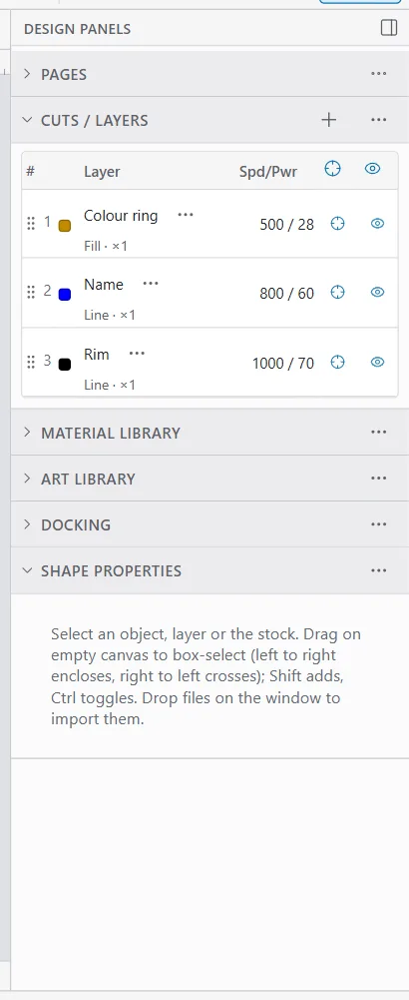
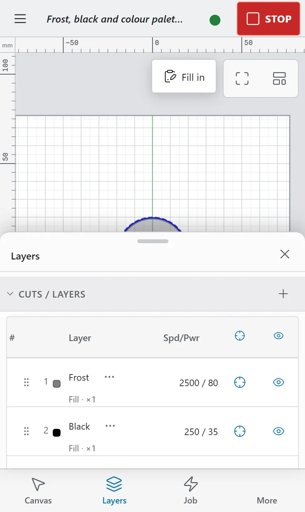

# Page format example

This page shows every piece of markdown the guide uses, so you can check how it looks in the app and on GitHub. Writers: copy from here. The format itself is in [the guide's README](https://github.com/krzim/OpenEtch/blob/main/docs/guide/README.md).

Text can be **bold**, *italic*, ***both***, ~~struck out~~ or `code`. Keys are code too: press `Ctrl+Z` to undo (`Cmd+Z` on a Mac). A line can end with a hard break  
like this one.

## Lists {#lists}

To fit a design to a coin:

1. Open the example with **File > New from example…**.
2. Select the ring.
3. In **Shape Properties**, set the size:
   - **Width** to the coin's diameter;
   - **Height** to the same value.
4. Check the layers in **Cuts / Layers**.

Things to have ready:

- eye protection rated for the wavelength;
- fume extraction;
- a scrap piece of the same material.

A list item can hold more than one paragraph:

1. Frame the job.

   The red pointer traces the outline. Nothing burns.

2. Start the job.

## Links {#links}

- To another page: [the start of the guide](index.md).
- To a section of another page: [how to open the guide](index.md#open-the-guide).
- To a section of this page: [the table below](#energy-density).
- To a website (opens in a new tab): [LightBurn's documentation](https://docs.lightburnsoftware.com/).

## Pictures {#pictures}

A picture of a panel, cropped to the panel:



A phone layout:



## Energy density {#energy-density}

Before you run a test grid or try a new setting, work out how much energy each square millimetre gets:

```text
energy density (J/mm²) = power (W) / (speed (mm/s) × line interval (mm))
```

For example, 30 W at 1000 mm/s with a 0.01 mm line interval gives 30 / (1000 × 0.01) = 3 J/mm².

| Power | Speed | Line interval | Energy density | On thin stainless steel |
|---:|---:|---:|---:|:--|
| 30 W | 1000 mm/s | 0.01 mm | 3 J/mm² | a light mark |
| 30 W | 300 mm/s | 0.01 mm | 10 J/mm² | a strong mark |
| 60 W | 200 mm/s | 0.01 mm | 30 J/mm² | likely to melt or warp it |

On stainless steel with a 60 W MOPA, roughly 2 to 15 J/mm² marks without melting. Higher values can melt or warp thin stock. These are starting points: test on a scrap of your own material.

> **Warning:** Wear eye protection rated for your laser's wavelength, run fume extraction and never leave a job unattended.

> **Tip:** Halving the power, or doubling the speed, halves the energy density. Doubling the line interval halves it too.

> **Note:** A setting that works on one machine may not work on another. Lenses and sources differ.

## Code blocks {#code-blocks}

A fenced code block keeps its text exactly as written:

```sh
npm run guide:shots -- --url http://127.0.0.1:7971
```

### A subsection {#a-subsection}

Every `##` and `###` heading ends with an anchor in braces, so a **?** button in the app can link to it.

---

That is the end of the example.
