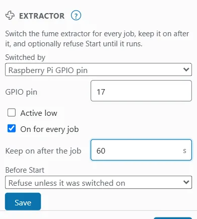

# Extractor

OpenEtch can switch your fume extractor for you. It can:

- switch it on for every job;
- keep it running for a while after the job ends (the run-on), because the fumes are still there;
- refuse Start until the extractor is running.

Each laser device has its own extractor settings. If you remove a device, its extractor settings go with it.

> **Warning:** Always extract the fumes when you mark. The Start check is a convenience, not a safety interlock: it checks once, when the run is approved, and does not watch the extractor during the job. Never leave a running job unattended.

## Open the extractor settings {#extractor-settings}

The extractor settings are in Preferences:

- On a desktop, choose **File > Settings > Preferences…** and scroll to **Extractor**.
- On a phone, tap **More**, then **Settings > Preferences**, and scroll to **Extractor**.

The settings belong to the active laser device. To set up another device, switch to it first.

To set up the extractor:

1. Choose how it is switched in **Switched by** (see below). **On for every job** and **Keep on after the job** appear once you choose an option other than **Not switched**.
2. Tick **On for every job** if OpenEtch should switch it on when a run is approved.
3. Type a run-on time in **Keep on after the job** (0 to 3600 seconds; 0 to start with).
4. Choose a check in **Before Start** (see [Refuse Start until it runs](#start-gating)).
5. Press **Save**. OpenEtch says "Saved."
6. Press **Switch on**, check the extractor runs, then press **Switch off**.

## How it is switched {#switched-by}

Choose one option in **Switched by**.

### Not switched {#not-switched}

**Not switched** is the default. OpenEtch does not switch anything. You can still use the **Before Start** check with a board input.

### The board's Busy output {#busy-output}

**The board's Busy output (output n)** uses the laser board's Busy output. Wire the extractor's relay to it. Set the output first in the device settings, under **IO ports (LightBurn)** (**Busy output**). See [Devices and calibration](devices-and-calibration.md). Without one, OpenEtch says "This device has no Busy output: set one in the device's IO ports first."

The board switches the Busy output on during every job by itself. After the job, OpenEtch holds it on for the run-on time.

Framing, STOP or a new job during the run-on can switch the output off early, because they set the board's outputs themselves.

> **Note:** Switching through the Busy output has not been checked on real hardware yet.

### Raspberry Pi GPIO pin {#gpio}

**Raspberry Pi GPIO pin** switches a pin of the Raspberry Pi the engine runs on. Set **GPIO pin** (0 to 53; 17 to start with). Tick **Active low** if your relay switches on when the pin is low.

This needs Raspberry Pi OS, and the engine's user must be allowed to switch pins. On any other computer, switching fails with "GPIO pins can be switched only on a Raspberry Pi (Linux)".

> **Warning:** Never connect a mains-powered extractor to a GPIO pin directly. Use a relay module rated for the load, and have mains wiring done safely.

> **Note:** Switching through a GPIO pin has not been checked on a Raspberry Pi yet.

### Home Assistant {#home-assistant}

**Home Assistant** switches an entity in Home Assistant, such as a smart plug.

1. First add a Home Assistant target in [Notifications](notifications.md#home-assistant), and save it.
2. In **Notification target**, pick that target.
3. In **Entity (e.g. switch.extractor)**, type your plug's entity id.

OpenEtch calls the entity's own turn-on and turn-off services, with the target's address and token.

> **Tip:** The extractor uses the target's address and token only. If you do not want job notifications from that target, untick its events.

### Webhook {#webhook}

**Webhook** sends a POST to a webhook target.

1. First add a webhook target in [Notifications](notifications.md#webhook), and save it.
2. In **Notification target**, pick that target.

The body is `{"event": "extractor", "state": "on"}` or `"off"`, with the device and `"source": "openetch"`.

## On for every job and run-on {#run-on}

With **On for every job** ticked, OpenEtch switches the extractor on when a run is approved.

**Keep on after the job** is the run-on time. When a job ends, the extractor stays on that long, then OpenEtch switches it off. This also happens after STOP or a failed job, because the fumes are still there. With 0, it is switched off as soon as the job ends.

A few details:

- When a job ends, the extractor is switched off after the run-on even if you switched it on by hand before the job.
- Switching it on or off by hand during the run-on cancels the timer.
- If a new job is running when the run-on ends, the extractor stays on.

## Refuse Start until it runs {#start-gating}

**Before Start** decides what Start needs from the extractor. The check runs when a run is approved: Start, an approval under **Waiting for approval**, and every foot switch burn.

| Option | What it does |
|---|---|
| **No check** | Start does not look at the extractor. |
| **Refuse until a board input reads on** | Reads an input of the laser board, for example an airflow switch or the extractor's running contact. Set **Input** (0 to 15; 6 to start with) and tick **Active low** if the input is on when low. |
| **Refuse unless it was switched on** | Start is refused unless OpenEtch switched the extractor on without an error. This needs an option in **Switched by**; with **Not switched** it is greyed out. |

When the check fails, Start is refused with a message:

- "the extractor is not running (input 6 reads off): switch it on, then Start";
- "the extractor is not switched on: switch it on in the cockpit, then Start".

The board input check works for galvo devices only.

> **Tip:** With **Refuse unless it was switched on**, also tick **On for every job**. OpenEtch then switches the extractor on at approval and refuses Start only if switching fails. Without it, the extractor goes off after each run-on and the next Start is refused until you switch it on again.

## Switch it by hand {#switch-by-hand}

You can switch the extractor by hand in two places:

- The cockpit's [Times card](production-cockpit.md#times-card) shows **Extractor on** or **Extractor off**, "(running on)" during the run-on, and a **Switch on** or **Switch off** button.
- **Preferences > Extractor** has **Switch on** or **Switch off** next to **Save**, once the settings are saved and there are no unsaved changes.

The **Production** window shows whether the extractor is on or off. If switching fails, the reason shows in red, for example "the extractor could not be switched on:" followed by the cause.

## Example: a smart plug through Home Assistant {#example-setup}

To switch an extractor plugged into a Home Assistant smart plug:

1. In **Preferences > Notifications**, add a **Home Assistant** target with your Home Assistant address and a long-lived access token. Press **Save**, then **Test**.
2. In **Preferences > Extractor**, choose **Home Assistant** in **Switched by**.
3. Pick the target in **Notification target**, and type the plug's entity id in **Entity (e.g. switch.extractor)**.
4. Tick **On for every job**, and type 60 in **Keep on after the job**.
5. In **Before Start**, choose **Refuse unless it was switched on**.
6. Press **Save**.
7. Press **Switch on** and check the extractor runs. Press **Switch off**.
8. Run a short job on scrap and check the extractor comes on, then goes off about a minute after the job.

## What AI agents can do {#ai-agents}

AI agents connected through MCP can read whether the extractor is on (in `production_status`). They cannot switch it or change its settings. See [AI agents](ai-agents.md).

## Common problems {#common-problems}

| Message | What to do |
|---|---|
| "The run-on is 0 to 3600 s." | Type a whole number of seconds from 0 to 3600. |
| "A Raspberry Pi GPIO pin is 0 to 53." | Check the pin number. |
| "A Home Assistant entity looks like switch.extractor." | Type the entity id in lower case, as Home Assistant shows it. |
| "Pick the notification target to call." | Add a target in Notifications first, save it, then pick it. |
| "A board input is 0 to 15." | Check the input number. |
| "\"Switched on\" needs a way to switch it." | Choose an option in **Switched by**, or choose another **Before Start** check. |
| "This device has no Busy output: set one in the device's IO ports first." | Set the **Busy output** in the device settings. |
