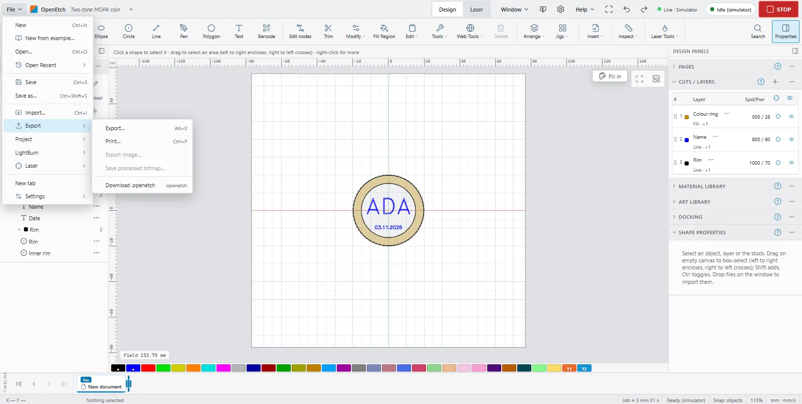
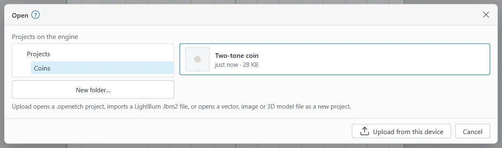
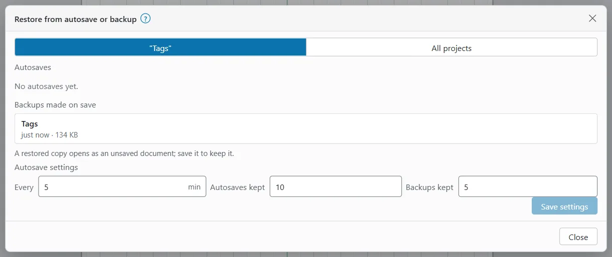
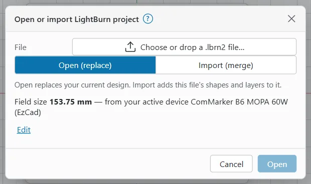
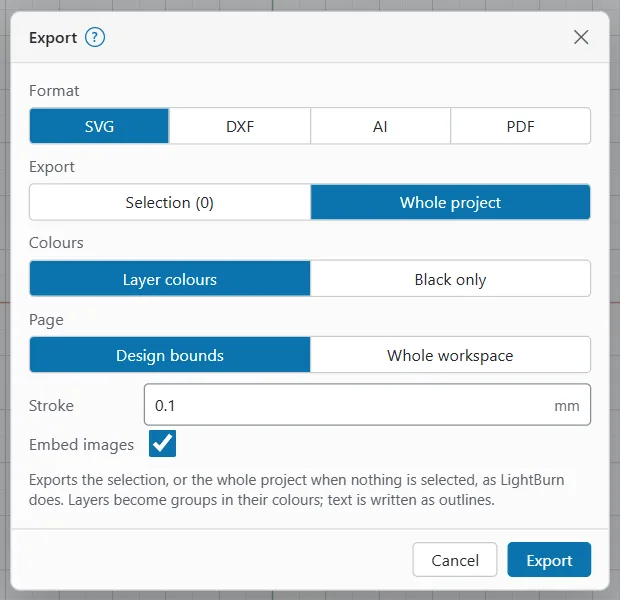
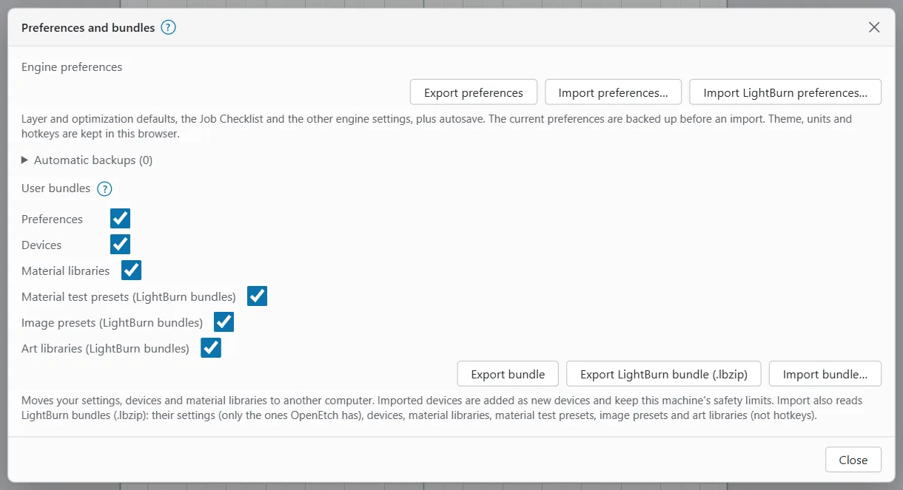

# Files and projects

This page covers everything in the **File** menu: new, open and save, autosave and backups, importing, exporting, LightBurn files, templates, notes, pages and bundles.

Your projects are kept by the engine, on the engine's computer, not on the device you are using. So you can save on the PC and open the same project on the iPad. Files you import come from your device. Files you export download to your device.

## Where your files are kept {#projects-folder}

The engine keeps projects in its projects folder:

| System | Default projects folder |
|---|---|
| Windows | `%APPDATA%\openetch\projects` |
| macOS | `~/Library/Application Support/openetch/projects` |
| Linux and Raspberry Pi | `~/.local/share/openetch/projects` |

The `--projects-dir` engine option chooses another folder. The folder is made the first time you save.

Inside it:

- Each project is a `.openetch` file, in folders if you use them.
- `.autosave` holds autosaved copies, and `.backups` the copies made when you save over a project.
- `templates` holds your templates, and `art-libraries` your Art Libraries.

The engine only writes inside its projects folder and any project locations you add. To put a file anywhere else, download it with **File > Export > Download .openetch** or another export.

## The File menu {#file-menu}

On the desktop, **File** is at the left of the top bar. On a phone, tap **More**: the **File** section has **New**, **Open…**, **Save**, **Save as…** and **Import…**, and **All file commands** opens the full menu.

| Entry | What it does | Key |
|---|---|---|
| **New** | Start a new, empty document. | `Ctrl+N` |
| **New from example…** | Open an example project. See [Getting started](getting-started.md#open-an-example). | |
| **Open…** | Open a project saved on the engine, or a file from this device. | `Ctrl+O` |
| **Open Recent** | The eight most recently changed projects. | |
| **Save** | Save the project under its name. | `Ctrl+S` |
| **Save as…** | Save under a new name or in another folder. | `Ctrl+Shift+S` |
| **Import…** | Add a file's shapes to your design. | `Ctrl+I` |
| **Export** | **Export…**, **Print…**, **Export image…**, **Save processed bitmap…** and **Download .openetch**. | |
| **Project** | **Fill in template…**, **Template fields…**, **Open template…**, **Recent templates**, **Save as template…**, **Notes…**, **Restore from autosave / backup…** and the autosave status. | |
| **LightBurn** | **Import LightBurn…**, **Export to LightBurn…** and **Preferences and bundles…** | |
| **Laser** | **Devices…**, **Material Library**, **Find My Laser / Add galvo…**, **Batch run…**, **Job log…** and **Check every row…** | |
| **New tab** | Open a new document in its own tab. See [The workspace](the-workspace.md#document-tabs). | |
| **Settings** | **Preferences…**, **Edit hotkeys…** and **Import options…** | |

Entries that need something first are greyed out until it is there: **Export image…** needs a selected image, and **Fill in template…** a design with template fields. On a phone, **Devices…** is under **More > Desktop features** instead.

> **Note:** Browsers keep `Ctrl+N` for a new browser window, so use **File > New** instead of the key.

## Start a new document {#new-document}

To start a new design, choose **File > New**.

If your design has unsaved changes, the **Unsaved changes** dialog asks first. Choose **Discard and start new** or **Cancel**. You can still get the old design back with **Undo**.

A new document is laid out for your active laser: a galvo's square field, or a gantry's bed. It is not a project yet. **Save** asks for a name the first time.

## Open a project {#open-a-project}

To open a saved project:

1. Choose **File > Open…** (`Ctrl+O`).
2. In the **Open** dialog, find the project under **Projects on the engine**. Each row shows a thumbnail, the name, when it was changed and its size. Pick a folder on the left if you use folders.
3. Click the project.

To reopen a recent project quickly, use **File > Open Recent**.

If your design has unsaved changes, you are asked first. Choose **Discard and open**, or **Cancel** and save first.

### Open a file from this device {#open-from-device}

To open a file that is on your PC, Mac, iPad or phone:

1. Choose **File > Open…**
2. Click **Upload from this device** and pick the file.

What happens depends on the file:

- A `.openetch` project opens and replaces your design. It is not saved on the engine until you choose **Save**.
- A LightBurn `.lbrn2` file opens the LightBurn dialog with **Open (replace)** chosen. See [Import or open a LightBurn file](#import-lightburn).
- A vector, image or 3D model file opens as a new, unsaved project named after the file, as LightBurn's Open does.

You can also drop a single `.openetch` file on the canvas to open it.

## Save a project {#save-a-project}

To save your design as a project:

1. Choose **File > Save** (`Ctrl+S`). The first time, the **Save as** dialog opens.
2. Type a **Project name**, for example **Namecards (brass)**.
3. Pick a folder (the dialog shows **Save in:** and the folder), or leave it at **Projects**.
4. Click **Save**.

The line under the name shows the file it makes, such as **Saved on the engine as Namecards (brass).openetch.**

After that, **Save** saves straight over the project. Before it does, the engine keeps a copy of the old file as a backup. See [Autosave and backups](#autosave-and-backups).

To save under another name, choose **File > Save as…** (`Ctrl+Shift+S`). If a project with that name exists, the dialog says **A project named "…" exists. Saving replaces it.** and the button becomes **Replace**.

Project names:

- Use letters, digits, spaces and `- _ . ( )`, up to 100 characters.
- A name cannot start with a dot or contain `..`, and cannot start or end with a space.
- Windows device names such as `CON`, `NUL` or `COM1` are refused on every system, so a project saved on a Pi can be copied to a PC.
- Names that differ only in capitals count as the same name, as on Windows and macOS.
- `templates` and `art-libraries` cannot be used as a top folder.

The document name in the top bar shows a dot while there are unsaved changes. Hover it for **All changes saved** or **Unsaved changes**.

### Project folders {#project-folders}

You can keep projects in folders, up to four deep, such as `Clients/Acme/badge`.

To make a folder, open **Save as** or **Open**, pick the folder to put it in, and click **New folder…** Type a **Folder name** and click **Create**.

You can also type a name with `/` in **Save as**. It makes the folders for you.

### Project locations {#project-locations}

A project location is another folder on the engine's computer, such as a network drive or a synced cloud folder. It shows as a top folder in **Save as** and **Open**. You can add up to 16.

To add one:

1. Open **Preferences** and find **Project locations**.
2. Click **Add location**.
3. Type a **Label** (such as **NAS**) and the folder's full path on the engine's computer. The folder must already exist.
4. Click **Save locations**.

Locations given with the engine's `--projects-mount` option show as **from the command line** and cannot be removed here. A location the engine cannot reach shows **not reachable**.

## Autosave and backups {#autosave-and-backups}

The engine protects your work in two ways:

- **Autosave**: every 5 minutes, while the design has unsaved changes, the engine writes a copy to the `.autosave` folder. It keeps the newest 10 per project. A design that is not a project yet is autosaved as **Untitled**. Only the active document tab is autosaved.
- **Backups made on save**: when you save over a project, the old file is copied to the `.backups` folder first. The newest 5 are kept.

**File > Project** shows the autosave status, such as **Autosave every 5 min · last 3 min ago**.

To restore a copy:

1. Choose **File > Project > Restore from autosave / backup…**
2. Under **Show**, choose the current project or **All projects**.
3. Pick a copy under **Autosaves** or **Backups made on save**.

The copy opens as an unsaved document. Save it to keep it.

The same dialog has the **Autosave settings**:

| Setting | Default | Range |
|---|---|---|
| **Every** | 5 min | 0 to 1440 min. 0 turns autosave off. |
| **Autosaves kept** | 10 | 1 to 50 |
| **Backups kept** | 5 | 0 to 50 |

Click **Save settings** to apply them. They are kept by the engine, so they apply to every device.

## Import files {#import-files}

Importing adds a file's shapes to your current design. To import:

- Choose **File > Import…** (`Ctrl+I`), or **Import** in the ribbon's **Insert** group, and pick one or more files. On a phone, tap **More**, open **File** and tap **Import…**
- Or drop files from your computer onto the canvas.

Imported shapes go on the active layer, as one group, centred on the field and selected. **Import options** change this. See [Import options](#import-options).

| Format | Files | Notes |
|---|---|---|
| SVG | `.svg` | Always centred. One object per path, in a group named after the file. |
| DXF | `.dxf` | Lines, polylines, circles, arcs, ellipses, splines and blocks. Units from the file, else millimetres with a warning. |
| Images | `.png`, `.jpg`, `.jpeg`, `.bmp`, `.gif`, `.webp`, `.tif`, `.tiff`, `.tga` | Sized from the file's resolution, else 254 DPI, and shrunk to fit 80 % of the field if larger. TIFF and TGA become PNG. See [Images](images.md). |
| PDF | `.pdf` | The page's paths and images. Text and shadings are left out with a warning. |
| Adobe Illustrator | `.ai` | Read as PDF, so the file must be saved with **Create PDF Compatible File**. Older PostScript files are read like EPS. |
| EPS | `.eps` | The common vector parts. Fonts, text and images are left out with a warning. |
| HPGL | `.hpgl`, `.hpg`, `.plt` | One path set per pen. |
| G-code | `.gcode`, `.nc`, `.gc`, `.ngc`, `.tap` | Only moves with the laser on, one path set per power value. |
| Gerber and drill | `.gbr`, `.gtl`, `.gbl` and other Gerber layers; `.drl`, `.xln`, `.exc` | Opens an options dialog first. |
| 3D models | `.stl`, `.obj`, `.off`, `.ply`, `.3mf`, `.amf` | Opens an options dialog first. Becomes a depth map image. |
| EzCad | `.ezd` | Each pen becomes a layer, each hatch a fill layer. |
| RDWorks | `.rd` | A Ruida controller's job file. Curves arrive as polylines. |
| LightBurn | `.lbrn2` | Opens the LightBurn dialog. See [LightBurn projects](#lightburn-projects). |
| Older LightBurn | `.lbrn` | Imported straight into your design. |
| LightBurn template | `.lbt` | Opens as a new, untitled document. |
| OpenEtch project | `.openetch` | Opens the project (replaces your design). Drop it on its own. |

Import warnings show in a toast. After you open a file or a LightBurn project, they show in a warnings panel at the bottom left of the canvas; close it with its × button (**Dismiss warnings**).

Some files are refused, with the reason:

- LightBurn material libraries (`.clb`): load them in the **Material Library** instead. See [Material libraries](material-libraries.md).
- Files over 100 MB, or 50 MB for `.openetch` and `.lbrn2` files.
- Empty files, and file types OpenEtch does not know.
- Any file while a dialog is open.

> **Tip:** On an iPad or iPhone the file picker may show every file. If you pick the wrong kind, the app says so, for example **… is not a file this can open**.

### Import options {#import-options}

To change how imports are placed, choose **File > Settings > Import options…** These are LightBurn's Import/Export settings, kept in this browser.

| Option | Default | What it does |
|---|---|---|
| **Group imported shapes** | on | Keep each file's shapes in one group. Off: ungroup them. |
| **Select imported shapes** | on | Select the new shapes after the import. |
| **Centre imported shapes** | on | Centre them on the field. Off: DXF, PDF, AI, EPS, HPGL, G-code, Gerber, EzCad and RD files keep the file's own coordinates. SVG, images and 3D models are always centred. |
| **Import hidden layers (AI / PDF)** | off | Also import layers that are hidden in the file. |
| **Allow importing to tool layers (T1 / T2)** | off | Let an import land on a tool layer. Off: an import never goes on one. |

### 3D models and Gerber files {#import-3d-models-and-gerber}

A 3D model or a Gerber or drill file opens an options dialog before it is imported.

For a 3D model, the **Import 3D model** dialog renders the model, seen from above, into a grey depth map: the top is white and the floor black, so black engraves deepest. Its options are **Width**, **Rotate X**, **Rotate Y**, **Rotate Z**, **DPI** (254 DPI is 0.1 mm per pixel), **Depth cutoff**, **16-bit grey**, **Invert**, **Transparent background**, **Equalize** and **Generate outline**. Engrave the result with the layer's image mode set to **3D Sliced**.

The model is kept in the project. To render it again with other options, right-click the image and choose **Edit 3D model…**

For Gerber files, the **Import Gerber** dialog has **File type** (**Automatic**, **Copper (RS-274X)** or **Drill (Excellon)**) and **Invert (board outside the copper)**. Copper becomes closed outlines and drill files become circles of the tool size.

With one file, the dialog also offers **Open as new project** instead of **Import**.

> **Note:** Depth engraving with 3D Sliced has not yet been checked on the B6. Test on scrap first.

## LightBurn projects {#lightburn-projects}

OpenEtch reads and writes LightBurn `.lbrn2` projects, so you can move work between the two.

### Import or open a LightBurn file {#import-lightburn}

To bring in a LightBurn project:

1. Choose **File > LightBurn > Import LightBurn…**, or drop a `.lbrn2` file on the canvas, or open it with **File > Open… > Upload from this device**.
2. In the **Open or import LightBurn project** dialog, choose the file if you have not yet.
3. Choose **Open (replace)** to replace your design with the file, or **Import (merge)** to add its shapes and layers to your design. The dialog picks **Open (replace)** while your design is empty and **Import (merge)** otherwise. Several files at once are always imported.
4. Check the field size (below).
5. Click **Open** or **Import**.

#### The field size {#lightburn-field-size}

LightBurn files do not store the field size they were made for. On a galvo, LightBurn measures from the corner of its field, so OpenEtch needs that size to put each shape in the right place. A wrong size shifts everything by half the difference.

The dialog shows the size it will use and where it came from. OpenEtch uses, in order:

- The field of the LightBurn device the file names, when you have that device.
- Otherwise your current design's field.

To use another size, click **Edit**. Type the size, or pick a quick choice such as **current design** or **this laser**. **Use the automatic size** goes back.

If the file was made for a LightBurn device you do not have, the dialog says so. To use that device's size, import the device in **File > Laser > Devices…** See [Devices and calibration](devices-and-calibration.md).

> **Tip:** Use the **Field Size** from LightBurn's **Device Settings** on the computer that made the file.

### What carries over and what does not {#lightburn-what-carries-over}

These come across from LightBurn:

- Shapes: rectangles, ellipses and paths, with their groups.
- Layers: power, speed, frequency, Q-pulse width, hatch, passes, sub-layers and cleanup passes.
- Tool layers T1 and T2, which never burn.
- Text, as live text. It burns as LightBurn's saved outline until you edit it.
- Images, with their Adjust Image settings.
- LightBurn options OpenEtch also has: Flood Fill, Auto-rotate, Wobble, Perforation, Dot Mode and Fill Grouping.
- Project notes.

These do not carry over, or do not run:

- **Kerf Offset** is not copied, because how LightBurn offsets holes and fills is not known.
- **Tabs** are not turned on, because where LightBurn keeps hand-placed tabs in a file is not known.
- Settings OpenEtch does not know (newer LightBurn versions add some). They are kept in the file but not run.
- Gantry-only values, such as minimum power, have no effect on a galvo.
- A galvo import ignores the file's mirror settings, because galvos use fixed coordinates.

The **Cuts / Layers** window lists, for each imported layer, **LightBurn settings in this layer that OpenEtch will not execute:**. Check this list before you burn an imported file. See [Layers and cut settings](layers-and-settings.md).

Everything OpenEtch does not use is kept, so the file can go back to LightBurn. A file you import and export unchanged is meant to come out the same, byte for byte.

> **Warning:** A job from a LightBurn file can mark differently from LightBurn if it used a setting in the list above. Check the energy density of each layer before the first burn. See [Getting started](getting-started.md#energy-density).

### Save as a LightBurn file {#export-lightburn}

To save your design for LightBurn:

1. Choose **File > LightBurn > Export to LightBurn…**
2. The **Export to LightBurn** dialog shows the field size from your active device. If the file will be opened on a laser with another field size, click **Edit** and type that size.
3. Click **Export**.

Your browser downloads a `.lbrn2` file named after the project. A message such as **Exported … for a 153.75 mm field.** confirms it, with any warnings.

If the design came from a LightBurn file, the export uses the field size it was imported with, so every shape goes back where LightBurn had it.

The export writes the stock outline on tool layer T1 (T2 when T1 is in use). With several pages, only the active page is exported, and a warning says so.

For a gantry device, the export uses the device's bed and origin corner. To export for another device, make it active in **File > Laser > Devices…**

## Export {#export}

### Export SVG, DXF, AI or PDF {#export-svg-dxf-ai-pdf}

To export your design for other software:

1. Select shapes to export only those, or nothing for the whole project.
2. Choose **File > Export > Export…** (`Alt+X`).
3. Set the options and click **Export**.

| Option | Choices | What it does |
|---|---|---|
| **Format** | **SVG**, **DXF**, **AI**, **PDF** | The file type. |
| **Export** | **Selection (n)**, **Whole project** | What to export. With nothing selected, only **Whole project** can be chosen. |
| **Colours** | **Layer colours**, **Black only** | The colours of the lines. |
| **Page** | **Design bounds**, **Whole workspace** | The size of the page: just the design, or the whole field. |
| **Stroke** | 0.1 mm | Line width (SVG, AI, PDF). |
| **Embed images** | on | Include images (SVG, AI, PDF). |
| **Keep circles** | on | Write circles as circles (DXF). |
| **Tolerance** | 0.01 mm | Curves become straight lines within this distance (DXF). |

Each format:

- **SVG**: in millimetres, one group per layer in its colour. Text is written as outlines.
- **DXF**: DXF R12, one DXF layer per layer in the nearest AutoCAD colour. Images are not written to DXF.
- **AI**: a PDF-compatible file that Adobe Illustrator 9 and later read.
- **PDF**: one page, paths in the layer colours, images included.

### Print {#print}

To print your design, for example as a paper template:

1. Choose **File > Export > Print…** (`Ctrl+P`). `Ctrl+Shift+P` opens it with **Keep colours** chosen.
2. Choose **Black only** or **Keep colours**, the **Line width**, and the area (**Whole workspace** or **Design bounds**). Tick **Selection only** to print only the selected shapes.
3. Click **Print…** to open your browser's print dialog at actual size.

Or choose a **PDF paper** size and click **Save PDF**. The design is centred on the paper and scaled down to fit inside the **Margin**. **Actual size (1:1)** keeps it at full size.

Hidden layers and layers with output off are left out.

> **Tip:** To check a printed template is true to size, measure a known shape on the paper. Some printers scale pages to fit.

### Export images {#export-images}

With an image selected:

- **File > Export > Export image…** downloads the image file as it was imported.
- **File > Export > Save processed bitmap…** downloads the image as the laser will see it: adjusted and dithered at the layer's line interval.

Both are also in the image's right-click menu. See [Images](images.md).

### Download the project file {#download-openetch}

To keep a copy of a project on your own device, choose **File > Export > Download .openetch**. It downloads the current design as a `.openetch` file, which you can open again with **Open… > Upload from this device**.

### G-code and RD files {#gcode-and-rd}

These appear in **File > Export** only for gantry lasers:

- **Save G-code…** while the active device is a GRBL gantry.
- **Save RD file…** while the active device is a Ruida gantry.

They write the job exactly as a run would send it, but send nothing to the machine.

## Templates on the engine {#templates-on-the-engine}

A template is a design you start new jobs from. Opening one gives you a new, untitled copy, so the template itself is never overwritten.

- To save your design as a template, choose **File > Project > Save as template…**, type a **Template name** and click **Save**.
- To start from a template, choose **File > Project > Open template…** (or **Templates…** on the empty canvas card) and click it.
- **File > Project > Recent templates** lists the ones you used last in this browser.
- To add a LightBurn template, click **Upload LightBurn .lbt** in the **Open template** dialog.

Templates are kept in the `templates` folder of the projects folder. For template fields and **Fill in template…**, see [Templates](templates.md).

## Project notes {#project-notes}

Notes are free text saved with the project: the material, the jig, the settings that worked.

To edit them, choose **File > Project > Notes…** (`Ctrl+Alt+N`). Type in the box and click **Save**.

Tick **Show notes when the file opens** to show them every time the project is opened. The example projects use this for their walkthroughs.

Notes are kept in LightBurn exports and read from LightBurn files.

## Pages {#pages}

A project can have several pages, like LightBurn's Pages window. Each page has its own shapes. Layers and cut settings are shared by all pages. Jobs, previews and framing use the active page.

The **Pages** window is in the right panel of the Design workspace (show it with **Window > Pages**). In it:

- Click a page to switch to it.
- Double-click a page to rename it.
- Drag a page to reorder it, or use **Move up** and **Move down** in its menu.
- Use the buttons for **Add page**, **Duplicate page** and **Delete page**.

To move shapes to another page, select them, right-click and choose **Move selection to page "…"**.

The Pages window is not in the phone layout. A LightBurn export carries only the active page.

## Preferences and bundles {#preferences-and-bundles}

Use bundles to move your settings, devices and material libraries to another computer, or to back them up.

To open them, choose **File > LightBurn > Preferences and bundles…**

### Engine preferences {#engine-preferences}

- **Export preferences** downloads the engine's preferences as an `.oeprefs` file: layer and optimisation defaults, the Job Checklist, other engine settings and autosave.
- **Import preferences…** replaces them from such a file. The current ones are backed up first.
- **Automatic backups** lists earlier preferences, made when the engine starts and before every import. Click one to restore it.

Theme, units and hotkeys are kept in your browser, not in these files.

### User bundles {#user-bundles}

Tick the parts you want: **Preferences**, **Devices**, **Material libraries**, and for LightBurn bundles **Material test presets (LightBurn bundles)**, **Image presets (LightBurn bundles)** and **Art libraries (LightBurn bundles)**.

- **Export bundle** downloads an `.oebundle` file.
- **Export LightBurn bundle (.lbzip)** downloads a bundle that LightBurn can import (**File > Bundles > Import Bundle** in LightBurn). It holds devices, material libraries, material test presets, image presets and art libraries, but not preferences or hotkeys.
- **Import bundle…** reads an `.oebundle` or a LightBurn `.lbzip`.

When you import a bundle:

- Devices are added as new devices and keep this machine's safety limits. A device that is already there, unchanged, is skipped.
- A material library whose name exists with other content loads as "name (bundle)", so nothing is overwritten.
- From a LightBurn bundle, only the settings OpenEtch has are used. Hotkeys are not imported.

### Import LightBurn preferences {#import-lightburn-preferences}

To bring your LightBurn settings across:

1. Open **Preferences**.
2. Click **Import LightBurn preferences…** at the bottom.
3. Pick a LightBurn `.lbprefs` backup or `prefs.ini`.
4. The dialog lists the settings OpenEtch can use, such as autosave, the optimisation defaults, and display, snapping, import, framing and dialog settings. Click **Import**.

Only the settings OpenEtch has are read. Device lists, accounts, licence data and recent files are skipped and not kept. The engine's current preferences are backed up first.

## Common problems {#common-problems}

- **A LightBurn file lands in the wrong place.** The field size was wrong. Import it again and set the **Field Size** from LightBurn's **Device Settings**.
- **Save asks for a name.** The design is not a project yet, for example after you opened a file from your device or an example. Save it once with a name; after that **Save** saves straight over it.
- **An imported SVG is the wrong size.** Some programs write SVG sizes in pixels. Set the size after the import in the context strip or Properties.
- **An Illustrator file is refused.** Save it again in Illustrator with **Create PDF Compatible File** on.
- **I cannot find my project on another computer.** Projects live on the engine's computer. Open the app from the same engine, or download the project and upload it on the other engine.
- **A dropped file is refused.** Close any open dialog first, and check the file is under the size limit.
