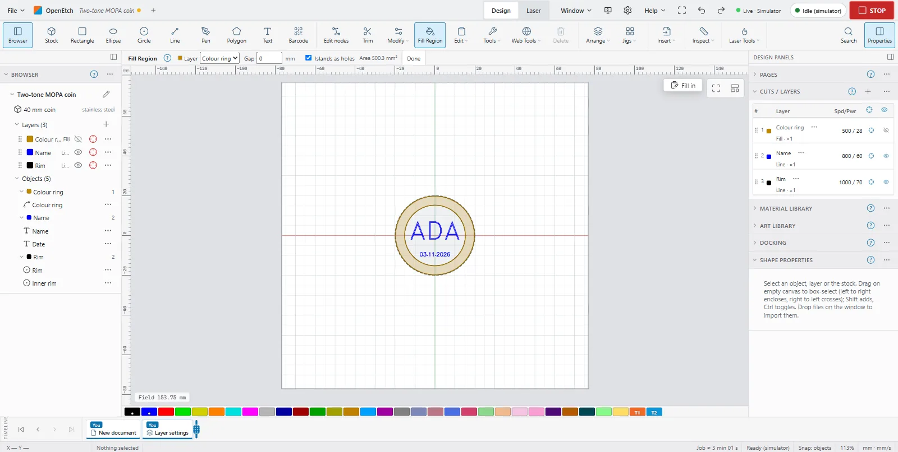

# Fill Region

Fill Region works like a paint bucket. You click inside an area enclosed by lines, and OpenEtch makes a new closed shape of exactly that area, on the layer you choose. The lines themselves stay as they are.

Use it to colour one part of a drawing: the ring between two circles on a coin, one petal of a flower, the background behind a name.

The Two-tone MOPA coin example's coloured ring was made this way (see [Templates](templates.md#example-projects)).

## Fill an area

1. Click **Fill Region** in the **Modify** group. On the phone it is in the tool strip.
2. In the bar, choose the **Layer** for the new shape.
3. Move the pointer inside an area. The area lights up and the bar shows its area.
4. Click. The new shape is made on the chosen layer.
5. Click **Done**, or press `Esc`, to leave the tool.

The lines are every vector shape on a visible layer, output on or off: shapes, paths and text (by its outline). Where lines cross, they split the areas. Images are not lines.

## Fill several areas at once

1. `Shift`+click each area to collect it. The bar shows **Collected: n**. `Shift`+click a collected area again to drop it.
2. Click one more area, press `Enter`, or click **Add (n)**.

All the collected areas are filled in one step, so one Undo removes them all. **Clear** forgets the collection; `Esc` clears it too, or leaves the tool when there is none.

## Fill region options

| Option | What it does |
|---|---|
| **Layer** | The layer the new shapes go on. It starts as the current layer |
| **Gap** | Closes openings narrower than this between lines, up to 10 mm. 0 means the lines must meet |
| **Islands as holes** | Shapes inside the area, like a pupil in an eye, stay holes in the new shape. Off fills over them |

## On a touch screen

1. Tap inside an area. It lights up.
2. Tap it again, or tap **Add**, to fill it.

A tap in another area shows that one instead. The modifier bar has no buttons for Fill Region, so on a touch screen you fill one area at a time. With a keyboard attached, hold `Shift` and tap to collect areas, as on a computer.

## When it does not fill

When a click or a tap does not find an area, the bar under the canvas says why. With several areas collected, the message starts with the point's number, for example **Point 2: That is on a line: click inside an area**.

- **"No closed area here: the lines around this point leave an opening (try a gap tolerance)"**: the lines do not quite meet. Raise **Gap** a little, or close the path (**Modify > Close path**).
- **"That is on a line: click inside an area"**: you clicked on a line. Click a little further in.

A failed fill changes nothing.

## Tips

- To leave some shapes out of the boundary, hide their layer first. Fill Region uses only lines on visible layers.
- Curves become straight pieces within 0.01 mm, which is far finer than the laser's spot.
- The new shape is an ordinary closed path. You can move it, offset it or edit its nodes.
- To fill the new shape with hatch lines when it burns, put it on a layer in **Fill** mode. On a **Line** layer it only burns its outline.

## Before you burn

A filled area takes much more energy than an outline. Before you test a new fill setting, work out the energy density:

J/mm² = power in W ÷ (speed in mm/s × line interval in mm)

For example, the Two-tone MOPA coin's Gold ring uses 28 % of a 60 W source (16.8 W) at 500 mm/s and a 0.01 mm interval: 16.8 ÷ (500 × 0.01) = 3.4 J/mm². Cross hatch runs the area twice, so double the figure.

On stainless steel with a 60 W MOPA, roughly 2 to 15 J/mm² marks without melting. Higher can melt or warp thin stock. Test on scrap first: see [Test grids](test-grids.md) and [Safety](safety.md).

> **Warning:** Wear eye protection rated for your laser's wavelength, run the fume extraction, and never leave a job unattended.
