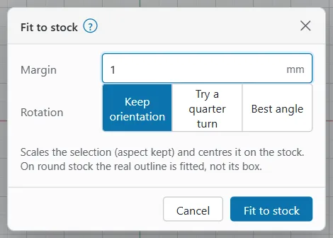

# Fit to stock

The stock is the piece of material you burn on: a coin, a tag, a plate. Once OpenEtch knows its size and shape, it can scale and centre your design to fill it.

## Define the stock

1. Click **Stock** in the **Create** group. On an iPad it is in the tool rail at the left (in its **More** flyout when the rail is short). On a phone, tap the **Canvas** tab, then **Stock** in the tool strip.
2. Choose **Rectangle** or **Circle**.
3. Give it a **Name**.
4. For a rectangle, set **Width**, **Height** and **Corner r** (the corner radius). For a circle, set **Diameter**.
5. Set the **Thickness** and **Material** (for example stainless 304). They are notes for focusing; the B6's Z height is not readable over USB.
6. Set **Centre X**, **Centre Y** and **Rotation** to where the piece sits in the field.
7. Click **OK**.

The stock shows on the canvas. To move it, click its outline to select it, then drag it or nudge it with the arrow keys. In Properties you can change its centre and rotation, click **Edit stock…** or **Remove stock**.

The stock never burns.

## Fit a design to the stock

1. Select the design. A group moves and scales as one.
2. Choose **Arrange > Fit to stock**. It is also in the right-click menu, under **Arrange**.

The design is scaled, with its proportions kept, and centred on the stock so it is as large as it can be inside the margin. A message tells you the scale, for example "Fitted to the stock (×1.250)".

On the phone, select the design and tap **Fit to stock** in the **Selection** sheet.

## Fit to stock options

To set the margin and rotation first, choose **Arrange > Fit to stock…**:

| Option | What it does |
|---|---|
| **Margin** | Space kept free between the design and the stock's edge, in mm (1 mm to start with) |
| **Rotation** | Rectangular stock only: **Keep orientation**, **Try a quarter turn** or **Best angle** |

Click **Fit to stock** to apply. This browser remembers the options, and the plain **Arrange > Fit to stock** uses them next time.

### Round stock

On a coin, the design's real outline is fitted, not its bounding box. A round or hexagonal design fills the coin edge to edge; a square box round it would leave the corners sticking out.

Rotation does not matter on round stock.

### Rectangular stock

On a rectangle, rounded corners are respected. **Rotation** decides whether the design may turn:

- **Keep orientation**: the design keeps its angle.
- **Try a quarter turn**: also tries it turned 90°, and keeps whichever is larger.
- **Best angle**: turns it by whatever angle makes it largest. The message says how far it turned.

> **Note:** Fit to stock scales the design to the largest size that fits. Check that small details, such as thin text, are still big enough to mark well. A design that grows also takes longer to burn, but the energy per mm² of each layer stays the same.

## Place on stock

**Place** puts the selection at a chosen point of the stock, with more control over the size.

1. Select the design.
2. Click **Place** in the **Insert** group. When the window is too narrow for the whole ribbon, the group folds into an **Insert** button: click **Insert**, then **Place**. On an iPad, **Place** is in the tool rail; on a phone, in the **Canvas** tab's tool strip. Place is greyed out until there is a stock (its tooltip says **Define a stock first**).
3. Click an **Anchor** in the grid: a corner, an edge or the centre.
4. Choose **Fit**:
   - **Keep size**
   - **Scale to fit inside stock**, with a **Margin**
   - **Scale to width** or **Scale to height**
   - **Exact size**, with **Width**, **Height** and **Keep aspect**
5. Set **Offset X** and **Offset Y** to move it from the anchor.
6. Click **Place**.

The anchor and offset are in the stock's own frame; "top" is the stock's +Y side, even when the stock is rotated.

> **Tip:** On a coin, **Scale to fit inside stock** fits the design's box inside the disc, which leaves it smaller than it could be. Use **Fit to stock** for round stock, or **Scale to width** with the coin's diameter less a margin.

## Centre on stock

To centre the selection on the stock without scaling it, choose **Arrange > Centre on stock**. On the phone, tap **Centre on stock** in the **Selection** sheet.

## Fit text to the stock

A text has its own **Fit to stock** button in Properties, under **Fit**. It centres the text on the stock and fits it into 80 % of it, and the text keeps fitting when you change the words. See [Auto-fit](text.md#fit-text-into-a-box-or-circle).

## When it does not fit

- **"Define the stock first (Create > Stock)."**: there is no stock yet.
- A margin that leaves no room on the stock is refused. Make it smaller.
- Locked objects cannot be scaled. Unlock them first (**Arrange > Unlock**). In a template that locks everything else, only the fill-in fields' texts are unlocked.

For several identical pieces in a holder, see [Jigs](jigs.md).
