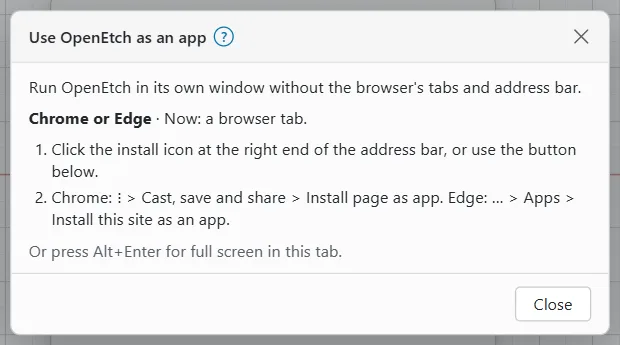
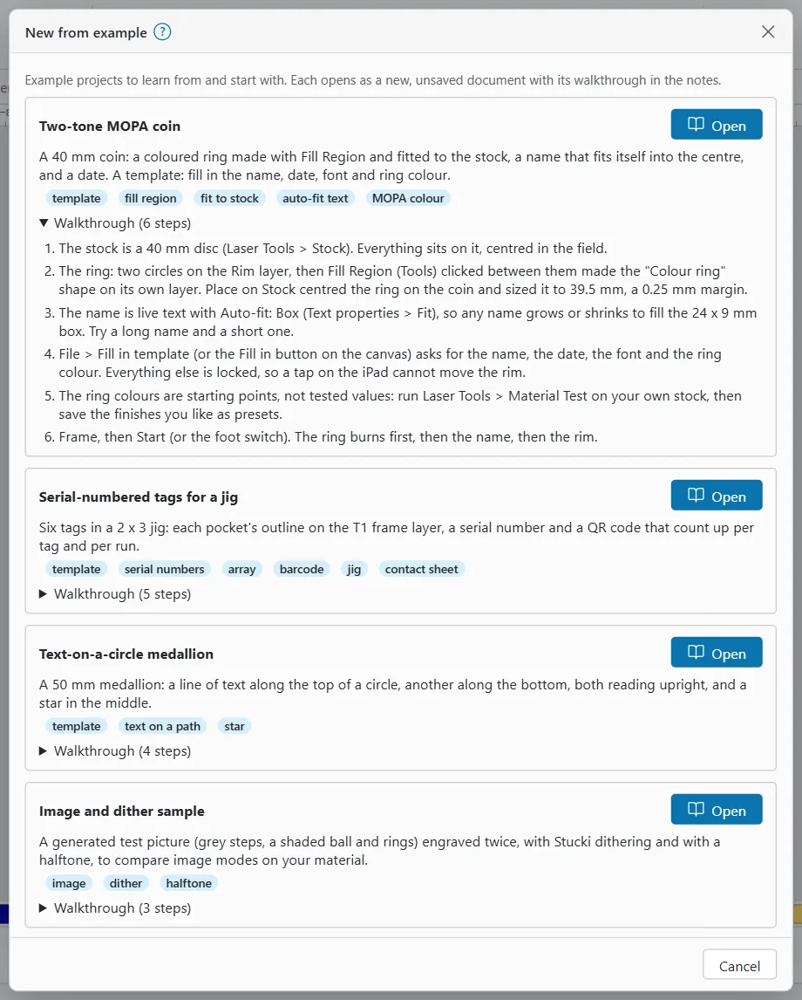

# Getting started

This page takes you from nothing to an open design. You run the engine once, then open the app in a browser on any device that can reach it.

## What you need {#what-you-need}

- A computer to run the engine: a Raspberry Pi 4 or 5 on the laser, or a PC or Mac. The engine is the only program that talks to the laser.
- A browser on each device you want to use: Chrome, Edge, Safari or Firefox on a PC or Mac, Safari on an iPad or iPhone, Chrome on Android.
- To build the engine from source: Rust 1.95 or newer with the `wasm32-unknown-unknown` target (`rustup target add wasm32-unknown-unknown`), and Node.js 22 or newer.
- For real burns: a supported galvo laser cabled to the engine's computer by USB. You can do everything else without a laser. The engine then drives a simulator.

> **Note:** The engine starts with the simulator unless you ask for the real laser with `--usb`. Use the simulator to learn the app. Nothing it does reaches a laser.

In this guide, `openetch` means the engine program. After a build it is `target/release/openetch` (`target\release\openetch.exe` on Windows). You can also run any engine command through Cargo, for example `cargo run --release -p engine -- token`.

## Run the engine on a PC or Mac {#run-on-a-pc}

To build and run the engine from a copy of the OpenEtch repository:

1. Build the app once. In the `web` folder run:

   ```sh
   npm install
   npm run wasm:tools
   npm run build
   ```

   `npm run wasm:tools` installs the build tools it needs (once per copy of the repository). The build writes the app to `web/dist`.

2. Start the engine from the repository folder:

   ```sh
   cargo run --release -p engine
   ```

3. Open `http://localhost:7878` in a browser on the same computer.

The engine prints the address to open and its MCP endpoint when it starts. By default it listens only on this computer (`127.0.0.1:7878`), drives the simulator and needs no access token. It looks for `web/dist` and the machine profile from the folder you start it in, so start it inside the repository.

The first time it runs, the engine also imports the LightBurn devices it finds on this computer. It only reads LightBurn's settings and never writes to them.

To drive a real laser over USB, build with USB support and add `--usb`:

```sh
cargo run --release -p engine --features usb -- --usb
```

> **Note:** On Windows the engine reaches the board only through the WinUSB driver. If it finds the board but says it is not on WinUSB, switch the driver with Zadig (USBLMCV4 to WinUSB). EzCad needs its own driver back afterwards.

> **Warning:** With `--usb` the engine drives the real laser. Read [Laser safety](safety.md) before you frame or burn anything.

### Other devices on your network {#pc-other-devices}

To use the app from an iPad or phone while the engine runs on your PC, make the engine listen on your network:

```sh
cargo run --release -p engine -- --listen 0.0.0.0:7878
```

Off this computer the engine then asks every device for its access token. When it starts, it prints a pairing link that carries the token. See [The access token](#access-token).

## Run the engine on a Raspberry Pi {#run-on-a-raspberry-pi}

On a Pi the engine sits on the laser and runs as a service, so it starts with the Pi. Every other device opens the app over your network.

> **Note:** Running on a Pi attached to the laser is new. The service set-up and the safe-restart script have so far been tested only with the simulator. The paths below are examples; use your own.

To set up the Pi:

1. Build the engine on the Pi with USB support:

   ```sh
   cargo build --release -p engine --features usb
   ```

   The program is `target/release/openetch`.

2. Build the app (`npm run build` in `web`). You can build it on a PC and copy the `web/dist` folder to the same place in the Pi's copy of the repository.
3. Plug the laser into the Pi by USB.
4. Set the operator PIN that approves burns (6 to 12 digits). Run this yourself in a terminal on the Pi (for example over ssh), as the user the service will run as:

   ```sh
   target/release/openetch set-pin --config-dir /opt/openetch/config
   ```

   It cannot be scripted. The digits show on screen while you type, so make sure nobody is watching. Restart the engine after you set or change the PIN. See [Running a job](running-a-job.md) for how approval works.

5. Create a systemd service, for example `/etc/systemd/system/openetch.service`. A minimal unit looks like this (change the paths and the user to yours):

   ```ini
   [Service]
   # User=<the user who owns /opt/openetch>
   WorkingDirectory=/opt/openetch
   ExecStart=/opt/openetch/target/release/openetch --usb --listen 0.0.0.0:7878 --config-dir /opt/openetch/config --shutdown-grace-secs 3600
   TimeoutStopSec=3660
   KillMode=mixed

   [Install]
   WantedBy=multi-user.target
   ```

   `WorkingDirectory` is the repository folder, so the engine finds `web/dist` and the machine profile.

6. Start the service (`sudo systemctl daemon-reload`, then `sudo systemctl enable --now openetch`). Then print the access token for your devices:

   ```sh
   target/release/openetch token --config-dir /opt/openetch/config
   ```

   Use the same `--config-dir` as the service, as a user who can read it.

### Stopping and restarting the engine {#stop-and-restart}

A stop or restart never cuts a burn short on its own. When the engine is asked to stop, it refuses new work and waits for a running job to finish, up to `--shutdown-grace-secs` (default 3600 seconds). A second stop signal, or the limit running out, aborts the job as **STOP** would.

- Set `TimeoutStopSec` a little longer than the grace time. Otherwise systemd kills the engine after 90 seconds, mid-burn.
- To restart only while no job runs, use `tools/pi/safe-restart.sh`. It refuses while a burn runs. It restarts the `openetch` service unless you name another with `--service`. When the engine listens on your network, give it the token in the `OPENETCH_TOKEN` environment variable.
- While it shuts down, the app shows an **ENGINE SHUTTING DOWN** badge in the top bar, or **ENGINE ABORTING JOB** when it aborts a job. **STOP** keeps working until the engine exits.

## Engine options you will use {#engine-options}

Run `openetch --help` for the full list.

| Option | What it does |
|---|---|
| `--listen <address>` | Where the engine serves the app. Default `127.0.0.1:7878` (this computer only). Use `0.0.0.0:7878` for your network. |
| `--usb` | Drive the real laser over USB. Needs a build with `--features usb`. Without it the engine drives the simulator. |
| `--no-token` | Ask for no access token, even off this computer. For a trusted home network only. |
| `--require-token` | Ask for the token on this computer too. For an HTTPS proxy on the same computer. |
| `--allow-host <name>` | Accept another host name, for example `openetch.local`. Repeat it for more names. |
| `--config-dir <path>` | Where the engine keeps its settings, devices, material libraries, operator PIN and access token. |
| `--projects-dir <path>` | Where your projects are saved. See [Files and projects](files-and-projects.md#projects-folder). |
| `--projects-mount <label>=<path>` | Show another folder as a top folder in Save and Open. |
| `--approval pin` or `--approval click` | How burns are approved: with the operator PIN typed in the app (default), or with no PIN, by **Start** in the app in a browser or the foot switch only. Never by an AI agent. |
| `--confirm-input <bit>` | After approval, also wait up to 30 seconds for a press on this machine input before the run starts. |
| `--device <id or name>` | Use this device for this run instead of the active one. |
| `--shutdown-grace-secs <s>` | How long a stop waits for a running job. Default 3600; 0 aborts at once. |

The engine also has commands of its own:

| Command | What it does |
|---|---|
| `openetch set-pin` | Set or change the operator PIN. `--reset` deletes a forgotten PIN after a confirmation phrase. |
| `openetch token` | Print the access token and a pairing link. `--rotate` makes a new token. |
| `openetch devices list` | List the devices. `openetch devices import <file>` imports devices from a LightBurn `.lbdev` file or `prefs.ini`. |
| `openetch profile from-lightburn` | Write a machine profile from a LightBurn device's settings. |

Give each command the same `--config-dir` as the engine.

Default folders, when you do not set them:

| System | Settings (`--config-dir`) | Projects (`--projects-dir`) |
|---|---|---|
| Windows | `%APPDATA%\openetch` | `%APPDATA%\openetch\projects` |
| macOS | `~/Library/Application Support/openetch` | `~/Library/Application Support/openetch/projects` |
| Linux and Raspberry Pi | `~/.config/openetch` | `~/.local/share/openetch/projects` |

On Linux, `XDG_CONFIG_HOME` and `XDG_DATA_HOME` change these when they are set.

## Open the app {#open-the-app}

Open the engine's address in a browser. On the engine's own computer that is `http://localhost:7878`. On another device use the engine computer's network address and port, `http://<engine address>:7878`.

To use a name such as `http://openetch.local:7878`, start the engine with `--allow-host openetch.local`. The engine refuses host names it does not know, to protect you from other websites. Plain IP addresses always work.

The app picks its layout from the screen size and whether you use a mouse or a finger. You can change it in **Preferences**. See [The workspace](the-workspace.md#layouts).

### On a PC {#open-on-a-pc}

Use Chrome, Edge or Firefox. A large window gets the wide layout with every panel beside the canvas. Press `F11` for the browser's full screen, or `Alt+Enter` for the app's own.

### On a MacBook {#open-on-a-mac}

Use Safari, Chrome or Edge. A MacBook window usually gets the compact layout: icon-only tools and a single bottom row, so the canvas keeps its room. Two-finger scrolling pans the canvas and pinching zooms.

### On an iPad {#open-on-an-ipad}

Use Safari. The iPad gets the tablet layout: tools in a rail down the left, panels that slide in from the sides, and a touch modifier bar for the keys a finger lacks. See [The workspace](the-workspace.md#tablet-layout).

### On a phone {#open-on-a-phone}

Use Safari on an iPhone or Chrome on Android. The phone gets its own layout: a full-screen canvas, four tabs at the bottom (**Canvas**, **Layers**, **Job**, **More**) and sheets that rise from the bottom. **STOP** stays at the top right at all times. See [The workspace](the-workspace.md#phone-layout).

## The access token {#access-token}

When the engine listens on your network, every device needs its access token once. The token stops other people on the network from using your laser.

On the engine's own computer (`localhost`) no token is needed, unless the engine runs with `--require-token`.

A device without a valid token sees the **Connect to OpenEtch** card instead of the app. Its **Where is the token?** section repeats the steps below.

To connect a device:

1. On the engine's computer, run `openetch token` (on a Pi, ssh in first, and add the service's `--config-dir`). It prints the token and a pairing link such as `http://<engine address>:7878/?token=…`.
2. On the device, open the pairing link. Or open the app and paste the token, or the whole link, into the **Access token** box of the **Connect to OpenEtch** card.
3. Leave **Remember on this device** ticked, then tap **Connect**.

The token stays the same when the engine restarts or is updated, so you pair each device once. With **Remember on this device** off, the token is kept only in this browser tab, until you close or reload it.

If the engine refuses a token, the card says **The engine refused that token. Check that it is the current one (`openetch token`).**

> **Tip:** **STOP** always works, even without the token. The **Connect to OpenEtch** card has its own **STOP** button.

### Making a new token {#rotate-token}

If a token may have leaked, make a new one:

1. Run `openetch token --rotate` (with the same `--config-dir`).
2. Restart the engine.
3. Pair every device again.

### Running without a token {#no-token}

On a network you trust completely, you can start the engine with `--no-token`. Anyone who can reach the port can then use the app and the MCP endpoint without a token. They can edit designs, frame with the red pointer and request runs.

A burn still needs a person at the app or the machine: the operator PIN typed in the app or, with `--approval click`, **Start** in the app or the foot switch. An AI agent can never approve one.

> **Warning:** Do not use `--no-token` on a shared, guest or public network.

### HTTPS {#https}

The app works over plain `http`. A few browser features need a secure (`https`) address: installing as an app in Chrome, Edge and Android, the browser camera, keeping the screen awake during a burn, and `Esc` staying with the app in full screen. On the engine's own computer, `localhost` counts as secure.

The engine has no HTTPS of its own. You can put an HTTPS proxy in front of it on the Pi. The repository's notes in `docs/https-on-the-pi.md` describe two ways (Tailscale or Caddy).

## Install OpenEtch as an app {#install-as-an-app}

You can run OpenEtch in its own window, without the browser's tabs and address bar.

To see the steps for your device:

- On a desktop, choose **Help > Use as an app…**. In the compact and tablet layouts, **Help** is in the **More** (⋯) menu at the top right.
- On a phone, tap **More**, then open **Help** and tap **Use as an app…**.

The **Use OpenEtch as an app** dialog shows the steps for the browser you are using. The first time you open the app on a touch device, it offers this dialog once by itself. Inside an app window the entry is not shown.



| Device | How to install |
|---|---|
| Safari on a Mac | Choose **File > Add to Dock…** in Safari's menu bar (macOS Sonoma or later), then **Add**. It opens already connected. |
| Chrome or Edge, over HTTPS | Click the install icon at the right of the address bar, or **Install OpenEtch** in the dialog. Or Chrome: **⋮ > Cast, save and share > Install page as app**; Edge: **… > Apps > Install this site as an app**. |
| Chrome or Edge, over http | Chrome: **⋮ > Cast, save and share > Create shortcut…**, tick **Open as window**, then **Create**. Edge: **… > Apps > Install this site as an app**. |
| iPad or iPhone | In Safari tap **Share**, choose **Add to Home Screen**, keep **Open as Web App** on, and tap **Add**. |
| Android | Over HTTPS: Chrome **⋮ > Install app**. Over http, **⋮ > Add to Home screen** makes a shortcut that opens a browser tab. |
| Firefox | No app windows on macOS. On Windows, Firefox 143 or later can pin a site with Taskbar Tabs (Firefox Labs). |

> **Note:** An iPad or iPhone Home Screen app keeps its own storage. It asks for the access token once, even if Safari already had it.

Where the platform supports app shortcuts, the installed app has a **Production cockpit** shortcut that opens the [Production cockpit](production-cockpit.md) directly.

## Start a design {#start-a-design}

An empty design shows the **Start a design** card in the middle of the canvas. It offers:

- **Import…**: bring in an SVG, DXF, image, LightBurn or other file. See [Files and projects](files-and-projects.md#import-files).
- **Open project…**: open a project saved on the engine.
- **Draw a rectangle** and **Add text**: pick that tool straight away.
- **Templates…**: start from a saved template.
- **Examples**: open one of the example projects below.

You can also drop a file anywhere on the canvas. The last line of the card shows the laser and its state, for example **Laser: ComMarker B6 MOPA 60W · Idle (simulator)**.

## Open an example project {#open-an-example}

OpenEtch comes with five example projects. Each one shows a few features and has a step-by-step walkthrough in its notes.

To open an example:

1. Choose **File > New from example…**. Or click **Examples** on the empty canvas card. On a phone, tap **More**, open **File**, then **All file commands > New from example…**.
2. In the **New from example** dialog, read the summary. Open **Walkthrough** to see the steps.
3. Click **Open** beside the example.
4. If your current design has unsaved changes, choose **Discard and start new**, or **Cancel** and save first.

The example opens as a new, unsaved document laid out for your active laser. The **Notes** window shows its walkthrough. To keep your own copy, choose **File > Save as…**; the name box suggests the example's title.



| Example | What it shows |
|---|---|
| **Two-tone MOPA coin** | A 40 mm coin with a coloured ring made with Fill Region, a name that fits itself into the centre, and a date. A template you fill in. |
| **Serial-numbered tags for a jig** | Six tags in a 2 x 3 jig with serial numbers and QR codes that count up per tag and per run. |
| **Text-on-a-circle medallion** | A 50 mm medallion with text along the top and bottom of a circle, both reading upright, and a star in the middle. |
| **Image and dither sample** | A generated test picture engraved twice, with Stucki dithering and with a halftone, to compare image modes. |
| **Frost, black and colour palette coin** | A 40 mm coin in three sectors, one per finish, each on its own layer. |

> **Warning:** The settings in the examples are starting points, not tested values for your laser or material. Before you burn one, check its energy density (see below) and run a material test on a spare piece. See [Test grids](test-grids.md).

## Before you burn anything {#before-you-burn}

OpenEtch is safe to explore on the simulator. Before your first real burn:

1. Read [Laser safety](safety.md). Wear eye protection rated for your laser's wavelength (1064 nm for a fibre laser). Run fume extraction. Never leave a running job unattended. Know where the laser's hardware emergency stop is.
2. Set how burns are approved: the operator PIN (`openetch set-pin`, then restart the engine) or `--approval click`. Without a PIN, and without `--approval click`, no run can be approved. The foot switch starts burns only with `--approval click`. See [Running a job](running-a-job.md).
3. Work out the energy density of each new setting before you use it.

> **Warning:** With `--approval click` there is no PIN. Any program on the engine's computer can then start a burn the way the app does. If an AI agent can run programs or control the browser on that computer while nobody watches the laser, use the PIN instead.

### Energy density, simply {#energy-density}

Energy density tells you how much laser energy lands on each square millimetre. It decides whether a setting marks, colours or melts.

**Energy density (J/mm²) = power (W) ÷ (speed (mm/s) × line interval (mm))**

For power, use the laser's rated power times the power percentage. For example, 50 % of a 60 W laser is about 30 W. At 300 mm/s with a 0.02 mm interval:

30 ÷ (300 × 0.02) = 30 ÷ 6 = **5 J/mm²**

On stainless steel with a 60 W MOPA, roughly 2 to 15 J/mm² marks without melting. Higher values can melt or warp thin stock. Slower speed, a finer interval or more power all raise the energy. Treat these numbers as a guide and test on scrap first.

## Next steps {#next-steps}

- Take the tour of [The workspace](the-workspace.md).
- Learn to open, save and import in [Files and projects](files-and-projects.md).
- Start drawing with [Drawing and editing](drawing-and-editing.md).
