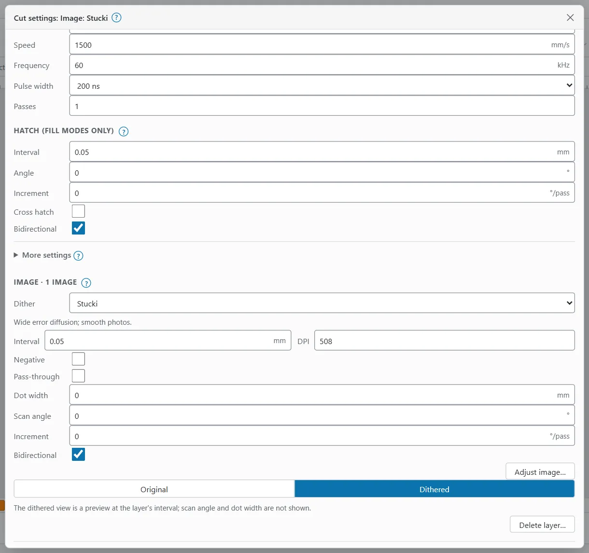
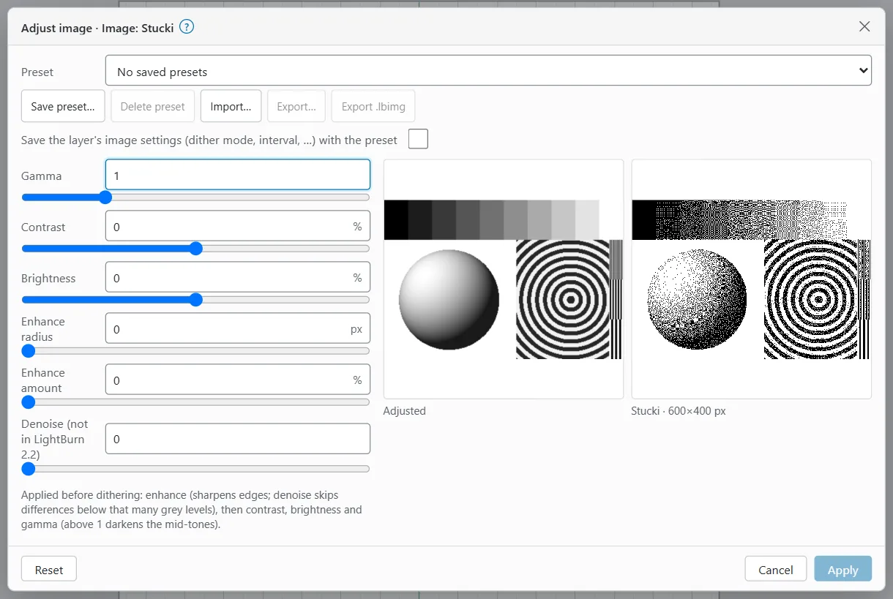
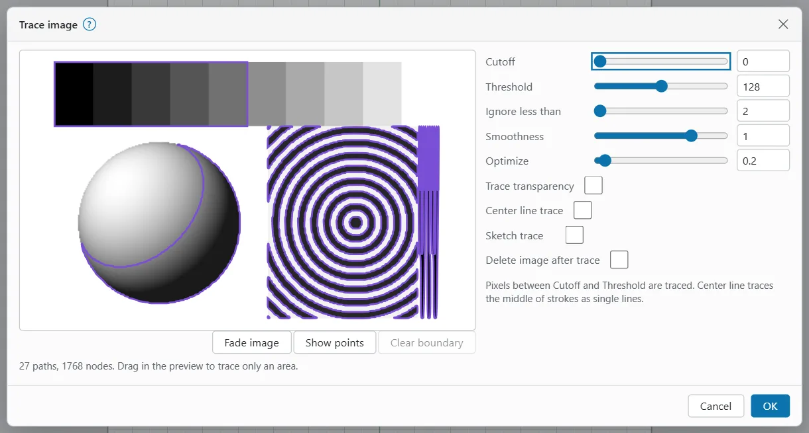

# Images

An image engraves dot by dot. How it looks on metal depends on the image itself, its adjustments, and the image settings of the layer it is on.

## Import an image {#import-an-image}

To bring in a picture, do one of these:

- Click **Import** in the **Insert** group, or press `Ctrl+I`.
- Choose **File > Import…**
- Drop the file on the window.
- Copy an image in another program and paste it (`Ctrl+V`) with **Use the system clipboard** on in the **Edit** menu (up to 50 MB).

On the phone, use **More > File > Import…**

OpenEtch reads PNG, JPEG, GIF, BMP, WebP, TIFF and TGA. The image is sized from its own resolution (or 254 DPI, 0.1 mm per pixel, when it has none), and shrunk to fit 80 % of the field if it is larger.

## How an image engraves {#how-images-engrave}

Three things decide the result:

1. **The image's adjustments**: gamma, contrast, brightness and sharpening. Each image has its own. See [Adjust image](#adjust-image).
2. **The layer's image settings**: the dither mode, the line interval and the scan direction. Every image on a layer shares them. See [Image settings](#image-settings-on-a-layer).
3. **The layer's power, speed and frequency**, as for any layer. See [Layers and settings](layers-and-settings.md).

Adjustments are applied first, then the dither turns the grey levels into dots.

## Image settings on a layer {#image-settings-on-a-layer}

Open the layer's cut settings (double-click the layer in **Cuts / Layers**, or select the layer and look in Properties). A layer that holds images has an **Image** section:

| Setting | What it does |
|---|---|
| **Dither** | How grey levels become dots (see the table below) |
| **Interval** / **DPI** | The distance between lines; type either one |
| **Negative** | Swaps light and dark |
| **Pass-through** | Engraves the image's own pixels unchanged, one dot per pixel, for a picture already dithered elsewhere. Interval and scan angle are not used |
| **Dot width** | Corrects for the size of the laser's dot |
| **Scan angle** | The direction of the lines |
| **Increment** | Turns the scan angle on each pass |
| **Bidirectional** | Marks in both directions |
| **Cells**, **Halftone angle** | Halftone only: cells per inch and the screen angle |
| **Min power** | Grayscale only: the power for white |

### Dither modes {#dither-modes}

| Mode | Best for |
|---|---|
| **Threshold** | Black or white at 50 % grey: logos and line art |
| **Ordered** | A regular 8x8 pattern: fast, with a visible texture |
| **Atkinson** | Error diffusion that keeps highlights and shadows crisp |
| **Dither** | Floyd-Steinberg error diffusion |
| **Stucki** | Wide error diffusion: smooth photos |
| **Jarvis** | Wide error diffusion: the usual choice for photos |
| **Newsprint** | Clustered 45° dots, like newspaper print |
| **Halftone** | Round dots on a screen of the given cells per inch and angle |
| **Sketch** | Keeps edges and drops flat areas |
| **Grayscale** | Varies the power per pixel between **Min power** and the layer's power |
| **3D Sliced** | A depth map, one grey-level slice per pass (see [3D Sliced](#models-and-3d-sliced)) |

The Image and dither sample example engraves one test picture twice, with Stucki and with Halftone, so you can compare them on your material (see [Templates](templates.md#example-projects)).

### See the dither on the canvas {#dithered-view}

Under the layer's Image settings, switch **Images on the canvas** between **Original** and **Dithered** to see the images as they will engrave. The Laser panel has the same switch as **Dithered images**. The dithered view is a preview at the layer's interval; it does not show the scan angle or dot width. The engine plans the real job.

## Adjust image {#adjust-image}

To adjust an image:

1. Select the image.
2. Right-click it and choose **Adjust image…** (in a long right-click menu it is under **Modify**), or press `Alt+I`. The layer's Image section also has an **Adjust image…** button.
3. Move the sliders. The two previews show the **Adjusted greyscale** and the **Dithered preview**.
4. Click **Apply**. **Reset** goes back to the defaults; **Cancel** changes nothing.

| Slider | What it does |
|---|---|
| **Gamma** | Above 1 darkens the mid-tones |
| **Contrast** | Spreads the grey levels apart or together |
| **Brightness** | Lightens or darkens everything |
| **Enhance radius**, **Enhance amount** | Sharpens edges over this many pixels, by this much |
| **Denoise** | Skips differences below this many grey levels when sharpening (not in LightBurn 2.2) |

The dialog works on the images of one layer. Tick **Apply to all n images** to adjust every image on the layer the same way.

### Adjust image presets {#adjust-image-presets}

To reuse adjustments:

- **Save preset…** saves the current sliders under a name. Tick **Save the layer's image settings (dither mode, interval, …) with the preset** to keep those too. A preset with the same name is replaced.
- **Preset** picks a saved preset.
- **Delete preset** removes it.
- **Import…** reads OpenEtch presets or LightBurn's .lbimg files; **Export…** and **Export .lbimg** save them.

The engine keeps presets, so every browser sees the same ones.

## Masks {#masks}

A mask engraves only the part of an image inside a shape, like a picture in a frame.

To mask an image:

1. Draw a closed shape over the part to keep. An inner shape cuts a hole.
2. Select the image and the shape.
3. Right-click and choose **Apply mask to image**.

The mask stays an editable shape: move or reshape it and the image follows. Put the mask on a tool layer, or a layer with output off, so it does not burn.

With a masked image selected, the right-click menu also has:

- **Remove mask from image**: shows the whole image again (the shape stays).
- **Flatten image mask**: bakes the mask into the image (outside becomes transparent, which never fires) and deletes the mask shape.
- **Crop image to mask**: flattens the mask and cuts the image down to the masked area.

On a touch screen, long-press for the menu.

## Trace image {#trace-image}

Tracing turns a picture into vector outlines you can cut, fill or edit.

1. Select the image.
2. Right-click it and choose **Trace image…**, or press `Alt+T`.
3. Adjust the settings while you watch the **Trace preview**:
   - **Cutoff** and **Threshold**: pixels with a brightness between the two are traced.
   - **Ignore less than**: drops specks smaller than this many pixels.
   - **Smoothness**: turns corners into curves.
   - **Optimize**: reduces the number of nodes.
   - **Trace transparency**: traces the opaque area of a picture with a transparent background.
   - **Center line trace**: traces the middle of strokes as single lines.
   - **Sketch trace**: uses local contrast, for sketches.
   - **Delete image after trace**: removes the picture afterwards.
4. To trace only part of the picture, drag a box in the preview. **Clear boundary** removes it.
5. Click **OK**.

**Fade image** and **Show points** help you judge the preview. The line under it shows how many paths and nodes the trace makes. The result is one path object.

> **Tip:** After tracing, **Modify > Optimize shapes…** can smooth jagged outlines and rebuild arcs. See [Path tools](drawing-and-editing.md#path-tools).

### Multi-File Trace {#multi-file-trace}

To trace many pictures with the same settings, choose **Tools > Multi-File Trace…**:

1. Under **Trace**, pick **Selected images (n)**, or pick **Image files** and click **Choose images…**
2. Set **Resolution when the file has none**.
3. Under **Result**, pick **Download the SVGs (one .zip)** or **Add the traced vectors to the document**. Tick **Delete the images after tracing** if you want.
4. Click **Trace**.

## Convert to bitmap {#convert-to-bitmap}

Converting renders vector shapes into one image, for example to engrave them with a dither.

1. Select the vector shapes.
2. Right-click and choose **Convert to bitmap…**, or press `Ctrl+Shift+B`.
3. Set the **DPI**. The dialog shows the size in pixels.
4. Choose **Render**: **Use cut settings** (line layers outlined, fill layers filled), **Fill all** or **Outlines only**.
5. Set the **Grey level** for drawn pixels (128 is LightBurn's 50 %) and the **Line width**.
6. Tick **Keep the vectors** to keep the originals.
7. Click **OK**.

The rest of the image is white and never fires. A bitmap over 100 megapixels is refused; lower the DPI.

## Replace, refresh and export {#replace-and-export}

Right-click an image for:

- **Replace image…**: puts in another file at the file's own size, keeping the place, rotation, layer, adjustments, mask and cut settings.
- **Replace image to fit…**: puts in another file, fitted inside the old size.
- **Refresh image (pick the edited file)…**: after you edited the picture elsewhere, picks the new version and stretches it to the old size.
- **Export image…**: downloads the file as it was imported.
- **Save processed bitmap…**: downloads the image as it will engrave, after adjustments and dither.

The last two are also under **File > Export**.

## 3D models and 3D Sliced {#models-and-3d-sliced}

3D Sliced engraves a depth map in layers, deepest first, for galvo deep engraving. Black is the deepest.

> **Warning:** The depth reached on the reference laser has not been checked on hardware. Treat every number here as a starting point for tests on scrap. Deep engraving runs many passes, so check the energy density of each pass and watch the job the whole time.

### Import a 3D model {#import-a-3d-model}

To engrave a 3D model, import it (STL, OBJ, OFF, PLY, 3MF or AMF). The **Import 3D model** dialog renders it as a depth map seen from above, with the top white and the floor black:

| Option | What it does |
|---|---|
| **Width** | The size of the depth map; empty keeps the model's own size |
| **Rotate X**, **Rotate Y**, **Rotate Z** | Turns the model before rendering |
| **DPI** | Resolution (254 DPI is 0.1 mm per pixel; 10 to 2540) |
| **Depth cutoff** | The floor, this far below the top; empty uses the lowest point |
| **16-bit grey** | More grey levels |
| **Invert** | Swaps high and low |
| **Transparent background** | Leaves the area round the model empty |
| **Equalize** | Spreads the grey levels |
| **Generate outline** | Adds the model's outline as a shape |

To change these later, right-click the depth map and choose **Edit 3D model…**, then click **Render again**. The depth map is rendered again in place from the model kept in the project.

### Set up 3D Sliced {#set-up-3d-sliced}

1. Put the depth map on its own layer.
2. In the layer's Image settings, set **Dither** to **3D Sliced**.
3. Set **Slices**: the number of passes. Pass k of N engraves where the depth map is darker than (N − k) / N, so black gets every pass.
4. Tick **Enable cleanup pass** to add a light cleanup pass, and set **Clean after # of passes**. **Clean whole image** cleans the whole picture, not only the slices.

To see the expected relief before you burn, use the [3D relief preview](relief-preview.md).

## Check the energy before you burn {#image-energy-check}

Even a light-looking dither can melt thin stock if the settings are too strong. Before you test a new image setting, work out the energy density of a fully black area:

J/mm² = power in W ÷ (speed in mm/s × line interval in mm)

The power in watts is the layer's power % of your source's rating. For example, the Image and dither sample example uses 35 % of a 60 W source (21 W) at 1500 mm/s and a 0.05 mm interval: 21 ÷ (1500 × 0.05) = 0.28 J/mm².

On stainless steel with a 60 W MOPA, roughly 2 to 15 J/mm² marks without melting; much more can melt or warp thin stock. Image settings often sit lower, because the dots overlap. Run a test on scrap first: see [Test grids](test-grids.md) and [Safety](safety.md).

> **Warning:** Wear eye protection rated for your laser's wavelength, run the fume extraction, and never leave a job unattended.
