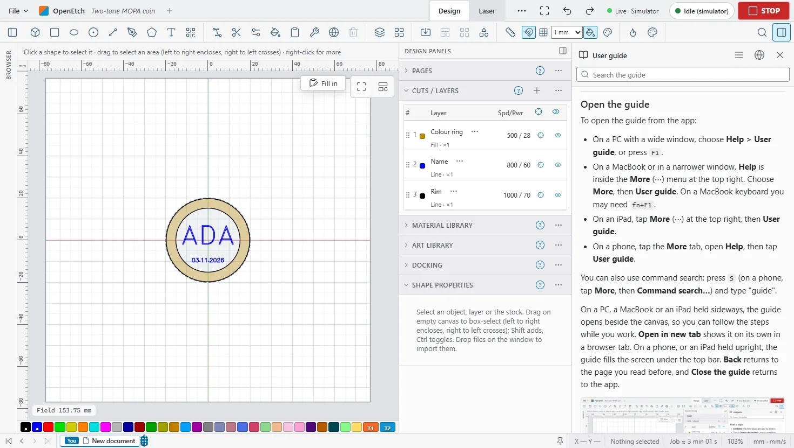

# OpenEtch user guide

OpenEtch is open-source software for designing jobs and running them on galvo fibre lasers with BJJCZ (LMC) boards. It works much like LightBurn. You draw or import a design, put shapes on layers with cut settings, preview and frame the job, then start the burn. The reference machine is a ComMarker B6 MOPA 60 W.

This guide shows you how to use the app on a PC, a MacBook, an iPad and a phone.

New to OpenEtch? Follow [Your first job](getting-started.md#your-first-job): one job from opening an example to the finished burn, step by step.

## Find a topic

- **Contents** lists every page, grouped by section.
- Type in **Search the guide** to search page titles, headings and text.
- A small **?** button next to a panel, a dialog or a tool bar opens the guide at the part that explains it.
- Pages marked **Needs a laser** only matter when a laser is connected.

## Contents

**Getting started**

- [Getting started](getting-started.md): Run the engine on a Raspberry Pi or a PC, open the app on a PC, Mac, iPad or phone, connect with the access token, install it as an app and open an example project.
- [The workspace](the-workspace.md): A tour of the app - top bar, Design and Laser workspaces, ribbon, docks, timeline, document tabs, command search and status bar - and the iPad and phone layouts, themes and language.
- [Files and projects](files-and-projects.md): Create, open and save projects on the engine, use autosave and backups, import SVG, DXF, images, LightBurn and other files, export to SVG, DXF, PDF and LightBurn, and move settings with bundles.

**Designing**

- [Drawing and editing](drawing-and-editing.md): Where the drawing tools are on each screen, pan and zoom, the Edit menu and curve tolerance, undo and redo with the timeline, and the pages for each kind of edit.
- [Drawing shapes](drawing-shapes.md): Draw rectangles, ellipses, circles, lines, curves, polygons and stars, and change a shape's size and corners in Shape properties.
- [Selecting and transforming](selecting-and-transforming.md): Select objects with clicks, boxes and keys, then move, rotate, scale, slant and mirror them on the canvas, with the keyboard or by exact numbers.
- [Snapping and guides](snapping-and-guides.md): Snap to the points and outlines of other objects or to the grid, place guides to line things up, and measure distances and angles.
- [Nodes and path editing](nodes-and-paths.md): Edit a path's nodes and curves, trim pieces off, combine shapes, offset outlines, round corners, tidy paths, and warp or deform a selection.
- [Arranging and arrays](arranging-and-arrays.md): Align, distribute, centre, flip and order objects, move them to a page position or dock them together, group and lock them, and make grid and circular arrays or nest parts.
- [Text](text.md): Add and edit text, choose fonts and keep favourites, bend text, fit it into a box or circle, put it on a path and convert it to shapes.
- [Variable text and barcodes](variable-text-and-barcodes.md): Serial numbers, dates, CSV fields and cut-setting text, the Variable Text window, barcodes and QR codes, and the Check every row contact sheet.
- [Images](images.md): Import photos and pictures, adjust them, choose a dither mode, trace them to vectors, mask them, and engrave depth maps with 3D Sliced.
- [Fill Region](fill-region.md): The Fill Region tool, a paint bucket that makes a closed shape of exactly the area you click between lines.
- [Fit to stock](fit-to-stock.md): Define the stock, then scale and centre a design to fill a coin, tag or plate with Fit to stock, Place on stock and Centre on stock.
- [Art Library](art-library.md): Keep reusable artwork in libraries on the engine, add it to any project, and load or save LightBurn .lbart libraries.
- [Templates and examples](templates.md): Fill in templates on any device, make your own templates with fill-in fields and locks, and learn from the built-in example projects.

**Layers and materials**

- [Layers and cut settings](layers-and-settings.md): Put shapes on layers and set how each layer burns on a galvo laser: mode, power, speed, frequency, pulse width, interval, passes, sub-layers and burn order.
- [Material libraries and presets](material-libraries.md): Keep cut settings as presets in LightBurn .clb material libraries, and assign or link them to layers.
- [MOPA colour](mopa-colour.md): Record what each preset gives on the material, preview the colours a design should come out, nudge a colour warmer or cooler, and separate an image into colour layers.
- [Test grids](test-grids.md): Make material, interval, focus and bracket test grids, check their energy density first, and read the results.
- [3D relief preview](relief-preview.md): See in 3D how deep a job engraves and in what order, before a long burn.

**Running jobs**

- [Laser safety](safety.md): Eye protection, fume extraction, energy density checks, the STOP button, the safety checks OpenEtch makes before a burn, and what AI agents can and cannot do. (Needs a laser)
- [Preview and framing](preview-and-framing.md): Check the toolpath and the time estimate in the Laser workspace, play the burn order, and trace the job on the work with the red pointer before you burn.
- [Running a job](running-a-job.md): Start or approve a burn, use the foot switch to frame then burn, pause, resume and stop, pause at a layer, repeat jobs and use the job counter. (Needs a laser)
- [Pre-flight warnings and keep-out zones](preflight-and-keep-out.md): The warnings OpenEtch shows next to Start, how to fix or mute them, objects outside the field, and keep-out zones that the laser must never mark. (Needs a laser)

**Production**

- [Re-mark a region](remark-region.md): Burn only part of a job again, inside a rectangle or a lasso you draw, to touch up a spot without re-marking the whole part. (Needs a laser)
- [Job ledger](job-ledger.md): Find every run in the job log, see the settings it burned with, mark parts OK or scrap, and re-run a job exactly as it burned. (Needs a laser)
- [Production cockpit](production-cockpit.md): A full-screen operator view for batch work at the laser, with the machine state, the count and Stop at, the next serial numbers, Start, STOP, the foot switch and a design lock. (Needs a laser)
- [Jigs](jigs.md): Make a jig with numbered pockets, place a design in every pocket, choose the numbering and leave empty pockets out.
- [Serial ledger](serial-ledger.md): See which serial number or CSV row went on which pocket in every run, save it as CSV, use Stop at End, and re-mark one pocket with the same value. (Needs a laser)
- [Notifications](notifications.md): Send job events to your phone with ntfy, to any web service with a webhook, or to Home Assistant. (Needs a laser)
- [Hour meter and maintenance](maintenance.md): See how many hours each laser device has marked, and set reminders such as cleaning the lens every 40 hours or every 500 runs. (Needs a laser)
- [Extractor](extractor.md): Switch the fume extractor on for every job, keep it running after the job, and refuse Start until it runs. (Needs a laser)

**Setup and reference**

- [Devices and calibration](devices-and-calibration.md): Add and switch laser devices, import them from LightBurn or EzCad, edit device settings, load a lens correction file, calibrate the galvo lens and the red dot, and set up a rotary. (Needs a laser)
- [Settings](settings.md): Preferences for display, units, snapping and input, layer and optimisation defaults, importing LightBurn preferences, and preference backups and bundles.
- [Camera](camera.md): Use a camera over the work area to see the stock under your design: capture a frame, calibrate the camera lens, align it to the galvo field and show the overlay. (Needs a laser)
- [AI agents](ai-agents.md): Connect an AI agent to OpenEtch over MCP, what tools it gets, why it can never approve or start a burn, and how to ask it for good work.
- [Keyboard shortcuts](keyboard-shortcuts.md): Every keyboard shortcut in OpenEtch, how to open the list, how to change a key, and which keys browsers keep for themselves.
- [Troubleshooting](troubleshooting.md): Fixes for common problems: cannot connect, access token, no laser, refused starts, slow preview, missing fonts after a LightBurn import, wrong field size, bug reports, logs and updates.

## Open the guide

To open the guide from the app:

- On a PC with a wide window, choose **Help > User guide**, or press `F1`.
- On a MacBook or in a narrower window, **Help** is inside the **More** (⋯) menu at the top right. Choose **More**, then **User guide**. On a MacBook keyboard you may need `fn+F1`.
- On an iPad, tap **More** (⋯) at the top right, then **User guide**.
- On a phone, tap the **More** tab, open **Help**, then tap **User guide**.

You can also use command search: press `S` (on a phone, tap **More**, then **Command search…**) and type "user guide", then choose **User guide**.

On a PC, a MacBook or an iPad held sideways, the guide opens beside the canvas, so you can follow the steps while you work. **Open in new tab** shows it on its own in a browser tab. On a phone, or an iPad held upright, the guide fills the screen under the top bar.

The guide's bar shows which page you are on. **Back** (the arrow at the left of the bar) returns to the page you read before. On a phone it is always there; beside the canvas it appears once you have followed a link. **Close the guide** (×), or `Esc`, returns to the app. A long page starts with an **On this page** list of its sections. Click or tap a picture to see it full size; click it again to see it at its own size, and press `Esc` or **Close** to go back.

When you open the guide with a **?** inside a dialog, the dialog stays open: beside the guide on a wide screen, or under it on a phone. Close the guide to carry on in the dialog.

## How OpenEtch fits together

OpenEtch has two parts.

- **The engine** is a small program. It runs on a Raspberry Pi that sits on the laser, or on a PC or Mac cabled to the laser. It holds your design, keeps your projects and settings, and is the only part that talks to the laser.
- **The app** runs in a web browser. The engine serves it, so you install nothing on your PC, Mac, iPad or phone. You can also add it to your Dock or Home Screen as an app.

Every browser connected to the same engine shows the same live design. A change you make on the iPad appears on the PC straight away.

AI agents can connect to the engine too, through its MCP endpoint. An agent can design with the same commands you use, and each change it makes appears in the timeline with the agent's name. An agent can also frame with the red pointer and prepare a run, but it can never approve or start a burn. Only a person can: with the operator PIN in the app or, when the engine runs with `--approval click`, with **Start** in the app or the foot switch. See [AI agents](ai-agents.md).

> **Note:** Many features have so far only run on the engine's simulator, not on a real laser. Settings in this guide are starting points to test on your own material, never guaranteed results.

## How this guide is organised

The pages are in six sections, in the order you are likely to need them:

1. **Getting started**: install, connect and find your way around.
2. **Designing**: draw, write text, import images and prepare a design.
3. **Layers and materials**: cut settings, material libraries and MOPA colour.
4. **Running jobs**: safety, preview, framing and the burn itself.
5. **Production**: repeat jobs, jigs, serial numbers and machine care.
6. **Setup and reference**: devices, preferences, agents, shortcuts and fixes.

Every page is listed by section under [Contents](#contents) near the top of this page.

Some pages only matter when a laser is connected. A copy of OpenEtch made for design only can leave those pages out.

### How the pages are written

- Buttons, menus and messages are written in **bold**, exactly as the app shows them.
- A menu path such as **File > Save as…** means: open the **File** menu, then choose **Save as…**
- Keys are written like `Ctrl+S`. On a Mac, iPad or iPhone, use `Cmd` where the guide says `Ctrl`, and `Option` where it says `Alt`. The app shows Apple key symbols there.
- Where the desktop and the phone or iPad differ, each page says where to find a thing on both.
- **Note**, **Tip** and **Warning** boxes mark extra information, shortcuts and safety points.
