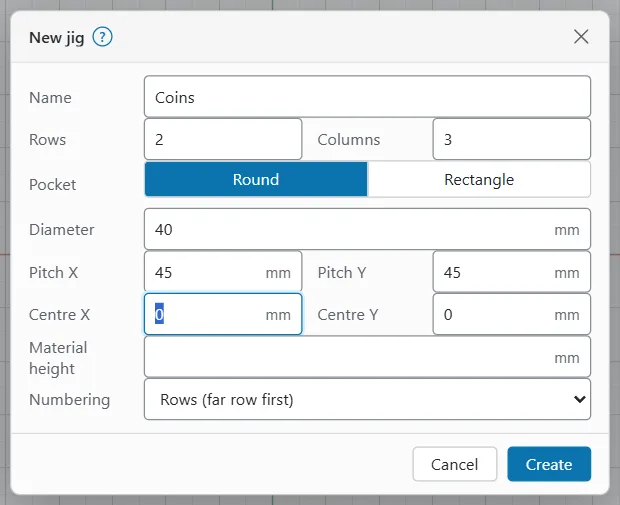
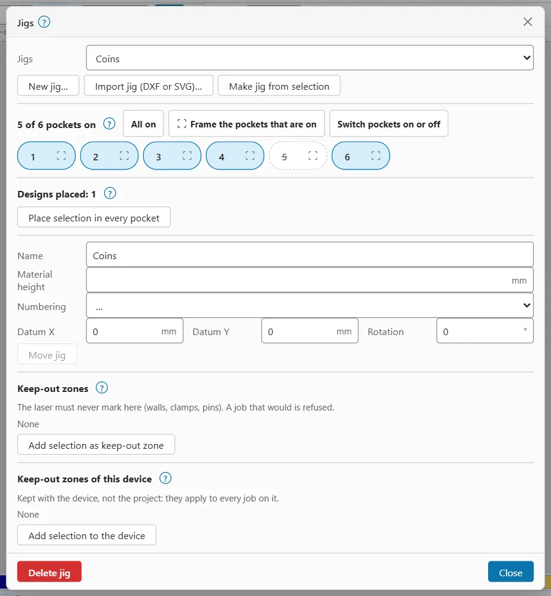
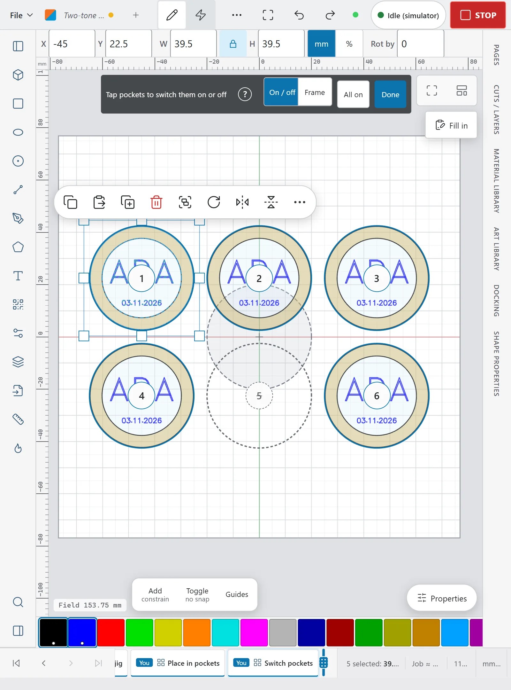

# Jigs

A jig is a plate that holds several blanks in pockets, so you can mark a whole set in one run. In OpenEtch, a jig is saved with the project. It has numbered pockets, a datum, an optional plate outline, a material height and keep-out zones.

You design the part once. OpenEtch puts it in the first pocket and places linked copies in every other pocket. Serial numbers count on from pocket to pocket.

You make jigs in the **Design** workspace. Framing a pocket needs a laser connected.

## The Jigs menu {#jigs-menu}

On a desktop, the **Jigs** dropdown is in the **Arrange** group of the **Design** workspace's ribbon. On a phone, it is in the tool strip of the **Canvas** tab. The items are also in command search.

| Item | What it does |
|---|---|
| **New jig…** | Makes a grid of pockets. See [Make a jig as a grid](#new-jig). |
| **Import jig (DXF or SVG)…** | Reads a drawing of your jig. See [From a DXF or SVG file](#import-jig). |
| **Make jig from selection** | Turns closed shapes you drew into pockets. See [From shapes you drew](#jig-from-selection). |
| **Place selection in every pocket** | Puts the selected design in every pocket that is on. With several jigs, pick the jig from the submenu (**Place selection in “Coins”**). |
| **Switch pockets on or off** | Lets you tap pockets on the canvas. While it is active, the item reads **Done**. |
| **Re-mark a region…** | Marks part of the job again. See [Re-mark a region](remark-region.md). |
| **Jigs…** | Opens the Jigs window. In command search it is "Jigs window". |

On the canvas, every jig shows:

- its plate outline, when it has one;
- its pockets, with the number just inside each pocket's top edge;
- pockets that are off, drawn dashed;
- a small cross at the datum;
- keep-out zones, hatched.

A project can hold up to 32 jigs.

## Make a jig as a grid {#new-jig}

To make a jig with pockets in rows and columns:

1. Measure your real jig: the pocket size, and the distance from the centre of one pocket to the centre of the next.
2. Choose **Jigs > New jig…**.
3. Fill in the fields (see the table below).
4. Press **Create**.

OpenEtch says, for example, "Jig “Coins” added (6 pockets)".

| Field | What it is |
|---|---|
| **Name** | The jig's name. Leave it empty for "Jig 1", "Jig 2" and so on. |
| **Rows** and **Columns** | The number of pockets each way. At most 500 pockets in all. It starts at 2 rows and 3 columns. |
| **Pocket** | **Round** or **Rectangle**. |
| **Diameter** | The size of a round pocket (25 mm to start with). |
| **Width**, **Height** and **Corner radius** | The size of a rectangular pocket. |
| **Pitch X** and **Pitch Y** | The distance from the centre of one pocket to the centre of the next, across and down (32 mm to start with). |
| **Centre X** and **Centre Y** | Where the centre of the grid goes. This is the jig's datum. It starts at the centre of the stock. |
| **Material height** | The height of the blanks' top surface. Optional. OpenEtch keeps it with the jig as a note for the operator; it does not set the focus. |
| **Numbering** | The order of the pocket numbers. See [Pocket numbering](#numbering). |

If something is wrong, the dialog says so and **Create** is greyed out:

- "Rows and columns must be whole numbers, at most 500 pockets."
- "The pitch is smaller than a pocket: pockets would overlap."
- "Give the pocket a size."

## Make a jig from a drawing {#jig-from-drawing}

Use a drawing when the pockets are not in a simple grid.

### From shapes you drew {#jig-from-selection}

To make a jig from shapes:

1. Draw a closed shape where each pocket is, for example circles or rectangles. Any closed outline works.
2. If you want a plate outline, draw one large outline around all the pockets.
3. Select all the shapes.
4. Choose **Jigs > Make jig from selection**.

Each closed outline becomes a pocket. With three or more outlines, the largest outline that holds all the others becomes the plate outline instead. The datum is the centre of the pockets.

The shapes you selected become part of the jig, so they leave the design. Undo brings them back. If the selection has no closed shapes, OpenEtch says "Select closed shapes for the pockets."

### From a DXF or SVG file {#import-jig}

To use a drawing of your jig, for example from the CAD file it was cut from:

1. Choose **Jigs > Import jig (DXF or SVG)…**.
2. Pick the file.

OpenEtch finds the pockets and the plate outline in the same way as for shapes you drew. Nothing is added to the design. The jig is named after the file and is centred on the stock (or on the field centre when there is no stock). It says, for example, "Jig “Tray” imported (12 pockets)".

If the file cannot be read, OpenEtch says "Could not read the jig drawing:" with the reason.

## Pocket numbering {#numbering}

The pocket numbers set the order in which the pockets burn and the order in which they get serial numbers. Pick the order that matches how you load and sort the parts.

| Numbering | Order |
|---|---|
| **Rows (far row first)** | Row by row, starting with the row furthest from you, each row left to right. This is reading order and the default. |
| **Columns** | Column by column from the left, each column from the far end towards you. |
| **Back and forth** | Row by row, alternating direction (left to right, then right to left). This is the shortest travel. |

The "far" row is the one at the top of the canvas.

You choose the numbering when you make the jig. To change it later, pick a new order in **Numbering** in the Jigs window (the list shows "…" until you pick one). Designs that are already placed follow the new order, so their serial numbers count on in the new order.

## Place a design in every pocket {#place-design}

To put a design in every pocket:

1. Design the part for one pocket, anywhere on the canvas.
2. Select all of it. Grouping the parts first makes this easier.
3. Choose **Jigs > Place selection in every pocket**.

OpenEtch centres the design on the first pocket that is on, turned with that pocket. It puts a linked copy in every other pocket that is on. It says, for example, "Placed in 6 pockets".

The copies follow the original:

- To change the design, edit the original in the first pocket. Every copy changes with it.
- **Edit array…** and **Duplicate array** are not offered for a jig placement. Change the jig instead.
- **Flatten array** (in the Arrange menu or the right-click menu) turns the copies into ordinary objects. **Remove from array** takes the selected original out.
- When you move the jig, the designs move with it.
- A design that is already in an array or a placement cannot be placed again.

### Serial numbers in each pocket {#serials-per-pocket}

If the design has serial-number or CSV text (see [Variable text and barcodes](variable-text-and-barcodes.md)), each pocket counts on by one in pocket order. Pocket 1 gets SN 0001, pocket 2 gets SN 0002, and so on. Pockets that are off get no number.

For the next run to start after the last pocket, Variable Text's **Advance by** must equal the number of pockets that are on. When it does not, the Jigs window reminds you, for example: "Serial numbers count on per pocket that is on: set Variable Text's Advance by to 6 so the next run starts after the last pocket." Press **Set Advance by to 6** to fix it.

## The Jigs window {#jigs-window}

To open the Jigs window, choose **Jigs > Jigs…**. On a phone, it opens as a full-screen sheet.

At the top are a picker for the jig (when there are several) and the buttons **New jig…**, **Import jig (DXF or SVG)…** and **Make jig from selection**.

The window then has these sections:

| Section | What it holds |
|---|---|
| **5 of 6 pockets on** | **All on**, **Frame the pockets that are on** and **Switch pockets on or off**. Below them, one button per pocket: press a number to switch that pocket on or off. The frame icon beside each number frames that pocket. |
| **Designs placed: 1** | **Place selection in every pocket**, and the Advance by reminder when it applies. |
| The jig's settings | **Name**, **Material height**, **Numbering**, **Datum X**, **Datum Y**, **Rotation** and **Move jig**. |
| **Keep-out zones** | The jig's own keep-out zones. See [Keep-out zones in a jig](#jig-keep-out). |
| **Keep-out zones of this device** | Zones kept with the laser device, not the project. |

At the bottom are **Delete jig** and **Close**.

### Move or turn a jig {#move-jig}

The datum is a point on the real jig, such as a corner pin. **Datum X** and **Datum Y** say where that point sits in the laser's field.

To move or turn a jig:

1. In the Jigs window, type the new **Datum X** and **Datum Y**.
2. To turn the jig, type a **Rotation** in degrees. Positive turns anticlockwise about the datum.
3. Press **Move jig**.

The pockets and the placed designs move together. OpenEtch says "Jig moved".

> **Tip:** To line the jig up with the real one, frame the pockets (see [Frame pockets](#frame-pockets)) and adjust the datum until the red pointer traces the real pockets.

### Delete a jig {#delete-jig}

To delete a jig:

1. In the Jigs window, press **Delete jig**.
2. Read the question "Delete jig “Coins”? The designs stay in pocket 1; their copies in the other pockets go."
3. Press **Delete jig** again to confirm. OpenEtch says "Jig deleted".

## Empty pockets {#empty-pockets}

There are two ways to leave a pocket out. Both keep the serial numbers in sequence, so no number is wasted.

| | Switch a pocket off | Mark a slot Empty |
|---|---|---|
| Where | The Jigs window, or the pockets on the canvas, in the Design workspace | The **Next** card of the [production cockpit](production-cockpit.md#next-card) |
| What it changes | The design: the pocket has no copy of the design and no serial number | The run: the pocket is left out and the next pockets take its value |
| While the cockpit is open | Refused (it is a design edit) | Allowed |
| Good for | A pocket that is damaged, or one you do not use for this job | A gap in today's load |

At least one pocket must stay on.

When you switch the first pocket off, the original design moves to the new first pocket that is on. The copies follow.

### Switch pockets on or off on the canvas {#pocket-mode}

To switch pockets by tapping them:

1. Choose **Jigs > Switch pockets on or off**, or press the same button in the Jigs window.
2. A bar at the top of the canvas says "Tap pockets to switch them on or off". Each pocket shows its number as a button.
3. Tap a pocket to switch it off. It turns dashed. Tap it again to switch it on.
4. To frame one pocket instead, choose **Frame** in the bar ("Tap a pocket to frame it"), then tap the pocket. Choose **On / off** to go back.
5. Press **All on** to switch every pocket on.
6. Press **Done**, or `Esc`, to finish.

On a phone, the open sheet closes so you can see the whole canvas.

## Frame pockets {#frame-pockets}

Framing traces outlines with the red pointer. There is no laser emission. You need a laser connected.

- **Frame the pockets that are on** traces the outline of every pocket that is on.
- The frame icon beside a pocket number traces the design in that pocket, or the pocket outline when the pocket is empty.
- In pocket mode, choose **Frame** and tap a pocket.

The frame keeps going until you stop it: press **Stop frame**, **STOP** or `Esc`.

## Keep-out zones in a jig {#jig-keep-out}

A keep-out zone is an area the laser must never mark, such as a wall, a clamp or a pin. A job that would mark inside a zone that is on is refused.

To add a zone to the jig:

1. Draw a closed shape over the area.
2. Select it.
3. In the Jigs window, press **Add selection as keep-out zone**.

The shape becomes part of the jig, so it leaves the design. The zone is named "Wall 1", "Wall 2" and so on, and moves with the jig. Each zone has a tick box to switch it on or off, and a **Remove** button.

**Keep-out zones of this device** are kept with the laser device, not the project, so they apply to every job on it. To add one, select a closed shape and press **Add selection to the device**. The shape stays in the design. The zone is named "Zone 1", "Zone 2" and so on.

A jig, and a device, can each have up to 64 keep-out zones.

See [Pre-flight and keep-out zones](preflight-and-keep-out.md) for how zones are checked.

## Fit a design to the stock {#fit-to-stock}

The **Arrange** menu has two more items that help with blanks:

- **Fit to stock** scales the selection (keeping its proportions) and centres it on the stock. On round stock the real outline is fitted, not its box. OpenEtch says, for example, "Fitted to the stock (×0.950)".
- **Fit to stock…** first asks for a **Margin** (1 mm to start with) and a **Rotation**: **Keep orientation**, **Try a quarter turn** or **Best angle**.

On a phone, **Fit to stock** is in the selection sheet. Without stock, OpenEtch says "Define the stock first (Create > Stock)."

## Jigs in production {#jigs-in-production}

Jig pockets carry through to production:

- The cockpit's **Next** card shows pocket numbers such as "P3" for slots that sit in a jig pocket. See [Production cockpit](production-cockpit.md#next-card).
- The [serial ledger](serial-ledger.md) records which pocket got which value.
- A [re-mark](serial-ledger.md#re-mark-a-slot) marks one pocket again.

AI agents can make, edit and place jigs with the same commands the Jigs menu uses. They can never start a burn. See [AI agents](ai-agents.md).

## Common mistakes {#common-mistakes}

| Mistake | What happens | What to do |
|---|---|---|
| Pitch measured from edge to edge | The pockets drift away from the real ones. | Measure from the centre of one pocket to the centre of the next. |
| Advance by does not match the pockets that are on | The next run repeats or skips numbers. | Press **Set Advance by to n** in the Jigs window. |
| Numbering does not match how you sort the parts | Numbers end up in the wrong order on the tray. | Change **Numbering** in the Jigs window. |
| Switching pockets while the cockpit is open | The edit is refused. | Mark the slot **Empty** in the cockpit instead, or exit the cockpit first. |
| No frame check before the first run | The design can sit off the real pockets. | Frame the pockets and adjust the datum. |
