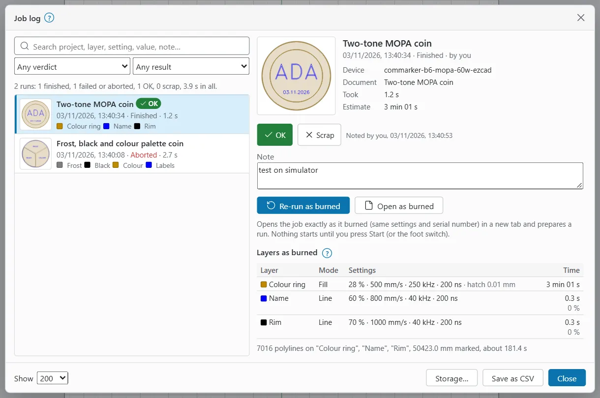

# Job ledger

OpenEtch keeps a record of every run that ends: when it ran, what it burned, with which settings, and how it came out. The window that shows it is called **Job log**.

Use it to answer questions like "what settings did I use on that coin last month?" and to burn the same job again exactly.

## Open the Job log

- **Computer and tablet:** click **Job log…** in the **Laser** window, or choose **File > Laser > Job log…**
- **Phone:** tap **Job** and scroll down to **Job log…**

You can also search for "Job log" in command search.

On a wide screen the list of runs is on the left and the selected run on the right. On a phone you see the list first; tap a run to see it full width, and tap **All runs** to go back.

## Find a run

Each row shows a small picture of what burned, the project name, a verdict if you gave one, the date and time, the result (**Finished**, **Failed**, **Aborted** or **Cancelled**), how long it took, and up to four of its layers.

To narrow the list:

- Type in **Search project, layer, setting, value, note…** Every word must appear somewhere in the run: the project, document, device, summary, layers and settings, variable text values, note or error.
- Choose a **Verdict**: **Any verdict**, **OK**, **Scrap** or **Not judged**.
- Choose a **Result**: **Any result**, **Finished**, **Failed**, **Aborted** or **Cancelled**.
- Under **Show**, choose how many runs to list: 50, 200 or 1000.

Above the list, a line sums up what is shown, for example **12 runs: 10 finished, 2 failed or aborted, 8 OK, 1 scrap, 14 min 05 s in all.**

To take the list into a spreadsheet, click **Save as CSV**.

A run that was never approved does not appear. A run that was approved but stopped before it fired (for example while it waited for the foot pedal) shows as **Cancelled**.

## Run details

Select a run to see:

- When it ran, its result, and who started it (**by you**, **by a script**, or **by** an agent's name).
- **Device**: the device it burned on.
- **Document**: the document name, when it differs from the project.
- **Took**: how long it took, and how many runs for a repeated job.
- **Estimate**: the time estimated, and the time the board measured with the difference in %.
- **Options**: for example **repeat 5 times**, **waited for the foot pedal**, **3 selected objects** or **started at segment 120**.
- The error, if it failed.

## Settings as burned

Each run keeps a snapshot of what it burned with, even if you have changed the design since.

- **Layers as burned**: one row per layer with its **Mode** (**Line**, **Fill**, **Fill + line** or **Offset fill**), its **Settings** (power, speed, frequency, pulse width, passes, hatch interval, image dither and line interval) and its share of the **Time**. A layer with output off is marked **output off**.
- **Variable text**: the **Serial / CSV row** and the value each serial number, CSV text and barcode had, with its jig pocket.
- **Jigs**: which pockets were on.

Runs logged before OpenEtch kept layer settings say **This run was logged before the job log kept layer settings.**

## Mark a part OK or scrap

Under **How the part came out**:

1. Click **OK** or **Scrap**. It is saved at once. Click the same button again to clear it.
2. Optionally type a **Note**, for example the colour or depth you got (**What you saw: colour, depth, position…**).
3. Click **Save note**.

The run then shows **Noted** by whom and when. Verdicts and notes are searchable, so you can find every scrapped part, or every note that says "blue".

## Re-run as burned

**Re-run as burned** opens the job exactly as it burned, with the same settings and the same serial number or CSV row, in a new tab, and prepares a run of it.

1. Select the run.
2. Click **Re-run as burned**.
3. The message says the job is open with a run ready. Check it.
4. Frame it, then start it as usual (see [Running a job](running-a-job.md)):
   - Without a PIN, the prepared run shows under **Waiting for approval** in the **Laser** window with its own **Start** button. The foot switch also burns the open job, after framing it.
   - With the operator PIN, approve it with **Approve…**

Nothing starts until you do. Every check that **Start** has still applies.

If the job burned on a different device from the one now active, OpenEtch opens it but prepares no run, and says why. Check the device before you run it.

### Open as burned

**Open as burned** opens the stored job in a new tab without preparing a run, so you can look at it or change it first.

### When Re-run is not available

The buttons are greyed out, with the reason underneath, when:

- the job's document was not kept (only the newest jobs keep it, and only up to a size limit; see [Storage](#storage)),
- the job log keeps no documents at all,
- the run was logged before the job ledger kept documents, or
- the run was a batch of projects: run the batch again from its projects.

## Storage

Click **Storage…** at the bottom of the window to open **Job log storage** and choose how much the job log keeps. The settings of every run are always kept; these settings only limit the stored documents and pictures.

| Setting | Default | What it does |
|---|---|---|
| **Keep documents** | 100 newest jobs | How many jobs keep their burned document for Re-run (0 to 2000). 0 keeps none, and Re-run is then off. |
| **Largest document** | 25 MB | A larger document is not kept (1 to 200 MB). Large photos make large documents. |
| **Keep pictures** | 2000 newest jobs | How many jobs keep their small picture. |
| **Picture size** | 160 px | The size of each picture. A picture is a few kilobytes. |

The window shows how much is kept now. Lowering a limit deletes the oldest kept documents or pictures when you click **Save**. Only a person in the app can change these settings.

## What agents can do with the ledger

An AI agent connected over MCP can search the job log, read a run, mark a run OK or scrap with a note (recorded as an agent's note, and only meant for when you have told it how the part came out), and open a stored job. It can then prepare a run, but MCP gives it no way to approve or start it. See [What AI agents can and cannot do](safety.md#what-ai-agents-can-and-cannot-do).
