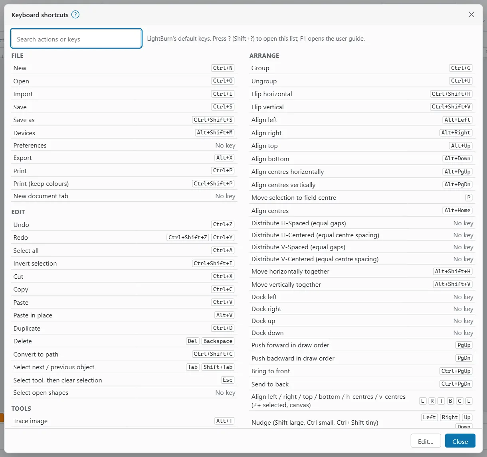

# Keyboard shortcuts

OpenEtch uses LightBurn's default keys where it can. You can change most of them.

## Stop a job from the keyboard

- `Ctrl+Pause` (or `Ctrl+Cancel`) is STOP: it ends any job or frame and cancels pending runs.
- `Ctrl+.` (`Cmd+.` on a Mac) is STOP while a run is under way. At other times it rotates the selection 15°, as in LightBurn.
- `Pause` pauses and resumes the job.
- `Esc` stops framing. **Esc never stops a burn.**

The STOP button and the hardware E-stop always work. Do not rely on a keyboard to stop a laser.

## Open the list

- Press `?` (`Shift+?`). (`F1` opens this user guide instead.)
- Or choose **Help > Keyboard shortcuts**. In smaller windows, on MacBooks and tablets, **Help** is in the **More** (⋯) menu at the top right. On a phone, tap **More > Help > Keyboard shortcuts**.

Type in **Search actions or keys** to find an action or a key. Actions are grouped as File, Edit, Tools, Arrange, View, Laser and Help. An action without a key shows **No key**.

## Change a shortcut

1. Open the list and click **Edit…** Or choose **File > Settings > Edit hotkeys…**, or click **Edit hotkeys…** in Preferences. The title changes to **Edit hotkeys**.
2. Next to an action, click **+**. It reads **Press a key… (Esc cancels)**.
3. Press the key or chord you want.
4. To remove a key, click **×** on it. To put a changed action back, click **↺** (**Back to the default keys**).
5. Click **Done editing**, then **Close**.

Things to know:

- If the key belonged to another action, it moves to this one and a note says "… was taken from: …".
- Keys marked **fixed** cannot be changed or taken.
- An action can have up to four keys.
- **Reset all to LightBurn defaults** puts every key back.
- Hotkeys are saved in this browser only.

## Keys browsers keep

Browsers keep some keys for themselves, so a web page never sees them: `Ctrl+W`, `Ctrl+T`, `Ctrl+Tab`, `Ctrl+Shift+Tab`, `Ctrl+Shift+N`, `Ctrl+Shift+T`, `Ctrl+Shift+W`, `Alt+F4`, `F11` and `F12`. You cannot assign them.

This means LightBurn's Weld (`Ctrl+W`) and Text (`Ctrl+T`) keys do not work in a browser tab. Use `T` for Text, or give Weld another key. `Ctrl+N` may also open a new browser window instead. Running OpenEtch as an app window (**Help > Use as an app…**) can help.

`F11` stays the browser's full screen; use `Alt+Enter` for OpenEtch's own.

Single letters (such as `R` or `P`) act only while the canvas has focus, so they never fire while you type in a field.

## On a Mac and iPad

- `Ctrl` in this page and in the list means `Cmd` (⌘) on a Mac or iPad. Both Cmd and Ctrl work.
- `Alt` means `Option` (⌥).
- Menus show the Mac symbols, for example ⇧⌘S.
- On an iPad, the shortcuts work with a hardware keyboard.
- A phone has no keyboard shortcuts. The touch modifier bar gives you Shift-, Ctrl- and Alt-style options while you draw or drag.

## File

| Action | Keys |
|---|---|
| New | `Ctrl+N` |
| Open | `Ctrl+O` |
| Import | `Ctrl+I` |
| Save | `Ctrl+S` |
| Save as | `Ctrl+Shift+S` |
| Devices | `Alt+Shift+M` |
| Preferences | none |
| Export | `Alt+X` |
| Print | `Ctrl+P` |
| Print (keep colours) | `Ctrl+Shift+P` |
| New document tab | none |

## Edit

| Action | Keys |
|---|---|
| Undo | `Ctrl+Z` |
| Redo | `Ctrl+Shift+Z`, `Ctrl+Y` |
| Select all | `Ctrl+A` |
| Invert selection | `Ctrl+Shift+I` |
| Cut | `Ctrl+X` |
| Copy | `Ctrl+C` |
| Paste | `Ctrl+V` |
| Paste in place | `Alt+V` |
| Duplicate | `Ctrl+D` |
| Delete | `Del`, `Backspace` |
| Convert to path | `Ctrl+Shift+C` |
| Select next / previous object (fixed) | `Tab`, `Shift+Tab` |
| Select tool, then clear selection (fixed) | `Esc` |
| Select open shapes | none |

## Tools

| Action | Keys |
|---|---|
| Trace image | `Alt+T` |
| Adjust image | `Alt+I` |
| Convert to bitmap | `Ctrl+Shift+B` |
| Rectangle | `R`, `Ctrl+R` |
| Ellipse | `E`, `Ctrl+E` |
| Circle from centre | `C` |
| Text | `T`, `Ctrl+T` |
| Barcode | none |
| Line / pen | `Ctrl+L` |
| Edit nodes | ``Ctrl+` `` |
| Weld | `Ctrl+W` |
| Boolean union | `Alt+Shift++`, `Alt++` |
| Boolean subtract | `Alt+-` |
| Boolean intersection | `Alt+Shift+*`, `Alt+*` |
| Cut shapes | `Alt+C`, `Alt+Shift+C` |
| Trim shapes | `Ctrl+K` |
| Fill region | none |
| Measure | `Alt+M` |
| Mirror across line | `Ctrl+Shift+M` |
| Offset shapes | `Alt+O` |
| Break apart | `Alt+B` |
| Auto-join | `Alt+J` |
| Delete duplicates | `Alt+D` |
| Optimize shapes | `Alt+Shift+O` |
| Two-point rotate | `Ctrl+2` |
| Set start point | none |
| Colour separation | none |
| Warp selection | none |
| Deform selection | none |
| Generate tangent circle | none |

With two or more shapes selected, `R`, `T`, `C` and `E` align instead (see Arrange).

## Arrange

| Action | Keys |
|---|---|
| Group | `Ctrl+G` |
| Ungroup | `Ctrl+U` |
| Flip horizontal | `Ctrl+Shift+H` |
| Flip vertical | `Ctrl+Shift+V` |
| Align left | `Alt+Left` |
| Align right | `Alt+Right` |
| Align top | `Alt+Up` |
| Align bottom | `Alt+Down` |
| Align centres horizontally | `Alt+PgUp` |
| Align centres vertically | `Alt+PgDn` |
| Move selection to field centre | `P` |
| Align centres | `Alt+Home` |
| Distribute H-Spaced (equal gaps) | none |
| Distribute H-Centered (equal centre spacing) | none |
| Distribute V-Spaced (equal gaps) | none |
| Distribute V-Centered (equal centre spacing) | none |
| Move horizontally together | `Alt+Shift+H` |
| Move vertically together | `Alt+Shift+V` |
| Dock left, Dock right, Dock up, Dock down | none |
| Push forward in draw order | `PgUp` |
| Push backward in draw order | `PgDn` |
| Bring to front | `Ctrl+PgUp` |
| Send to back | `Ctrl+PgDn` |
| Align left / right / top / bottom / h-centres / v-centres (2+ selected, canvas) (fixed) | `L`, `R`, `T`, `B`, `C`, `E` |
| Nudge (Shift large, Ctrl small, Ctrl+Shift tiny) (fixed) | arrow keys |
| Rotate 90° clockwise / counter-clockwise (Shift 45°, Ctrl 15°) (fixed) | `.`, `,` |
| Fit to stock | none |
| Move selected objects (page positions) | none |

The nudge distances are set in [Preferences](settings.md#editing).

## View

| Action | Keys |
|---|---|
| Notes window | `Ctrl+Alt+N` |
| Variable Text window | none |
| Toggle wireframe / filled | `Alt+Shift+W` |
| Preview (Laser workspace) | `Alt+P` |
| Zoom in | `Ctrl+=`, `Ctrl+Shift++` |
| Zoom out | `Ctrl+-` |
| Zoom to field | `Ctrl+0` |
| Zoom to selection | none |
| Full screen | `Alt+Enter` |
| Focus canvas | `Ctrl+Alt+F` |
| Material Library | none |
| Camera | none |
| Result colours (draw layers in their expected colours) | none |
| Art Library | none |
| Jigs window | none |
| Toggle side panels | none |

Hold `Space` and drag, or drag with the middle mouse button, to pan the canvas.

## Laser

| Action | Keys |
|---|---|
| Frame selection | `Ctrl+Shift+A` |
| Frame (bounding box) | `Alt+R` |
| Frame outline (contour) | `Alt+Shift+R` |
| Stop framing | none |
| Request run | `Alt+S` |
| Pause / resume the job | `Pause` |
| Position laser (point the red dot at a click) | `Alt+L` |
| Rotary setup | `Ctrl+Shift+R` |
| Stop | `Ctrl+Pause`, `Ctrl+Cancel`, `Ctrl+.` |
| Material test | none |
| Interval test | none |
| Focus test | none |
| Print and Cut | `Alt+0` |
| Job log | none |
| Production cockpit | none |
| Serial ledger | none |
| Bracket test of a preset | none |
| Hue step model | none |
| 3D relief preview | none |
| Re-mark a region | none |

> **Warning:** `Alt+S` does what the Start button does. With the operator PIN it creates a pending run that waits for approval. On an engine without a PIN, it starts the burn at once, as LightBurn's Start does (if the Job Checklist is on and not ticked, it opens the checklist instead). Close the enclosure and put on eye protection before you press it.

## Help

| Action | Keys |
|---|---|
| Command search | `S` |
| Use as an app | none |
| User guide | `F1` |
| Keyboard shortcuts | `Shift+?` |

## Keys inside tools

These keys work only while a tool is active. They are not in the list and cannot be changed.

**Pen and line tool:**

| Key | What it does |
|---|---|
| `Enter` | Finish the path. |
| `C` | Close the path. |
| `Backspace` | Undo the last point. |
| `Esc` | Cancel the path. |

**Edit nodes** (point at a node or segment, or select nodes; the canvas must have focus):

| Key | What it does |
|---|---|
| `Ctrl+A` | Select all nodes. |
| `D`, `Del` or `Backspace` | Delete nodes. |
| `B` | Break the path at a node. |
| `J` | Join two end nodes. |
| `S` | Make nodes smooth, or the pointed segment a curve. |
| `C` | Make nodes corners. |
| `L` | Make segments straight lines. |
| `K` | Make segments curves. |
| `I` | Insert a node at the pointer. |
| `M` | Insert a node in the middle of the segment. |
| `T` | Trim the segment at the pointer. |
| `E` | Extend the nearest open end to the next line. |
| `Esc` | Clear the node selection. |

**While drawing or dragging:** `Shift` draws a square or circle, or keeps to 15° steps; `Ctrl` draws from the centre or turns snapping off; `Alt` snaps to guides only. `Esc` ends the tool.
