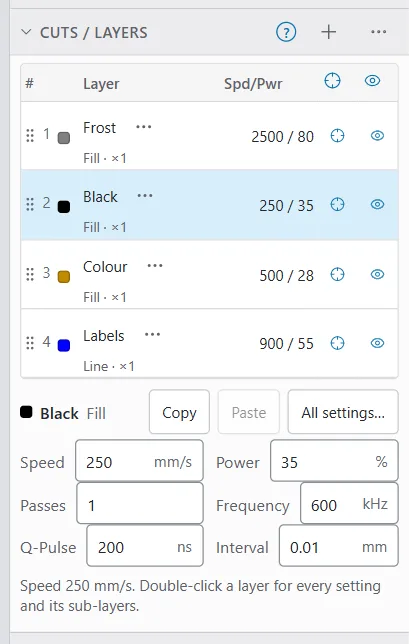
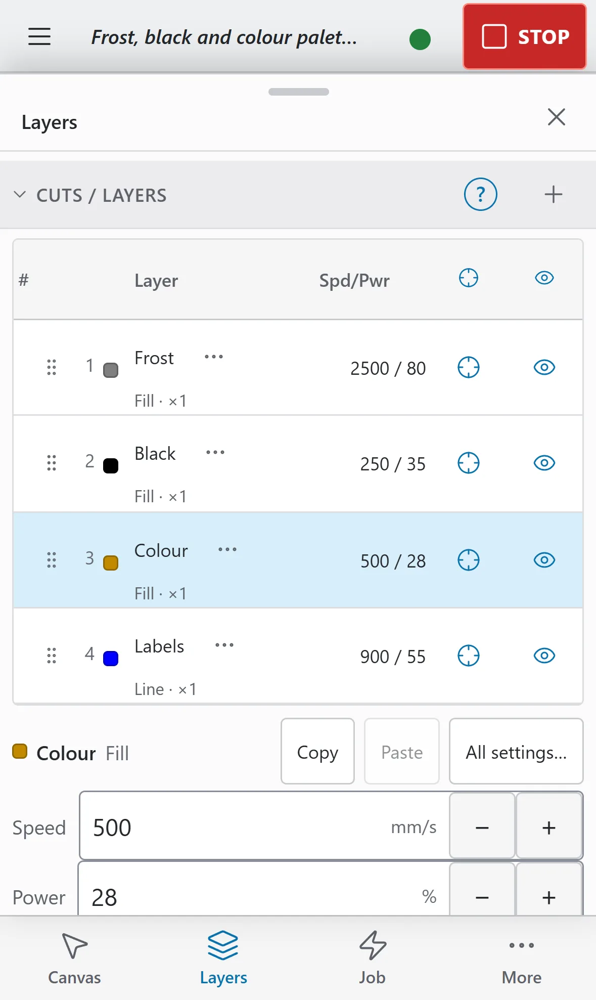
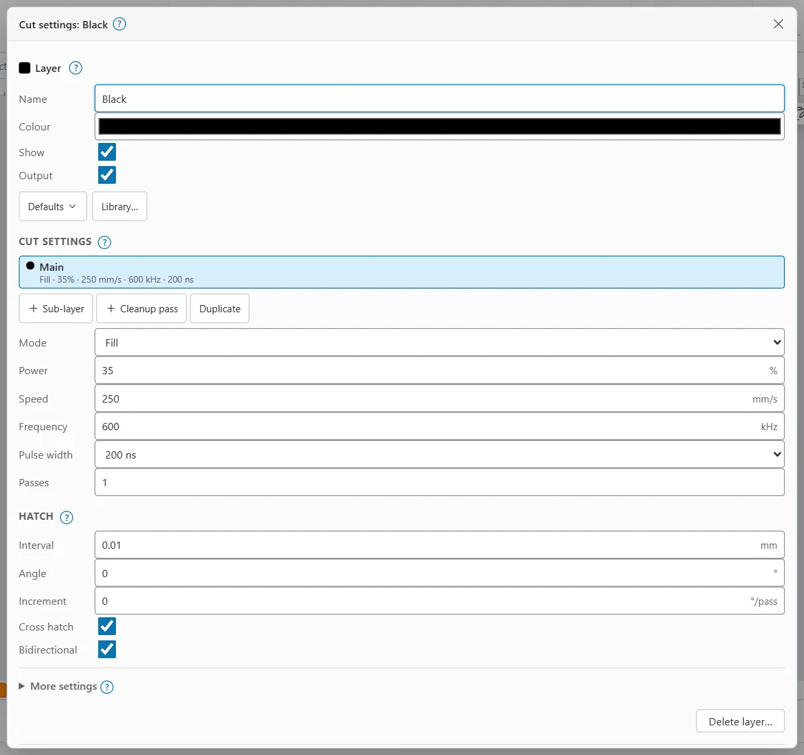

# Layers and cut settings

Every shape sits on a layer. The layer decides how the laser marks it: line or fill, power, speed, frequency, pulse width, line interval and passes. Shapes on the same layer always burn with the same settings.

Jobs burn layer by layer, from the top of the list down. So the layer list is also your burn order.

> **Note:** The numbers on this page are examples. Settings depend on your source, lens, focus and material. Treat any value as a starting point to test, not a guarantee. See [Test grids](test-grids.md) before you try a new setting.

## The Cuts / Layers window {#cuts-layers-window}

**Cuts / Layers** lists the layers of the open document, one row per layer.

Where to find it:

- **Desktop and MacBook:** in the right-hand panel, in both the **Design** and **Laser** workspaces. If you hid it, show it again from the **Window** menu in the top bar (shown when the window is wide).
- **iPad and other tablets:** in the right-hand panel. When that panel is collapsed to a rail of window titles, tap the rail to open the panel over the canvas.
- **Phone:** tap the **Layers** tab at the bottom. The sheet opens at half height; drag its handle to make it taller.

The columns are:

| Column | What it shows |
|---|---|
| **#** | The layer number, with a grip to drag the row. |
| Colour | The layer's colour on the canvas. |
| **Layer** | The layer's name. A link mark means it follows a library preset; **T1** or **T2** means a tool layer; **!** means LightBurn settings OpenEtch will not run. The **⋯** button (**More actions**) opens the layer menu. |
| **Mode** | **Line**, **Fill**, **Fill+Line**, **Offset Fill**, **Multi** (it has sub-layers) or **Tool**. |
| **Spd/Pwr** | Speed and power of the main settings. Speed shows in the unit set in **Preferences**. |
| **#P** | Passes: all the layer's passes added together. |
| **Out** | Output: whether the layer burns. |
| **Show** | Whether the layer is drawn on the canvas. |
| Order | Up and down arrows to move the layer. |

When the window is narrow (a small dock or the phone's sheet), it drops the least important columns: first the arrows, then passes, mode, and speed and power. Their values then show on a second line under the layer name, for example "Fill · 1000 / 30 · ×1". The **Out** and **Show** headers become icons.

## Put shapes on a layer {#layer-colour-palette}

To move shapes to a layer:

1. Select the shapes.
2. Click a colour in the colour palette.

The palette sits along the bottom of the canvas on desktop and tablet, in the **Design** workspace. On a phone it is in the **Layers** tab, under the layer list.

The palette has LightBurn's colours C00 to C29, plus **T1** and **T2**. If no layer has that colour yet, OpenEtch makes one, named after the colour (for example C05). Swatches that already have a layer are marked, and the selection's layer is outlined. **T1** and **T2** are tool layers (see [Tool layers](#tool-layers)).

You can also change a shape's layer in **Shape Properties** with the **Layer** list.

> **Tip:** If you click a colour with nothing selected, OpenEtch says "Select shapes first, then click a colour to put them on that layer."

## Select and reorder layers {#layer-order}

- **Click** a row to select the layer. Its settings appear in the quick-edit fields under the list and in **Shape Properties**. In the Laser workspace they also show in the **Machine and runs** window.
- **Shift+click** a row to select every shape on the layer. On a touch screen, use **Select all shapes on this layer** in the row's **⋯** menu, or turn on **Add** in the modifier bar first (it counts as Shift).
- **Double-click** a row to open its cut settings. On a touch screen you can also use the row's **⋯** button and pick **Cut settings…**, or tap **All settings…** under the list.
- Click **+** (**Add layer**) in the window's title bar to add a layer.

To change the burn order, do one of these:

- Drag a row by its grip at the left, above or below another row. This works with a mouse, a pen or a finger.
- Use the up and down arrows in the last column.
- Open the row's menu and pick **Move layer up** or **Move layer down**.

A layer higher in the list burns earlier. **Optimization settings** can reorder shapes inside a layer, but layers burn in the Cuts / Layers order. The one exception is **Sort cuts last (line layers after fills and images)** in Optimization settings, which moves line layers after fills and images.

## The layer menu {#layer-menu}

Right-click a row (two-finger click on a MacBook trackpad) to open its menu. On a touch screen, long-press the row or tap its **⋯** button.

| Item | What it does |
|---|---|
| **Cut settings…** | Opens the layer's full settings. |
| **Select all shapes on this layer** | Same as Shift+click. |
| **Flash layer** | Blinks the layer's shapes on the canvas so you can find them. Shift+right-click on the row does the same. |
| **Show only this layer**, **Show all layers**, **Hide all layers** | Changes what the canvas draws. |
| **Output only this layer**, **Enable output for all layers**, **Disable output for all layers**, **Invert output** | Changes what burns. |
| **Copy layer settings**, **Paste layer settings** | See [Copy and paste settings](#copy-paste-settings). After a copy, the paste item reads **Paste settings of** and the copied layer's name. |
| **Move layer up**, **Move layer down** | Changes the burn order. |
| **Make tool layer T1**, **Make tool layer T2**, **Make an ordinary layer** | See [Tool layers](#tool-layers). |
| **Make Default**, **Make Default for All**, **Reset to Default**, **Reset to OpenEtch defaults** | See [Layer defaults](#layer-defaults). |
| **Library…** | Opens the [Material Library](material-libraries.md) for this layer. |
| **Unlink** | Only on a linked layer: stops following its preset. |
| **Delete layer** | See [Delete a layer](#delete-a-layer). |

## Output and Show {#output-and-show}

Each row has two switches:

- **Out** (output): on means the layer is included in jobs. Off means it is left out.
- **Show**: on means the layer is drawn on the canvas. This is display only.

Click the **Out** header for **Enable output for all layers**, **Disable output for all layers** or **Invert output**. Click the **Show** header for **Show all layers**, **Hide all layers** or **Invert show**.

> **Warning:** A hidden layer still burns while its output is on. To keep a layer out of a job, turn **Out** off, not **Show**.

## Quick edits {#quick-edit}

Under the list, the selected layer has a row of quick-edit fields: **Speed**, **Power**, **Passes**, **Frequency**, **Q-Pulse** and, for fill modes, **Interval**. Each change is one undo step.

- **Copy** and **Paste** copy the whole layer's settings to another layer.
- **All settings…** opens the full cut settings.
- On a touch screen, **Speed**, **Power**, **Passes** and **Frequency** have **−** and **+** buttons.

If the layer has sub-layers, tabs appear above the fields: **Main** and one tab per sub-layer. The fields edit the chosen tab's pass. To change the order of the sub-layers, drag a sub-layer tab, or drag its grip with a finger or a pen.

**Q-Pulse** left empty means "source default": the source keeps its current pulse width.

A layer linked to a library preset shows its values greyed out. You cannot edit them here until you unlink it (see [Linked layers](material-libraries.md#linked-layers)).

## Cut settings {#cut-settings}

The full settings of a layer open in a window called **Cut settings:** followed by the layer name. To open it:

- double-click the layer's row, or
- pick **Cut settings…** in the layer menu, or
- click **All settings…** under the list.

With a layer selected and no shapes selected, the same settings also show in **Shape Properties**. With shapes selected, Shape Properties shows their layer as one row; its **All settings…** button opens the settings there.

The top of the window has the layer itself:

- **Name** and **Colour**.
- **Show** and **Output**, the same switches as in the list.
- On a linked layer: **Linked**, the preset's path and an **Unlink** button.
- **Defaults** and **Library…** (see [Layer defaults](#layer-defaults) and [Material libraries](material-libraries.md)).

Under the **Cut settings** heading is a row of tabs: **Main** and one per sub-layer, in burn order. Each tab shows a short summary of its settings. The form below edits the open tab.

Below the form come **More settings** (see [More settings](#more-settings)), the image settings when the layer holds images (see [Images](images.md)), and **Delete layer…**.

### Mode: line or fill {#fill-vs-line}

**Mode** decides what the laser does with the layer's shapes:

| Mode | What it does | Use it for |
|---|---|---|
| **Line** | Traces each outline. | Thin lines, cuts, outlines, single-line text. |
| **Fill** | Hatches the inside of closed shapes with parallel lines. | Solid areas, MOPA colour, black marks, frosting. |
| **Fill + line** | Fills, then traces the outline. | A filled area with a crisp edge. |
| **Offset Fill** | Fills with outlines that step inward at the interval, like contour lines. | Round or flowing shapes where straight hatch lines look wrong. |

Open shapes cannot be filled. A Fill layer only hatches closed shapes.

Images on a layer use the layer's image settings. See [Images](images.md).

### Power, speed and frequency {#power-speed-frequency}

- **Power** (%): the share of the source's rated power. On a 60 W source, 50 % is roughly 30 W.
- **Speed** (mm/s): how fast the beam moves while it marks. Faster means less energy on each spot.
- **Frequency** (kHz): how many pulses the source fires per second. The allowed range comes from the active device. If the device reports none, OpenEtch allows 1 to 4000 kHz.

For a fill, power, speed and interval together set how much energy reaches each square millimetre. Work this out before you test a new setting. See [Check the energy density first](test-grids.md#energy-density).

The setting fields are always in mm/s. The **Speed** choice in **Preferences** changes how speeds are shown in the **Spd/Pwr** column and in summaries; the engine always stores mm/s.

### Pulse width on a MOPA source {#pulse-width}

A MOPA source can change the length of each pulse. **Pulse width** sets it, in nanoseconds.

- The list offers only the widths your source accepts. If the device does not report its list, OpenEtch uses the B6 MOPA's list, from 2 ns to 500 ns.
- **Source default** sends no pulse width: the source keeps whatever it is set to.
- If a layer holds a width the source does not take (for example from an imported file), the list shows it as "not supported" with the nearest width, and a message asks you to pick one from the list.

Short pulses usually give finer, lighter marks. Long pulses carry more energy per pulse and often suit deeper or darker marks. MOPA colour on steel depends a lot on pulse width and frequency (see [MOPA colour](mopa-colour.md)). Test before you rely on any of this.

The field is hidden when the active device says its source has no adjustable pulse width. A gantry laser (GRBL or Ruida) shows neither frequency nor pulse width.

### Passes {#passes}

**Passes** is how many times the open tab's settings run over the shapes, from 1 to 1000. Each pass adds more energy, so two passes is roughly double the energy of one.

**Global passes** (under **More settings** on the **Main** tab) repeats the whole layer, main settings and sub-layers together, in order.

### Hatch: interval, angle and cross hatch {#hatch}

The **Hatch** settings apply to fill modes only. For a Line layer the heading reads **Hatch (fill modes only)**.

- **Interval** (mm): the gap between fill lines. A smaller interval puts the lines closer and adds energy. 0.01 mm is very fine; coarser intervals such as 0.05 mm are common starting points for general marking.
- **Angle** (°): the direction of the fill lines.
- **Increment** (°/pass): turns the angle by this much on each pass, so passes cross each other.
- **Cross hatch**: adds a second set of lines at right angles. This roughly doubles the energy of the fill.
- **Bidirectional**: marks in both directions instead of returning to the same side each time. Faster.

With **Offset Fill**, only the interval applies. The window says so: the angle, cross hatch and bidirectional settings do not apply.

> **Tip:** Halving the interval doubles the energy density. If a fill suddenly melts, check the interval before you change power.

## Sub-layers {#sub-layers}

A sub-layer is one more pass over the same shapes with its own settings. LightBurn calls these sub-layers too. Use them to, for example, fill and then clean, or mark a colour in two steps.

In the Cut settings window:

1. Click **Sub-layer** to add one. It starts from the main settings.
2. Click its tab and change its settings.
3. Give it a name in the **Sub-layer** field if you like.

Other buttons:

- **Duplicate**: on **Main**, copies the main settings as a new first sub-layer. On a sub-layer, copies it right after itself.
- The up and down arrows (**Run earlier**, **Run later**) change the order.
- **Delete** removes the open sub-layer.

Sub-layers burn left to right after the main settings. A layer can have up to 64 sub-layers. In Cuts / Layers a layer with sub-layers reads **Multi**; click its arrow (**Show passes**) to see one row per pass.

### Cleanup pass {#cleanup-pass}

**Cleanup pass** adds a sub-layer that clears debris after the main passes. It starts as one fast, low-power pass with the hatch turned 45°: a quarter of the power, twice the speed, and twice the frequency (capped at the source's highest). Its tab shows a **Cleanup** badge.

To make an existing sub-layer a cleanup pass, tick **Cleanup pass** on its tab, then set **Clean after** to the number of main passes between cleanups. The cleanup runs after every that-many main passes and once more after the last one, before the other sub-layers.

## More settings {#more-settings}

Under the main form, **More settings** holds the rest of the galvo options. It opens by itself when one of them is in use, and a number shows how many are.

The fill options show for fill modes. The line options (dot mode, wobble, perforation, tabs and kerf offset) show for every mode except **Fill**.

| Setting | What it does |
|---|---|
| **Global passes** | On **Main** only: repeats the whole layer, sub-layers included. |
| **Output main settings** / **Output this sub-layer** | Turns one pass off without deleting it. |
| **Lines per inch** | The fill interval as lines per inch (the same value as **Interval**). |
| **Fill grouping** | **Each shape individually**, **All shapes at once** or **By group**. When shapes are filled together, overlaps cancel. |
| **Flood fill** | Hatches each connected area on its own instead of whole scan lines across gaps, so travel stays inside an area. |
| **Auto-rotate per job** | Turns the hatch angle by the increment on every job, not every pass. |
| **Dot width adjust** | Shortens both ends of every fill line by half this width, to make up for the dot size. |
| **Dot mode** | Marks dots instead of lines: **Dot time** and **Dot spacing**. |
| **Wobble** | Moves the beam in small circles along the line: **Step** and **Size**. |
| **Perforation** | Alternates marked and skipped lengths: **Cut length** and **Skip length**. |
| **Tabs (bridges)** | Leaves small gaps in cut lines. |
| **Kerf offset** | Traces closed outlines outward (+) or inward (−). Open paths are not offset. |
| **Pause before**, **Pause after** | Waits with the laser off before or after the layer. |
| **Pause before this layer (wait for Continue)** | Galvo jobs only. The run stops before this layer with the laser off and waits until you press Continue in the app or the foot switch. |
| **Z offset**, **Z step per pass** | Moves a Z lift on the board's extension axis. Without one, the plan warns and ignores it. |
| **Timing and jump** > **Override timings** | Replaces the device's laser on and off delays and jump settings for this pass. |

When several line options are on, they are applied in this order: tabs, perforation, wobble, dots. Some options appear only for a GRBL gantry (for example **Constant power (M3)**, **Air assist (M8)**, **Overscan** and **Overcut**).

> **Note:** **Beginner Mode** in **Preferences** hides **More settings**, as LightBurn's Beginner Mode does.

## Shape cut settings {#shape-cut-settings}

With shapes selected, **Shape Properties** has a **Shape cut settings** section:

- **Power scale** (%): marks these shapes at that share of their layer's power.
- **Cut priority**: orders cuts when Optimization orders by priority (0 first).

## Copy and paste settings {#copy-paste-settings}

To copy one layer's settings to another:

1. Select the first layer and click **Copy** under the list (or **Copy layer settings** in its menu).
2. Select the other layer and click **Paste** (or **Paste settings of** and the first layer's name, in its menu).

Sub-layers are copied too.

## Layer defaults {#layer-defaults}

OpenEtch can remember settings per layer colour. Defaults belong to the active laser device: each device keeps its own. The **Defaults** menu sits above a layer's cut settings, and most of its items are also in the layer menu.

| Item | What it does |
|---|---|
| **Make Default** | Saves this layer's settings, sub-layers included, as the default for its colour on this device. |
| **Make Default for All** | Saves them as the one default for every colour on this device. This replaces any defaults saved per colour. |
| **Reset to Default** | Puts the saved default back on the layer. With none saved, it uses OpenEtch's defaults. |
| **Reset to OpenEtch defaults** | Puts OpenEtch's own settings back. |
| **Load default layer settings on New / restart** | Only in the **Defaults** menu. When ticked, a new document's first layer starts with your saved default. |

A new layer you add (with **+** or the palette) takes the saved default for its colour.

## Tool layers {#tool-layers}

A tool layer (**T1** or **T2**) never burns, but it is framed with the job. Use it for guides, jig outlines, alignment marks and print-and-cut targets. Its **Out** switch is greyed out.

To make one, pick **Make tool layer T1** or **Make tool layer T2** in the layer menu, or put shapes on **T1** or **T2** in the palette. **Make an ordinary layer** turns it back. Each tool name can belong to one layer only.

## Delete a layer {#delete-a-layer}

From Cuts / Layers:

1. Open the layer menu and pick **Delete layer**.
2. If the layer has shapes, choose where they go in **Move its … objects to**.
3. Click **Delete layer**.

The Cut settings window also has **Delete layer…** at the bottom. It moves the layer's shapes to the first other layer, and says so before you click **Delete**.

You cannot delete the last layer. Undo brings a deleted layer back.

## Preview colours {#preview-colours}

In the Laser workspace preview, each layer's toolpath is drawn in its layer colour. Sub-layers are drawn in colours shifted from the layer colour, so you can tell passes apart.

The **Toolpath** card in the **Machine and runs** window (Laser workspace; on a phone, the **Job** tab) lets you:

- tick or untick a layer, or a single pass, to show or hide it in the preview (display only), or click **Solo** to show only that one;
- tick **Shade by energy** to draw stronger layers darker;
- tick **Show travel** to see jumps between marks.

For MOPA colour work, **Result colours** draws each layer in the colour it should come out instead of its layer colour. See [Result colours](mopa-colour.md#result-colours). For more on the preview, see [Preview and framing](preview-and-framing.md).

## LightBurn settings OpenEtch does not run {#unsupported-settings}

A layer imported from LightBurn may hold settings OpenEtch will not execute. Its row then shows a **!** badge. Rest the mouse on the badge to see the list. OpenEtch keeps those values so they go back into a LightBurn export, but it does not burn them.

## Common mistakes {#common-mistakes}

- **Hiding a layer to stop it burning.** Turn **Out** off instead.
- **Shapes on the wrong layer.** Shift+click the layer row to see which shapes it holds, or use **Flash layer**.
- **Open shapes on a Fill layer.** They are not filled. Close the shape, or use Line mode.
- **Wrong order.** Jobs burn top to bottom. Put fills before outlines if the outline must stay crisp.
- **Editing a linked layer.** Its fields are greyed out. Unlink it, or change the preset in the Material Library.
- **Very small intervals with high power and slow speed.** These can melt or warp thin stock. Work out the energy density first (see [Test grids](test-grids.md#energy-density)).
