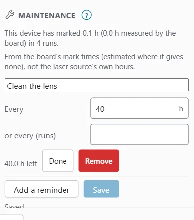

# Hour meter and maintenance

OpenEtch counts how long each laser device has marked and how many runs it has done. You can set maintenance reminders on those counts, such as "Clean the lens every 40 hours". When a reminder is due, the app shows it and can send a notification.

## The hour meter

The hour meter adds the marking time of every pass that runs to the end. Each laser device has its own meter. It starts counting the first time the device runs a job.

Where the board reports its own mark time, the meter uses that. Otherwise it uses the job's time estimate, for example on the simulator, on a gantry laser, or for jobs with several stages such as layer pauses. The meter keeps the two apart, so you can see how much is estimated.

> **Note:** The meter counts the controller's marking time, not the laser source's own running hours. The source keeps no count that the board can read.

You see the meter in two places:

- **Preferences > Maintenance**, which says, for example, "This device has marked 12.3 h (11.8 h measured by the board) in 412 runs.";
- the **Hour meter** line in the cockpit's [Times card](production-cockpit.md#the-times-card).

There is no button to reset the meter. If you remove a device, its meter and reminders go with it.

## Set up reminders

To add a reminder:

1. Choose **File > Settings > Preferences…** (on a phone: **More**, then **Settings > Preferences**).
2. Scroll to **Maintenance**.
3. Press **Add a reminder**. A new row appears: "Clean the lens" every 40 h.
4. Change the name if you want to.
5. Set **Every** (hours), **or every (runs)**, or both. Leave a field empty to not use it.
6. Press **Save**. OpenEtch says "Saved."

A reminder is due when either limit is reached, whichever comes first. A new reminder counts from when you save it.

Each saved row shows what is left, for example "12.5 h left · 300 runs left", or **Due**. Press **Remove** to delete a reminder, then **Save**.

The limits are:

- the name is 1 to 80 characters;
- hours are 0.1 to 100 000;
- runs are 1 to 10 000 000;
- each reminder needs hours, runs or both;
- each device can have up to 20 reminders.

If a reminder cannot be saved, OpenEtch says "Every reminder needs a name." or "Give hours (> 0) or runs (1 or more)."

Reminders belong to the active laser device. To set up another device's reminders, switch to that device first.

> **Tip:** Take the intervals from your laser's manual and your own experience, and adjust them over time. Typical reminders are cleaning the lens or protective window, and checking the fume extractor's filter.

## When a reminder is due

When a reminder becomes due, it shows in these places:

- a chip in the top bar, to the left of the machine status chip, with a spanner icon and "Due: Clean the lens" (or "2 maintenance items due"). On a phone, the chip shows the icon only. Tap it to open the [Maintenance window](#the-maintenance-window).
- the **Production** window: "Due: Clean the lens";
- the cockpit's **Times** card, with a **Done** button;
- a **Maintenance due** [notification](notifications.md#events), sent once until you mark it done.

A due reminder does not stop jobs from running.

## Mark a reminder done

When you have done the job, press **Done** next to the reminder. You can do this in the Maintenance window, in the cockpit's Times card or in **Preferences > Maintenance**. The reminder then counts again from now. In the cockpit, OpenEtch also says "Marked done".

In Preferences, **Done** is greyed out while you have unsaved changes. Press **Save** first.

## The Maintenance window

The Maintenance window opens from the chip in the top bar. It lists every reminder of the active device with what is left, or **Due**, and a **Done** button.

To add or edit reminders, use Preferences: the window says "Edit reminders in Preferences > Maintenance." When there are none, it says "No maintenance reminders. Add them in Preferences > Maintenance."

## What AI agents can do

AI agents connected through MCP can read the hour meter and the reminders (`hour_meter`). Only a person can add, change or complete reminders, in the app. See [AI agents](ai-agents.md).
