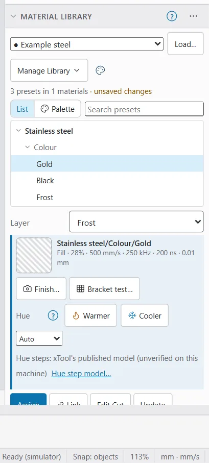

# Material libraries and presets

A material library holds presets: saved cut settings for a material. OpenEtch reads and writes LightBurn's material library files (`.clb`). A library you load from LightBurn is written back unchanged, apart from the presets you edit.

Each preset sits in a tree: **material**, then **thickness** (or a title when it has no thickness), then **description**. For example: Stainless steel > Colour > Gold.

A preset does not prove a setting is right for your machine. Always test a preset you got from someone else on scrap first (see [Test grids](test-grids.md)).

## The Material Library window {#material-library-window}

Where to find it:

- **Desktop and MacBook:** in the right-hand panel, under **Cuts / Layers**, in both workspaces. It starts collapsed: click its title to open it. **Laser Tools > Material Library** and **File > Laser > Material Library** open it too.
- **iPad and other tablets:** in the right-hand panel, or from **Laser Tools > Material Library** on the tool rail.
- **Phone:** tap the **Layers** tab. The Material Library is under the layer list and the colour palette. Tap its title to open it.

The window has, from top to bottom:

1. The library list (**Select Library**), the **Load…** button, the **Manage Library** menu and the **Result colours** button (palette icon).
2. A line such as "3 presets in 1 materials", with "unsaved changes" when you have edited the library.
3. **List** and **Palette** views, and in the list view a **Search presets** box.
4. The preset tree.
5. The **Layer** list: the layer the buttons act on.
6. The picked preset's path and settings, with **Finish…**, **Bracket test…** and the hue controls.
7. The buttons **Assign**, **Link**, **Edit Cut**, **Update**, **Edit Description**, **Duplicate** and **Delete**, then **Create new from layer**.

If the engine has no material libraries, the window says "This engine has no material libraries."

## Load a LightBurn library {#load-a-library}

1. Click **Load…**
2. Pick a `.clb` file.

The library is added to the library list and selected. If a library of the same name is already loaded, the new one gets " (2)" after its name.

On an iPhone or iPad the file picker shows every file. OpenEtch checks the type after you pick, and tells you if it is not a `.clb`.

OpenEtch keeps its copy in the engine's libraries folder, so it is there next time. The engine also remembers which libraries are loaded and which one is selected, for every browser that connects to it.

## Start a new library {#new-library}

1. Open **Manage Library** and pick **Create New Library…**
2. Type a **Library name** and click **Create**.

The library starts empty. Add presets with **Create new from layer** (see [Save a layer as a preset](#create-a-preset)).

## Find a preset {#browse-presets}

- Click a material or a group to fold it open or closed.
- Type in **Search presets** to filter by material, thickness, title or description.
- Rest the mouse on a preset to see its settings. A coloured chip or a small photo shows its result colour, if it has one.
- A link mark with a number shows how many layers in the open document follow that preset.

**Palette** shows the presets that have a result colour as swatches, grouped by surface. See [The palette view](mopa-colour.md#palette-view).

## Apply a preset to a layer {#apply-a-preset}

1. Select the layer in **Cuts / Layers**. The **Layer** list in the Material Library follows it. You can also pick a layer straight from that list.
2. Click a preset in the tree.
3. Click **Assign** or **Link**.

Double-clicking a preset assigns it.

| Button | What happens |
|---|---|
| **Assign** | Copies the preset's settings, with its sub-layers, to the layer. Later edits to the layer or the preset stay separate. |
| **Link** | The layer takes the preset's settings and follows any change to the preset. Its settings cannot be edited until you unlink it. |

If the preset has a result colour, the layer takes that too (see [Result colours](mopa-colour.md#result-colours)).

### Linked layers {#linked-layers}

A linked layer shows a link mark in **Cuts / Layers**, in the **Layer** list (🔗) and above its cut settings, where **Linked** is followed by the preset's path.

- To edit a linked layer, click **Unlink** above its cut settings, or pick **Unlink** in its layer menu. The layer keeps its current settings and stops following the preset.
- To change all linked layers at once, change the preset with **Edit Cut** or **Update**. A message says how many linked layers were updated.
- **Assign** on a linked layer copies the new preset and also removes the old link.

## Save a layer as a preset {#create-a-preset}

1. Set up a layer's cut settings (including any sub-layers).
2. Make sure it is the layer shown in the **Layer** list.
3. Click **Create new from layer**. The window **New preset from** and the layer's name opens.
4. Fill in the window:
   - **Material name**, for example "Stainless steel". Start typing to pick an existing one.
   - Tick **No thickness** and give a **Title** (for example "Engrave" or "Colour"), or untick it and give a **Thickness** in mm.
   - **Description**, for example "Gold".
5. Click **OK**.

The preset is kept in the engine's memory until you save the library (see [Save your changes](#save-library)).

## Change a preset {#edit-a-preset}

Pick the preset first. The buttons under the tree, and the preset's right-click or long-press menu, offer these actions.

### Edit Cut {#edit-cut}

**Edit Cut** opens **Edit Cut:** and the preset's path. It has **Mode**, **Power**, **Speed**, **Frequency**, **Q-Pulse width**, **Passes** and, for fill modes, **Interval**. Click **OK** to save. Linked layers follow.

> **Warning:** Edit Cut changes only the settings shown. The preset's other options (wobble, timings, image settings) are reset. To keep them, **Assign** the preset to a layer, change it there, then click **Update**. If a layer in the document is already linked to the preset, Edit Cut starts from that layer and keeps its other options.

### Update a preset from a layer {#update-preset}

**Update** replaces the preset's settings with those of the layer in the **Layer** list, sub-layers and all. Linked layers follow.

### Other actions {#other-preset-actions}

- **Edit Description** renames the preset (material, thickness or title, description). Linked layers follow the new name.
- **Duplicate** makes a copy of the preset.
- **Delete** removes the preset after you confirm. Linked layers keep their settings and are unlinked. **Save Library** makes the deletion permanent.

## Save your changes {#save-library}

Every edit to a library stays in the engine's memory until you save it. A dot (●) before the library name, and "unsaved changes", show it is not saved yet.

To save, open **Manage Library** and pick **Save Library**.

> **Note:** An AI agent connected through MCP can read the libraries, edit a preset's finish notes and colour, apply hue steps to a preset, and write a bracket test box back to a preset. It cannot create, rename or delete presets, load or save a library, or change the hue step model. Its edits stay unsaved until you save the library yourself.

## The Manage Library menu {#manage-library}

| Item | What it does |
|---|---|
| **Save Library** | Writes the library file, with its finish data. |
| **Save Library As…** | Saves a copy under a new name. The copy becomes the selected library. |
| **Create New Library…** | Starts an empty library. |
| **Merge Library With…** | Needs two loaded libraries. Adds the presets of the other library that this one lacks: pick it under **Merge in** and click **Merge**. Unsaved until Save Library. |
| **Rename…** | Renames the library. Linked layers follow the new name. |
| **Unload** | Removes the library from the list. Its file stays in the libraries folder. With unsaved changes you can **Save and unload** or **Discard and unload**. |
| **Download .clb** | Downloads the library as a LightBurn file. |
| **Download finish data** | Downloads the photos, colours and notes of the presets (see below). |
| **Import finish data…** | Reads finish data back in. |

## Finish data {#finish-data}

OpenEtch can keep, for each preset, a photo of the result, the colour it comes out, the surface it was made for, the lens, focus, supplier, lot, date and notes. LightBurn's `.clb` has no place for these, so OpenEtch keeps them in a separate file next to the library (`<library name>.oefinish.json`). Your `.clb` stays LightBurn's own file.

The finish data is saved with **Save Library**. **Download finish data** and **Import finish data…** move it between engines. When you import, presets that are not in this library are skipped, and a message says how many.

See [MOPA colour](mopa-colour.md) for how to record and use finishes.

## Switch libraries {#switch-library}

Pick another library in the library list. As in LightBurn, a linked layer whose preset (same material, thickness or title, and description) also exists in the new library takes the new library's settings. A message says how many linked layers changed.

## Common mistakes {#common-mistakes}

- **Forgetting to save.** Edits are lost when the engine restarts if you never pick **Save Library**.
- **Editing a linked layer.** Unlink it first, or edit the preset.
- **Using Edit Cut on a preset with wobble or custom timings.** Those options are reset. Use Assign, edit, Update instead.
- **Assigning to the wrong layer.** The buttons act on the layer in the **Layer** list, which follows the selected layer.
- **Trusting a shared library blindly.** Different sources, lenses and lots mark differently. Test first.
