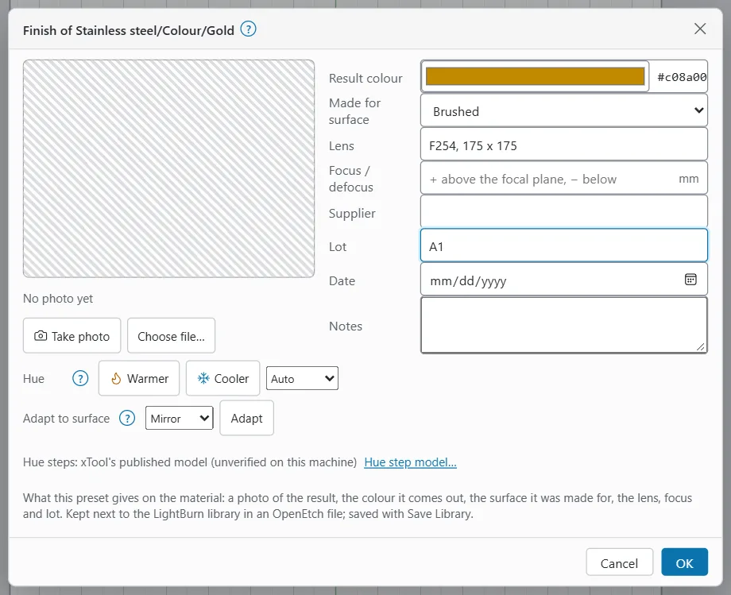
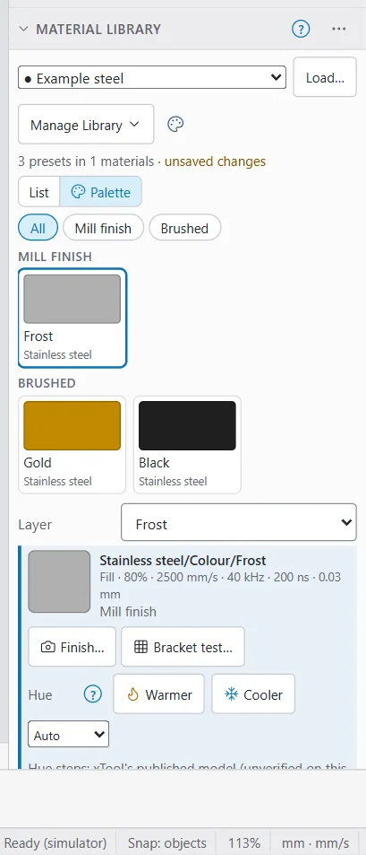
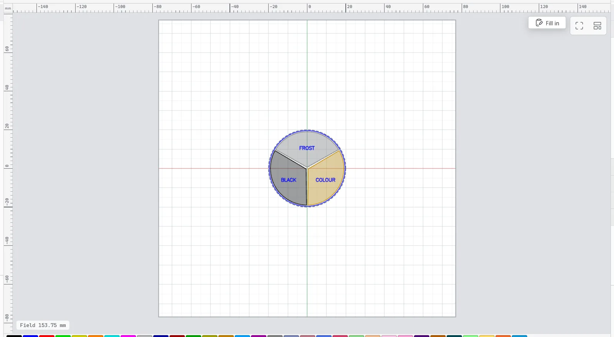
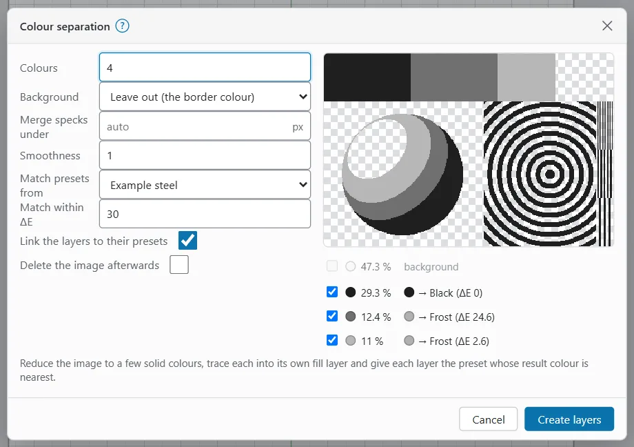

# MOPA colour

A MOPA fibre laser can colour stainless steel and titanium. The heat grows a thin oxide layer, and its thickness sets the colour. On steel the colours go roughly straw, gold, brown, purple, blue as the energy per area grows.

Colour depends on many things: power, speed, interval, frequency, pulse width, focus, the surface finish and even the batch of steel. A setting that gives gold on one lot can give brown on the next. OpenEtch helps you record what works, preview it, and adjust it in small steps. It does not know your colours for you.

> **Warning:** Wear eye protection rated for your laser's wavelength (about 1064 nm for a fibre laser) and run fume extraction. Never leave a job running unattended. Colour settings often use fine intervals and slow speeds, which put a lot of energy into the metal: work out the energy density before every new setting (see [Check the energy density first](test-grids.md#check-the-energy-density-first)).

> **Note:** These tools have mostly been tried on the simulator. Settings and hue step numbers are starting points to test, not guarantees.

## The Materials menu

The **Materials** menu collects the MOPA tools. It is in the **Design** workspace.

- **Desktop and MacBook:** in the ribbon's **Laser Tools** group.
- **iPad and other tablets:** on the tool rail, behind the **Laser Tools** group button.
- **Phone:** in the **Canvas** tab, in the tool strip (scroll it sideways to the Laser Tools group).

| Item | What it does |
|---|---|
| **Bracket test of a preset…** | A small test grid around the preset picked in the Material Library (see [Bracket test](test-grids.md#bracket-test-of-a-preset)). |
| **Colour separation…** | Splits the selected image into colour layers (see [Colour separation](#colour-separation)). Greyed out unless one image is selected. |
| **Result colours** | Draws layers in the colours they should come out (see [Result colours](#result-colours)). A tick shows it is on. |
| **Hue step model…** | How far one hue moves a setting (see [The hue step model](#the-hue-step-model)). |

You can also find each of these in command search.

## Record a finish

A finish is what a preset gives on the material: a photo, the colour, the surface and your notes.

To record one:

1. In the [Material Library](material-libraries.md), pick the preset.
2. Click **Finish…** (or pick it in the preset's right-click or long-press menu). The window **Finish of** and the preset's path opens.
3. Under **Result photo**, click **Take photo** or **Choose file…**
   - On a phone or iPad, **Take photo** opens the rear camera.
   - On a computer it opens a file chooser.
   - The photo is scaled down to at most 1280 px and uploaded at once.
4. Check **Result colour**. It starts as the photo's average colour (taken from the middle half of the photo). Pick another colour if the average is off. **Use the photo's average** goes back to it.
5. Set **Made for surface**: **Not recorded**, **Mill finish**, **Brushed**, **Polished** or **Mirror**.
6. Fill in what helps you repeat it: **Lens** (for example "F254, 175 x 175"), **Focus / defocus** in mm (+ above the focal plane, − below), **Supplier**, **Lot**, **Date** and **Notes**.
7. Click **OK**.

Everything, the photo included, is unsaved until you pick **Manage Library > Save Library**.

If you change the preset's settings after the photo was taken, the window and the library say "The settings changed after this photo was taken: burn it again and retake the photo." **Remove photo** deletes the photo.

> **Tip:** Photograph the result in even daylight or under the same lamp each time. Phone cameras adjust colour on their own, so a photo's average is only a guide. Correct the **Result colour** by eye if it looks wrong.

## The palette view

In the Material Library, click **Palette** (next to **List**) to see every preset that has a result colour as a swatch.

- Swatches are grouped by the surface they were made for; presets without one sit under "Surface not recorded". The chips at the top (**All** and each surface in use) show one group only.
- Each swatch shows the photo or colour, the description, the material, lot and date. A mark shows when the photo is out of date.
- Click a swatch to pick the preset. Double-click it to assign it to the layer.
- On a touch screen, long-press a swatch for the preset's menu.

If no preset has a colour yet, the view says "No preset has a result colour yet. Give one a photo or a colour (Finish…) and it appears here."

## Result colours

Layer colours are for telling layers apart. **Result colours** draws each layer in the colour it should come out instead, so you can check a coloured design before you burn it.

To turn it on or off, use any of these:

- the palette button in the ribbon's **Inspect** group (Design workspace),
- **Materials > Result colours**,
- the palette button in the Material Library's header.

A layer's result colour comes from:

1. its linked preset's result colour in the selected library, which follows the library; or else
2. the colour it was given when a preset was assigned, by colour separation, or by an example project.

Layers with neither keep their layer colour.

> **Note:** Result colours is a guide drawn from recorded colours. The real colour depends on the metal, its surface and the lot.

## Hue steps

When a preset comes out a little off (for example blue instead of purple), the hue controls change it by small, known steps.

- **Warmer** means a little less energy (towards straw and gold).
- **Cooler** means a little more energy (towards purple and blue).

To nudge a preset:

1. Pick the preset in the Material Library. The hue controls (**Hue**) are under its details, and also in its **Finish…** window.
2. In **By**, choose what changes: **Auto**, **Power**, **Speed** or **Frequency**.
3. Click **Warmer** or **Cooler**. Each click adds one hue in that direction. A proposal shows what would change, for example "2 hue(s) cooler: 28 → 29 %".
4. Read any warnings under the proposal.
5. Click **Apply to preset**, or **Cancel**.

**Auto** uses frequency when the setting runs at 500 kHz or more and the jump is under 4 hues. Otherwise it uses power. If you choose **Frequency** for a setting below 500 kHz, OpenEtch refuses and asks you to use power or speed.

A warning appears when the pulse width is under 20 ns, or when a big jump uses frequency, because the steps may not hold there.

Applying changes the preset (unsaved until Save Library), and linked layers follow. The photo is then marked out of date.

Before you burn a nudged setting, work out its energy density again (see [Check the energy density first](test-grids.md#check-the-energy-density-first)).

## Adapt to a surface

A polished or mirror surface reflects more, so it usually needs a little more power for the same colour.

1. Open the preset's **Finish…** window.
2. Under **Hue**, pick the new surface in **Adapt to surface**.
3. Click **Adapt**. A proposal starting "For Mirror:" shows the power change.
4. Click **Apply to preset**.

The change is worked out from the surface the preset records under **Made for surface**. If it records none, Mill finish is assumed and a warning says so. After applying, the preset records the new surface.

> **Tip:** Duplicate the preset first if you want to keep both versions, one per surface.

## The hue step model

The hue step model says how far one hue moves each setting. Open it with **Materials > Hue step model…**, or the **Hue step model…** link under the hue controls. The window is called **Hue step model of this device**: each laser device has its own model, and only a person can change it in the app.

The starting values come from xTool's published guide for a 60 W MOPA source on 304 stainless steel. They have not been checked on your machine; a bracket test can refine them.

| Field | Starting value | Meaning |
|---|---|---|
| **Power per hue** | 0.5 % | Power change for one hue. |
| **Speed per hue** | 100 mm/s | Speed change for one hue. |
| **Frequency per hue** | 150 kHz | Frequency change for one hue. |
| **Frequency steps from** | 500 kHz | Below this, a hue is not a frequency step. |
| **Model holds from pulse width** | 20 ns | Below this pulse width, a warning says the steps may not hold. |
| **Big jumps (use power) from** | 4 | Jumps of this many hues or more use power in Auto. |
| **Brushed: extra power** | 0 % | Added for a brushed surface over mill finish. |
| **Polished: extra power** | 1 % | Added for a polished surface. |
| **Mirror: extra power** | 2 % | Added for a mirror surface. |

The line under the fields says where the numbers come from: "xTool's published model (unverified on this machine)" or "refined by a bracket test". **Reset to xTool's model** puts the starting values back at once. **OK** saves your changes.

To refine the model from a real burn, see [Refine the hue steps](test-grids.md#refine-the-hue-steps).

## Colour separation

Colour separation turns an image (a logo, for example) into a few solid colour areas, each on its own fill layer. Each layer can take the library preset whose result colour is nearest.

To separate an image:

1. Select one image on the canvas.
2. Pick **Materials > Colour separation…**, or right-click the image (long-press on touch) and pick **Colour separation…**
3. Set the options. The preview on the right updates as you go.
4. Untick any colour you do not want traced.
5. Click **Create layers**.

| Option | What it does |
|---|---|
| **Colours** | How many colours to reduce the image to, 1 to 16 (4 to start). |
| **Background** | **Leave out (the border colour)**: the colour covering most of the image's edge is not traced. **Trace every colour**: all are traced. |
| **Merge specks under** | Areas smaller than this many pixels merge into their surroundings. Empty means auto. |
| **Smoothness** | 0 gives only straight lines, 1.33 only curves (1 to start). |
| **Match presets from** | A library to match colours against (the selected one to start), or **No library (image colours)**. |
| **Match within ΔE** | How close a preset's colour must be (30 to start). As a rough guide, a ΔE of about 2 is just visible and 10 is clearly different. |
| **Link the layers to their presets** | Links each matched layer to its preset (ticked to start). Untick to copy the settings instead. |
| **Delete the image afterwards** | Removes the original image. |

The list under the preview shows each colour, its share of the image, and its match, for example "→ Gold (ΔE 6)". A colour with no preset close enough reads "no preset near (image colour kept)". The background colour is marked "background".

After **Create layers**, a message says how many layers were made and how many were matched. Creating is one undo step.

> **Warning:** A layer with no matched preset gets ordinary fill settings, not a tested colour setting. Assign a preset to it, or set and test its settings, before you burn.

Only presets that have a result colour can be matched. Record finishes first (see [Record a finish](#record-a-finish)). Large images take longer, because the separation runs on the engine; on a phone, keep the image small.

## The palette-coin example

The example "Frost, black and colour palette coin" shows three finishes side by side on a 40 mm stainless coin.

To open it:

1. Pick **File > New from example…** On a phone: **More > File > All file commands > New from example…** On an empty canvas you can also click **Examples**.
2. Choose **Frost, black and colour palette coin** and click **Open**.

It has three sectors, each a closed shape on its own fill layer (**Frost**, **Black** and **Colour**), and a **Labels** layer with the rim and the words. The walkthrough shows in the project notes.

The colour sector is a template field (**Colour sector**). Use **File > Project > Fill in template…**, or the **Fill in** button over the canvas, to choose its finish, then click **Apply**. If the selected library has fill presets with a result colour, they are the choices (up to eight). Otherwise the choices are the built-in Gold, Blue and Purple.

The built-in settings are illustrative, not tested. Here is roughly what they put into the metal on a 60 W source:

| Layer | Power | Speed | Interval | Frequency, pulse | Energy density |
|---|---|---|---|---|---|
| Frost | 80 % (48 W) | 2500 mm/s | 0.03 mm | 40 kHz, 200 ns | about 0.6 J/mm² |
| Gold (Colour) | 28 % (16.8 W) | 500 mm/s | 0.01 mm | 250 kHz, 200 ns | about 3.4 J/mm² |
| Blue (Colour) | 22 % (13.2 W) | 300 mm/s | 0.01 mm | 450 kHz, 200 ns | about 4.4 J/mm² |
| Purple (Colour) | 24 % (14.4 W) | 350 mm/s | 0.01 mm | 400 kHz, 200 ns | about 4.1 J/mm² |
| Black | 35 % (21 W) | 250 mm/s | 0.01 mm, cross hatch | 600 kHz, 200 ns | about 8.4 J/mm² per direction, about 17 J/mm² with the cross hatch |

The Black sector is above the rough 2 to 15 J/mm² range for stainless, because of its cross hatch. The Frost sector is below it, which is intended for a light frost. Try the coin on scrap, not a finished part. Then run a [material test](test-grids.md#material-test) on your own stock and save what works as presets.

## Share finish data

Photos, colours and notes are kept beside the library, not inside the `.clb`. To move them to another OpenEtch, use **Manage Library > Download finish data** and **Import finish data…** See [Finish data](material-libraries.md#finish-data).

## AI agents and colour

An AI agent connected through MCP can list presets and their finishes, edit finish notes and colours (not photos), compute or apply hue steps on a preset or a layer, make a bracket test, write back the box you tell it is best, and run colour separation. It cannot change the hue step model, cannot save the library, and has no way to approve or start a burn. A run it asks for waits until a person approves it in the app. See [AI agents](ai-agents.md).

## Common mistakes

- **Expecting a colour to carry over to a new lot of steel.** Re-check with a [bracket test](test-grids.md#bracket-test-of-a-preset).
- **Nudging many hues at once.** Big jumps are less reliable. Move one or two hues, burn, then look.
- **Forgetting the surface.** A preset made on brushed steel will come out differently on a mirror finish. Record the surface and use **Adapt to surface**.
- **Old photos.** After you change a preset, burn it again and retake the photo, or the palette shows the old colour.
- **Not saving.** Finishes and nudges are lost if you never save the library.
