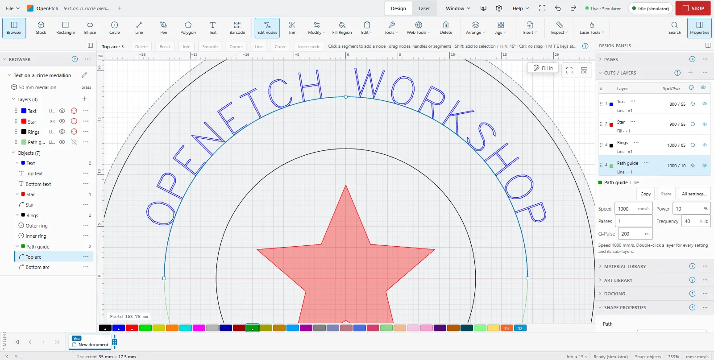

# Nodes and path editing

This page covers the tools that change the outline of a shape: **Edit nodes** and **Trim**, the **Modify** menu and the **Tools** menu, all in the **Modify** group of the ribbon.

> **Note:** On a Mac, press `Cmd` where this guide says `Ctrl`, and `Option` where it says `Alt`.

The phone's tool strip and menus leave out **Edit nodes**, **Trim**, **Weld** and **Add Tabs**. You can still start them from **More > Desktop features**.

## Edit nodes

Node editing changes the points and curves of a path.

To edit a shape's nodes:

1. Select one shape.
2. Click **Edit nodes** (`` Ctrl+` ``), or choose **Modify > Edit nodes**.
3. Drag a node, a curve handle or a segment. Click a segment to add a node there.
4. Press `Esc`, click **Edit nodes** again, or choose **Modify > Stop editing nodes** when you are done.

A rectangle, ellipse, polygon or text must be converted to a path first. The tool bar offers **Convert to path** when you click one.

To select nodes, click one, `Shift`+click to add more, or drag a box round them. While dragging, `Shift` keeps to horizontal, vertical or 45°, and `Ctrl` turns snapping off.

The tool bar buttons and keys act on the node or segment under the pointer, or else on the selected nodes:

| Button | Key | What it does |
|---|---|---|
| **Delete** | `Delete` or `D` | Deletes the nodes |
| **Break** | `B` | Breaks the path at the node |
| **Join** | `J` | Joins two selected end nodes |
| **Smooth** | `S` | Makes a smooth node (on a line, makes it a curve) |
| **Corner** | `C` | Makes a corner node |
| **Line** | `L` | Makes the segment between two selected nodes straight |
| **Curve** | `K` | Makes the segment between two selected nodes a curve |
| **Insert node** | | Adds a node in the middle of the selected segment |
| | `M` | Adds a node in the middle of the segment under the pointer |
| | `I` | Inserts a node at the pointer |
| | `T` | Trims at the pointer |
| | `E` | Extends the open end to the nearest line |

On the phone, **Edit nodes** is under **More > Desktop features** (select the shape first). Use **Insert node** in the bar, because there is no pointer to point with.

## Trim

Trim removes a piece of a shape up to the nearest crossings, like scissors.

1. Click **Trim** (`Ctrl+K`).
2. Click the piece to remove.
3. Press `Esc` when done.

On a touch screen, the piece lights up while you press and is cut when you lift your finger.

## Combine shapes

The **Modify** menu combines closed shapes. For the commands marked "last selected", the order you select in matters.

| Command | Key | Result |
|---|---|---|
| **Weld** | `Ctrl+W` | Merges overlapping shapes into one outline |
| **Union** | `Alt++` | One shape covering every selected shape |
| **Subtract (last selected)** | `Alt+-` | Removes the last selected shape from the others |
| **Intersect** | `Alt+*` | Keeps only where the shapes overlap |
| **Exclusive or (XOR)** | | Keeps the areas covered an odd number of times |
| **Cut shapes (last selected cuts)** | `Alt+C` or `Alt+Shift+C` | Cuts the others into pieces along the last selected shape |

> **Note:** Browsers keep `Ctrl+W` (close tab) for themselves, so use the menu for Weld in a browser tab. On the phone, Weld is under **More > Desktop features**.

## Offset shapes

Offsetting draws a new outline a set distance from a shape.

1. Select the shapes.
2. Choose **Modify > Offset shapes…** (`Alt+O`).
3. Set the **Distance** and the **Direction**: **Outward**, **Inward** or **Both**.
4. Pick the **Corners**: **Rounded**, **Sharp** or **Bevelled**.
5. Tick **Delete original shapes** to replace the originals, or **Merge shapes first (one result)** to offset overlapping shapes as one.
6. Click **Offset**.

The results are new shapes on each original's layer. Open paths are offset on both sides.

## Fillet corners

To round or sharpen corners, choose **Modify > Fillet corners…** and pick an **Action**:

- **Round corners**: set a **Radius** and click **Fillet**. Corners where the radius does not fit stay sharp. A negative radius cuts a concave bite instead.
- **Make every rounded corner sharp**: removes every circular-arc corner and extends the sides until they meet. Click **Make sharp**.
- **Make corners sharp: click each on the canvas**: click **Pick corners**, then click each rounded corner. Press `Esc` when done. This works on one shape at a time.

If you selected nodes in **Edit nodes** first, only those corners are rounded.

## Path tools

The rest of the **Modify** menu tidies paths:

- **Break apart** (`Alt+B`) splits a shape into its separate pieces.
- **Auto-join** (`Alt+J`) joins open paths whose ends meet. **Auto-join with tolerance…** joins ends up to a **Tolerance** apart.
- **Close path** closes open paths. **Close paths with tolerance…** closes only paths whose ends are within the **Tolerance**, by **Adding a line** or **Moving the ends together** (**Close by**).
- **Delete duplicates** (`Alt+D`) removes exact copies, which would otherwise burn twice. With nothing selected it checks the whole design.
- **Convert to path** (`Ctrl+Shift+C`) turns a rectangle, ellipse, polygon or text into a plain path.
- **Optimize shapes…** (`Alt+Shift+O`) cleans up traced or imported art: **Fit shapes to lines** (with a **Line tolerance**), **Fit shapes to arcs** (with an **Arc tolerance**) and **Smooth source shapes** (with **Smoothing**). They run in the order smooth, arcs, lines.
- **Reverse direction** reverses the direction a path is marked in.

## The Tools menu

The **Tools** menu in the **Modify** group holds:

- **Warp selection** and **Deform selection** (see below).
- **Generate tangent circle**: select exactly three circles, then click one of the red candidate circles, or **Create all**.
- **Rubber-band outline**: one outline round the selection, like a rubber band stretched round it.
- **Convert toolpath to path**: turns the marks a job would make (for example a fill's hatch lines) into shapes. With a selection it reads **Convert toolpath to path (selection)**.
- **Art Library**: opens the [Art Library](art-library.md).
- **Add Tabs**, **Dogbone corners…**, **Resize Slots in Selection…** and **Multi-File Trace…** (see [Images](images.md#multi-file-trace)).

The **Web Tools** menu beside it holds your own tools: web pages and saved command sequences (**Manage User Tools…**).

### Warp and deform

1. Select vector shapes (not images).
2. Choose **Tools > Warp selection** (four corner handles, **Perspective**) or **Tools > Deform selection** (a grid of handles, **Envelope**).
3. Drag the handles. Hold `Shift` for horizontal symmetry or `Alt` for vertical symmetry. Double-click a handle to reset it.
4. Press `Enter` or click **Apply**. `Esc` cancels; **Reset** starts again.

For a perspective warp, the four corners must form a convex shape.

## Common mistakes

- **Edit nodes shows no nodes.** The shape is still a rectangle, ellipse, polygon or text. Click **Convert to path** in the tool bar first.
- **Subtract removed the wrong shape.** Subtract and Cut shapes use the last selected shape. Select the cutter last.
- **Weld closed the browser tab.** `Ctrl+W` belongs to the browser. Use **Modify > Weld** instead.
- **A shape burns twice.** It may have an exact copy on top of it. Use **Modify > Delete duplicates**.
