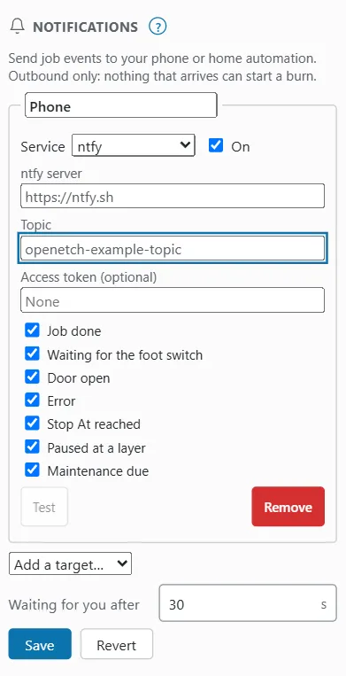

# Notifications

OpenEtch can tell you when a job is done, when the laser is waiting for you, or when something goes wrong. It sends these events to:

- **ntfy**, a push service with a phone app;
- a **Webhook**, any web address that accepts JSON;
- **Home Assistant**.

Notifications are outbound only. Nothing that comes back can start a burn.

> **Warning:** Notifications tell you when the laser needs you. They are not a reason to leave a running job unattended.

## Open the notification settings {#notification-settings}

Notifications are in Preferences:

- On a desktop, choose **File > Settings > Preferences…** and scroll to **Notifications**.
- On a phone, tap **More**, then **Settings > Preferences**, and scroll to **Notifications**.

The engine keeps the targets, so every browser and every laser device uses the same ones.



## Events {#events}

Each target picks which events it gets. A new target gets them all.

| Event | When it is sent |
|---|---|
| **Job done** | A run finished. |
| **Waiting for the foot switch** | The foot switch cycle has framed the job and is waiting, or a run waits for its start input, for longer than **Waiting for you after**. |
| **Door open** | The door interlock stopped a run or a foot switch press. |
| **Error** | A run failed, or framing hit an error. |
| **Stop At reached** | **Count** reached **Stop at**. |
| **Paused at a layer** | A run waits at a layer pause for Continue. |
| **Maintenance due** | A maintenance reminder became due. It is sent once, until you mark the reminder done. |

Each event also says whether it happened while framing or while marking (or neither, as for a maintenance reminder).

## Add a target {#add-a-target}

To add a target:

1. Open **Notifications** in Preferences.
2. In **Add a target…**, choose **ntfy**, **Webhook** or **Home Assistant**.
3. Fill in the name and the fields for that service (see the sections below).
4. Untick the events you do not want.
5. Press **Save**. OpenEtch says "Saved."
6. Press **Test**. OpenEtch says, for example, "Test sent (HTTP 200)." or "Test failed:" with the reason.

**Test** only works on a saved target. While you have unsaved changes, it is greyed out ("Save first").

Each target has:

| Field | What it does |
|---|---|
| (name, at the top) | The target's name, up to 60 characters. |
| **Service** | ntfy, **Webhook** or Home Assistant. |
| **On** | Untick to stop sending to this target without removing it. |
| The address | **ntfy server**, **URL (the event is POSTed as JSON)** or **Home Assistant URL (fires the openetch_event event)**. |
| The token | **Access token (optional)**, or **Long-lived access token** for Home Assistant. |
| The event tick boxes | Which events this target gets. |
| **Test** | Sends a test event now. |
| **Last:** | The result of the last send and when it happened, for example "Last: HTTP 200 at 14:03:22". |
| **Remove** | Removes the target (press **Save** afterwards). |

Under the targets, **Waiting for you after** sets how many seconds the job waits for the foot switch before **Waiting for the foot switch** is sent. It is 0 to 3600 seconds, and 30 to start with.

**Revert** appears while you have unsaved changes and throws them away. You can have up to 16 targets.

## ntfy {#ntfy}

ntfy sends push notifications to the ntfy phone app.

To get notifications on your phone:

1. Install the ntfy app on your phone.
2. Choose a topic name: up to 64 letters, digits, `-` and `_`. Make it long and hard to guess.
3. In the app, subscribe to that topic.
4. In OpenEtch, add an **ntfy** target.
5. Leave **ntfy server** as `https://ntfy.sh`, or type the address of your own ntfy server.
6. Type the **Topic**.
7. If your topic is protected, type the **Access token (optional)**.
8. Press **Save**, then **Test**.

Waiting, door, error, Stop At and layer pause events are sent with high priority. Job done and maintenance events are sent with normal priority.

> **Note:** On the public ntfy.sh server, anyone who knows a topic name can read its messages. Choose a topic nobody would guess, or use an access token.

## Webhook {#webhook}

A webhook sends each event as JSON in an HTTP POST to the address you give. Use it with automation tools or your own scripts.

To add a webhook:

1. Add a **Webhook** target.
2. Type the address in **URL (the event is POSTed as JSON)**. It must start with `http://` or `https://`.
3. If the service needs a token, type it in **Access token (optional)**. It is sent as `Authorization: Bearer` followed by the token.
4. Press **Save**, then **Test**.

The body looks like this:

```json
{
  "seq": 12,
  "event": "job_done",
  "operation": "mark",
  "title": "OpenEtch: Job finished",
  "message": "Job finished: …",
  "time_unix_s": 1793700000,
  "device": "my-laser",
  "project": "Serial tags",
  "run_id": "run-7",
  "count": 23,
  "stop_at": 50,
  "detail": null,
  "source": "openetch"
}
```

| Field | What it is |
|---|---|
| `event` | `job_done`, `waiting_for_foot_switch`, `door`, `error`, `stop_at_reached`, `layer_pause`, `maintenance_due`, or `test` from the Test button. |
| `operation` | `frame` or `mark`: whether it happened while framing or while marking. `none` for maintenance and test events. |
| `count` and `stop_at` | The device's count and Stop at when the event happened. |
| `seq` | A number that goes up by one per event, from 1 when the engine starts. |

## Home Assistant {#home-assistant}

OpenEtch fires each event in Home Assistant as an event of type `openetch_event`. Its data has the same fields as the webhook body.

To connect Home Assistant:

1. In Home Assistant, create a long-lived access token in your user profile.
2. In OpenEtch, add a **Home Assistant** target.
3. Type the address in **Home Assistant URL (fires the openetch_event event)**. It starts as `http://homeassistant.local:8123`.
4. Paste the token into **Long-lived access token**. Home Assistant targets need one.
5. Press **Save**, then **Test**.

In a Home Assistant automation, trigger on the event type and filter on the event name, for example:

```yaml
trigger:
  - platform: event
    event_type: openetch_event
    event_data:
      event: job_done
```

A Home Assistant target can also switch your fume extractor. See [Extractor](extractor.md#home-assistant).

## How sending works {#how-sending-works}

A few things are good to know about how the engine sends:

- It uses the `curl` program on the computer the engine runs on. If `curl` is missing, sending fails with "cannot run curl".
- It sends one event at a time and waits at most 10 seconds for each one. It only uses `http` and `https` and does not follow redirects.
- If a lot of events pile up, the newest are dropped and the engine logs it.
- Tokens are stored by the engine and never shown again. The token field then reads "Stored (type to replace)". Type a new token to replace it.
- Nothing a target sends back is acted on.

## What AI agents can do {#ai-agents}

AI agents connected through MCP can read the same events (`production_events`) and wait for the next one. They cannot add or change targets, so they cannot send your events anywhere. See [AI agents](ai-agents.md).

## Common problems {#common-problems}

| Message or problem | What to do |
|---|---|
| "Every target needs a name." | Type a name at the top of the target. |
| "Every target needs an http:// or https:// address." | Check the address. It must start with `http://` or `https://` and have no spaces or quotes. |
| "An ntfy target needs a topic (letters, digits, - and _)." | Type a topic with only those characters. |
| "Home Assistant needs a long-lived access token." | Create a token in Home Assistant and paste it in. |
| "A token has no spaces or quotes." | Copy the token again, without spaces. |
| The test fails with HTTP 401. | The token is wrong or has expired. |
| Nothing arrives. | Check that the target is **On**, that the event is ticked, and that your phone is subscribed to the topic. |
