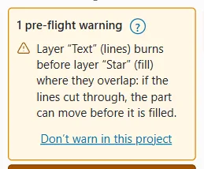
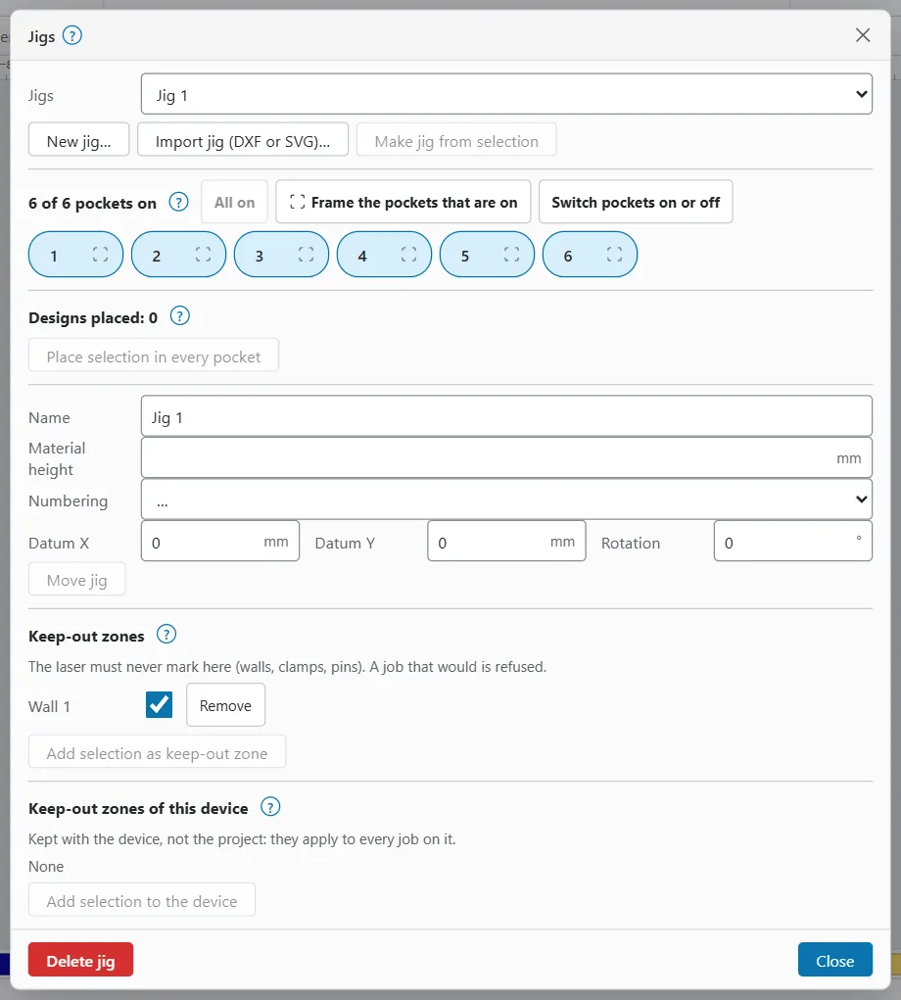

# Pre-flight warnings and keep-out zones

Before every job, OpenEtch looks for common mistakes and lists them next to **Start**. Keep-out zones go further: a job that would mark inside one is refused.

## Pre-flight warnings

The warnings are checked again whenever the design changes. Where they show:

- **Computer and tablet:** above **Start** in the **Laser** window. Next to **Start** in the ribbon, a small warning button shows the number of warnings, or **Start will be refused**. Click it to open the **Laser** window with the full list.
- **Phone:** above **Start** at the top of the **Job** sheet.

The list starts with **1 pre-flight warning** or **N pre-flight warnings**. Warnings do not stop you starting. A keep-out finding does: then the list starts with **Start will be refused**.

| Check | Example message | What to do |
|---|---|---|
| Cut before fill | Layer “Outline” (lines) burns before layer “Fill” (fill) where they overlap… | Reorder the layers in **Cuts / Layers**, or turn on **Sort cuts last** in **Optimization…** A cut that frees the part can let it move before it is filled. |
| Empty output layers | Layer “…” is set to output but has nothing on it. | Switch the layer's output off, or check you put the shapes on the right layer. |
| Unfilled variables | … merges CSV columns but no CSV file is loaded: it would burn empty. | Load the CSV, or check the row and End. Similar warnings cover a CSV row past the last one, an empty cell, and a serial number past End. See [Variable text and barcodes](variable-text-and-barcodes.md). |
| Serial / CSV rows | "…" at 0042: … | A serial or CSV text would run outside its pocket or stock, or has missing letters. Click **Check every row…** next to the warning to see every row. |
| Duplicate shapes | 3 shapes are exact copies on the same layer and would burn twice (…). | Delete the copies. See [Duplicate shapes](#duplicate-shapes). |
| Keep-out zones | “…” on layer “…” reaches into keep-out zone “…”. | Move the design or the jig, or switch the zone off. This one refuses the job. |

### Switch a check off for this project

If a warning is expected for this design, click **Don’t warn in this project** next to it. That check is no longer made for this project; the choice is saved with the project.

To bring them back, click **Warn again about switched-off checks (N)** under the list.

The keep-out check cannot be switched off here, because the engine refuses such a job anyway. Switch the zone off instead.

### Duplicate shapes

Two identical shapes on the same output layer burn the same place twice. On a MOPA colour or a fine engraving that doubles the energy and spoils the result.

Copies usually come from pasting twice, **Duplicate** (`Ctrl+D` copies in place) or importing a file that already has them.

To remove them, in the Design workspace open **Modify** in the ribbon and choose **Delete duplicates**, or press `Alt+D`. It keeps one of each and tells you how many it deleted. With shapes selected, it only looks in the selection.

## Objects outside the field

A galvo laser can only reach a square field. Any object that touches or crosses its edge cannot be burned.

You can tell when this happens:

- The object is drawn red on the canvas.
- A note over the canvas says **1 object outside the galvo field (red). The laser cannot reach it.** On a phone it is shortened to **N off field**.
- In the Laser workspace, the **Toolpath** card says **No preview:** and that the objects fall outside the field.
- **Start** and **Request run** are refused.

To fix it, move or scale the object inside the field. **Centre on field** (`P`) in the Design workspace is a quick way. OpenEtch never clips or shrinks a design for you.

## Keep-out zones

A keep-out zone is an area the laser must never mark: a jig wall, a clamp, a locating pin. If any mark of a job falls inside an enabled zone, the job is refused when it is planned, whoever asked for it: **Start**, the foot switch, or a run an agent prepared. Travel moves (laser off) do not count.

There are two kinds:

| Kind | Saved with | Applies to | Who can change it |
|---|---|---|---|
| Jig keep-out zones | The project, as part of a jig | Jobs of this design. They move with the jig. | You, and an AI agent editing the design |
| Device keep-out zones | The device | Every job on that device | Only a person in the app |

Both kinds are drawn hatched on the canvas.

> **Note:** A keep-out zone only stops OpenEtch from planning marks there. It does not stop someone moving the part or the jig. Frame the job to check.

### Jig keep-out zones

To add a keep-out zone to a jig:

1. In the Design workspace, draw a closed shape over the area to protect, for example a rectangle over a clamp.
2. Select it.
3. In the ribbon's **Arrange** group, open **Jigs** and choose **Jigs…**
4. Pick the jig.
5. Under **Keep-out zones**, click **Add selection as keep-out zone**.

The shape becomes the zone (named **Wall 1**, **Wall 2** and so on) and is removed from the design, so it never burns. The zone appears in the list with a checkbox: untick it to switch the zone off, or click **Remove** to delete it.

For how to make a jig, see [Jigs](jigs.md).

### Device keep-out zones

Use a device zone for something fixed on the machine, such as a clamp that never moves. It applies to every job on the active device, in every project.

1. Draw a closed shape over the area and select it.
2. Open **Jigs…** (as above). You do not need a jig for this.
3. Under **Keep-out zones of this device**, click **Add selection to the device**.

The zone is saved with the device as **Zone 1**, **Zone 2** and so on. Untick it to switch it off, or click **Remove**.

The shape you drew stays in the design. Delete it, or move it to a tool layer, or it would burn inside its own zone and the job would be refused.

Device zones can only be changed in the app. AI agents cannot add, change or remove them.

### When a job is refused

A refused job says which zone it marks inside, the layer and the position, for example: the job marks inside keep-out zone "Wall 1" (layer …, at 12.50, -3.20 mm); move the design, or the jig, or switch the zone off.

To fix it:

1. Look for the hatched zone on the canvas near that position.
2. Move or shrink the design, or move the jig, until no mark touches the zone.
3. If the zone is wrong, switch it off in **Jigs…** (only if you are sure the laser cannot hit anything there).

The check uses the planned toolpath, so a fill's hatch lines and a line layer's outline are both checked, not just the shape's box.
