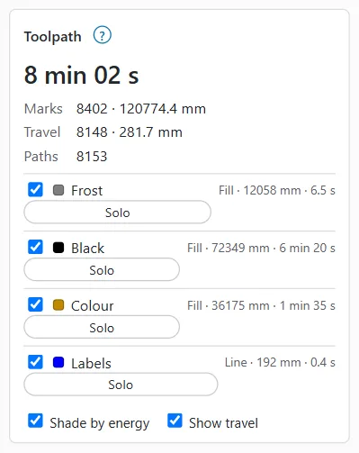
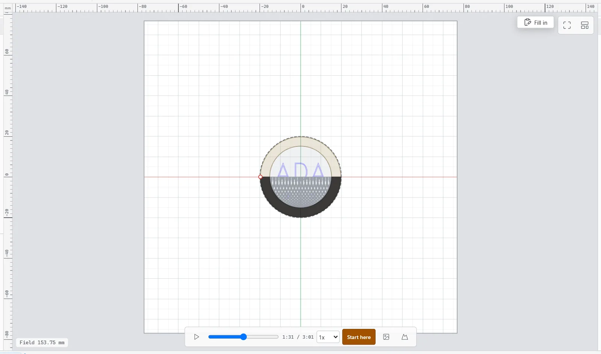
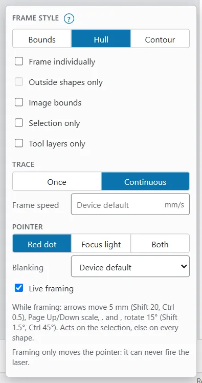

# Preview and framing

Before you burn, check two things: that the toolpath is what you expect (the preview), and that it lands in the right place on the work (framing). The preview works without a laser. Framing needs a galvo laser connected.

## Open the preview

The preview shows the toolpath the laser will follow, planned for the active device.

To open it on a computer or tablet:

1. In the workspace switcher in the top bar, choose **Laser**. On a tablet the switcher shows icons only.
2. If the toolpath does not show, click **Preview** in the ribbon.

You can also press `Alt+P`. From the Design workspace it switches to the Laser workspace with the preview on; from the Laser workspace it switches back to Design.

On a phone, tap the **Job** tab at the bottom. The app switches to the Laser workspace, so the canvas above the sheet shows the job.

In the preview:

- Marks are drawn solid, in their layer's colour.
- Travel moves (laser off) are drawn dashed, when **Show travel** is on.
- Objects outside the laser's field are drawn red. See [Objects outside the field](preflight-and-keep-out.md#objects-outside-the-field).

> **Note:** The preview is a simulation of the planned toolpath. Check the real result on scrap.

## The Toolpath card

The **Toolpath** card gives the numbers behind the preview.

- On a computer or tablet, it is in the **Machine and runs** window of the Laser workspace.
- On a phone, scroll down the **Job** sheet.

The card shows:

- The estimated job time, in large type.
- **Marks**: how many mark segments, and their total length.
- **Travel**: how many travel moves, and their total length.
- Warnings from the planner, if any.
- One row per layer: a checkbox to show or hide its toolpath, the mode (**Line**, **Fill** or **Fill+Line**), the mark length and the layer's estimated time. **Solo** shows only that layer; press it again to show every layer.
- For a layer with sub-layers, one row per pass with its settings. A **Cleanup** badge marks a cleanup pass.

Display options at the bottom:

| Option | What it does |
|---|---|
| **Shade by energy** | Draws each pass darker the more energy it puts in, instead of in its layer colour. It compares passes with each other; it does not show J/mm². |
| **Show travel** | Draws the travel moves as dashed lines. |
| **Dithered images** | Shows images as their layer's dither will engrave them. Only shown when the design has an image. |

> **Note:** Hiding a layer or a pass here only changes the display. It still burns. To leave a layer out of the job, switch its output off in **Cuts / Layers** (see [Layers and settings](layers-and-settings.md)).

If the job cannot be planned, the card says **No preview:** and the reason, for example objects that fall outside the field or a power above the machine's limit. Fix that first; Start will be refused too.

## Play and scrub the job

The preview's time slider sits at the bottom centre of the canvas. Use it to see the order the laser will mark in.

| Control | What it does |
|---|---|
| Play / **Pause** | Plays the job at the chosen speed. |
| Slider | Drag to any moment: the canvas shows only what has burned up to then. |
| Clock | The time at the slider and the whole job's time. Hover over it to see how many segments are done. |
| **Playback speed** | From 0.25× to 100× the estimated real time. |
| **Start here** | Starts or requests a run from the slider position (see below). |
| **3D relief** | Opens the **3D relief preview**. See [3D relief preview](relief-preview.md). |
| **Save preview image (PNG)** | Saves a picture of the preview. |

On a small phone the slider gives way to warnings and messages when the **Job** sheet is half open, and comes back when there is room.

### Start from a point

If a job stopped part way, you can burn the rest without starting again.

1. Drag the slider back to where the run should start. With the slider at the end, **Start here** is greyed out.
2. Click **Start here**.
3. The run goes through the same checks as **Start**. Without a PIN it burns at once (**Job started from segment N.**). With the operator PIN it waits for your approval in the **Laser** window. See [Running a job](running-a-job.md).

**Start here** always runs the whole job from that point: it ignores **Cut selected graphics** and any re-mark region. If the design changed since the preview, nothing starts: wait for the new preview and try again.

## Time estimates

OpenEtch shows the estimated job time in several places:

| Where | What it shows |
|---|---|
| The **Toolpath** card | The whole job, each layer and each pass |
| The status bar (Design workspace, computer and tablet) | **Job ≈** and the time, for the whole job on the active device |
| The **Start** button | The time after the scope, for example **Start · all · ~2:14**. Only for the whole job. |
| A run waiting for approval | **Est. time** |
| While a job runs | Time elapsed and time left in the **Laser** window, and the progress on the status chip |
| The job log | The estimate next to the time the board measured |

The estimate comes from the planner's model of the machine. After real runs, OpenEtch learns a small correction for each device:

- It starts after 3 finished runs on a real laser that were each estimated at 1 second or more. Runs that took less than half or more than twice their estimate are ignored.
- It uses the last 10 such runs, and never makes the estimate shorter than 80 % or longer than 125 % of the planner's.
- Simulator runs, runs that were paused and runs made of several parts (rotary strips, Z steps) do not count.

Time spent waiting at a layer pause is not part of the estimate. When the estimate runs out while the job is still marking, the **Laser** window shows **Finishing…** rather than 0 seconds left.

## Frame the job

Framing traces the job's outline on the work with the red pointer, so you can see where it will burn. Framing only moves the pointer: it can never fire the laser.

To frame the job:

1. Put the work on the bed and focus the laser.
2. Click **Frame**. On a computer it is in the **Laser** window and in the ribbon's **Job** group. On a tablet it is also in the strip above the canvas, next to the status chip and **Start**. On a phone it is near the top of the **Job** sheet.
3. Watch the red pointer trace the outline. Move the work, or the design, until it lines up.
4. Click **Stop frame**, or press `Esc`.

While framing, the status chip shows **Framing** with a **Stop frame** button. Stopping a frame keeps any runs that are waiting for approval.

A continuous frame stops by itself after about 2 minutes. You cannot start a job while framing: stop the frame first.

## Framing options

Click the small arrow next to **Frame** in the **Laser** window to open **Framing options**. The options stay set in this browser, and a frame that is running follows any change.

| Option | Choices | What it does |
|---|---|---|
| **Frame style** | **Bounds** | The smallest rectangle around the shapes. Fastest. |
| | **Hull** | A rubber band around the shapes. Nearly as fast, and fits curves better. This is the default. |
| | **Contour** | The shapes' own outlines. Slowest, exact. |
| **Frame individually** | On / off | One frame per shape instead of one around them all. Not for Contour. |
| **Outside shapes only** | On / off | Contour only: skips shapes inside others, such as the holes in letters. |
| **Image bounds** | On / off | Frames an image's content (its non-white pixels), not its whole rectangle. |
| **Selection only** | On / off | Frames only the selected shapes. |
| **Tool layers only** | On / off | Frames only shapes on layers whose output is off, such as a jig outline. Not with **Selection only**. |
| **Trace** | **Once** / **Continuous** | Traces once, or keeps tracing until you stop it. Continuous is the default. |
| **Frame speed** | mm/s | Empty (**Device default**) uses the device's frame speed. |
| **Pointer** | **Red dot**, **Focus light**, **Both** | Which light traces. The focus light needs a focus light output in the device settings. |
| **Blanking** | **Device default**, **On**, **Off** | Turns the pointer off while it travels between shapes. |
| **Live framing** | On / off | The frame follows every edit. On by default. |

### Live framing

With **Live framing** on, the frame redraws whenever the design changes, so you can line the design up with the work while you watch the pointer.

While framing, these keys move the framed shapes (the selection, or every shape on an output layer if nothing is selected):

| Keys | What they do |
|---|---|
| Arrow keys | Move 5 mm (`Shift` 20 mm, `Ctrl` 0.5 mm) |
| `Page Up` / `Page Down` | Scale up or down by 5 % (`Shift` 10 %, `Ctrl` 1 %) |
| `.` and `,` | Rotate 15° (`Shift` 1.5°, `Ctrl` 45°) |

Each key press is an ordinary edit, so you can undo it. The keys do nothing while you are typing in a field.

### Frame shortcuts

The arrow next to **Frame** in the ribbon's **Job** group (**Frame options**) offers **Frame (Laser window options)**, **Frame the selection**, **Frame the bounding box** and **Frame the outline (contour)**.

| Keys | What they do |
|---|---|
| `Ctrl+Shift+A` | **Frame the selection**, with the Laser window's options (the whole job when nothing is selected) |
| `Alt+R` | Frame the bounding box (**Bounds** style) |
| `Alt+Shift+R` | Frame the shapes' own outlines (**Contour** style) |

With shapes selected, these frame only the selection; with nothing selected, they frame the whole job.

## The red-light pointer

Apart from framing, you can use the red pointer to find a point on the bed.

- **Red dot always on**, in the **Laser** window, keeps the pointer lit while the laser is idle (never during a job). It is saved in the device's IO settings.
- **Red dot and Z**, near the bottom of the **Laser** window, has **Red dot X** and **Red dot Y**. Type a field position and click **Move red dot here** to hold the dot there.
- **Position laser**: press `Alt+L`, then click on the canvas where the dot should point. `Esc` cancels.
- **Stop frame** turns the held dot off again.
- If your device has a Z lift, **Red dot and Z** also has **Z position** and **Move Z**. Moving Z is motion only.

None of these fire the laser: the red dot is light only.

If your machine has an external framing switch, set it as the **Start Framing input** on the device's **Ports and laser** settings page. Pressing it frames the job while the laser is idle.

## Common mistakes

- **Framing the selection by accident.** If only part of the job is framed, check **Selection only** in **Framing options**, or deselect everything.
- **Expecting a hidden layer to stay off.** Hiding a layer in the **Toolpath** card does not stop it burning.
- **Framing the wrong revision.** With **Require framing before start** on, every edit means you must frame again before the burn. Live framing keeps the frame up to date.
- **Trusting the frame for height.** Framing shows position, not focus. Check the material height separately.
