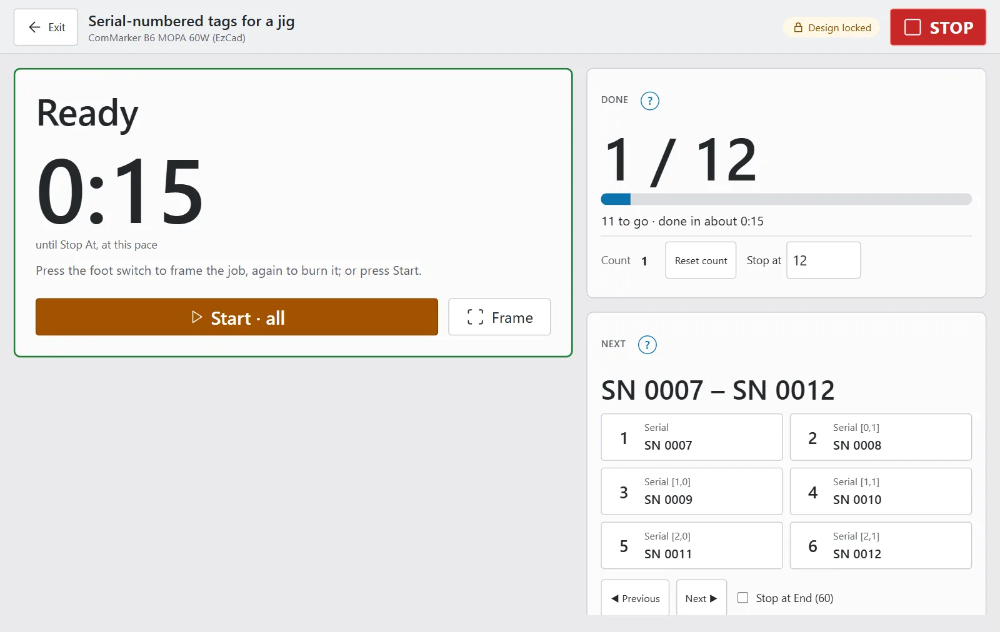
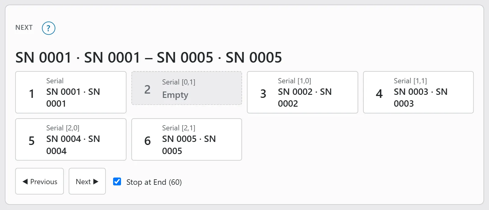
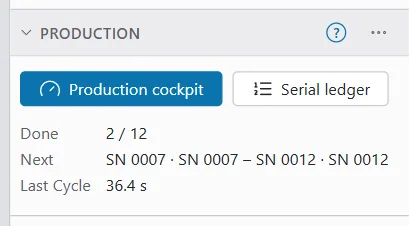
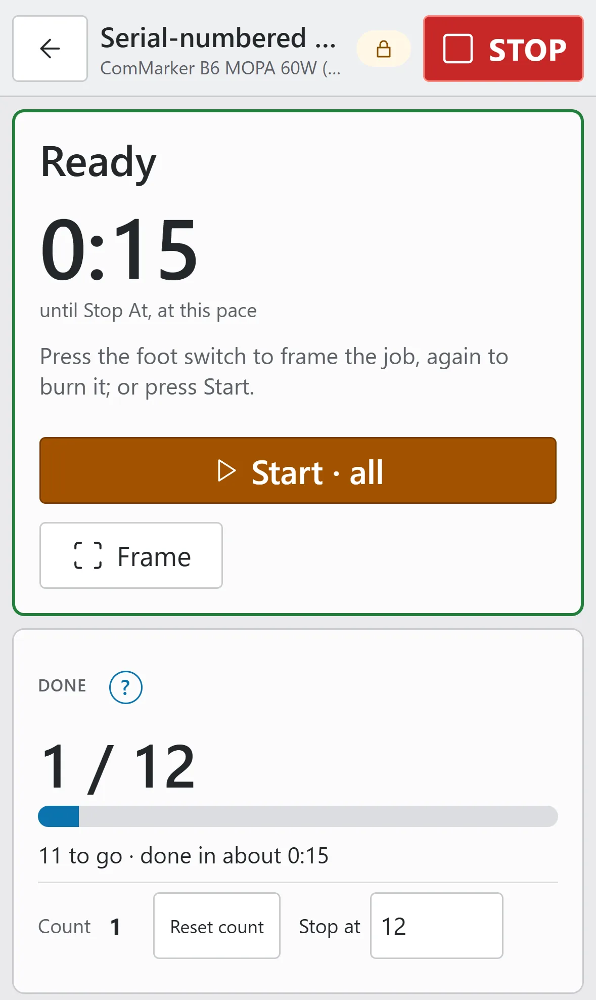

# Production cockpit

The production cockpit is a full-screen view for marking the same job many times, for example a jig of tags or a tray of coins. It is built for a tablet on a stand next to the laser, but it also works on a phone or a desktop.

In large type, the cockpit shows what the machine is doing, how many pieces are done, which serial numbers the next run will mark and how long the last cycles took. While it is open, it locks the design so nobody can change the job between pieces.

> **Warning:** The cockpit makes repeat work quicker. It does not make it safe to walk away. Wear eye protection rated for your laser's wavelength (about 1064 nm for a fibre laser), run fume extraction and never leave a running job unattended. **STOP** in the app is a software stop, so know where the laser's hardware E-stop is.

## Before you start a batch {#before-a-batch}

Check the job on scrap before you mark the first real part.

1. Mark one piece of scrap of the same material with the same settings.
2. Work out the energy density of every fill layer. The formula is: J/mm² = power (W) ÷ (speed (mm/s) × line interval (mm)). If a layer shows power as a percentage, multiply it by the laser's rated power first (50 % of 60 W is 30 W).
3. Check the result. For example, 30 W at 1000 mm/s with a 0.005 mm line interval gives 30 ÷ (1000 × 0.005) = 6 J/mm². On stainless steel with a 60 W MOPA, roughly 2 to 15 J/mm² marks without melting. Much higher can melt or warp thin stock.
4. Frame the job on the jig and check that it lines up.
5. Set **Stop at** to the number of pieces you want (see [Done: the count and Stop at](#counter-and-stop-at)).

> **Note:** The energy figures are starting points to test, not guarantees. Many production features have so far only run on the simulator. Watch the first pieces closely.

## Open the cockpit {#open-the-cockpit}

To open the cockpit on a desktop or laptop:

1. Switch to the **Laser** workspace in the top bar.
2. In the ribbon's **Production** group, click **Production cockpit**.

You can also open it in these ways:

- Click **Production cockpit** at the top of the **Production** window (see [The Production window](#production-window)).
- Open command search and type "Production cockpit".
- Add `#/cockpit` to the end of the app's address in the browser.
- If you installed OpenEtch as an app, use its **Production cockpit** shortcut (shown as **Cockpit** where space is short) where your system shows app shortcuts.

On a phone, tap the **Job** tab at the bottom of the screen. Then tap **Production cockpit** in the **Production** part of the sheet.

On a tablet, use the **Laser** workspace as on a desktop: the **Production** group sits with the other Laser tools, and the **Production** window is with the other windows.

To leave the cockpit, press **Exit** at the top left, or use the browser's Back. The design unlocks as you leave.

If the engine is too old for the production features, the cockpit says "This engine has no production features yet." and the Production window is not shown.

## What the cockpit shows {#cockpit-layout}

The bar at the top holds:

- **Exit**, at the left;
- the project name, with the device name under it;
- a **Design locked** badge while the design lock is on;
- **STOP**, the largest button on the screen. It is always visible, above everything else in the cockpit.

Below the bar are the status panel and up to four cards: **Done**, **Next**, **Times** and **Serial ledger**. The **Serial ledger** card only appears once a run has marked serial numbers or CSV rows.

On a wide screen, the status panel is on the left and the cards are on the right. The panel stays in view while you scroll the cards, so Start and Continue are always on screen.

On a screen narrower than 900 pixels (a tablet held upright, or a phone), everything is in one column with the status panel first. On a screen narrower than 600 pixels, **Exit** and **Design locked** show as icons only.

### The status panel {#status-panel}

The large panel says what the machine is doing, most urgent first. When the laser needs you, it shows a **Waiting for you** badge.

| Title | What it means | What to do |
|---|---|---|
| **Engine offline** | The app cannot reach the engine. STOP may not reach the laser. | Use the hardware E-stop if you need to stop. Check the network. |
| **Paused before "layer"** | A run waits at a layer pause. The clock shows how long it has waited. | Get the part ready, then press **Continue** (or the foot switch, when the device has one). |
| **Paused** | Someone paused the job. | Press **Resume**, or STOP. |
| **Waiting for you** | A run waits for the foot switch to start its next pass. | Press the foot switch. |
| **Starting…** | The job is starting. | Wait. |
| **Marking** | The job is burning. The clock counts down the time left and a bar shows progress. At the very end it says "Finishing…". | Watch the job. **Pause** is there if you need it. |
| **Ready: press the foot switch** | The foot switch cycle has framed the job on the jig. The clock shows how long until the frame stops. | Load the part, check the frame, then press the foot switch to burn. |
| **Framing** | The red pointer traces the job. | Stop the frame before Start. |
| **Target reached: 50 / 50** | **Count** has reached **Stop at**. | Reset the count, or raise Stop at. |
| **Serial range used up** | **Stop at End** is on and every value up to End is used. | Reset the serial counter, or raise End in Variable Text. |
| **No laser connected** | The engine runs, but no laser is connected. | Connect the laser, or check the device in the Laser window. |
| **Ready** | Nothing is running. With Stop at set, the clock shows about how long the rest of the batch will take at the current pace. | Press **Start**, or the foot switch. |

The buttons under the title change with the state:

- **Start** is the app's normal Start, with the Job Checklist when the device uses one. On an engine with an operator PIN it reads **Request run**. It shows when no job is running.
- **Frame** traces the job's bounding box with the red pointer (no emission), whatever the Laser window's **Framing options** say. To frame in another style, use **Frame** in the Laser window. While a frame runs, the button reads **Stop frame**. Frame is greyed out while the engine is offline.
- **Pause** and **Resume** show while a job runs.
- **Continue** shows while a run waits at a layer pause.

Under the buttons, **Waiting for approval** lists runs that wait for a person: a run an AI agent prepared, a run requested in the app, or a [re-mark](serial-ledger.md#re-mark-a-slot). To start one:

- On an engine without a PIN, press **Start** on its row.
- On an engine with a PIN, press **Approve…**, type the **Operator PIN**, then press **Confirm and fire**.

### Done: the count and Stop at {#counter-and-stop-at}

The **Done** card shows how many pieces this device has completed. With **Stop at** set, it shows the count against the target (for example "23 / 50"), a progress bar and the time left, such as "27 to go · done in about 12:30".

The card's controls are:

| Control | What it does |
|---|---|
| **Count** | The number of completed passes on this device. Each repeat of a job counts, and so does a re-mark. |
| **Reset count** | Sets this device's count back to 0. It is greyed out while a job runs. |
| **Stop at** | Approvals are refused once the count reaches this number. Leave it empty (it shows "off") to switch it off. |

To run exactly 50 pieces:

1. Press **Reset count**.
2. Type 50 in **Stop at**, then press `Enter` or tap somewhere else.
3. Run the batch as usual.

At 50 the status panel shows **Target reached: 50 / 50**, and the card says "Count 50 has reached Stop At: reset the count or raise Stop At to run again." Every further Start is refused, the foot switch's too. A **Stop At reached** [notification](notifications.md#events) goes out if you set one up.

### Next: the values the next run marks {#next-card}

The **Next** card is for designs with serial-number or CSV text (see [Variable text and barcodes](variable-text-and-barcodes.md)). Without such text, it says "No serial-number or CSV text in this design."

The headline shows what the next run marks, for example "SN 0007 – SN 0012" in the Serial-numbered tags example. A tag's text and its QR code carry the same number, so each number shows once.

Below it there is one button per **slot**. A slot is everything that shares one Variable Text offset, which is usually one pocket's tag and its barcode. Each slot button shows:

- a badge: the jig pocket's number (for example "P3", the number you see on the jig) when the slot sits in a [jig pocket](jigs.md), or else the slot number;
- the slot's name;
- the value it will get, or **Empty** or **Past End**.

To leave a pocket out of the next run:

1. Tap its slot. It shows **Empty**.
2. Run as usual. The empty pocket is not marked at all, and the next pockets take its value, so no serial number is wasted.
3. When the pocket is loaded again, tap the slot again.

> **Note:** An empty slot stays empty for every run until you tap it again. It is saved with the design.

The tools under the slots are:

| Control | What it does |
|---|---|
| **◀ Previous** | Moves the serial counter back by one set (Variable Text's **Advance by**). |
| **Next ▶** | Skips one set of values. |
| **Stop at End (60)** | When ticked, a slot whose value would pass End is left out (it shows **Past End**). When every value up to End is used, runs are refused. When not ticked, the number wraps back to Start after End. The number in brackets is End. |

You can change all of these while the design is locked. The [serial ledger](serial-ledger.md#stop-at-end) explains Stop at End in more detail.

### Times {#times-card}

The **Times** card shows:

| Line | What it is |
|---|---|
| **Last burn** | From approval to the end of the last finished run. |
| **Last cycle** | From the end of the previous finished run to the end of the last one, so it includes loading the part. |
| **Average cycle** | The average of the last 20 cycles. A gap of more than 30 minutes starts a new series. |
| **Hour meter** | This device's marking hours (see [Hour meter and maintenance](maintenance.md)). |

When an extractor is set up, the card also shows **Extractor on** or **Extractor off**, with "(running on)" during its run-on time and a **Switch on** or **Switch off** button. See [Extractor](extractor.md).

When maintenance is due, the card shows one line per item, for example "Due: Clean the lens", with a **Done** button. See [Hour meter and maintenance](maintenance.md#mark-done).

### The Serial ledger card {#ledger-card}

The **Serial ledger** card shows the last three runs that marked serial numbers or CSV rows. Each run shows its time and its result (finished, aborted or failed), or "re-mark of slot 3".

Each marked slot is a button, for example "3: SN 0009". To mark that pocket again with the same value, tap the button. OpenEtch says "Re-mark requested: approve it to burn". See [Re-mark a slot](serial-ledger.md#re-mark-a-slot). Slots that were left out are greyed out.

## The design lock {#design-lock}

While the cockpit is open, it locks the design. Every edit is refused: from this browser's other tabs, from other devices, from scripts and from AI agents. Undo, redo, moving in the timeline and switching document tabs are refused too.

An edit that is refused shows a message like "the design is locked by the production cockpit on iPad: close the cockpit (or unlock it in the app) to edit".

These still work while the design is locked:

- the Variable Text counter and the slots (**Empty**, **◀ Previous**, **Next ▶**, **Stop at End**);
- **Count**, **Reset count** and **Stop at**;
- Start, approvals, framing, Pause and Resume;
- **STOP**, which is never blocked.

The lock names the device that holds it: iPad, iPhone, Android, Mac, Windows or Linux. The cockpit renews the lock every 15 seconds. The lock ends about 45 seconds after the last renewal, so a closed tab or a lost connection unlocks the design by itself.

If you open the cockpit on a second device, the second cockpit takes the lock over.

To unlock from another device:

1. Open the **Production** window. It says, for example, "The cockpit on iPad has the design locked."
2. Press **Unlock**.

> **Note:** If that cockpit is still open, it takes the lock back at its next renewal, within 15 seconds. Close it on the device that has it open instead.

> **Tip:** Switching jig pockets on or off is a design edit, so it is refused while the cockpit is open. To skip a pocket for a run, mark its slot **Empty** in the Next card instead.

## Run a batch with the foot switch {#foot-switch-cycle}

The foot switch cycle lets you work with both hands on the parts: one press frames the job on the jig, the next press burns it.

You need all of these:

- An engine without an operator PIN. The Laser window then says "No PIN on this engine". With a PIN, the foot switch cycle is off.
- A galvo device with **Start marking input** set in its device settings (**IO ports**). See [Devices and calibration](devices-and-calibration.md).
- The Job Checklist switched off for the device. A foot cannot tick the checklist, so every foot switch burn is refused while it is on.

To run a batch with the foot switch:

1. Open the job and check it on scrap (see [Before you start a batch](#before-a-batch)).
2. Open the cockpit. The status panel says "Press the foot switch to frame the job, again to burn it; or press Start."
3. Load the jig, then press the foot switch. The red pointer frames the whole job and the panel shows **Ready: press the foot switch**.
4. Check that the frame lines up with the parts.
5. Press the foot switch again. It burns exactly what is framed.
6. When the burn ends, framing starts again with the next serial numbers. Swap the parts and press again.
7. To finish, press **STOP** or **Stop frame**. If nobody presses for 10 minutes, the frame stops and the cycle ends by itself.

The cycle follows these rules:

- Only the framed version burns. If the design or the device changed since the frame started, the press frames the new version instead and tells you.
- Every burn goes through the normal checks: the door interlock, Require Framing, Stop at and the extractor check.
- The foot switch never approves runs that wait for approval, such as an AI agent's run or a re-mark. Start those in the app.
- A press while a run is burning is ignored, so it never queues a second burn.
- STOP ends the cycle and its frame. So does a burn that does not finish (stopped, door opened or failed): press the foot switch again to frame.

If the job waits for the foot switch for longer than **Waiting for you after** in [Notifications](notifications.md#add-a-target), a **Waiting for the foot switch** notification goes out.

## Engines with an operator PIN {#pin-mode}

On an engine with an operator PIN, the cockpit shows "This engine approves runs with the operator PIN: request the run, then approve it below."

To run a job:

1. Press **Request run**.
2. Under **Waiting for approval**, press **Approve…**
3. Type the **Operator PIN**, then press **Confirm and fire**.

The foot switch cycle is off on these engines. A run can still wait for the foot pedal if you choose the run option **Wait for foot pedal (Start Marking input)**. The panel then shows **Waiting for you**. See [Running a job](running-a-job.md).

## Continue at a layer pause {#layer-pause}

A layer can stop the run before it starts, with the laser off, so you can clean, flip or change the part. You switch this on with **Pause before this layer (wait for Continue)** in the layer's cut options. See [Layers and settings](layers-and-settings.md).

When a run waits at a layer, you see it in these places:

- the cockpit's status panel, with **Continue**;
- the **Production** window, with "Waiting for you" and **Continue**;
- a bar over the canvas in every workspace, with **Continue**;
- the status chip in the top bar, which reads "Waiting at a layer".

To go on, press **Continue**, or the foot switch when the device has a **Start marking input**. OpenEtch says "Continuing the run".

A few limits apply:

- Layer pauses work for galvo jobs only, and not for rotary jobs.
- A pause before the job's first layer is ignored, because Start already waits for you.
- A run waits at most one hour at a pause. After that, the run ends as stopped.
- STOP still works at a pause and ends the run.

## The Production window {#production-window}

The **Production** window is part of the **Laser** workspace. On a desktop, open it from the **Window** menu if it is hidden. On a phone, it is in the **Job** tab's sheet.

It shows:

- **Production cockpit** and **Serial ledger** buttons;
- "Waiting for you" with **Continue**, while a run waits at a layer;
- **Done**, **Next** and **Last cycle**;
- why the next run would be refused, for example when the serial range is used up;
- the design lock, with **Unlock**;
- maintenance that is due;
- whether the extractor is on or off.

## Use a tablet or phone at the machine {#tablet-and-phone}

A tablet on a stand next to the laser makes a good operator screen. To set one up:

1. Open OpenEtch in the tablet's browser and open the cockpit.
2. Add the page to the Home Screen, so it can open straight into the cockpit.
3. Set the tablet's auto-lock to never while you work.

> **Note:** If the tablet goes to sleep, the cockpit stops renewing the lock and the design unlocks about 45 seconds later. It locks again when the cockpit is back on screen.

On an engine without a PIN, Start must come from the OpenEtch app's own page in a browser. If the engine cannot tell that it does, Start is refused with "Start works only in the OpenEtch app in a browser opened at http://localhost or https. Use the foot switch, or open the app on the laser's computer." See [Troubleshooting](troubleshooting.md).

On a phone, the cockpit is one column: the status panel first, then the cards. Scroll down for the cards. **STOP** stays in the bar at the top.

## What AI agents can do {#ai-agents}

AI agents connected through MCP can:

- read what the cockpit shows (`production_status`);
- follow the production events (`production_events`);
- read the serial ledger (`serial_ledger`) and the hour meter (`hour_meter`);
- prepare production with design commands, such as layer pauses, Stop at End and empty slots;
- request a re-mark (`serial_remark_request`), which only creates a run that waits for approval.

Agents can never approve or start a burn. They cannot press Continue, switch the extractor, unlock the cockpit, or change notification, maintenance or extractor settings. While the cockpit is open, their design edits are refused like everyone else's; only Variable Text commands (the counter, empty slots, Stop at End) still work. See [AI agents](ai-agents.md).

## Common problems {#common-problems}

| Problem | What to do |
|---|---|
| Every edit is refused with "the design is locked by the production cockpit". | A cockpit is open somewhere. Press **Exit** there, or **Unlock** in the Production window. |
| Start is refused because the job counter reached Stop At. | Press **Reset count**, or raise **Stop at**. |
| The panel shows **Serial range used up**. | Reset the serial counter or raise End in Variable Text, or untick **Stop at End**. |
| The foot switch does nothing. | Check that the engine has no PIN, the device has a **Start marking input**, and the Job Checklist is off. A press while a run burns is ignored. |
| Start is greyed out. | Read the reason shown under the button. |
| The cockpit says "This engine has no production features yet." | Update the engine. |
