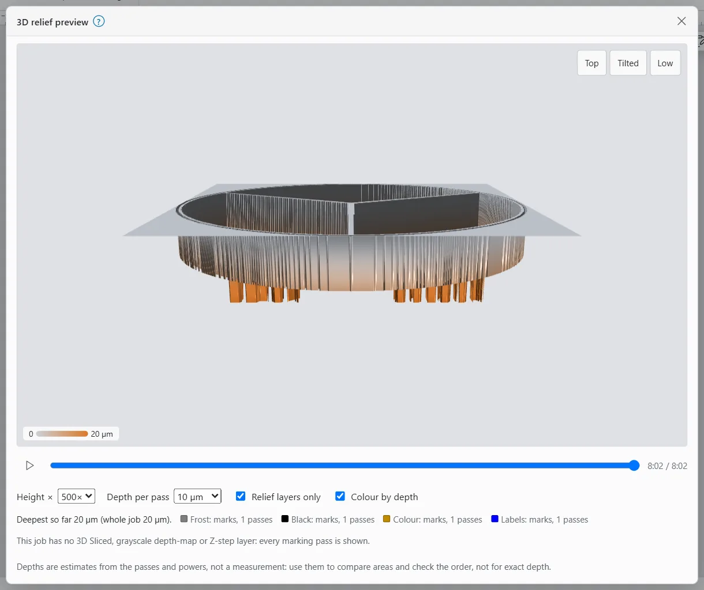

# 3D relief preview

The 3D relief preview shows a height view of what a job removes, pass by pass. Use it to check a coin's relief, a deep engraving or a 3D Sliced image before a long burn: where material goes, in which order, and which areas end up deepest.

It is display only. It reads the preview the Laser workspace already has, and never talks to the laser.

> **Note:** Depths are estimates from the passes and powers, not a measurement. Use them to compare areas and check the order, not for exact depth.

## Open the 3D relief preview

1. Switch to the **Laser** workspace. On a phone, tap the **Job** tab.
2. Make sure **Preview** is on (it is by default).
3. In the preview bar at the bottom of the canvas, click the mountain button (**3D relief**).

You can also search for "3D relief preview" in command search. It switches to the Laser workspace and turns the preview on for you.

Leaving the Laser preview closes the 3D view.

## The 3D relief preview window

The window shows the job as a surface, with deeper areas lower. While it works it says "Building the relief…". If nothing in the job marks material, it says "Nothing in this job marks material yet."

On a phone the window fills the screen and uses a coarser grid, so it stays quick.

### Turn, pan and zoom

| Action | Mouse | Touch | Keys (click the view first) |
|---|---|---|---|
| Turn | Drag | One finger | Arrow keys |
| Pan | Right-drag or Shift+drag | Two fingers | |
| Zoom | Wheel | Pinch | `+` and `-` |
| Reset | | | `0` |

The **Views** buttons jump to a set angle:

- **Top**: straight down.
- **Tilted**: from the operator's side, tilted.
- **Low**: low across the surface. This shows depth best.

### Play the job

Under the view, a play button and a time slider run through the job's estimated time. Drag the slider to see the relief as it is at that moment, or press play to watch it build. The clock shows the time so far and the whole job's time.

The line "Deepest so far … (whole job …)" gives the deepest point at the slider's position and at the end. Next to it, each layer shown is listed with its kind and number of passes.

### Options

| Option | What it does |
|---|---|
| **Height ×** | Exaggerates the depth, from 1× to 500×, so shallow engraving is visible. OpenEtch picks a value to start. |
| **Depth per pass** | What one full-power pass is assumed to remove, from 1 to 100 µm (10 µm to start). Layers with a Z step use their Z step instead; when every layer shown has one, this list is greyed out. |
| **Relief layers only** | Shows only relief layers (on to start). Untick to show every marking pass. |
| **Colour by depth** | Colours the surface from shallow to deep, with a scale beside the view (on to start). |

> **Tip:** Set **Depth per pass** from a real test: burn a few passes on scrap, measure the depth, and divide by the passes.

## What counts as relief

With **Relief layers only** ticked, the view shows:

- image layers in **3D Sliced** mode (see [Images](images.md));
- image layers in grayscale mode, used as depth maps: a dot at half power removes half as much;
- layers with a **Z step per pass** (under [More settings](layers-and-settings.md#more-settings)): each pass is drawn as deep as its Z step;
- the sub-layers of 3D Sliced and grayscale layers, such as a cleanup pass.

Other fills and outlines add one pass depth to every spot their lines cross. If the job has no relief layers, the view shows every marking pass and says "This job has no 3D Sliced, grayscale depth-map or Z-step layer: every marking pass is shown."

## Limits

- Real removal depends on the material, the lens, focus and the source. The view does not know these.
- The surface is a grid. Very fine detail is smoothed out, more so on a phone.
- Only layers with output on are in the preview, so only they show here.
- If your graphics card drops the 3D view, it says "The 3D view lost its graphics context. Close it and open it again."

For deep engraving, take the same care as with any long job: eye protection rated for your laser's wavelength, fume extraction, and never leave it unattended. See [Safety](safety.md).
