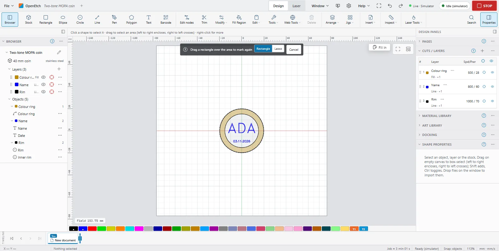

# Re-mark a region

Sometimes one spot of a mark comes out weak, for example where the part was not quite flat. **Re-mark a region** burns only the part of the job inside an area you draw, and leaves the rest of the part alone.

## How it works {#how-it-works}

OpenEtch plans the whole job as usual, then keeps only the toolpath inside your region. Because it cuts the planned toolpath rather than the design, the hatch lines inside the region fall exactly where they fell the first time, as long as the part, the design and the settings have not moved or changed.

The re-mark is an ordinary run: it goes through the same approval and checks as any other job.

## Draw the region {#draw-region}

1. Keep the part where it was. Do not move it or the design.
2. Choose **Re-mark a region…** On a computer or tablet, it is in the Design workspace's ribbon, in the **Arrange** group under **Jigs**, and on the canvas's right-click menu (in a long menu, under **Laser**). You can also find it with command search. On a phone, find it under **Jigs** in the **Canvas** tab's tool strip; the open sheet closes so you can draw on the canvas.
3. A bar over the canvas says **Drag a rectangle over the area to mark again**. Choose **Rectangle** or **Lasso**:
   - **Rectangle**: drag from one corner to the other.
   - **Lasso**: draw round the area with the mouse, pen or finger (**Draw round the area to mark again**).
4. Release. The region shows as a dashed outline on the canvas.

To give up before drawing, click **Cancel** or press `Esc`.

## Check what the region touches {#remark-bar}

Once a region is set, the bar shows:

- **N shapes in the region**: how many shapes on output layers reach into it. If it says **Nothing on an output layer reaches into the region.**, the region is in the wrong place.
- A warning for each layer linked to a material library preset, for example: Layer “Ring” uses library preset “…”: marking the same area again shifts a MOPA colour. Test on scrap first.
- **Frame region**: traces the region's outline with the red pointer, so you can check it is over the right spot on the part. Stop it with **Stop frame**.
- **Rectangle** and **Lasso**: draw the region again.
- **Clear**: removes the region.

## Burn the region {#burn-region}

1. Switch to the Laser workspace (on a phone, tap **Job**). The region stays set.
2. Check that **Start** now reads **Start · region** (or **Request run · region**).
3. Burn as usual (see [Running a job](running-a-job.md)):
   - Without a PIN, click **Start**. The message **Re-marking the region** appears.
   - With the operator PIN, click **Request run**, then approve it. The message **Re-mark run requested: approve it with your PIN.** reminds you.

With **Cut selected graphics** on and shapes selected, only the selected shapes inside the region burn.

## Clear the region {#clear-region}

The region stays set, and every **Start** burns only inside it, until you clear it. To clear it, do one of these:

- Click **Clear** in the bar.
- Press `Esc` (this also stops a frame of the region).
- Choose **Stop re-marking a region** where you chose **Re-mark a region…**

The region is not saved with the project.

## Limits and tips {#limits}

- **MOPA colours shift.** Colour comes from heat, so marking the same area twice changes it. Try it on scrap first. See [MOPA colour](mopa-colour.md).
- **Auto-rotating fills turn.** A fill layer with **Auto-rotate per job** uses the job count, which has moved on since the first burn, so its hatch angle is different on the re-mark.
- **Energy adds up.** A second pass on the same spot adds to the first. Work out the energy density before re-marking a delicate finish (see [Laser safety](safety.md#energy-density)).
- **Not with Start here.** Starting from a point in the preview ignores the region.
- **Not with the foot switch.** A foot switch burn is always the whole job.
- **Keep-out zones still apply.** See [Keep-out zones](preflight-and-keep-out.md#keep-out-zones).
- **Agents can prepare, not burn.** An AI agent can ask for a region run, but it waits for you to approve it like any other run.

## Re-mark one serial slot {#remark-serial-slot}

To mark one pocket of a jig again with the serial number or CSV value it had, use **Re-mark** in the serial ledger instead. It prepares a run of that pocket only, with its recorded value, and the counter does not move after it. You approve it like any other run. See [Serial ledger](serial-ledger.md).
