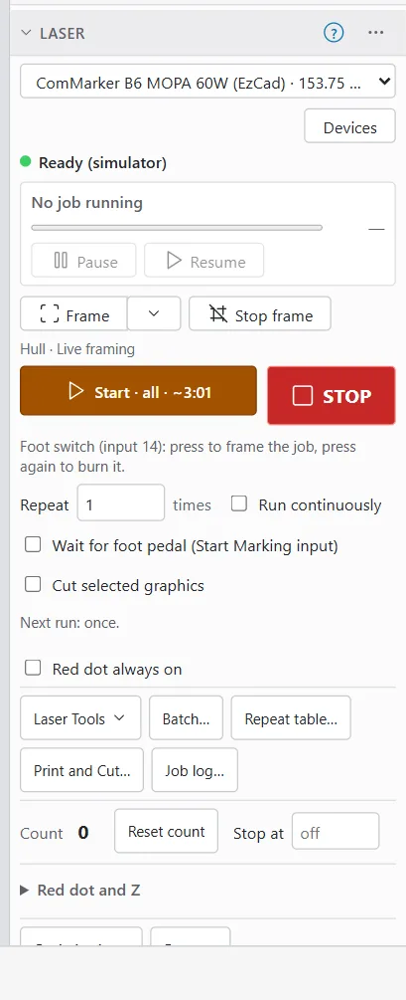
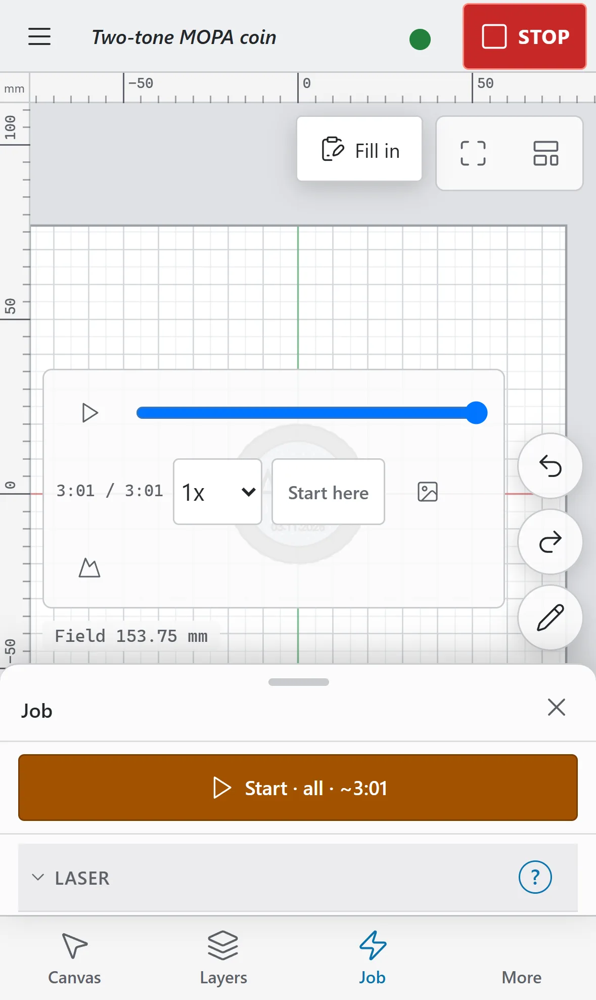
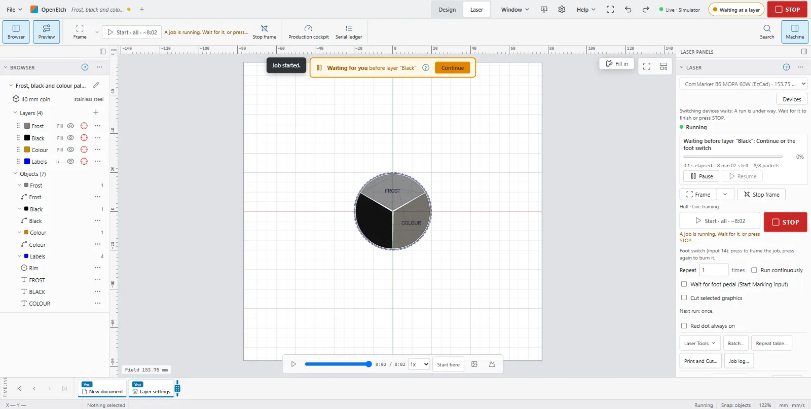

# Running a job

This page covers everything from pressing **Start** to the job finishing. Read [Laser safety](safety.md) first, and check the job with [Preview and framing](preview-and-framing.md).

## How a burn is approved

Every burn needs a person to approve it. The engine is started in one of two approval modes. The **Approval** row in the **Machine** card (in the **Machine and runs** window) shows which one yours uses.

| Mode | Approval row | How you burn |
|---|---|---|
| Operator PIN (the default) | **Operator PIN** | Click **Request run**, then approve the run with your PIN. |
| No PIN | **Start in the app** | Click **Start**, or use the foot switch to frame and then burn. |

The mode is chosen when the engine starts (`--approval pin` or `--approval click`), not in the app. Every other check (the Job Checklist, Require framing, the door input, Stop at, keep-out zones) works the same in both modes.

The engine can also be started with a physical confirmation input (`--confirm-input`). Then every approved run also waits for a press of that input; see [Operator PIN approval](#operator-pin-approval).

> **Note:** An AI agent connected over MCP can prepare a run, but MCP gives it no way to approve or start one. See [What AI agents can and cannot do](safety.md#what-ai-agents-can-and-cannot-do).

## The Laser window

The **Laser** window holds the job controls. Where it is:

- **Computer:** in the Laser workspace, docked at the side. Choose **Laser** in the workspace switcher in the top bar.
- **Tablet:** in the Laser workspace's side panel. The status chip, **Frame** and **Start** are also in the strip above the canvas, so you can reach them without opening the panel.
- **Phone:** tap the **Job** tab. **Start** is pinned under the sheet's header, so it is in view at every sheet height. STOP is in the top bar.

From top to bottom, the window has:

- The device list and the laser's state, for example **Ready** or **Ready (simulator)**, with the number of runs waiting (**N pending**).
- **Steps to burn**, in Beginner Mode (see [Steps to burn](#steps-to-burn-beginner-mode)).
- The job progress, with **Pause**, **Resume** and **End after this run**.
- **Frame** and **Stop frame** (see [Frame the job](preview-and-framing.md#frame-the-job)).
- Without a PIN, the Job Checklist, if it is on.
- Pre-flight warnings, then **Start** (or **Request run**) and **STOP**.
- Runs waiting for approval (**Waiting for approval**).
- The foot switch line, when the device has a foot switch and the engine runs without a PIN.
- The run options (**Repeat**, **Run continuously** and so on).
- **Red dot always on** and the buttons **Laser Tools**, **Batch…**, **Repeat table…**, **Print and Cut…** and **Job log…**
- The job counter: **Count**, **Reset count** and **Stop at**.
- **Red dot and Z**, then **Optimization…** and **Rotary…** (hidden in Beginner Mode).

On a phone, **Frame** comes right after the laser's state, and **Start** is pinned at the top of the sheet instead.

## Start a job (no PIN)

Use this when the **Approval** row says **Start in the app**.

> **Warning:** Start fires the laser at once. Wear eye protection rated for your laser's wavelength (about 1064 nm for a fibre laser), run fume extraction and never leave a running job unattended. **STOP** in the app is a software stop, so know where the laser's hardware E-stop is.

1. Check the preview and frame the job.
2. If the Job Checklist shows above **Start**, tick every item.
3. Read any pre-flight warnings above **Start** (see [Pre-flight warnings](preflight-and-keep-out.md#pre-flight-warnings)).
4. Click **Start**. On a computer it is in the **Laser** window and in the ribbon's **Job** group; on a phone it is at the top of the **Job** sheet.

The job starts at once. The message **Job started.** appears and the status chip shows the progress.

The button's label tells you what will burn and, for the whole job, roughly how long it takes:

| Label | Meaning |
|---|---|
| **Start · all · ~2:14** | The whole job, about 2 minutes 14 seconds |
| **Start · selection (3)** | Only the 3 selected objects (**Cut selected graphics** is on) |
| **Start · from 120** | From segment 120 (see [Start from a point](preview-and-framing.md#start-from-a-point)) |
| **Start · region** | Only the re-mark region (see [Re-mark a region](remark-region.md)) |

You can also press `Alt+S`. From the Design workspace this opens the **Laser** window first, then starts. If the Job Checklist is on and not ticked, it opens the checklist instead of starting.

### When Start is greyed out

The reason shows under the button:

| Message | What to do |
|---|---|
| **Offline: the laser engine cannot be reached.** | Check the engine is running and the connection. |
| **Waiting for the laser's status…** | Wait a moment. |
| **No laser connected.** | Connect the laser, or check the device. |
| **A job is running. Wait for it, or press STOP.** | Wait, or stop the job. |
| **Target reached (12 / 12): reset the count or raise Stop At to go on.** | Reset the count, or raise **Stop at** (see [Job counter and Stop at](#job-counter-and-stop-at)). |
| **Framing: stop the frame first (Stop frame or Esc).** | Stop the frame. |
| **Nothing to burn: the document is empty.** | Add something to burn. |
| **Tick every item of the Job Checklist first.** | Tick the checklist above **Start**. |
| **The engine is shutting down: nothing new starts until it is back.** | Wait for the engine to restart. |

### When Start is refused

If the engine refuses a Start, **Start refused:** and the reason show above the button until you click **Dismiss** or press **Start** again. Common reasons:

| Message | What to do |
|---|---|
| **Require Framing is on: frame the job (Frame in the Laser window) since its last edit, on this device, then try again.** | Frame the job, then press **Start** again. |
| **Door Protect: the enclosure is open (input N). Close it, then try again.** | Close the enclosure. |
| **The job changed just before Start (an edit was still arriving, e.g. an agent's). Nothing was burned: check it and press Start again.** | Check the design, then press **Start** again. |
| **Another run holds the machine. Wait for it to end (or STOP it), then try again.** | Wait, or press STOP. |
| **Start works only in the OpenEtch app in a browser opened at http://localhost or https. Use the foot switch, or open the app on the laser's computer.** | The request did not come from the OpenEtch app at an address the engine accepts. See [Troubleshooting](troubleshooting.md). |

A keep-out zone or an object outside the field also refuses the job, with a message that says which.

## Operator PIN approval

Use this when the **Approval** row says **Operator PIN**.

> **Warning:** **Confirm and fire** fires the laser at once. Wear eye protection rated for your laser's wavelength (about 1064 nm for a fibre laser), run fume extraction and never leave a running job unattended. **STOP** in the app is a software stop, so know where the laser's hardware E-stop is.

1. Check the preview and frame the job.
2. Click **Request run**. Nothing fires yet. The message says **Run requested. Approve it in the Laser window, under Waiting for approval.** The run waits under **Waiting for approval** in the **Laser** window, right below the button.
3. Read the run's details: who asked for it (**You**, or an agent's name), the summary, **Est. time**, **Mark** and **Jump** (travel) lengths, **Segments** and the **Revision**.
4. Click **Approve…**
5. Read **This fires the laser.** Enclosure closed, eyewear on, focus and stock checked?
6. Tick the Job Checklist, if it shows.
7. Type your **Operator PIN** (6 to 12 digits).
8. Click **Confirm and fire**, or press `Enter`.

To back out, click **Cancel** or press `Esc` in the PIN field. The confirm step also closes by itself after 20 seconds without typing, and forgets the PIN.

Things to know:

- **Document changed - request a new run.** A run is planned from the design as it was. If you or anyone else edits the design afterwards, the run cannot be approved. Request a new one.
- A run planned for another device, or from another open document, cannot be approved either.
- Up to 8 runs can wait at once. **STOP** cancels them all.
- After 5 wrong PINs in a row, approvals lock for a minute, then for twice as long after each further lockout, up to an hour. Only the right PIN resets this. The card counts down.
- **No operator PIN is set. Run 'openetch set-pin' on the engine machine once.** The PIN is set on the computer that runs the engine, in a terminal, with `openetch set-pin`. It is never set from the app.
- **PIN file changed - restart the engine.** If the PIN file changes while the engine runs, approvals stop until the engine is restarted.

If the engine was started with a physical confirmation input, the run then shows **Press the foot pedal (input N) within 30 s to start. STOP cancels.** Release and press the pedal to begin.

The **Pending runs** card in the **Machine and runs** window says how approval works on this engine. With nothing waiting, it says where runs wait: in the **Laser** window. While runs are waiting, it points you there, where you approve them.

## Job Checklist and Require framing

Two optional checks make sure nobody burns in a hurry. Both are set per device: on a computer or tablet, open **File > Laser > Devices…**, select the device, click **Edit…** and go to the **Job** page. You can only change them for the active device.

- **Show the Job Checklist before each approval**: a list of items (one per line, up to 30) that must all be ticked before a burn. If you turn it on with no items, OpenEtch starts you with a suggested list: enclosure closed and door interlock working, laser safety eyewear on, focus and material height checked, fume extraction on. With an empty list, **Suggest items** fills it in. Click **Save items** when done.
- **Require framing before start**: approval is refused until the job was framed on this device since its last edit.

With a PIN, the checklist shows in the approval step. Without a PIN, it shows above **Start**, and on a waiting run's own **Start**. The ticks are cleared after every job, so you tick them again each time. The engine checks the ticks again itself.

The **Job** page also has **Play sound when a job finishes** and **Mute in this browser**.

> **Note:** A foot cannot tick a checklist. With the Job Checklist on, every foot switch burn is refused; use **Start** in the app. The foot switch still frames, and the **Laser** window says so: **Foot switch (input N): press to frame the job. It cannot burn while the Job Checklist is on: tick the list and use Start.**

## The foot switch: frame, then burn

Without a PIN, a foot switch wired to the device's **Start marking input** (on the **Ports and laser** settings page) gives you a hands-free loop: press to frame, press again to burn.

The **Laser** window shows what the next press does, for example **Foot switch (input N): press to frame the job, press again to burn it.**

1. Load the part. Press the foot switch. The red pointer starts tracing the whole job, in the style of your last frame (**Framing. Press the foot switch to burn.**).
2. Check the frame on the part.
3. Press the foot switch again. OpenEtch burns exactly what was framed (**Burning. Framing resumes when it ends; STOP ends the cycle.**).
4. When the burn ends, framing starts again by itself on the design as it is then (with a serial number moved on, if the job has one).
5. Load the next part and press to burn again.

Checks the engine makes:

- Only the framed design burns. If the design or the device changed since the frame started, the press frames the new design instead, and a message says so.
- A foot switch burn is always the whole job, once. It ignores **Repeat**, **Run continuously**, **Cut selected graphics** and **Selection only**.
- Every burn goes through the same checks as **Start**: the door input, Require framing, the Job Checklist, Stop at and keep-out zones.
- Presses while a burn is running are ignored. They never queue another burn.
- The foot switch never approves runs waiting in the **Laser** window (for example one an agent prepared). Approve those in the app.
- **STOP**, **Stop frame** (or `Esc`) or any other frame ends the loop.
- Framing stops after 10 minutes without a press, and the loop ends.

For production work with a jig, see [Production cockpit](production-cockpit.md) and [Jigs](jigs.md).

## Run options

The run options under **Start** set how the next run goes. They are kept in this browser.

| Option | What it does |
|---|---|
| **Repeat** … **times** | Marks the job this many times in a row (up to 10,000). One approval covers them all. |
| **Run continuously** | Starts the job again after every run until **STOP**, **Stop at** or **End after this run**. |
| **Wait for foot pedal (Start Marking input)** | Each run waits for the foot pedal before it fires, for up to an hour. |
| **Require full pulse to start** | With the option above: the pedal must be released and pressed again. Off accepts a pedal that is held down. On by default. |
| **Cut selected graphics** | Runs only the selected objects. Hidden in Beginner Mode, and never remembered from a previous visit. |

The line **Next run:** under the options sums them up, for example **Next run: 5 times, each run starts on a full foot-pedal press.**

> **Warning:** **Repeat** and **Run continuously** keep firing with no further approval. Stay at the machine.

## Watch a running job

While a job runs, the top of the **Laser** window shows:

- The state: **Starting…**, **Marking**, **Paused**, **Waiting for the foot pedal**, or waiting before a layer.
- **Run 2 of 5** (or **Run 7 (continuous)**) for repeated jobs, and **Part 1 of 3** for jobs in several parts.
- A progress bar and percentage.
- Time elapsed and time left (or **Finishing…**), and the packets sent to the board.

### The status chip

The status chip sits just left of **STOP** in the top bar in every layout. It shows the laser's state, for example **Idle**, **Framing**, **Running 42% · 3:12**, **Paused 42%**, **Waiting for the foot switch** or **Waiting at a layer**, and how many runs wait for approval. It has a one-tap button for the action you most likely need: **Stop frame**, **Pause** or **Resume**.

Tap the chip to open the **Laser** window (on a phone, the **Job** sheet). On a phone the chip is just a coloured dot, and its action is an icon.

When a job ends, a message says how: **Job finished.**, **Job stopped before the end.**, **Job cancelled before it started.** or **Job failed.** A sound can play too: turn on **Play sound when a job finishes** on the device's **Job** settings page.

## Pause, resume and stop

- **Pause** holds the job where it is. Find it in the **Laser** window, on the status chip, or press `Pause`.
- **Resume** continues a paused job. It is in the same places, and `Pause` toggles it. Only a person in the app can resume; an agent cannot.
- **STOP** ends the job at once and cancels any runs waiting. A stopped job cannot be resumed. See [The STOP button](safety.md#the-stop-button).

> **Note:** Pause and resume have been tested on the simulator. Check how your own machine behaves on scrap before you rely on pausing in the middle of a job.

## End after this run

For a job that repeats or runs continuously, **End after this run** shows next to **Pause**. Click it and the job stops when the current run finishes, instead of starting another. The button then reads **Ending after this run**.

## Pause at a layer

A job can stop before a layer and wait for you, for example to clean the part between a colour fill and a frost pass, flip it or change the jig.

To set it up:

1. Select the layer in **Cuts / Layers**.
2. In the layer's settings in the Properties panel, open **More settings**.
3. Under **Pauses**, tick **Pause before this layer (wait for Continue)**.

When the job reaches that layer, it stops with the laser off. You see **Waiting for you** and the layer's name over the canvas, in the **Production** window and on the status chip (**Waiting at a layer**).

To go on, do your work on the part, then either:

- click **Continue** (over the canvas, in the **Production** window or in the production cockpit), or
- press the foot switch, if your device has a Start marking input.

Things to know:

- **STOP** still ends the job at once. **Pause** holds the next part until you resume.
- The door input is checked again before the next layer starts.
- If nobody continues within an hour, the job ends.
- Only a person can continue: an agent cannot.
- A pause before the job's first layer is ignored, because Start already waits for you.
- It works for galvo jobs only. Rotary jobs and gantry lasers plan the layer without the pause; the run summary says so.
- The setting is hidden in Beginner Mode.
- A material-library preset can carry the pause, so every layer that takes the preset pauses too. Change it with **Edit Cut** (see [Edit Cut](material-libraries.md#edit-cut)).
- Time spent waiting is not in the time estimate.

> **Note:** Pausing at a layer has been tested on the simulator, not yet on a real B6 laser.

## Job counter and Stop at

The job counter, near the bottom of the **Laser** window, counts the runs this device has finished.

- **Count** is the number of runs that ran to the end. Each repeat counts once. The count is kept for each device, and survives an engine restart.
- **Reset count** sets it back to 0. You cannot reset it while a job runs.
- **Stop at**: type a number to stop there. Once the count reaches it, no further run is approved, and a repeating job ends before its next run. Leave it empty (**off**) for no limit. Stop at is not saved: it is off again after the engine restarts.

When the count reaches **Stop at**, you see **Count N has reached Stop At: reset the count or raise Stop At to run again.**

Fill layers set to **Auto-rotate per job** turn their hatch angle by the job count, so the count also changes the next job's hatch.

## Steps to burn (Beginner Mode)

In Beginner Mode (turn it on in Preferences), the **Laser** window shows **Steps to burn**: **Preview**, **Frame** and **Start**, with a hint for the next step, for example **Enclosure closed and eyewear on? Then Start.** A frame counts for the design as it was framed; after an edit, frame again.

## Machine and runs

On a computer or tablet, the **Machine and runs** window of the Laser workspace shows:

- **Machine**: the link, the state, the device, the laser source, the controller, the field, the power limit, the approval mode, the foot switch input and the last error. **Advanced** shows every raw value.
- **Active run**: the run that holds the machine.
- **Pending runs**: how approval works on this engine, and a pointer to the **Laser** window while runs are waiting.
- **Recent runs**: the last runs that ended, with any error. A cancelled run says **(stopped before it fired)**.
- **Toolpath**: see [The Toolpath card](preview-and-framing.md#the-toolpath-card).

On a phone these are further down the **Job** sheet. For the full history, see [Job ledger](job-ledger.md).

## Common problems

- **Start refused because the job was not framed.** **Require framing before start** is on. Frame the job (after your last edit) and press **Start** again.
- **Document changed - request a new run.** Someone edited the design after the run was requested. Request a new run.
- **The foot switch frames but never burns.** Check that the Job Checklist is off for that device, and that the door input reads closed.
- **Start is refused with Start works only in the OpenEtch app in a browser…** The page was not opened at an address the engine accepts. See [Troubleshooting](troubleshooting.md).
- **A repeating job will not start.** The count may have reached **Stop at**. Reset the count or raise **Stop at**.
