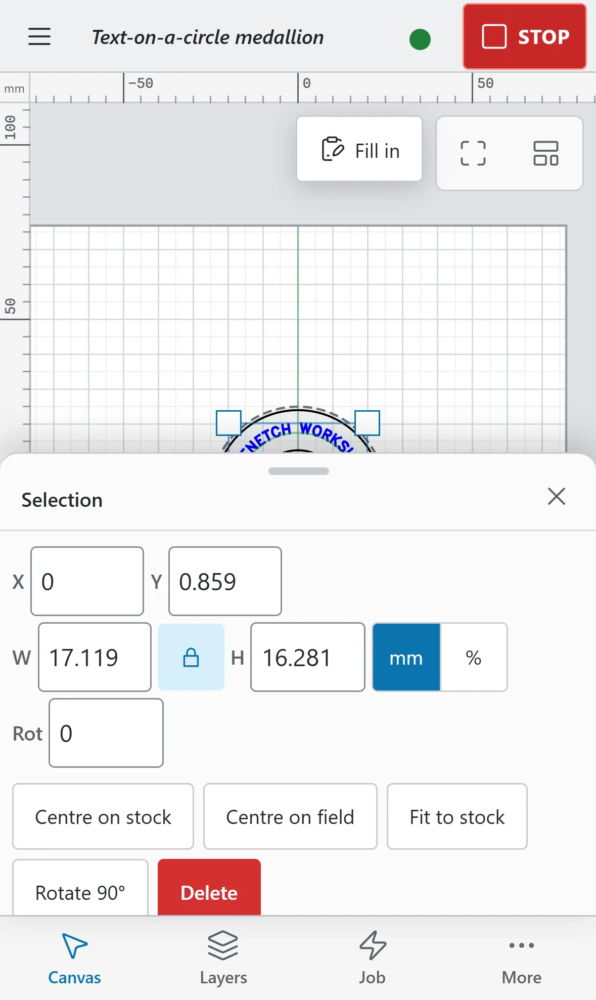

# Selecting and transforming

This page covers choosing objects and changing their position, size and angle. To line several objects up, see [Arranging and arrays](arranging-and-arrays.md).

> **Note:** On a Mac, press `Cmd` where this guide says `Ctrl`, and `Option` where it says `Alt`.

## Select objects

Selection follows LightBurn's rules.

| To | Do this |
|---|---|
| Select one object | Click its line, or inside a closed shape |
| Add to the selection | `Shift`+click |
| Add or remove one object | `Ctrl`+click |
| Remove from the selection | `Ctrl+Shift`+click |
| Select everything inside a box | Drag from left to right on empty canvas (a solid box) |
| Select everything the box touches | Drag from right to left (a dashed box) |
| Select all | `Ctrl+A` |
| Invert the selection | `Ctrl+Shift+I` |
| Step to the next or previous object | `Tab` or `Shift+Tab` |
| Clear the selection | `Esc` (the first press goes back to the Select tool), or click empty canvas |

The same modifier keys work with the box. Clicking a member of a group selects the whole group (see [Group and lock](arranging-and-arrays.md#group-and-lock)).

You cannot select objects on a hidden layer. A locked object can be selected but not moved or edited until you unlock it.

To select by kind, open **Edit > Select** and choose **Select open shapes**, **Select open shapes set to fill** or **Select contained shapes** (the shapes inside the selected ones).

On a touch screen, one finger on empty canvas draws the selection box. To make one finger pan instead, change **One finger on empty canvas** to **Pan** in Preferences.

## Move, rotate and scale

### On the canvas

- To move, drag a selected object. Hold `Shift` to keep to horizontal, vertical or 45°; a guide line shows the direction.
- To scale, drag a corner handle (keeps the proportions) or an edge handle (one direction). Hold `Shift` to free the proportions, or `Ctrl` to scale about the centre. Dragging past the opposite side mirrors the selection.
- To rotate, drag a round handle just outside a corner. Hold `Shift` for 15° steps, or `Ctrl` for 5° steps.
- Press `Esc` before you let go to cancel the drag.

On a touch screen, tap a selected object again to switch its handles between scaling and rotating.

A lone circle stays round when you scale it while **Keep round** is on in Properties.

A drag snaps to other objects and guides; see [Snapping](snapping-and-guides.md#snapping).

### With the keyboard

| Keys | Moves or turns the selection |
|---|---|
| Arrow keys | 5 mm |
| `Shift`+arrow | 20 mm |
| `Ctrl`+arrow | 1 mm |
| `Ctrl+Shift`+arrow | 0.1 mm |
| `.` and `,` | 90° clockwise and anticlockwise |
| `Shift` with `.` or `,` | 45° |
| `Ctrl` with `.` or `,` | 15° |
| `Ctrl+Shift` with `.` or `,` | 1.5° |
| `P` | Moves the selection to the centre of the field |

You can change the arrow-key distances in Preferences, under **Editing**. **Default moves (5, 20, 1, 0.1 mm)** puts them back.

> **Warning:** `Ctrl+.` is also a STOP key. While a job is running, it stops the job instead of turning the selection.

### With numbers

On a computer, the row under the ribbon shows the selection's **X**, **Y**, **W** and **H** and its rotation (**Rot**, or **Rot by** for several objects). Type a value and press `Enter`.

- The small grid of dots is the **Reference point**: X, Y, sizing and rotation refer to that point of the selection's box.
- The lock button keeps **W** and **H** in proportion.
- The **mm** / **%** switch sets whether W and H are lengths or a percentage of the current size.

The Properties window has the same fields, plus **Name**, **Layer**, **Lock aspect**, **Diameter** with **Keep round** for a circle, **Rotation** and a **Flip** readout. On a touch screen it also has a nudge pad: **Nudge left**, **Nudge right**, **Nudge up** and **Nudge down**, with a **Step** of **Normal**, **Large**, **Small** or **Tiny**. On a tablet, tap **Properties** over the canvas to open the window.

On the phone, select an object and the **Selection** sheet opens with these fields and the buttons **Centre on stock**, **Centre on field**, **Fit to stock**, **Rotate 90°** and **Delete**.

If part of the selection is outside the galvo field, Properties says so: the laser cannot reach it.

### Transform

To scale, slant or mirror by exact amounts, open **Arrange > Transform…**:

- **Scale about the centre**: type **Scale** (or **Width** and **Height** with **Keep proportions** off) as a percentage, then click **Apply scale**.
- **Shear (slant) about the centre**: type an **X** or **Y** angle (up to ±89°), then click **Apply shear**.
- **Pick on the canvas**: **Mirror across line…**, **Mirror copy across line…**, **Two-point rotate…** and **Two-point scale…** (tick **Two-point scale also rotates** to turn as well).
- Click **Done** to close the dialog.

The same picks are in the **Arrange** menu:

- **Two-point rotate** (`Ctrl+2`): click the pivot, then a reference point, then where the reference should point.
- **Two-point scale**: click the pivot, a reference point, then where the reference should go. The scale is the ratio of the distances.
- **Mirror across line** (`Ctrl+Shift+M`): click two points of the mirror line. **Mirror across line (keep original)** keeps the original and makes a mirrored copy.

Beginner Mode hides the mirror commands.

To flip in place, use **Arrange > Flip horizontal** or **Flip vertical** (see [Centre, flip and order](arranging-and-arrays.md#centre-flip-and-order)).

## Common mistakes

- **Nothing happens when you drag.** The object may be locked (**Arrange > Unlock**), or its layer hidden.
- **Clicking one shape selects several.** It is in a group. Ungroup it (`Ctrl+U`) to pick it on its own.
- **The selection jumps while you drag.** It snaps to nearby objects and guides. Hold `Ctrl` to turn snapping off for this drag.
