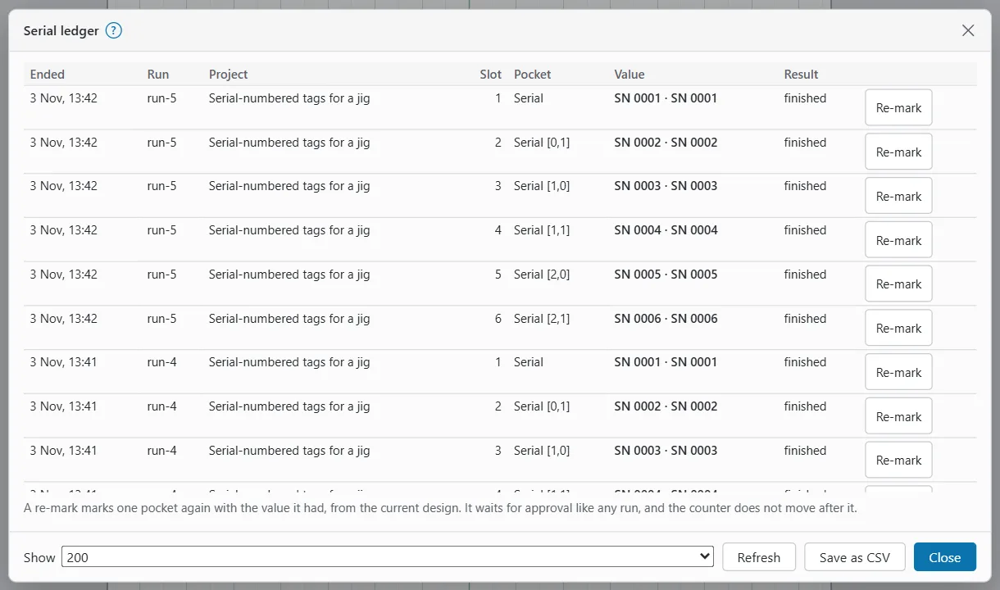

# Serial ledger

The serial ledger records every run that marked serial-number or CSV text. For each run, it records which value went on which slot (pocket), which slots were left out and why, and how the run ended.

A slot is everything that shares one Variable Text offset. That is usually one pocket's tag and its barcode.

The engine keeps the ledger in its configuration folder, in a file named `serial-ledger.jsonl`. It adds a line after every run and never rewrites old lines.

The ledger records runs that started marking, whether they finished, were stopped or failed. A run that was cancelled before it started marked nothing, so it is not recorded. The values are the ones the run was planned with.

> **Note:** The serial ledger has no notes or OK/scrap verdicts. To mark a run OK or scrap and add a note, use the [job ledger](job-ledger.md).

## Open the serial ledger {#open-the-serial-ledger}

On a desktop:

1. Switch to the **Laser** workspace.
2. In the ribbon's **Production** group, click **Serial ledger**.

You can also press **Serial ledger** in the **Production** window, or type "Serial ledger" in command search.

On a phone, tap the **Job** tab, then **Serial ledger** in the **Production** part of the sheet.

The [production cockpit](production-cockpit.md#ledger-card) shows the last three runs in its **Serial ledger** card.

## The Serial ledger window {#serial-ledger-window}

The window lists one row per slot, newest run first. If no run has marked serial numbers yet, it says "No run has marked a serial number or CSV row yet."

| Column | What it shows |
|---|---|
| **Ended** | When the run ended. |
| **Run** | The run's id. A re-mark also shows which run and slot it marked again, for example "(re-mark of run-12 #3)". |
| **Project** | The project, or the document name when the project was not saved. |
| **Slot** | The slot number. |
| **Pocket** | The slot's name, with the jig pocket when it sits in one, for example "Serial · Coins P3". |
| **Value** | What the slot's texts and barcodes showed, for example "SN 0009". A slot that was left out shows "–". |
| **Result** | How the run ended: finished, aborted (stopped) or failed. A slot that was left out shows **Empty** or **Past End**. |
| (last column) | **Re-mark**, on every slot that was marked. |

"Aborted" means the run was stopped. Its slots may be only partly marked, so check those parts.

The controls at the bottom are:

- **Show**: how many runs to list (50, 200 or 1000; 200 to start with);
- **Refresh**: reads the ledger again;
- **Save as CSV**: saves the listed runs as `OpenEtchSerialLedger.csv`;
- **Close**.

## Save the ledger as CSV {#ledger-csv}

**Save as CSV** saves one row per slot, ready for a spreadsheet. The columns are:

`time_unix_s, run_id, state, device, project, document, completed, slot, label, value, shown, marked, skipped, remark_of_run, remark_of_slot, jig, pocket_id, pocket`

The time is in Unix seconds. Text that would start like a spreadsheet formula (with `=`, `+`, `-` or `@`, or a tab) gets an apostrophe in front, so the spreadsheet does not run it.

## How the counter moves on {#counter-after-run}

After a run, the serial counter moves on as follows (when **Auto-advance** is on in Variable Text):

- After a finished run that marked every slot, it moves on by **Advance by**.
- After a finished run that left slots out, it moves on by only what was used, so empty pockets waste no numbers.
- After a stopped or failed run, it does not move. The next run marks the same values again.
- If someone changed the counter while the run was burning, the engine leaves it alone.
- After a re-mark, it never moves.

> **Warning:** After a stopped run, check the parts before you run again. The next run reuses the same values, so a part that was partly marked needs a re-mark or goes in the scrap.

## Stop at End {#stop-at-end}

**Stop at End** stops a numbered batch at Variable Text's End value, so no number is marked twice. You switch it on with the **Stop at End (60)** tick box in the [cockpit's Next card](production-cockpit.md#next-card). The number in brackets is End. You can change it while the cockpit is open.

With **Stop at End** on:

- A slot whose value would pass End is left out of the run. It shows **Past End** in the cockpit and the ledger.
- The pre-flight check says, for example, "Serial would get a value past End (60): Stop at End leaves them out of this run."
- When every value up to End is used, runs are refused with "every serial number / CSV row up to End (60) is used (Stop at End): reset the counter or raise End". The cockpit shows **Serial range used up**.

With **Stop at End** off, the number wraps back to Start after End. The pre-flight check warns before that happens, for example: "Serial would show a serial number past End (60): it wraps back to Start (1)."

To set Start, End and Advance by, see [Variable text and barcodes](variable-text-and-barcodes.md).

## Re-mark a slot {#re-mark-a-slot}

Use a re-mark when one pocket came out wrong: a faint mark, a part that moved, or a pocket that was loaded wrongly. A re-mark creates a new run that marks only that slot's pocket, with the value it had in the ledger. The run waits for your approval like any other.

To re-mark a slot from the Serial ledger window:

1. Open the **Serial ledger**.
2. Find the row of the run and slot.
3. Press **Re-mark**. OpenEtch says, for example, "Re-mark of SN 0009 requested: approve it in the Laser window or the cockpit".
4. Put the part (or a fresh blank) in that pocket. For a jig, you can check the position with the frame icon beside the pocket number in the [Jigs window](jigs.md#frame-pockets).
5. Under **Waiting for approval**, in the Laser window or the cockpit, start the run. On an engine without a PIN, press **Start** on its row. With a PIN, press **Approve…**, type the **Operator PIN** and press **Confirm and fire**.

To re-mark from the cockpit, tap the slot's button in the **Serial ledger** card (for example "3: SN 0009"). OpenEtch says "Re-mark requested: approve it to burn". Start it under **Waiting for approval** as above.

> **Warning:** Marking the same spot again adds energy. On a part that is already marked, a second pass can darken the mark, shift a MOPA colour, or melt or warp thin stock. Work out the energy density first (J/mm² = power W ÷ (speed mm/s × line interval mm)) and test on scrap.

A re-mark follows these rules:

- It uses the design as it is now, with the counter set so the slot shows its recorded value.
- The slot must still exist with the same Variable Text offset. If it does not, the re-mark is refused with, for example, "the document has no slot with offset 2 any more".
- Empty slots and Stop at End do not apply to a re-mark.
- If the design changed since the app last showed it, nothing is requested: "the document changed … nothing was requested: check it and try again".
- It works for galvo (LMC) devices only, with a laser connected.
- The device's keep-out zones apply.
- The foot switch never approves a re-mark.
- The serial counter does not move after it. **Count** in the cockpit goes up by one, as for any run.
- It appears in the ledger as a new run with "re-mark of", and in the cockpit card as "re-mark of slot 3".

To mark again only an area of the design rather than a whole pocket, see [Re-mark a region](remark-region.md).

## What AI agents can do {#ai-agents}

AI agents connected through MCP can read the serial ledger (`serial_ledger`). They can also request a re-mark (`serial_remark_request`). That only creates a run that waits for approval. A person must approve it in the app. Agents can never approve or start a burn. See [AI agents](ai-agents.md).
