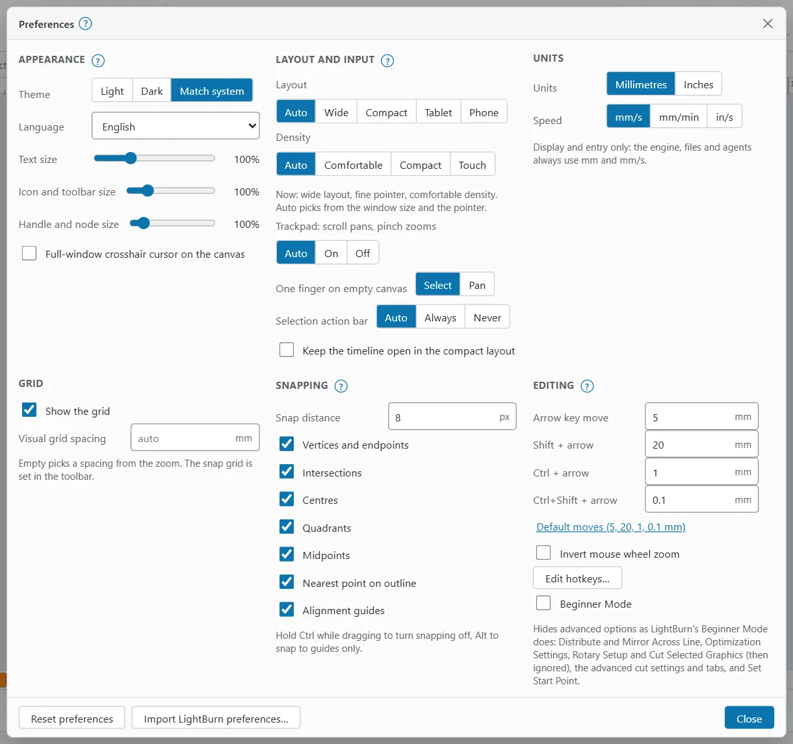
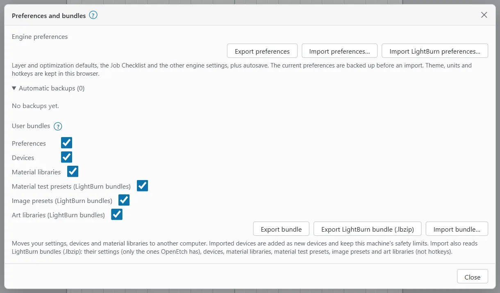

# Settings

OpenEtch has two kinds of settings. This page explains both, and how to move them between computers.

## Where settings live

- **Browser settings** are kept in the browser you use: theme, language, sizes, units, grid, snapping, nudge steps, layout and hotkeys. Each browser and device has its own. An iPhone or iPad Home Screen app has its own storage too.
- **Engine settings** are kept by the engine and shared by every browser: layer defaults, optimisation defaults, the Job Checklist and other job settings, project locations, autosave, notifications, maintenance and the extractor. Many of them are per device.

Changing a browser setting never changes your designs or the engine. The engine, files and AI agents always use millimetres.

## Preferences

To open Preferences:

- **Wide desktop window:** click the gear button (**Preferences**) at the right of the top bar, or choose **File > Settings > Preferences…**
- **Smaller windows, MacBooks and tablets:** click **More** (⋯) at the right of the top bar, then **Preferences**. **File > Settings > Preferences…** works too.
- **Phone:** tap **More**, open **Settings** and tap **Preferences**.

Changes apply at once. Click **Close** when you are done.

### Appearance

| Setting | What it does |
|---|---|
| **Theme** | **Light**, **Dark** or **Match system**. |
| **Language** | The language of the interface. Besides English there is a machine-translated Spanish. |
| **Text size** | 80 % to 150 %. |
| **Icon and toolbar size** | 75 % to 200 %. |
| **Handle and node size** | 75 % to 300 %. Larger handles help on touch screens. |
| **Full-window crosshair cursor on the canvas** | Draws a crosshair across the whole canvas. |

### Layout and input

| Setting | What it does |
|---|---|
| **Layout** | **Auto**, **Wide**, **Compact**, **Tablet** or **Phone**. Auto picks from the window size and the pointer. |
| **Density** | **Auto**, **Comfortable**, **Compact** or **Touch**. |
| **Trackpad: scroll pans, pinch zooms** | **Auto**, **On** or **Off**. |
| **One finger on empty canvas** | **Select** (drag selects an area) or **Pan** (drag moves the view). |
| **Selection action bar** | **Auto**, **Always** or **Never**. |
| **Keep the timeline open in the compact layout** | Pins the timeline instead of merging it with the status bar. |

A line under these settings shows the layout, pointer and density in use now.

### Units

- **Units:** **Millimetres** or **Inches**.
- **Speed:** **mm/s**, **mm/min** or **in/s**.

These change display and entry only. You can also click the units in the status bar to switch between mm and inches.

### Grid

- **Show the grid** turns the visual grid on or off.
- **Visual grid spacing** sets the spacing in mm. Leave it empty (**auto**) to pick a spacing from the zoom.

The snap grid is set in the toolbar, not here.

### Snapping

- **Snap distance** is how close, in screen pixels, the pointer must come to snap (1 to 40, default 8).
- Tick what to snap to: **Vertices and endpoints**, **Intersections**, **Centres**, **Quadrants**, **Midpoints**, **Nearest point on outline** and **Alignment guides**.

Hold `Ctrl` while dragging to turn snapping off, or `Alt` to snap to guides only.

### Editing

- **Arrow key move**, **Shift + arrow**, **Ctrl + arrow** and **Ctrl+Shift + arrow** set how far the arrow keys nudge a selection. **Default moves (5, 20, 1, 0.1 mm)** puts them back.
- **Invert mouse wheel zoom** reverses the wheel.
- **Edit hotkeys…** opens the hotkey editor (see [Keyboard shortcuts](keyboard-shortcuts.md#change-a-shortcut)).

### Beginner Mode

**Beginner Mode** (in the **Editing** section) hides advanced options, as LightBurn's does: Distribute and Mirror Across Line, Optimization Settings, Rotary Setup and Cut Selected Graphics (which is then ignored), the advanced cut settings and tabs, and Set Start Point. A **Beginner Mode** badge shows while it is on. Turn it off here to get the options back.

### Project locations

Project locations are extra folders on the engine's computer, such as a network drive or a synced cloud folder. They appear as top folders in Save and Open.

To add one:

1. Click **Add location**.
2. Type a label (for example "NAS") and the folder's full path. The folder must already exist.
3. Click **Save locations**.

To take a location off the list, click **Remove** next to it, then **Save locations**. The folder itself is not touched. A location marked **not reachable** cannot be reached now. One marked **from the command line** was set when the engine started (`--projects-mount`) and cannot be changed here.

### Notifications, maintenance and extractor

The last sections of Preferences set up **Notifications**, **Maintenance** reminders and the **Extractor**. See [Notifications](notifications.md), [Maintenance](maintenance.md) and [Extractor](extractor.md).

### Reset preferences

**Reset preferences** (at the bottom of the dialog) puts this browser's preferences back to the defaults. Your hotkeys and window layout are kept; reset hotkeys in **Edit hotkeys**, and the layout with **Window > Reset to default layout**.

## Theme switch

To change the theme quickly, click the theme button in the top bar. On smaller screens it is the **Theme: … (click to switch)** row in the **More** (⋯) menu; on a phone, under **More > Settings**. Each click goes Light, Dark, Match system.

## Layer defaults

Layer defaults are saved cut settings for a layer colour on the active device, like LightBurn's Make Default. New layers of that colour start with them.

To save a layer's settings as the default:

1. Select the layer in **Cuts / Layers**.
2. In the **Shape Properties** panel, click **Defaults**. On a phone, open the **Layers** tab and long-press the layer row (or tap its **More actions** button). On a computer you can also right-click the layer row.
3. Choose one of:
   - **Make Default** saves the settings for this colour on this device.
   - **Make Default for All** saves them for every colour on this device.
   - **Reset to Default** puts this layer back to its saved default.
   - **Reset to OpenEtch defaults** puts it back to OpenEtch's own settings.
   - **Load default layer settings on New / restart** (a tick, in the **Defaults** menu only) applies defaults to new documents.

The **Defaults** button's tooltip says whether a default is saved for this colour, the all-colours default applies, or nothing is saved.

A layer linked to a Material Library preset shows **Linked**. Its settings follow the preset and cannot be edited here; click **Unlink** to edit them, or **Library…** to open the [Material Library](material-libraries.md).

> **Warning:** A saved default is used on every new layer of that colour. Check the energy density of the settings before you save them: J/mm² = power W ÷ (speed mm/s × line interval mm). On stainless with a 60 W MOPA, roughly 2 to 15 J/mm² marked without melting on the reference machine (yours may differ). Treat these as starting points to test.

## Optimisation defaults

The **Optimization settings** dialog sets the burn order of a document (see [Running a job](running-a-job.md)). Its defaults can be saved per device, so new documents start with them.

To open the dialog, go to the Laser workspace and click **Optimization…** in the Laser window. On a phone, it is in the **Job** tab. It is hidden in Beginner Mode.

The **Set as Defaults** menu at the bottom has:

- **Set as Defaults:** new documents on this device start with these settings. If you changed anything, click **OK** first to save your changes, then come back.
- **Reset to saved:** applies the saved defaults of this device to this document.
- **Reset to OpenEtch defaults:** applies OpenEtch's own defaults.
- **Forget saved defaults:** removes the saved defaults; OpenEtch's defaults apply to new documents.

The **Defaults** button in the dialog only puts the fields back to OpenEtch's defaults; it saves nothing.

## Import LightBurn preferences

You can bring some of your LightBurn preferences into OpenEtch: display, snapping, import, framing and dialog settings, LightBurn's autosave interval and the optimisation defaults.

1. Find a LightBurn `.lbprefs` backup (on Windows in `%LOCALAPPDATA%\LightBurn\backup\prefs`) or LightBurn's `prefs.ini`.
2. Click **Import LightBurn preferences…** at the bottom of Preferences. The same button is in **File > LightBurn > Preferences and bundles…**
3. Pick the file. A preview says how many LightBurn settings OpenEtch can use, and lists them:
   - **Autosave every … minute(s) (engine)**
   - **Optimization Settings defaults of the active device (engine)**
   - the number of display, snapping, import, framing and dialog settings for this browser.
4. Click **Import**.

Only the settings OpenEtch has are read. Device lists, accounts, licence data and recent files are skipped and not kept. The engine backs up its current preferences first. Settings that are the wrong type or out of range are listed as not usable.

To import LightBurn devices, use the Devices window instead (see [Devices and calibration](devices-and-calibration.md#import-from-lightburn)).

## Preferences and bundles

To open it, choose **File > LightBurn > Preferences and bundles…** On a phone, tap **More**, open **File**, tap **All file commands** and choose **LightBurn > Preferences and bundles…**

### Export and import engine preferences

Engine preferences are the layer and optimisation defaults, the Job Checklist and the other engine settings, plus autosave. Theme, units and hotkeys stay in the browser and are not included.

- **Export preferences** downloads them as an `.oeprefs` file.
- **Import preferences…** replaces the engine's preferences with a file you pick. It asks first (**Continue**), and backs up the current ones.

### Automatic backups

The engine backs up its preferences when it starts (if they changed since the last backup) and before every import or restore. Up to 50 backups are kept.

To restore one:

1. Open **Automatic backups** in the Preferences and bundles dialog.
2. Click the backup you want, by its date.
3. Click **Continue**. The current preferences are backed up first, so you can go back.

### User bundles

A bundle moves your settings, devices and material libraries to another computer.

1. Under **User bundles**, tick what to include: **Preferences**, **Devices**, **Material libraries**, **Material test presets (LightBurn bundles)**, **Image presets (LightBurn bundles)** and **Art libraries (LightBurn bundles)**.
2. Click **Export bundle** for an OpenEtch bundle (`.oebundle`), or **Export LightBurn bundle (.lbzip)** for LightBurn. With **Preferences** ticked, a LightBurn bundle holds the hotkeys you changed in this browser; it holds no other preferences.
3. On the other computer, open the same dialog, tick what to take, click **Import bundle…**, pick the file and click **Continue**.

Imported devices are added as new devices and keep the receiving machine's limits. Import also reads LightBurn bundles (`.lbzip`): their settings (only the ones OpenEtch has), hotkeys, devices, material libraries, material test presets, image presets and art libraries. A device that had a material library linked in LightBurn uses that library here too. A summary shows what was imported and what was skipped.

## Import options

**File > Settings > Import options…** sets how imported files are placed. See [Files and projects](files-and-projects.md).
