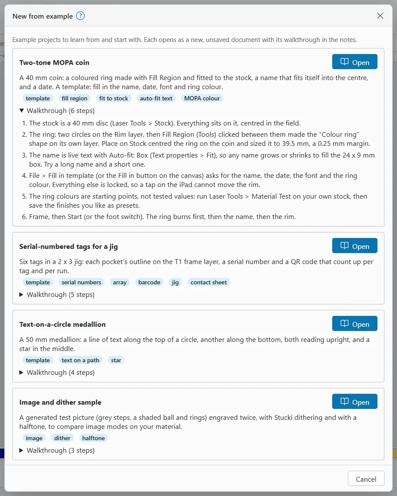
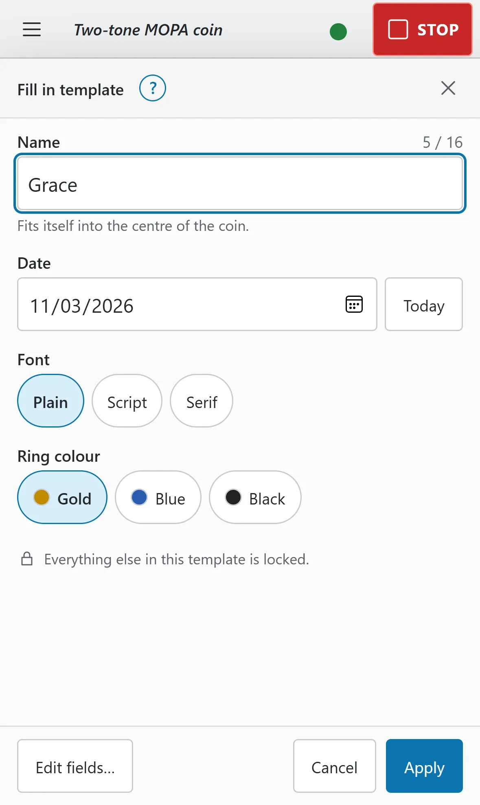
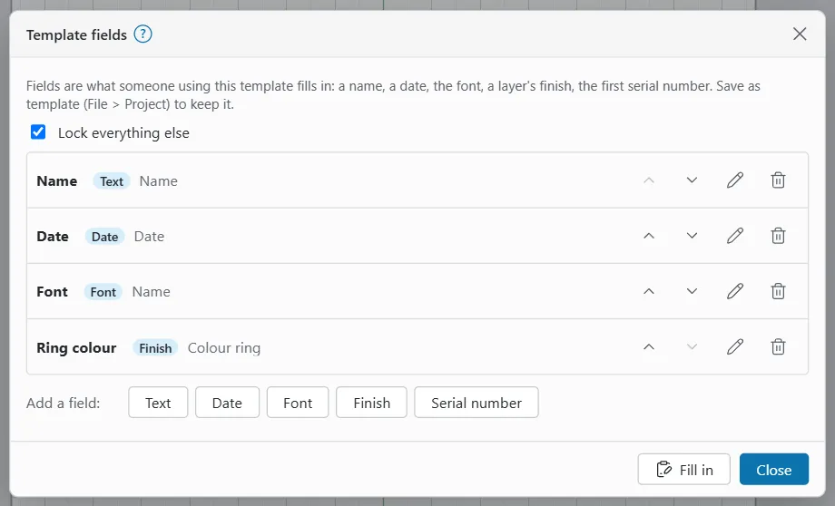

# Templates and examples

A template is a design that someone else fills in: the name on a coin, a date, the font, the colour of a ring, the first serial number. Everything else can be locked, so a tap on the iPad cannot move the rim.

OpenEtch also comes with example projects. Each one shows a few features, ready to study or to start from.

## Example projects

To open an example:

1. Choose **File > New from example…** On an empty canvas you can also click **Examples**. On the phone, use **More > File > All file commands > New from example…**
2. Read the cards. Click **Walkthrough (n steps)** to see how an example was made.
3. Click **Open**.

The example opens as a new, unsaved document laid out for the active device, with its walkthrough in the project notes. The notes show when it opens; to read them again, choose **File > Project > Notes…** When you save, OpenEtch offers the example's name.

| Example | What it shows | Read more |
|---|---|---|
| **Two-tone MOPA coin** | A 40 mm coin with a coloured ring made with Fill Region, a name that fits itself into the centre, and a date. A template: fill in the name, date, font and ring colour | [Fill Region](fill-region.md), [Auto-fit](text.md#fit-text-into-a-box-or-circle), [MOPA colour](mopa-colour.md) |
| **Serial-numbered tags for a jig** | Six tags in a 2 x 3 jig: each pocket's outline on tool layer T1, a serial number and a QR code that count up per tag and per run | [Variable text](variable-text-and-barcodes.md), [Jigs](jigs.md) |
| **Text-on-a-circle medallion** | A 50 mm medallion with text along the top and bottom of a circle, both reading upright, and a star | [Text on a path](text.md#text-on-a-path) |
| **Image and dither sample** | A generated test picture engraved twice, with Stucki and with Halftone, to compare image modes | [Images](images.md#dither-modes) |
| **Frost, black and colour palette coin** | A 40 mm coin in three sectors, one per finish (frost, black and a MOPA colour), each on its own layer | [MOPA colour](mopa-colour.md), [Layers](layers-and-settings.md) |

The colour choices in the two coin examples come from your selected Material Library: its entries with a result colour become the choices. Without any, the Two-tone coin offers Gold, Blue and Black, and the palette coin Gold, Blue and Purple.

### The examples' settings are starting points

The example settings are illustrations, not tested values. Run a material test on your own stock before you burn them, and keep what works as library presets. See [Test grids](test-grids.md).

Here is the energy density of the example fills on a 60 W source, worked out as J/mm² = power in W ÷ (speed in mm/s × line interval in mm):

| Example layer | Power | Speed | Interval | Energy density |
|---|---|---|---|---|
| Gold (coins) | 28 % (16.8 W) | 500 mm/s | 0.01 mm | 3.4 J/mm² |
| Blue (coins) | 22 % (13.2 W) | 300 mm/s | 0.01 mm | 4.4 J/mm² |
| Purple (palette coin) | 24 % (14.4 W) | 350 mm/s | 0.01 mm | 4.1 J/mm² |
| Black (coins), cross hatch | 35 % (21 W) | 250 mm/s | 0.01 mm | 8.4 J/mm² per direction, about 17 J/mm² in all |
| Frost (palette coin) | 80 % (48 W) | 2500 mm/s | 0.03 mm | 0.64 J/mm² |
| QR code (tags) | 55 % (33 W) | 900 mm/s | 0.03 mm | 1.2 J/mm² |
| Star (medallion), cross hatch | 55 % (33 W) | 900 mm/s | 0.03 mm | 1.2 J/mm² per direction |
| Images (dither sample) | 35 % (21 W) | 1500 mm/s | 0.05 mm | 0.28 J/mm² at full black |

On stainless steel with a 60 W MOPA, roughly 2 to 15 J/mm² marked without melting on the reference machine (yours may differ). Below about 2 J/mm² a fill may barely mark.

> **Warning:** The Black finish adds up to about 17 J/mm² with its cross hatch, above that range. On a thin coin it can melt or warp the metal. Test it on scrap first, and lower the power or turn off cross hatch if it overheats.

Line layers (the names, rims and labels) mark along a line, so this formula does not apply to them.

> **Warning:** Wear eye protection rated for your laser's wavelength, run the fume extraction, and never leave a job unattended.

## Fill in a template

When a document has fill-in fields, a **Fill in** button shows at the top right of the canvas. Opening a template or project with fields shows the form straight away.

1. Click **Fill in**, or choose **File > Project > Fill in template…**
2. Fill in each field:
   - **Text**: type the text. When the field has a limit, a counter shows how many characters you have used out of it.
   - **Date**: pick a date, or click **Today**.
   - **Font**: pick one of the offered fonts, or any font when the template offers none.
   - **Finish**: tap one of the finishes, such as Gold or Blue.
   - **Serial number**: type the first number, or use the **One less** and **One more** buttons.
3. Click **Apply**.

All the values go in as one undo step. If a text no longer fits its shape, the form says **Does not fit:** with the reason. Shorten the text, or turn on Fit for it, before you frame.

"Everything else in this template is locked." means only the fields can change. Filling in never starts a run.

> **Warning:** A **Finish** choice replaces the cut settings of its layer. Before you burn a finish for the first time, check its energy density and test it on scrap.

## Make a template

To turn a design into a template:

1. Choose **File > Project > Template fields…** Or right-click a selected plain text and choose **Make a template field…**
2. Under **Add a field:**, click the kind of field: **Text**, **Date**, **Font**, **Finish** or **Serial number**.
3. Set the field's options (see the table below) and click **Add field**.
4. Repeat for each field. Use **Move up** and **Move down** to order them as the form shows them.
5. Tick **Lock everything else** to lock every object that is not a field's text.
6. Click **Fill in** to try the form, then save it as a template (see [Save and open templates](#save-and-open-templates)).

| Field kind | What it changes | Options |
|---|---|---|
| **Text** | The text of the chosen **Texts** | **Required**, **Several lines**, **Most characters (0 = no limit)** |
| **Date** | Writes a date into the chosen **Texts** | **Date format**, using the date codes in [Variable text](variable-text-and-barcodes.md#dates-and-times) |
| **Font** | The font of the chosen **Texts** | **Fonts to choose from** (**Add a font…**); none means any font |
| **Finish** | The cut settings of the chosen **Layers** | **Finishes**: type a finish name (for example Gold), pick **Settings from layer**, click **Add** |
| **Serial number** | The first serial number of the variable text; the range keeps its length | None |

Every field has a **Label** and a **Help line** that the form shows. Click a field's edit button to change it and **Save field**, or its remove button to delete it; the objects stay as they are.

Text and date fields work on plain text, not variable text. A finish is copied from a layer's current settings, so apply a library preset to a layer first, then add it.

A template can have up to 32 fields, and a font or finish field up to 64 choices.

## Save and open templates

- To save the design as a template, choose **File > Project > Save as template…** and give it a **Template name**. A template with the same name is replaced.
- To use a template, choose **File > Project > Open template…** and pick it. After you have opened a template, it is also listed under **Recent templates** in **File > Project** (the list belongs to this browser). It opens as a new untitled document; the template itself is never overwritten.
- To use a LightBurn template, click **Upload LightBurn .lbt** in the Open template window.

The engine keeps the templates. The fields are saved with the project and with the template.

## AI agents

An AI agent connected over MCP can list a template's fields and fill them in, as a design edit. MCP gives it no way to approve or start a burn: a person does that at the machine. See [AI agents](ai-agents.md).
