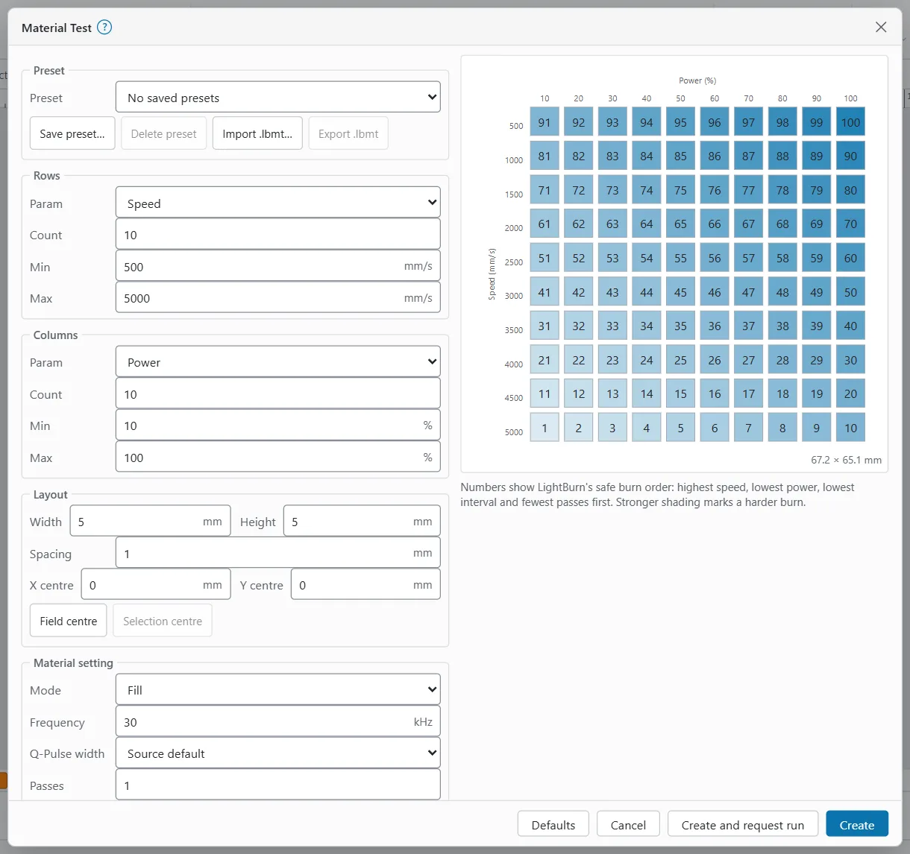
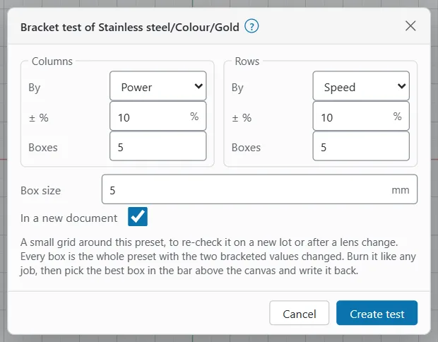
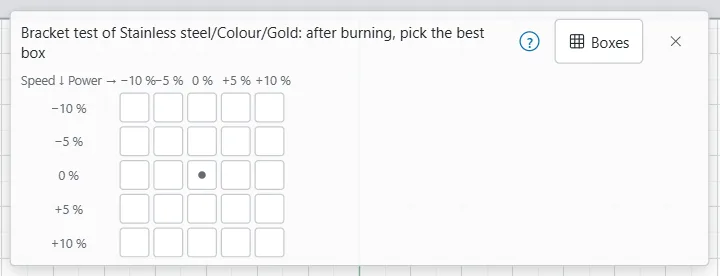

# Test grids

A test grid burns many small boxes, each with slightly different settings, so you can see which one works on your material. OpenEtch has four:

- **Material Test**: a grid varying two settings, for example power and speed.
- **Interval Test**: fill swatches at a range of line intervals.
- **Focus Test**: lines at stepped heights, to find the focus.
- **Bracket test**: a small grid around one library preset, to re-check it.

Each test is added as ordinary shapes and layers, in one group, in one undo step. Burning it is an ordinary job that a person approves or starts in the app.

> **Warning:** Wear eye protection rated for your laser's wavelength and run fume extraction. Never leave a test running unattended. Use scrap, not a finished part. Work out the energy density of the strongest box before you burn (below).

## Check the energy density first {#energy-density}

Energy density is how much energy each square millimetre of a fill receives. Too little and nothing marks. Too much and thin metal melts, warps or discolours around the mark.

OpenEtch does not work this out for you. Do it by hand for the strongest box of every test, and for any new setting.

The sum, in joules per square millimetre:

`energy density (J/mm²) = power (W) ÷ (speed (mm/s) × line interval (mm))`

- **Power in watts** is your source's rated power times the power percentage. On a 60 W source, 30 % is about 18 W.
- Multiply by the number of passes. A cross hatch roughly doubles it.
- For line mode there is no interval, so the sum does not apply. Compare power and speed instead.

Worked examples on a 60 W MOPA:

| Setting | Sum | Result |
|---|---|---|
| 30 %, 1000 mm/s, 0.05 mm | 18 ÷ (1000 × 0.05) | 0.36 J/mm²: light |
| 28 %, 500 mm/s, 0.01 mm | 16.8 ÷ (500 × 0.01) | 3.4 J/mm²: in the marking range |
| 100 %, 500 mm/s, 0.05 mm | 60 ÷ (500 × 0.05) | 2.4 J/mm²: the strongest box of the default material test |
| 100 %, 100 mm/s, 0.01 mm | 60 ÷ (100 × 0.01) | 60 J/mm²: far too high, likely to melt |

On stainless steel with a 60 W MOPA, roughly 2 to 15 J/mm² marks without melting. Below about 2 the mark is often faint. Above about 15, thin stock can melt or warp. These are rough guides, not limits. Frequency and pulse width change how the energy arrives (and so the colour), but not this sum.

> **Tip:** Check the strongest corner of the grid: the highest power with the lowest speed, lowest interval and most passes. If that box is in range, the rest are lower.

## Material Test {#material-test}

A material test varies two settings across a grid. Each box gets its own layer, in a safe burn order. Labels mark the values beside the grid, in a single-line font on their own layer.

To open it:

- **Desktop and MacBook:** **Laser Tools > Material Test** in the ribbon's **Laser Tools** group (Design workspace), or the **Laser Tools** button in the Laser window (Laser workspace).
- **iPad and other tablets:** the **Laser Tools** group button on the tool rail (Design workspace), or the **Laser Tools** button in the Laser window.
- **Phone:** the **Laser Tools** menu in the **Canvas** tab's tool strip, or the **Laser Tools** button in the **Job** tab.

To make a test:

1. Under **Rows** and **Columns**, pick the **Param** for each: **Power**, **Speed**, **Frequency**, **Q-Pulse width**, **Interval** or **Passes**. The two must differ.
2. Set **Count**, **Min** and **Max** for each. Up to 30 values per axis.
3. Under **Layout**, set the box **Width**, **Height** and **Spacing**, and where the grid goes: **X centre** and **Y centre**, or click **Field centre** or **Selection centre**.
4. Under **Material setting**, set the settings the test does not vary: **Mode**, **Power**, **Speed**, **Frequency**, **Q-Pulse width**, **Passes** and **Interval**. The tested ones are hidden.
5. Under **Text and border**, tick **Enable text** to label the grid (**Text height**, **Text power**, **Text speed**, **Title**), and **Enable border** for a frame (**Border power**, **Border speed**).
6. Check the preview and work out the energy density of the strongest box.
7. Click **Create**, or **Create and request run**.

The preview numbers each box in burn order: highest speed, lowest power, lowest interval and fewest passes first, as LightBurn does. Stronger shading marks a harder burn. If something is wrong, the preview shows why in red.

The defaults are a 10 × 10 grid: speed 500 to 5000 mm/s down the rows, power 10 % to 100 % across the columns, 5 mm boxes 1 mm apart, fill at 0.05 mm interval and 30 kHz. **Defaults** puts them back. Your last values are remembered in this browser.

For MOPA colour, a frequency × Q-Pulse width grid at a fixed power and speed is a common start.

**Create and request run** adds the test and asks for a run of only the test. Nothing fires yet: the message says "Approve it in the Laser window, under Waiting for approval." The waiting run shows in the Laser window under Start. A person approves it there, with the operator PIN when one is set (see [Running a job](running-a-job.md)). The button is greyed out when the active device cannot run jobs.

### Material Test presets {#material-test-presets}

The **Preset** section at the top keeps whole test set-ups by name. Presets are kept by the engine, so every browser sees them.

- Pick a name in the list to load it.
- **Save preset…** saves the current values under a **Preset name**. A preset of the same name is replaced.
- **Delete preset** removes the picked one after you confirm.
- **Import .lbmt…** adds the presets from LightBurn's `material_test_presets.lbmt`. Names already taken get " (2)".
- **Export .lbmt** downloads every preset in LightBurn's format. Spacing, label height and title are not in that file.

## Interval Test {#interval-test}

An interval test fills a row of swatches at different line intervals, each on its own layer.

Open it with **Laser Tools > Interval Test**.

1. Under **Intervals**, set **Min interval**, **Max interval** and **Steps** (2 to 50).
2. Pick **Fill**: **Simple fill** or **Dithered image**.
3. Set **Swatch size** and where it goes (**X centre**, **Y centre**, **Field centre** or **Selection centre**).
4. Under **Material setting**, set **Power**, **Speed**, **Frequency** and **Q-Pulse width**, and tick **Enable text** for labels.
5. Work out the energy density of the smallest interval.
6. Click **Create**, or **Create and request run**.

LightBurn suggests 0.08 to 0.16 mm for a first test; those are the defaults, with 5 swatches of 10 mm at 30 % and 1000 mm/s.

## Focus Test {#focus-test}

A focus test marks short lines, each at a different Z height, to find the sharpest focus.

Open it with **Laser Tools > Focus Test**.

1. Under **Z range**, set **Start Z**, **End Z** and **Steps**. You get one line more than the steps (8 steps from −2 to 2 mm give 9 lines). The hint shows the step per line, relative to the current height.
2. Under **Layout**, set **Line length**, **Line spacing** and where it goes.
3. Under **Material setting**, set **Power**, **Speed** and **Frequency**.
4. Click **Create**, or **Create and request run**.

> **Note:** The focus test needs a Z lift on the board's extension axis. Without one, every line is marked at the current height and the Z offsets are ignored; the window says so, and OpenEtch warns again when you create the test. Then set the height by hand and mark each line on its own.

## Bracket test of a preset {#bracket-test}

A bracket test makes a small grid around one library preset. Use it to re-check a preset on a new lot of material, or after a lens change. Every box is the whole preset (sub-layers too) with only two values changed.

To make one:

1. In the [Material Library](material-libraries.md), pick the preset.
2. Click **Bracket test…** under its details, or pick **Materials > Bracket test of a preset…** If no preset is picked, OpenEtch opens the Material Library and says "Pick a preset in the Material Library first".
3. Under **Columns** and **Rows**, choose **By** (**Power**, **Speed**, **Frequency**, **Q-pulse**, **Interval** or **Passes**), **± %** (how far each way, 0.1 to 50 %) and **Boxes** (1 to 15). The two must differ. **Q-pulse** is only offered when the preset has a pulse width.
4. Set **Box size** (1 to 30 mm).
5. Leave **In a new document** ticked to keep the test apart from your design.
6. Work out the energy density of the strongest box.
7. Click **Create test**.

The default is 5 × 5 boxes, power across and speed down, ±10 %, 5 mm boxes. An odd number of boxes includes the preset's own value in the middle.

Example on a 60 W source: a preset at 28 %, 500 mm/s and 0.01 mm is about 3.4 J/mm². With ±10 % power and speed, the strongest box is 30.8 % at 450 mm/s: about 4.1 J/mm². If the preset has sub-layers, add their energy too.

### Pick the best box {#pick-the-best-box}

While the open document holds a bracket test, a bar at the top centre of the canvas (Design workspace) names the test and asks you to pick the best box after burning.

1. Burn the test (see [Burn a test](#burn-a-test)) and look at the result.
2. Click **Boxes** in the bar. A small grid shows the boxes as they sit on the canvas, with the percentages along the edges. The marked box is the preset itself.
3. Tap the box that looks best. You can also select a single box on the canvas.
4. Click **Use this box**.

OpenEtch writes that box's settings back to the preset (unsaved until Save Library) and opens the preset's **Finish…** window to take a photo. On a phone or iPad the camera opens straight away.

The close button (**Hide the bracket test bar**) hides the bar.

### Refine the hue steps {#refine-hue-steps}

A bracket test can also teach OpenEtch how far one hue moves a setting on your machine. This works for power, speed or frequency.

1. After **Use this box**, select another box in the same row or column as the best one.
2. Look at it next to the best box. Where the bar says "Compared with the best box this one came out", click **1 hue warmer** or **1 hue cooler**.

The [hue step model](mopa-colour.md#hue-step-model) for that setting is updated, and a message shows the new step. If the box is not in the same row or column, the bar asks you to pick one that is. If the pair runs against the model (for example a box with more power that came out warmer), OpenEtch refuses it.

## Burn a test {#burn-a-test}

A test burns like any job:

1. Check the energy density of the strongest box.
2. Put scrap material in place and check focus.
3. Frame the test with the red pointer to see where it lands.
4. Start it, or approve the requested run.

See [Preview and framing](preview-and-framing.md) and [Running a job](running-a-job.md). An AI agent can create a test grid, frame it with the red pointer and ask for a run, but it cannot approve or start the burn: a person does that in the app.

## Read the results {#read-results}

- Let the metal cool before you judge colour. Colours shift while it is hot.
- Look at the boxes under the same light, from the same angle. MOPA colours change with the viewing angle.
- Look for the box that marks fully and evenly, without a raised, glossy or melted edge.
- If the best box is at the edge of the grid, make a new grid centred on it.
- Save the winner as a preset (see [Save a layer as a preset](material-libraries.md#create-a-preset)). Each box is its own layer, so you can use **Create new from layer** straight from its layer.
- Write down the material, lot, lens and focus with the preset's **Finish…**

## Common mistakes {#common-mistakes}

- **Skipping the energy check.** A fine interval at slow speed can put tens of J/mm² into the metal.
- **Testing on the final part.** Use scrap of the same material and finish.
- **Grids that are too wide.** Very wide ranges waste most boxes. Start wide, then narrow down around the best result.
- **Judging hot metal.** Wait for it to cool.
- **Forgetting Save Library** after **Use this box**.
