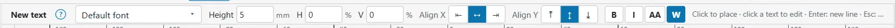
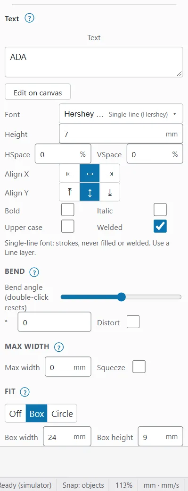
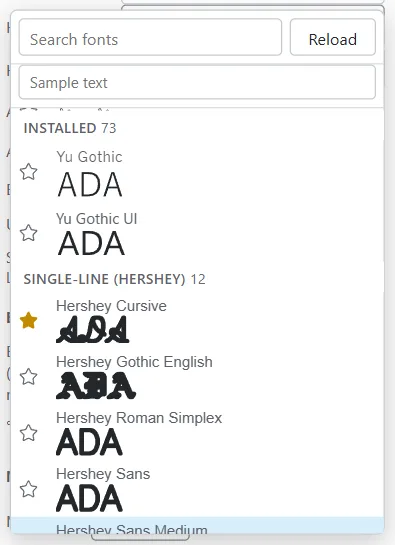
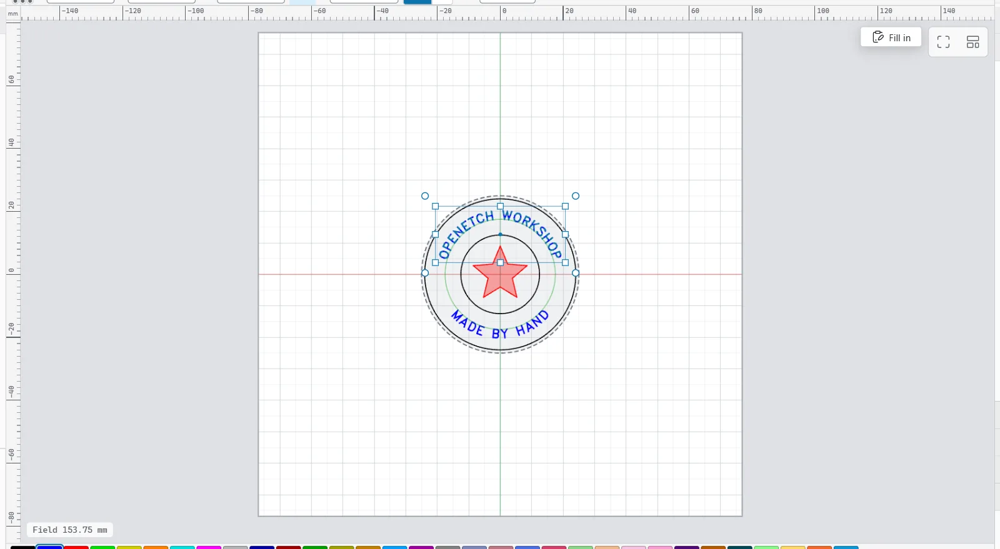

# Text

Text in OpenEtch stays live: you can change the words, the font and the size at any time, and the engine draws the outlines again. Text burns like any other shape on its layer.

For serial numbers, dates and CSV fields, see [Variable text and barcodes](variable-text-and-barcodes.md).

## Add text {#add-text}

1. Click **Text** in the **Create** group, or press `T`.
2. Click on the canvas where the text goes.
3. Type. Press `Enter` for a new line.
4. To finish, press `Esc` or `Ctrl+Enter`, or click elsewhere.

An empty text box adds nothing. The new text goes on the current layer.

> **Note:** LightBurn's Text key is `Ctrl+T`, but browser tabs keep it for themselves; `T` works while the canvas has the focus. With two or more objects selected, `T` aligns their tops instead.

On the phone, the **Text** tool is in the tool strip (the **Canvas** tab). Tap to place the text, then type with the on-screen keyboard.

## The Text options bar {#text-options-bar}

While the Text tool is on, the **Text options** bar shows under the ribbon (on the phone, over the canvas). It sets the look of **New text**, or of the **Selected text** when a text is selected:

- the font (see [Fonts](#fonts)),
- **Height**, and **H** and **V** spacing in %,
- **Align X** and **Align Y**,
- **B** (bold), **I** (italic), **AA** (upper case) and **W** (welded).

The bar remembers your choices for the next text in this browser.

## Edit text {#edit-text}

To change the words of a text on the canvas, do one of these:

- With the Text tool, click the text.
- With the Select tool, double-click it.
- Right-click it and choose **Edit text**.
- In Properties, click **Edit on canvas**.

Emptying a text on the canvas and finishing deletes it.

You can also type in the **Text** box in Properties. It saves when you click away or press `Ctrl+Enter`; `Esc` puts the old text back. An empty box there is not saved.

## Text properties {#text-properties}

Select one text and its **Text** section shows in the Properties window (on a tablet, tap **Properties** over the canvas to open it). It holds everything about the text:

| Field | What it does |
|---|---|
| **Text** | The words. Becomes **Format** for variable text |
| **Shows** | What the text shows now, when that differs from what you typed (variable text) |
| **Font** | The font picker |
| **Height** | Font size in mm. In most fonts capitals are about 0.7 of it |
| **HSpace** | Extra space between letters, % of the height. Negative tightens |
| **VSpace** | Extra space between lines, % of the line height |
| **Align X** | **Left**, **Middle** or **Right**: which point of each line sits on the text's position |
| **Align Y** | **Top** (tops of capitals), **Middle** or **Bottom** (last baseline) |
| **Bold** | The bold face. "(no bold face)" means the font has none |
| **Italic** | The italic face, or slanted for a single-line font |
| **Upper case** | Shows the text in capitals |
| **Welded** | Merges overlapping letters into one outline (on by default) |
| **Bend**, **Max width**, **Fit**, **Text on path** | See the sections below |
| **Text mode**, **Offset**, **Ignore empty vars** | See [Variable text](variable-text-and-barcodes.md#text-modes) |
| **Refresh** | Draws the text again, for example after installing a font, or to update a date |
| **Convert to path** | Turns the text into plain shapes |

Each change is one undo step.

## Fonts {#fonts}

The engine draws the text, so the fonts are the ones on the engine's computer (the Raspberry Pi on the laser, or your PC), not the ones on your phone or iPad. The font picker lists them in groups:

| Group | What they are |
|---|---|
| **Favourites** | The fonts you starred |
| **Installed** | Fonts installed on the engine's computer. They are outlines, filled when burned on a fill layer |
| **Single-line (Hershey)** | Fonts drawn as single strokes, built in |
| **SHX** | AutoCAD single-line fonts |
| **JSF (EzCad)** | EzCad's single-line fonts |

To choose a font:

1. Click the **Font** box.
2. Type part of the name in **Search fonts**, or scroll.
3. Click the font.

Each row shows a live sample drawn by the engine. By default it shows the selected text; type in **Sample text** to see something else.

If you installed a font on the engine's computer while OpenEtch was open, click **Reload**.

> **Tip:** Hershey, SHX and JSF fonts are made of strokes. They are never filled or welded, so put them on a **Line** layer. They mark fast and are good for small text and serial numbers.

### Font favourites and hidden fonts {#font-favourites}

To keep the fonts you use near the top:

- Click the star next to a font to add it to **Favourites**; click it again to remove it.
- Click the eye next to a font to hide it from the list.
- Click **Show hidden (n)** to see hidden fonts again and unhide them.

The engine keeps the favourites and hidden fonts, so your PC, iPad and phone share one list.

### A missing font {#missing-font}

If a text uses a font the engine's computer does not have, a **Missing font** badge shows on the canvas and in Properties. The text keeps its saved outline and still burns, but you cannot change it until you install the font and click **Refresh**, or pick another font.

## Spell check {#spell-check}

OpenEtch has no spell checker of its own. The text box on the canvas and the **Text** box in Properties use your browser's spell check for plain text, so misspelt words are underlined as in any web form. It is off for variable-text formats, because codes like `0dddd` are not words.

Check names and dates carefully before you burn: a spelling mistake on metal is permanent.

## Bend text {#bend}

Bend curves the text into an arc, without a path.

1. Select the text.
2. Under **Bend**, drag the **Bend angle** slider, or type the angle in °.

The angle is how many degrees the widest line spans round a circle, from -360 to 360. Positive arches up, negative arches down, 0 is straight. Double-click the slider to reset it.

Tick **Distort** to warp the letters along the bend; off keeps each letter rigid.

Bend is not available for text on a path.

## Max width and squeeze {#max-width}

To stop a line getting too wide, set **Max width** in mm. Wider lines are scaled down to fit, keeping their proportions. Tick **Squeeze** to narrow them only sideways, keeping their height. Set Max width to 0 to turn it off.

## Fit text into a box or circle {#auto-fit}

Auto-fit makes text grow or shrink to fill a space, so any name fills the same area. This is how the name on a coin stays the right size.

1. Select the text.
2. Under **Fit**, choose **Fit text into**: **Box** or **Circle** (**Off** turns it off).
3. For a box, set **Box width** and **Box height**. For a circle, set **Diameter**.
4. Choose the **Size** mode:
   - **Fit (grow or shrink)**: scales the text up or down, keeping its proportions.
   - **Stretch to fill** (box only): stretches width and height separately to fill the box exactly.
   - **Shrink only**: only text that does not fit gets smaller.

The box is placed by **Align X** and **Align Y**. The circle is centred on the text's position, like a coin's face. While the text is selected, the canvas draws the fit area dashed.

If the document has a stock, **Fit to stock** centres the text on the stock and fits it into 80 % of it.

Text on a path follows its path, so it cannot be fitted. Detach it first.

## Text on a path {#text-on-a-path}

Text can follow any vector shape: an arc, a circle, a wave.

To put text on a path:

1. Select the text.
2. Under **Text on path**, click **Apply path…**
3. Click the shape for the text to follow. Press `Esc` to cancel.

Or select the text and the shape together, then click **Apply path to text** in Properties (or right-click and choose it).

The text follows the shape from its start point. **Align X** places it along the path and **Align Y** across it. Set **Offset** to slide it along the path, in mm.

- If you edit or move the path, click **Follow path again** to lay the text out on it again.
- To free the text, click **Detach text from path**.

Text can only follow a vector shape, not an image or another text.

> **Tip:** To make text read upright along the bottom of a circle, the path must run left to right there, and the text should hang from it (**Align Y** **Top**). The Text-on-a-circle medallion example shows both arcs set up this way: open it with **File > New from example…** (see [Templates](templates.md#example-projects)).

## Convert text to paths {#convert-to-paths}

Converting turns the text into plain shapes. You can then edit its nodes, weld it with other shapes or send the file to someone without the font.

To convert, select the text and click **Convert to path** in Properties, or press `Ctrl+Shift+C`.

> **Warning:** A converted text is no longer text. You cannot change its words, font or variable data afterwards, except with Undo. If you may need it again, keep a copy of the live text on a layer with output off. A hidden layer is not enough: it still burns while its output is on.

## Text on the phone {#text-on-phone}

On the phone you can add text and set its font, height, spacing, alignment and styles in the Text options bar. The phone layout has no Properties window, so bend, max width, auto-fit, text on a path and variable text are set on a computer or tablet. To change the words of a ready-made design on the phone, use a template's **Fill in** form (see [Templates](templates.md#fill-in-a-template)).

## Before you burn {#before-you-burn}

- Put filled fonts on a **Fill** layer and single-line fonts on a **Line** layer. See [Layers and settings](layers-and-settings.md).
- Small text on a fill layer needs a fine line interval. Work out the energy density before testing a new setting: J/mm² = power in W ÷ (speed in mm/s × line interval in mm). On stainless with a 60 W MOPA, roughly 2 to 15 J/mm² marks without melting. See [Test grids](test-grids.md).
- Frame the job to check the text sits where you expect: [Preview and framing](preview-and-framing.md).
