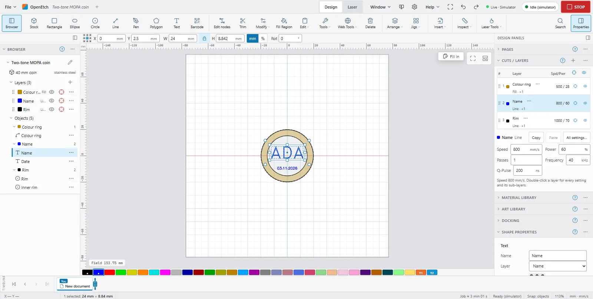
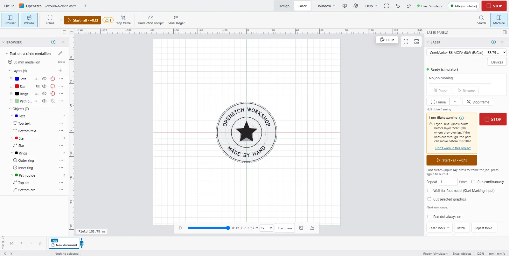
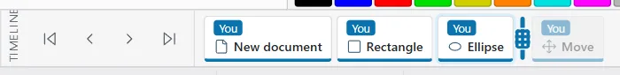
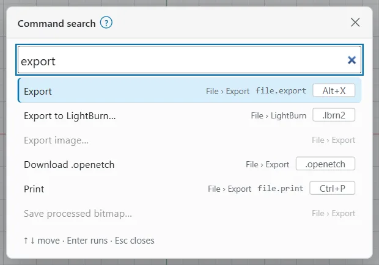
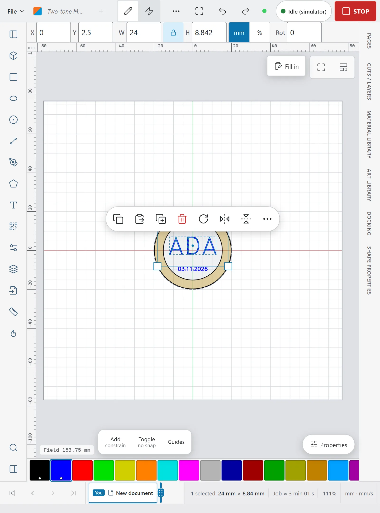
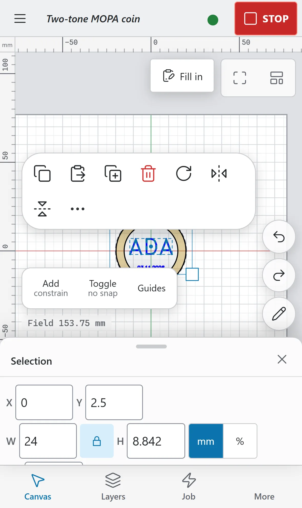
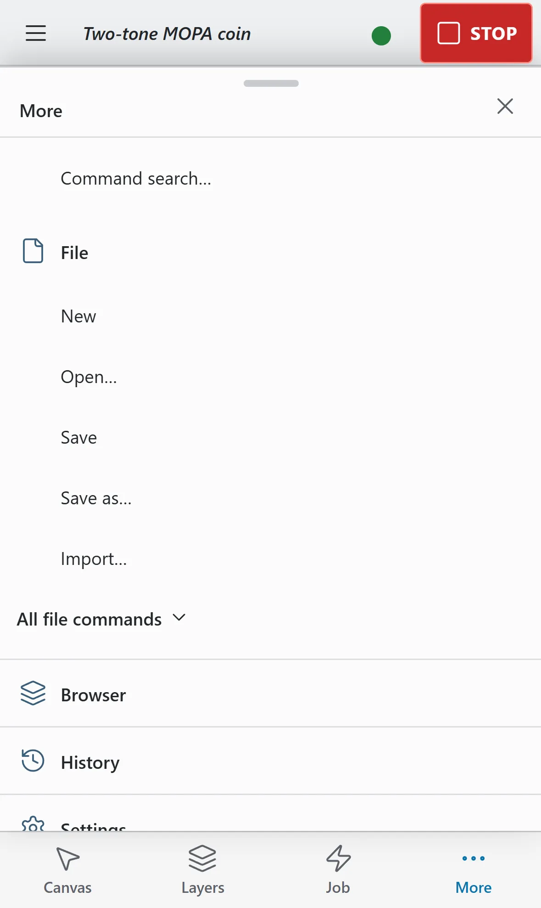

# The workspace

This page is a tour of the app's screen. It covers the desktop first, then the iPad and the phone, which move some things around.

Everything you see comes from the engine. Every connected browser shows the same live design, and an AI agent's edits appear as soon as it makes them.

## Layouts at a glance {#layouts}

The app picks one of four layouts from the window size and from whether you use a mouse or a finger.

| Layout | Picked when | What changes |
|---|---|---|
| **Wide** | A large window (at least 1600 x 900 pixels) with a mouse | Every panel beside the canvas, tool names under the icons, timeline and status bar as two rows. |
| **Compact** | A smaller desktop window, such as a MacBook | Icon-only tools, the left panel folded to a rail, timeline and status bar merged into one row. |
| **Tablet** | Narrower than 1100 pixels, or any touch screen such as an iPad | Tools in a rail down the left, both side panels as rails that slide over the canvas. |
| **Phone** | Narrower than 600 pixels, or a touch screen whose short side is under 500 pixels | Its own layout with bottom tabs and sheets. |

To choose a layout yourself, open **Preferences** and set **Layout and input > Layout**. See [Layout and input preferences](#layout-preferences).

## The top bar {#top-bar}

The top bar runs across the top of the window. From left to right on the desktop:

- **File**: the File menu. See [Files and projects](files-and-projects.md#file-menu).
- **OpenEtch** and the document's name. A dot after the name means unsaved changes. Click the name to see it in full, with **Save as…** to give it a new name.
- **+**: open another document in a new tab (shown here while only one document is open). See [Document tabs](#document-tabs).
- **Beginner Mode**: a badge shown while Beginner Mode hides advanced options. Turn it off in **Preferences > Editing**.
- **Design** and **Laser**: the workspace switcher. A number on **Laser** counts runs waiting for approval.
- **Window** (wide layout only), the theme button, **Preferences** (the gear) and **Help**. In the compact and tablet layouts these fold into one **More** (⋯) menu. Safety badges such as **ENGINE SHUTTING DOWN** or **SIMULATOR TEST PIN** also appear here when they apply.
- **Full screen**, **Undo** and **Redo**.
- The connection indicator, the laser status chip and **STOP**.

On a tablet the connection indicator shows only its dot. On a phone the top bar holds only **Menu** (opens the **More** sheet), the document name, the status dot and **STOP**.

### Connection status {#connection-status}

The connection indicator shows whether the app can reach the engine and what it drives, for example **Live · Simulator**:

| Shows | Meaning |
|---|---|
| **Live** | Connected to the engine. |
| **Connecting…** | Trying to reach the engine. |
| **Offline** | The engine cannot be reached. |
| **Engine error** | The engine answered with an error. Hover for the details. |
| **Simulator** | The engine drives the simulator. Nothing reaches a laser. |
| **Laser connected** | The engine drives a real laser. |
| **No laser** | No laser is connected. |

A chip such as **2 cmd missing** means the engine is older than the app and lacks some commands. Hover it for the list.

If the connection drops, a banner reads **Lost connection to the laser engine – reconnecting…** (or **Cannot reach the laser engine – retrying…** if it never connected) with **STOP may not reach the laser; use the hardware E-stop.** It goes away when the engine answers again.

The status chip left of **STOP** shows the laser's state: **Idle**, **Idle (simulator)**, **Framing**, **Running 42% · 3:12**, **Paused 42%**, **Waiting for the foot switch**, **Offline** and so on. Click it to open the Laser window. On a phone it is a coloured dot that opens the **Job** sheet.

### STOP {#stop-button}

**STOP** is always at the top right, in every layout, and stays in view over dialogs and sheets. It aborts any run or frame and cancels pending runs.

- `Ctrl+Pause` and `Ctrl+Cancel` do the same at any time.
- `Ctrl+.` (`Cmd+.` on a Mac) stops while a job is under way. At other times it keeps its LightBurn meaning and rotates the selection 15°.
- `Esc` stops red-pointer framing but never stops a burn.

> **Warning:** **STOP** is a software stop. If the app has lost its connection, it may not reach the laser. Know where your laser's hardware emergency stop is before you start a job.

## Workspaces: Design and Laser {#workspaces}

The app has two workspaces, like Fusion 360. Switch with **Design** and **Laser** in the top bar.

- **Design** is for drawing and editing. The ribbon has the drawing and arranging tools. The right panel has **Cuts / Layers**, **Shape Properties** and the libraries.
- **Laser** is for running the job. The canvas shows the toolpath preview. The ribbon has **Preview**, **Frame**, **Start** (or **Request run** when burns need the operator PIN) and **Stop frame**. The right panel has the **Laser** window, **Cuts / Layers** and **Machine and runs**.

On a tablet the switcher shows a pencil (Design) and a lightning bolt (Laser). On a phone there is no switcher: the **Job** tab shows the Laser workspace and the other tabs show Design.

## The ribbon {#ribbon}

The ribbon is the toolbar under the top bar. Its tools are in named groups, as in Fusion 360.

In the **Design** workspace:

| Group | Tools |
|---|---|
| **Create** | **Stock**, **Rectangle**, **Ellipse**, **Circle**, **Line**, **Pen**, **Polygon**, **Text** and **Barcode**. |
| **Modify** | **Edit nodes**, **Trim**, **Fill Region**, the **Modify**, **Edit**, **Tools** and **Web Tools** menus, and **Delete**. |
| **Arrange** | The **Arrange** menu (align, distribute, group, flip, centre, arrays and nesting) and the **Jigs** menu. With two or more shapes selected, six align buttons appear. |
| **Insert** | **Import**, **Place**, **Array** and **Art**. |
| **Inspect** | **Measure**, snap to objects, snap to grid with the grid step, the filled view and **Result colours**. |
| **Laser Tools** | The **Laser Tools** menu (material tests, start point and other laser tools) and the **Materials** menu. |

In the **Laser** workspace:

| Group | Tools |
|---|---|
| **Preview** | **Preview** turns the toolpath preview on the canvas off and on. |
| **Job** | **Frame** (with a menu of frame options), **Start** or **Request run**, and **Stop frame**. |
| **Production** | **Production cockpit** and **Serial ledger**. |

Three buttons sit at the ends of the ribbon in both workspaces: **Browser** (left panel), **Search** (command search) and **Properties** or **Machine** (right panel).

When the window is too narrow, the lower-priority groups fold into buttons such as **Insert ▾**. Click one to open its tools. This keeps the ribbon from scrolling.

To put the Create tools on a vertical rail at the canvas's left edge, as in LightBurn, right-click an empty part of the ribbon and choose **Creation tools on a vertical rail (LightBurn style)**.

In the compact layout the ribbon shows icons only; hover a tool for its name. On a tablet the ribbon becomes the tool rail on the left. On a phone it is a strip inside the **Canvas** sheet that scrolls sideways.

See [Drawing and editing](drawing-and-editing.md) for the tools themselves, and [Preview and framing](preview-and-framing.md) for the Laser tools.

## The context strip {#context-strip}

The strip just above the canvas changes with what you are doing:

- With shapes selected, it shows their position and size (X, Y, W, H), the anchor point, rotation and the lock for the aspect ratio. Type a value and press `Enter`.
- With a drawing tool active, it shows that tool's options, or the hint **Esc ends the tool**.
- With nothing selected, it shows how to select: click a shape, or drag an area (left to right encloses, right to left crosses).

On a phone there is no strip. A tool's options appear at the top left of the canvas instead.

## Side panels and docks {#docks}

The side panels hold the tool windows (docks):

- The **left panel** holds the **Browser**.
- The **right panel** holds the workspace's windows. In Design: **Pages**, **Cuts / Layers**, **Material Library**, **Art Library**, **Variable Text**, **Docking** and **Shape Properties**. In Laser: **Laser**, **Cuts / Layers**, **Material Library**, the production windows and **Machine and runs**.

A panel is either pinned beside the canvas or folded to a narrow rail. Click a rail to open the panel over the canvas. Use the buttons in the panel's header to switch: **Pin beside the canvas** or **Collapse to a rail**.

To resize a panel, drag the line between it and the canvas. Double-click the line to reset it. When the canvas would get narrower than about 640 pixels, pinned panels fold to rails on their own.

Each window has a title row:

- Click the title to collapse or expand the window.
- Click the menu button (or right-click the title) to move it: **Dock left**, **Dock right**, **Dock at the bottom**, **Float**, **Tab with** another window, **Separate from the tabs**, **Move up**, **Move down** or **Hide**.

A floating window can be dragged by its title and resized by its corner. Your window layout is saved in this browser.

On a phone there are no side panels. Their windows appear in the sheets instead. See [The phone layout](#phone-layout).

### The Window menu {#window-menu}

The **Window** menu lists every tool window with a tick when it is shown. Click one to show or hide it. A window marked **other workspace** belongs to Design or Laser and shows only there.

The menu also has:

- **Layout: Wide**, **Layout: Compact** and **Layout: Touch**: arrange the windows for that kind of screen, with some windows grouped as tabs.
- **Full screen** (`Alt+Enter`).
- **Focus canvas** (`Ctrl+Alt+F`): hides the docks, the colour palette and the bottom row. The top bar and **STOP** stay.
- **Reset to default layout**.

In the wide layout **Window** is in the top bar. In the compact and tablet layouts it is at the top of the **More** (⋯) menu.

### The Browser panel {#browser-panel}

The **Browser** lists the document as a tree, as in Fusion 360: the stock, the layers in cut order, and the objects on each layer with their groups.

- Click a row to select it. `Shift` adds to the selection and `Ctrl` toggles.
- `Shift`+click a layer to select every shape on it.
- Use the eye and output buttons to show or hide a layer, or switch its output off.
- Drag a layer by its grip to change the cut order.
- Right-click a row for more, such as **Select all shapes in this layer**, **Hide all layers but this one** or **Disable output for all layers but this one**. On a touch screen, long-press the row or tap its ⋯ button.
- Double-click the document name to rename it.

On a phone the Browser is under **More > Browser**.

## The timeline and history {#timeline}

The timeline runs along the bottom of the window, like Fusion 360's design timeline. It has one chip for each change to the design, oldest on the left, and a marker after the last step that is applied.

Each chip says what the step did, such as **Rectangle**, **Move** or **Text "Hello"**. Its badge says who made it: **You**, **Script** or the AI agent's name. A step an agent has just made flashes briefly.

To roll the design back:

1. Click a step. The design returns to how it was just after that step. With a finger or pen, tap the step and choose **Roll marker here**.
2. The steps after the marker turn grey. They are kept, not deleted.
3. Click a later step, or drag the marker, to move forward again.

If you make a new edit while the marker is rolled back, the edit goes in at the marker. The later steps are replayed after it and stay grey until you move the marker past them. A step that no longer applies is kept and shown in red, marked **Failed on replay**.

To see a step's details, right-click it, long-press it, or tap it with a finger or pen. Its menu offers **Roll marker here**, **Roll marker before this step** and **Delete step**.

The buttons at the left go to the start, back one step, forward one step and to the end.

**Undo** and **Redo** (`Ctrl+Z` and `Ctrl+Shift+Z` or `Ctrl+Y`) work as in LightBurn. Steps you undo are drawn dashed and struck through: the next edit discards them, marked **Undone: the next edit discards it**. Rolling the marker back does not discard anything.

In the compact and tablet layouts, the timeline and the status bar share one row. To keep the timeline open at full height in the compact layout, click the pin button at the right of the row (**Pin the timeline open**), or tick **Keep the timeline open in the compact layout** in Preferences.

On a phone the timeline is a list under **More > History**. A two-finger tap on the canvas undoes and a three-finger tap redoes.

## Document tabs {#document-tabs}

You can have up to 16 documents open at once, each in its own tab, like LightBurn's New Window. Edits, previews, framing and runs always go to the active tab.

- With one document open, a **+** button sits beside the document name in the top bar.
- With two or more, a row of tabs appears under the top bar. A dot on a tab means unsaved changes.

To open a new tab, click **+** and choose **New document**, or a project under **Open a project in a new tab**. **File > New tab** does the same as **New document**. A project that is already open switches to its tab.

To close a tab, click its **×**, or middle-click the tab. If it has unsaved changes, you are asked first. Choose **Discard changes and close**, **Show it** (to save it first) or **Cancel**.

Each tab has its own timeline. Only the active tab is autosaved. A switch made by an agent or another browser shows here too.

Document tabs are not shown on a phone. The phone works on the active document.

## Command search {#command-search}

Command search finds any command, tool or setting by name, like Fusion 360's `S` key.

To use it:

1. Press `S` while the canvas has focus, or click **Search** at the right end of the ribbon. On a phone, tap **More**, then **Command search…**.
2. Type part of a name. Other words work too: "settings" finds **Preferences**.
3. Use `↑` and `↓` to move, `Enter` to run, `Esc` to close.

Each result shows where it lives (such as **File › Export**) and its shortcut. Your recent picks are listed first.

Command search never offers **Request run** or **Start**. A burn starts only from the Laser window, the ribbon's **Start** or the foot switch.

## The status bar {#status-bar}

The status bar along the bottom shows, from left to right:

- The pointer's position (**X** and **Y**), or the snapped point and what it snapped to.
- The selection's size, such as **2 selected: 40 × 40**, or **Nothing selected**.
- **Job ≈** the estimated time of the whole job (Design workspace only; an estimate, not a promise).
- The laser's state, such as **Ready (simulator)**.
- **Snap:** what snapping is on.
- The zoom as a percentage (100 % is real size). Click it to fit the field in the window.
- The units, such as **mm · mm/s**. Click to switch between millimetres and inches.

## The canvas {#canvas}

The canvas shows your laser's field (a square for a galvo), the stock and your design.

| To | With a mouse or trackpad | With touch |
|---|---|---|
| Select | Click a shape. Drag on empty space for a box: left to right encloses, right to left crosses. | Tap a shape. Drag on empty space for a box. |
| Pan | Middle-drag, or `Space`+drag. Two-finger scroll on a trackpad. | Drag with two fingers. |
| Zoom | Mouse wheel, or pinch on a trackpad. | Pinch. |
| Context menu | Right-click. | Long-press. |
| Undo / Redo | `Ctrl+Z` / `Ctrl+Shift+Z` | Two-finger tap / three-finger tap. |

You can drop files from your computer onto the canvas to import them. See [Files and projects](files-and-projects.md#import-files).

## The iPad and tablet layout {#tablet-layout}

On an iPad, or any window narrower than 1100 pixels, the app uses the tablet layout.

- **The tool rail** runs down the left edge with the ribbon's groups. When the window is not tall enough for every group, the least-used groups move into a **More** button at the end of the rail, which opens them to the side.
- **The side panels** are rails. The **Browser** button on the tool rail opens the left panel. Tap the right rail to slide the right panel over the canvas.
- **Properties**: with shapes selected in Design, a **Properties** button appears over the canvas at the bottom right. Tap it to open the selection's settings. Selecting never opens the panel on its own.
- **The top bar** shows the workspaces as icons and folds **Window**, **Help**, the theme and **Preferences** into the **More** (⋯) menu.
- **The bottom row** holds the timeline and status bar together.
- **The touch modifier bar** and the **selection action bar** appear over the canvas. See [Touch controls](#touch-controls).

With a finger on a coarse pointer, the position fields in Properties get a **Nudge** pad with **Normal**, **Large**, **Small** and **Tiny** steps.

## The phone layout {#phone-layout}

On a phone the canvas fills the screen. Everything else is in four tabs at the bottom and in sheets that rise over the canvas.

The top bar has **Menu**, the document name, the status dot and **STOP**. Over the canvas, at the bottom right, are **Undo**, **Redo** and **Tools** (the pencil, which opens the Canvas sheet).

### Bottom tabs {#bottom-tabs}

| Tab | What it opens |
|---|---|
| **Canvas** | The **Tools** sheet: the drawing tools as a strip. With a shape selected, the sheet is called **Selection** and also shows its position and size, **Centre on stock**, **Centre on field**, **Rotate 90°** and **Delete**. |
| **Layers** | **Cuts / Layers**, the layer colours and the **Material Library**. |
| **Job** | The Laser window in the Laser workspace, so the canvas shows the job preview. **Start** (or **Request run**) stays pinned under the sheet's header at every height. |
| **More** | Command search, File commands, the Browser, History, Settings, Help and the desktop features. |

Tap the active tab again to close or reopen its sheet.

Selecting a shape on the canvas opens the **Selection** sheet at its lowest height, and pans the canvas so the shape stays in view. Clearing the selection closes it again.

### Sheets {#bottom-sheets}

A sheet has three heights: low (about a third of the screen), half and full. The **Canvas** sheet opens low, **Layers** and **Job** at half, and **More** full.

- Tap the sheet's handle to change its height, or drag it to resize.
- Drag it down, or use its close button, to close it.
- A sheet never covers the top bar, so **STOP** is always in view.

While the on-screen keyboard is up, the tab bar hides to leave room for the field you are typing in.

### The More sheet {#more-sheet}

The **More** sheet has these sections:

- **Command search…**
- **File**: **New**, **Open…**, **Save**, **Save as…**, **Import…**, and **All file commands** (the full File menu).
- **Browser**: the document tree.
- **History**: the timeline as a list.
- **Settings**: **Preferences** and the theme switch.
- **Help**: the Help menu, including **Use as an app…**.
- **Desktop features**.

### Desktop features on the phone {#desktop-features}

Some features are made for a bigger screen and a mouse or pen, so they are left out of the phone's tool strip, menus and command search. **More > Desktop features** lists them and opens the ones a phone can still run:

- **Edit nodes**, **Pen**, **Polygon** and **Trim** (each closes the sheet so the canvas is in view). **Edit nodes** needs a selected shape.
- **Weld** (with shapes selected), **Add Tabs** and **Manage User Tools…**.
- **Devices, device settings and the lens wizard…**.

Only on a computer or tablet: **Docking**, editing the Art library, and the GRBL console.

## Touch controls {#touch-controls}

On a touch screen, one finger acts as the left mouse button and two fingers move the view. A long-press is the right-click. While you draw with a pen, touches from a resting palm only move the view.

Tap a selected shape again to switch its handles between scaling and rotating.

To make one finger on empty canvas pan instead of drawing a selection box, set **Preferences > Layout and input > One finger on empty canvas** to **Pan**.

### The modifier bar {#touch-modifier-bar}

The modifier bar, at the bottom left of the canvas, gives you the keys a finger lacks. It shows on touch screens, and with **Density** set to **Touch**. Its buttons change with the tool:

| Tool | Buttons |
|---|---|
| Select | **Add** (constrain), **Toggle** (no snap), **Guides** |
| Rotating | **15° steps**, **5° steps** |
| Rectangle, Ellipse | **Square**, **From centre** |
| Circle | **No snap** |
| Line, Pen, Measure | **15° steps**, **No snap** |
| Polygon | **15° steps** |
| Edit nodes | **Add** |

Tap a button to use it for the next gesture only. Double-tap it to keep it on until you tap it again. A lit button is on.

### The selection action bar {#selection-action-bar}

With shapes selected and the Select tool active, a bar of buttons floats above the selection: **Copy**, **Paste**, **Duplicate**, **Delete**, **Group** (two or more shapes) or **Ungroup** (a group), **Rotate 90°**, **Flip horizontal**, **Flip vertical** and **More…**. Buttons that do not fit go under the last ⋯, with **All actions…** for the full menu.

The bar shows on touch screens by default. To show it with a mouse too, or never, set **Preferences > Layout and input > Selection action bar** to **Always** or **Never**. It hides while a sheet covers the selection.

## Full screen and Focus canvas {#full-screen}

- **Full screen** (`Alt+Enter`, or the full-screen button in the top bar) gives the app the whole screen. `F11` is the browser's own full screen; press `F11` again to leave it.
- If `Esc` takes you out of full screen, a tip explains how to get back. In an app window this does not happen.
- **Focus canvas** (`Ctrl+Alt+F`, or **Window > Focus canvas**) hides the docks, palette and bottom row but keeps the top bar.

## Themes {#themes}

OpenEtch has a light and a dark theme. **Match system** (the default) follows your device's setting.

To change the theme:

- On the desktop, click the theme button in the top bar. Each click moves to the next: **Light**, **Dark**, **Match system**. In the compact and tablet layouts it is in the **More** (⋯) menu as **Theme: … (click to switch)**.
- On a phone, tap **More**, open **Settings** and tap the theme row.
- Or choose it in **Preferences > Appearance > Theme**.

## Language {#language}

To change the language, open **Preferences** and choose **Appearance > Language**. The choices are **English** and **Español (traducción automática)**, a machine translation. Text that is not translated yet shows in English.

**Appearance** also has **Text size**, **Icon and toolbar size** and **Handle and node size**, to make the app easier to read or to hit with a finger.

## Layout and input preferences {#layout-preferences}

Open **Preferences** (the gear in the top bar, the **More** (⋯) menu, or **More > Settings > Preferences** on a phone). The **Layout and input** section has:

| Setting | Choices | What it does |
|---|---|---|
| **Layout** | **Auto**, **Wide**, **Compact**, **Tablet**, **Phone** | **Auto** picks from the window size and pointer. |
| **Density** | **Auto**, **Comfortable**, **Compact**, **Touch** | How large and spaced the controls are. **Touch** also shows the modifier bar. |
| **Trackpad: scroll pans, pinch zooms** | **Auto**, **On**, **Off** | **Auto** is on for Apple devices and once a trackpad has been used. |
| **One finger on empty canvas** | **Select**, **Pan** | What one finger does on empty canvas. |
| **Selection action bar** | **Auto**, **Always**, **Never** | **Auto** shows it on touch screens. |
| **Keep the timeline open in the compact layout** | on or off | Gives the timeline its own row. |

The line under them, such as **Now: compact layout, fine pointer, compact density.**, shows what the app is using now. These preferences are kept in this browser. See [Settings](settings.md) for every other preference.

## The Help menu {#help-menu}

The **Help** menu (in the **More** (⋯) menu in the compact and tablet layouts, and under **More > Help** on a phone) has:

- **User guide** (`F1`): this guide. See [Open the guide](index.md#open-the-guide).
- **Keyboard shortcuts** (`Shift+?`). See [Keyboard shortcuts](keyboard-shortcuts.md).
- Links to the **OpenEtch README**, **Architecture (engine API, MCP)**, **Web UI README**, **LightBurn documentation** and **Report a problem**.
- **Developer: engine commands (JSON)…**, **Enable debug log**, **Report a bug…** and **Check for updates…**.
- **Use as an app…** (not shown inside an app window). See [Getting started](getting-started.md#install-as-an-app).
- **About OpenEtch**: the versions of the app and the engine, and the engine's MCP address for AI agents.
