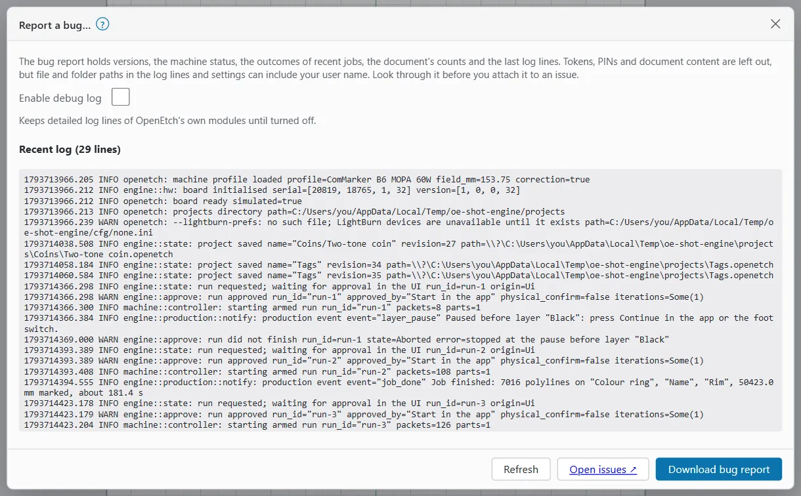

# Troubleshooting

Start with the problem that matches what you see. If nothing here helps, send a bug report (see [Report a bug](#bug-reports-and-logs)).

> **Warning:** If the laser does something you did not expect, press the hardware E-stop. Do not rely on the app to stop it.

## Cannot connect to the engine

You see a banner such as "Cannot reach the laser engine – retrying…" or "Lost connection to the laser engine – reconnecting…", and the status chip says **Offline**. While this shows, STOP may not reach the laser; use the hardware E-stop.

Check, in this order:

1. **Is the engine running?** On a Raspberry Pi, check that it is switched on and has finished starting.
2. **Is the address right?** The engine's default port is 7878, for example `http://openetch.local:7878`.
3. **Does the engine listen on the network?** By default it listens only on `127.0.0.1`, which other devices cannot reach. To reach it from a phone, tablet or another computer, it must be started with `--listen 0.0.0.0:7878`. It then needs the access token (unless it was started with `--no-token`).
4. **Does it accept the name?** If you use a host name such as `openetch.local`, the engine must be started with `--allow-host openetch.local`. An IP address always works.
5. **Same network?** Your device and the engine must be on the same network, or connected another way (for example a VPN).

The app reconnects by itself when the engine is back. Reload the page if it does not.

## The app asks for an access token

You see **Connect to OpenEtch**: "This OpenEtch engine needs its access token before this device can use it."

1. On the engine's computer (on the Raspberry Pi: connect with ssh first), run `openetch token`. It prints the token and a pairing link.
2. Open the pairing link on this device. Or paste the token (or the link) into **Access token**.
3. Tick **Remember on this device** and click **Connect**.

Things to know:

- The token stays the same when the engine restarts.
- "The engine refused that token" means it is not the current one. Run `openetch token` again.
- `openetch token --rotate` makes a new token. Restart the engine, then pair every device again.
- A Home Screen app on an iPhone or iPad keeps its own storage, so it asks for the token once.
- **STOP** works on the Connect card even without the token.

## No laser connected

- **"Ready (simulator)", "Idle (simulator)" or Link "Connected (Simulator)":** the engine runs the simulator. It drives a real laser only when started with `--usb`. See [The simulator](devices-and-calibration.md#the-simulator).
- **"No laser connected" or Link "Not connected":** check the USB cable and the laser's power. Close EzCad: only one program can use the board.
- **Frame and Start are off and a note says OpenEtch can't drive this device:** the active device is design only. Make a device active that OpenEtch can drive, such as a JCZ galvo (see [Devices and calibration](devices-and-calibration.md#switch-the-active-device)).

## Start or approval refused

The Laser window says why. Common reasons:

| Message | What to do |
|---|---|
| "No operator PIN is set. Run 'openetch set-pin' on the engine machine once." | Run `openetch set-pin` in a terminal on the engine's computer, then restart the engine. |
| "PIN file changed - restart the engine." | Restart the engine to use the new PIN. |
| "Too many wrong PINs. Approvals are locked for a while." | Wait (the Laser window counts down), then try again with the right PIN. |
| "Document changed - request a new run." | The design changed after the run was requested. Request it again. |
| "Tick every item of the Job Checklist first." | Tick the checklist in the Laser window. |
| "Require Framing is on: frame the job since its last edit before approving." | Frame the job, then approve or start. |
| "Door Protect on …: approval is refused while the enclosure is open." | Close the enclosure. |
| "Start works only in the OpenEtch app in a browser opened at http://localhost or https…" | On an engine without a PIN, Start needs the app at `localhost` or over HTTPS. Use the foot switch, or open the app on the laser's computer. |
| "The engine approves runs another way now. Reload the page." | The engine was restarted with another approval mode. Reload. |

See [Running a job](running-a-job.md) and [Safety](safety.md).

## The preview is slow

The preview draws every line of the job. Large images at a fine line interval make a lot of lines.

- Turn **Preview** off while you design and on when you want to check (`Alt+P`).
- Switch off the dithered image preview in the layer's image settings ("Show images on the canvas as their layer's dither will engrave them") while you edit.
- Use `Alt+Shift+W` for the wireframe view.
- Check the interval of image and fill layers. A finer interval is slower to preview and to burn.
- On a Raspberry Pi, the engine does the heavy work; one job at a time keeps it quick.
- On a phone, close other tabs and apps.

## Missing fonts after a LightBurn import

Text shows **Missing font**: the font is not available on the engine's computer. The fonts that count are the ones on the computer the engine runs on, not on your phone or laptop.

The text keeps its saved outline and still burns. You cannot change the text until you do one of these:

1. Install the font on the engine's computer, then click **Reload** in the font picker ("Read the fonts again").
2. Or pick another font for the text.

On a Raspberry Pi, copy the font files (`.ttf`, `.otf`, `.ttc`, `.shx` or `.jsf`) to the Pi and install them there. The engine also reads the font folders named in the `OPENETCH_FONT_DIRS` environment variable when it starts (separate folders with `;` on Windows, `:` elsewhere).

## Field size or position is wrong

Symptoms: the design marks too big or too small, the frame does not match the stock, or a LightBurn design lands shifted.

LightBurn files do not store the field size. When you open one, OpenEtch picks the size from the device the file names, else your active device. A wrong size shifts everything by half the difference.

1. **Opening a LightBurn file:** in the **Open or import LightBurn project** dialog (**File > LightBurn > Import LightBurn…**), check **Field size**. Click **Edit** and type the Field Size from LightBurn's Device Settings when the file was made. Or import that LightBurn device first (see [Import from LightBurn](devices-and-calibration.md#import-from-lightburn)).
2. **Every design is the wrong size:** check **Field width** in the device settings (see [Field size](devices-and-calibration.md#field-size)), then [calibrate the lens](devices-and-calibration.md#calibrate-the-galvo-lens).
3. **Only framing is off, the burn is right:** adjust the **Red dot** offsets (see [Red dot alignment](devices-and-calibration.md#red-dot-alignment)).
4. **Objects show red:** they are outside the galvo field and cannot be marked. Move them in.
5. **Exporting to LightBurn:** the export dialog says which device the file is laid out for. Make the right device active before you export.

## Bug reports and logs

Open **Help > Report a bug…** (In smaller windows and on tablets, **Help** is in the **More** (⋯) menu; on a phone, tap **More > Help**.)

The dialog shows the engine's recent log lines.

1. Tick **Enable debug log** to keep detailed log lines while you repeat the problem. You can also switch it from the Help menu (**Enable debug log**). Turn it off when you are done.
2. Repeat what went wrong, then click **Refresh**.
3. Click **Download bug report**. It saves `openetch-bug-report.json`.
4. Look through the file. It holds versions, the machine status, the outcomes of recent jobs, the document's counts and the last log lines. Tokens, PINs and document content are left out, but file and folder paths in the log lines and settings can include your user name. Remove anything you do not want to share.
5. Click **Open issues ↗** and attach the file to a new issue. **Help > Report a problem** opens the same page.

The engine keeps its recent log lines in memory, so they are lost when it restarts. Download the report before you restart. The engine also writes its log to its console output; on a Pi running it as a system service, read it with the system's service log tools.

## Check for updates

1. Open **Help > Check for updates…**
2. Tick **Check for updates (asks GitHub's releases; opt-in)**. It is off until you turn it on, and **Check now** stays off until then.
3. Click **Check now**.

The result says whether a newer OpenEtch is available, with a **Release notes ↗** link, or that you are up to date. Nothing is downloaded or installed: the engine only compares its version with the latest release. The check needs internet access and the `curl` program on the engine's computer.

**Help > About OpenEtch** shows the **Web UI** and **Engine** versions. After an update, reload the app so the web UI matches the engine.

## Reset things

- **Browser preferences:** **Reset preferences** in [Preferences](settings.md#reset-preferences).
- **Hotkeys:** **Reset all to LightBurn defaults** in [Edit hotkeys](keyboard-shortcuts.md#change-a-shortcut).
- **Window layout:** **Window > Reset to default layout**.
- **Engine preferences:** restore an [automatic backup](settings.md#automatic-backups).
- **Device settings:** **Revert** in the device settings before you save, or duplicate the built-in device again.
