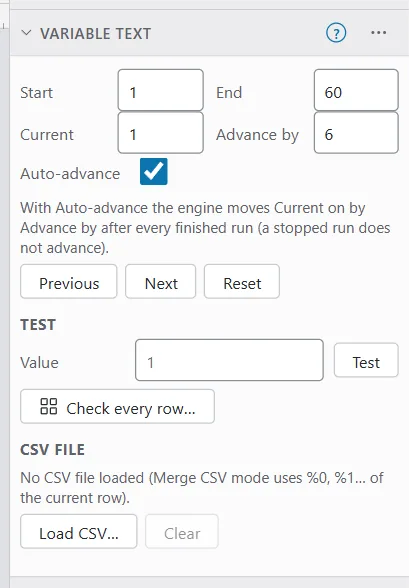
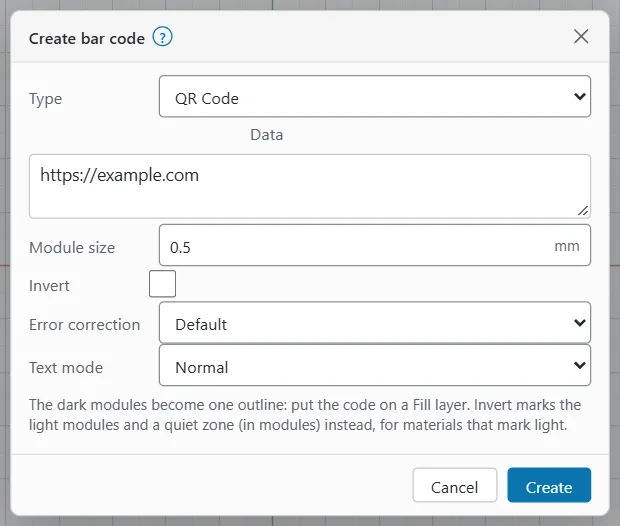
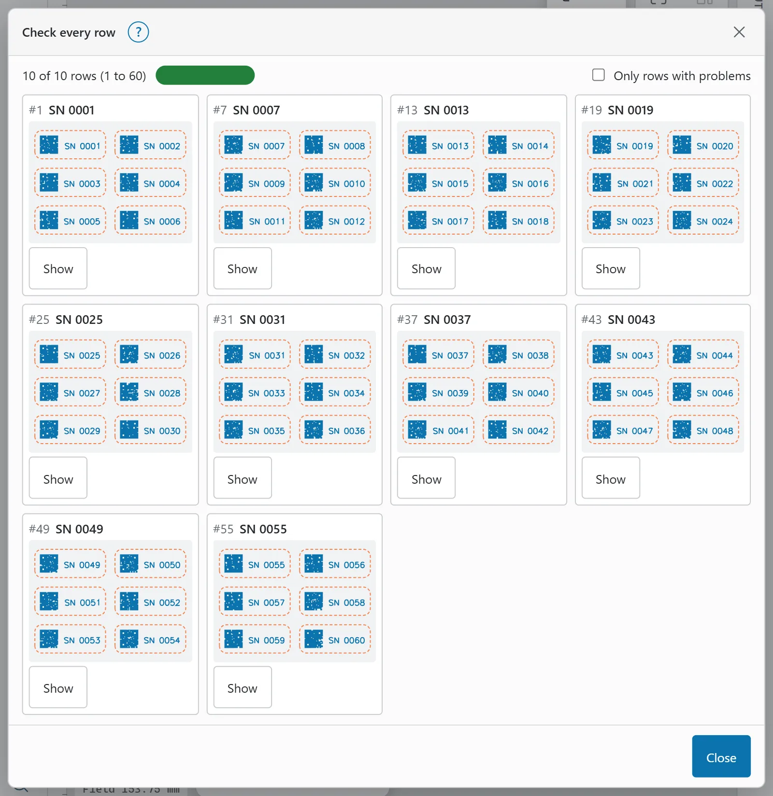

# Variable text and barcodes

Variable text changes from one run to the next: a serial number that counts up, today's date, or a name from a spreadsheet. Barcodes and QR codes can carry the same data.

> **Note:** Variable text is set in the Properties window, so use a computer or tablet. The phone layout has no Properties window.

## Text modes

Every text has a **Text mode**. To set it:

1. Select the text.
2. In Properties, under **Variable text**, choose the **Text mode**:
   - **Normal**: ordinary text.
   - **Date / Time**: the date or time, in a format you write.
   - **Serial Number**: a number that counts on.
   - **Merge CSV**: columns from a row of a CSV file.
   - **Cut Setting**: the settings of a layer, such as speed and power.
3. Type the format in the **Format** box (it replaces the **Text** box).

A **Variable** badge shows next to the Text heading. The **Shows** line tells you what the text shows now.

**Format codes** opens a table of the codes for the mode, with an example. In every mode, text in single quotes is copied as it is.

**Offset** adds to the counter for this text only, so two texts can show neighbouring numbers or rows.

**Ignore empty vars** leaves out lines whose variable text comes out empty.

## Serial numbers

| Code | Meaning |
|---|---|
| `d` | A decimal digit. The number of `d`s is the width |
| `h` / `H` | A hexadecimal digit, lower or upper case |
| `0` | Pad with leading zeros, as in `0ddddd` |
| `'text'` | Copied as it is |

Example: with the counter at 42, `'SN-'0dddd` shows SN-0042.

Use one run of `d`, `h` or `H`. A number longer than the run shows its last digits. Two runs, or decimal and hex mixed, show "bad serial format".

The number shown is the Variable Text window's **Current** plus this text's **Offset**.

## Dates and times

| Code | Meaning |
|---|---|
| `d dd ddd dddd` | Day, 2-digit day, short and long weekday |
| `M MM MMM MMMM` | Month, 2-digit month, short and long name |
| `yy yyyy` | 2- and 4-digit year |
| `h hh` / `H HH` | Hour (12-hour, with `AP`) / 24-hour |
| `m mm s ss` | Minutes, seconds |
| `z zzz` | Milliseconds |
| `AP ap` | AM/PM, am/pm |
| `w W` | ISO week, ISO year and week |
| `t` | Time zone (UTC offset) |
| `'text'` | Copied as it is (`''` is one quote) |

Example: `yyyy-MM-dd HH:mm`.

The date is worked out when a run is requested. The canvas shows the time of the last edit; click **Refresh** in the text's Properties to update it.

## CSV fields

| Code | Meaning |
|---|---|
| `%0`, `%1`, … | Column 0, 1, … of the current row |
| `%%` | A percent sign |

Example: `%0 %1` shows the first and second columns.

To use a CSV file:

1. Set the text's mode to **Merge CSV** and write the format.
2. In the Variable Text window, click **Load CSV…** and pick the file (up to 10 MB).
3. Set **Current** to the row to show.

The row is **Current** plus the text's **Offset**. Row 0 is the first line of the file.

> **Tip:** If your file has a heading row, row 0 is the headings. Set **Start** and **Current** to 1 so the first run uses the first real row.

**Clear** removes the CSV file from the document.

## Cut setting text

Cut Setting mode writes a layer's settings into the design, which is handy for labelling a test piece.

| Code | Meaning |
|---|---|
| `s` / `S` | Speed, without / with units |
| `p` / `P` | Max power, without / with % |
| `m` / `M` | Min power, without / with % |
| `n` | Number of passes |
| `k` / `K` | Frequency, without / with kHz |
| `q` / `Q` | Q-pulse width, without / with ns |
| `i` / `I` | Line interval, without / with units |
| `d` / `D` | The interval as DPI |
| `z` / `Z` | Z offset, without / with units |
| `L` | The laser (device) name |
| `C##` | Use layer ## for the rest, as in `C03p` |
| `'text'` | Copied as it is |

Example: `'P'p 'S'S`. The values come from the text's own layer unless `C##` names another.

## The Variable Text window

The **Variable Text** window holds the document's counter. It shows in the Properties window while the document uses variable text. To open it otherwise, click **Variable Text window** in the Properties of a serial-number or CSV text, right-click the canvas and choose **Variable Text window**, or search for it (`S`).

| Field | What it does |
|---|---|
| **Start** | The first value |
| **End** | The last value. Past End, the number wraps back to Start |
| **Current** | The value the next run uses |
| **Advance by** | How far Current moves on each time |
| **Auto-advance** | Moves Current on by Advance by after every finished run |

A stopped run does not advance. **Previous** and **Next** move Current by Advance by (wrapping round), and **Reset** puts Current back to Start.

> **Tip:** For a jig with six pockets, set **Advance by** to 6, so the next load starts after the last tag. The Jigs window can set this for you: see [Jigs](jigs.md).

### Test a value

To see what every variable text and barcode would show for a value, type it in **Value** under **Test** and click **Test**. Leave Value empty to test Current. Test changes nothing.

## Copies that count on

To make a sheet of tags that each show the next number:

1. Make one tag with a serial-number text.
2. Select the tag and open **Arrange > Grid array…** (or **Array** in the **Insert** group).
3. Set **Auto-increment variable text** to 1.
4. Click **Create**.

Each copy's Offset is one more than the one before, so six tags show six numbers. Set **Advance by** to the number of tags. See [Grid array](arranging-and-arrays.md#grid-array).

The Serial-numbered tags example is set up this way (see [Templates](templates.md#example-projects)).

## Barcodes and QR codes

To add a barcode:

1. Click **Barcode** in the **Create** group.
2. Click where the code goes.
3. In **Create bar code**, choose the **Type**, type the **Data** and set the size. A new code starts as a QR Code with a 0.5 mm module.
4. Click **Create**.

To change a barcode, double-click it, or right-click it and choose **Edit bar code**, then click **Apply**. Its settings also show in Properties under **Barcode**; each change redraws it in place.

### Barcode types

- **2D codes**: QR Code, Data Matrix, Aztec, PDF417, and others the engine offers, such as QR Micro, PDF417 Compact, Grid Matrix, Chinese Sensible Code, AprilTag and ArUco tags (for a tag, the data is its id).
- **1D bar codes**: Code 128, Code 39, Code 93, Codabar, EAN-8, EAN-13, UPC-A, UPC-E, ITF, Telepen, and others such as 2 of 5, ISBN, VIN and Plessey.

### Barcode options

| Option | What it does |
|---|---|
| **Type** | The kind of code |
| **Data** | What the code holds. With a text mode, its format |
| **Module size** (2D) / **Bar width** (1D) | The size of one square, or the narrowest bar, in mm |
| **Bar height** (1D) | The height of the bars |
| **Invert** | Marks the light modules and a quiet zone instead of the dark ones |
| **Quiet zone** | The margin, in modules, marked round an inverted code |
| **Error correction** | How much damage the code survives (QR, Aztec, PDF417 and others). **Default** lets the engine choose |
| **Force square** | Data Matrix: square symbols only |
| **Show text** | 1D: writes the data under the bars |
| **Text mode**, **Offset** | Variable data, as for text |

The dark modules become one outline, so put the code on a **Fill** layer. Use **Invert** on materials that mark light, so the marked area is the background.

### Variable barcodes

Set the barcode's **Text mode** to **Serial Number**, **Date / Time** or **Merge CSV**, and use the same codes in **Data** as for text. A QR code and a text with the same format and Offset show the same number.

> **Warning:** Scan a test piece before a batch. How well a code reads depends on the module size, the material and the settings. A module that is too small for the spot merges into its neighbours. Work out the energy density of the fill before the test: J/mm² = power in W ÷ (speed in mm/s × line interval in mm).

## Check every row

The contact sheet draws every serial number or CSV row as a run would burn it, and flags the ones that go wrong. Use it before a batch.

To open it, choose **File > Laser > Check every row…**, click **Check every row…** in the Variable Text window, or search for it. It needs a serial-number or CSV text or barcode in the design.

Each card is one row, with the variable texts highlighted. A card can carry these flags:

| Flag | Meaning |
|---|---|
| **Overflow** | The text runs outside its shape, the stock or the workspace |
| **Missing glyph** | The font has no letter for a character |
| **Empty** | The text is blank: an empty CSV cell, or a row past the end of the file |
| **Shrunk** | Max width or auto-fit drew the text at less than half its height |
| **Error** | The text could not be drawn (a missing font, a bad serial format, data a barcode cannot hold) |
| **Note** | Something to check |

The rows run from Start to End, by Advance by. The summary line shows how many rows are shown out of the total, and from which row to which.

- Tick **Only rows with problems** to hide the good ones.
- Click **Show more rows** to load the next page.
- Click **Show** on a card to set the counter to that row, so the canvas shows it.

On a phone the contact sheet fills the screen.

## Warnings before you start

When you start a job, the pre-flight check warns about variable text that would burn wrong: a CSV text with no CSV file loaded, a row past the last row, an empty cell, or a serial number past End that wraps back to Start. See [Pre-flight and keep-out](preflight-and-keep-out.md).

## AI agents

An AI agent connected over MCP can set up variable text, change the counter and run the same row check. It can never approve or start a burn: a person does that at the machine. See [AI agents](ai-agents.md).
